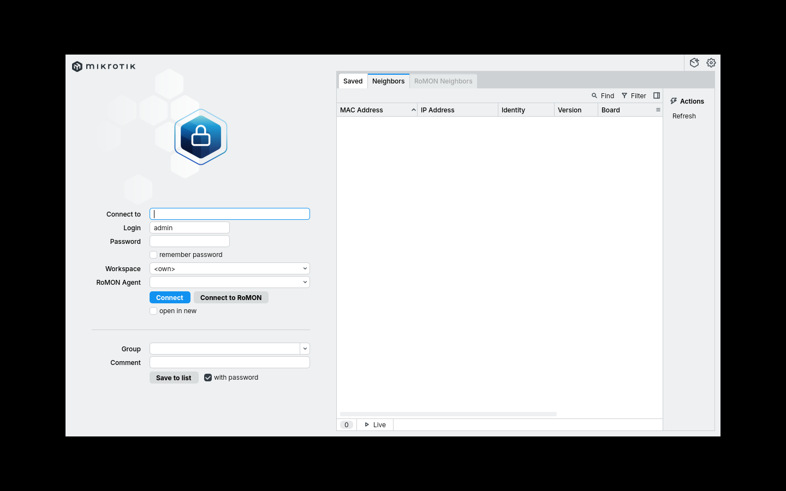
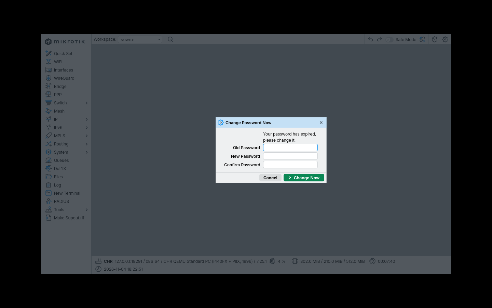

> پیش‌نویس مستقل تهنت؛ اجرای لابراتوار و ثبت تصویر هنوز انجام نشده است. خروجی‌های این متن «مورد انتظار» هستند، نه نتیجهٔ آزمون واقعی.

## پاسخ سریع و نتیجهٔ این قسمت

WinBox برنامهٔ مدیریت MikroTik و WebFig رابط مدیریتی داخل مرورگر است. برای اتصال قابل تکرار به CHR، ابتدا از کنسول یک آدرس روی ether2 می‌گذاریم و رایانهٔ مدیریت را در همان شبکه تنظیم می‌کنیم. بعد WinBox را با IP آزمایش می‌کنیم. اتصال MAC یک ابزار دسترسی محلی در یک دامنهٔ لایهٔ دوم است و جای آدرس‌دهی یا مسیریابی را نمی‌گیرد. پایان این درس باید بتوانید بدون تغییر اتفاقی تنظیمات، نسخه، اینترفیس‌ها و آدرس R1 را از رابط گرافیکی پیدا کنید.

این روش به مشاهدهٔ همسایه وابسته نیست. نمایش داده نشدن دستگاه در Neighbors به‌تنهایی ثابت نمی‌کند R1 خاموش است؛ کشف همسایه و اتصال مدیریت دو قابلیت متفاوت هستند. همچنین دیدن نام MikroTik تضمین نمی‌کند همان روتر آزمایشگاهی خود را انتخاب کرده‌اید. MAC ثبت‌شده در درس قبل، نشانهٔ دقیق‌تری برای تشخیص ماشین است.

## پیش‌نیاز و نقشهٔ اتصال

لابراتوار قسمت اول باید آماده و کنسول VM در دسترس باشد. R1 دو کارت دارد: ether1 برای بالادست جدا و ether2 برای LAB-LAN. رایانهٔ مدیریت را فقط به LAB-LAN مربوط به آزمایش وصل کنید. آدرس مدیریت روتر 10.77.10.1/24 و آدرس رایانه 10.77.10.10/24 خواهد بود. در این مرحله برای رایانه Gateway یا DNS لازم نیست؛ ارتباط با روتر در همان زیرشبکه انجام می‌شود.

WinBox را از [صفحهٔ رسمی دانلود](https://mikrotik.com/download/winbox) متناسب با سیستم‌عامل میزبان بگیرید. مبنای نگارش در ۴ نوامبر ۲۰۲۶، WinBox 4.5 است؛ این شماره به معنی اجرای واقعی آن در این پروژه نیست. نام یا جای بعضی دکمه‌ها ممکن است با نسخهٔ مورد استفادهٔ شما فرق کند. مفهوم مسیر منو و مقادیر تنظیمات را ملاک قرار دهید و نسخهٔ واقعی خود را ثبت کنید.

## مرحلهٔ اول: ساخت مسیر مدیریت از کنسول

ابتدا فهرست موجود را ببینید تا آدرس تکراری ایجاد نشود:

```routeros
/interface ethernet print detail
/ip address print detail
```

MAC مربوط به LAB-LAN باید روی ether2 باشد. اگر نیست، نگاشت مجازی‌ساز را اصلاح کنید و سپس ادامه دهید. اگر 10.77.10.1/24 از قبل روی همان اینترفیس وجود دارد، دستور افزودن را دوباره اجرا نکنید. اگر شبکهٔ دیگری از همین محدوده در میزبان استفاده می‌کند، لابراتوار را جدا کنید؛ در این مجموعه آدرس‌ها را میان درس‌ها بی‌اطلاع عوض نکنید.

فقط روی CHR آزمایشگاهی که آدرس مورد نظر را ندارد، بنویسید:

```routeros
/ip address add address=10.77.10.1/24 interface=ether2 comment="TEHNET-L02-MGMT"
/ip address print detail where comment="TEHNET-L02-MGMT"
```

خروجی مورد انتظار، یک آدرس فعال با اینترفیس ether2 و شبکهٔ 10.77.10.0 است. Prefix برابر ۲۴ بخشی از آدرس است؛ حذف آن می‌تواند معنی تنظیم را تغییر دهد. در [مرجع IP Address](https://manual.mikrotik.com/docs/cli-reference/ip/address/) مفهوم network و محاسبهٔ آن توضیح داده شده است. این دستور روی ether1 آدرس نمی‌گذارد و مسیر پیش‌فرض اینترنت نیز ایجاد نمی‌کند.

روی سیستم‌عامل رایانهٔ مدیریت IPv4 ثابت 10.77.10.10 و ماسک 255.255.255.0 قرار دهید. اگر چند کارت مجازی دارید، کارت LAB-LAN را با نام و MAC شناسایی کنید. تغییر IP کارت اینترنت روزمرهٔ میزبان ممکن است ارتباط عادی شما را قطع کند؛ تنظیم باید مربوط به همان شبکهٔ آزمایشی باشد. از رایانه آدرس 10.77.10.1 را Ping کنید. پاسخ، فقط دسترسی ICMP به همین مقصد را نشان می‌دهد و آزمون ورود WinBox نیست.

## مرحلهٔ دوم: ورود با WinBox

WinBox را باز کنید، در مقصد اتصال 10.77.10.1 را بنویسید و حساب موجود روی R1 را وارد کنید. رمز خالی را پیش‌فرض همگانی MikroTik ندانید؛ دستگاه فیزیکی می‌تواند رمز اختصاصی روی برچسب داشته باشد و CHR هم ممکن است در ورود اولیه تغییر رمز خواسته باشد. اطلاعات ورود را از VM خودتان بگیرید.

پس از ورود، این مشاهده‌ها را انجام دهید: در System → Resources نسخه را بخوانید، در Interfaces دو کارت را با نقشه مقایسه کنید و در IP → Addresses آدرس LAN را ببینید. سپس New Terminal را باز و `/system resource print` را اجرا کنید. مقدار نسخه در رابط و ترمینال باید یکسان باشد. فعلاً از Quick Set برای راه‌اندازی خودکار استفاده نکنید؛ این دوره تنظیمات را مرحله به مرحله می‌سازد و تغییر هم‌زمان چند سرویس تشخیص خطا را دشوار می‌کند.

اگر از Neighbors استفاده می‌کنید، MAC ردیف را با ether2 تطبیق دهید. اتصال MAC فقط زمانی ممکن است که محیط مجازی ترافیک لازم را عبور دهد و سرویس MAC WinBox روی این مسیر مجاز باشد. نبود این امکان دلیل خوبی برای بازکردن مدیریت روی WAN نیست. کنسول همچنان مسیر بازیابی شماست. [راهنمای ابزارهای مدیریت](https://manual.mikrotik.com/docs/management-tools/) تفاوت این روش‌ها را پوشش می‌دهد.

## مرحلهٔ سوم: مشاهدهٔ WebFig

WebFig به آدرس IP و سرویس وب فعال نیاز دارد؛ بدون IP نمی‌توان مانند اتصال MAC WinBox وارد آن شد. در WinBox بخش IP → Services یا در ترمینال `/ip service print` را ببینید. نام سرویس‌های وب و وضعیت فعال بودنشان را ثبت کنید. برای صرفاً کامل کردن تمرین، سرویس خاموش را روی WAN فعال نکنید.

اگر HTTP از قبل روی همین LAN ایزوله فعال است، آدرس `http://10.77.10.1` را باز کنید و WebFig را انتخاب کنید. HTTP رمزگذاری ارتباط را فراهم نمی‌کند؛ این مشاهده فقط در شبکهٔ جدا و بدون اطلاعات حساس قابل قبول است. اگر HTTPS با گواهی معتبر یا مورد اعتماد شما از قبل پیکربندی شده است، از نشانی HTTPS استفاده کنید. در این قسمت ایجاد گواهی یا ردکردن بی‌دلیل هشدار امنیتی مرورگر آموزش داده نمی‌شود. اگر سرویس آماده نیست، بررسی WebFig را ثبت کنید و ادامهٔ دوره را با WinBox انجام دهید.

## عیب‌یابی به ترتیب وابستگی

| نشانه | بررسی اول و اقدام بعدی |
|---|---|
| Ping به 10.77.10.1 شکست می‌خورد | IP رایانه، ماسک، شبکهٔ مجازی و ether2 را از کنسول بررسی کنید |
| Ping موفق است ولی WinBox وارد نمی‌شود | وضعیت سرویس، حساب و محدودیت آدرس ورود را بررسی کنید |
| Neighbors خالی است | اتصال IP را امتحان کنید؛ تنظیم کشف همسایه را با خاموش کردن امنیت جایگزین نکنید |
| صفحهٔ وب باز نمی‌شود | نام سرویس، پورت و فعال بودن آن را در IP Services ببینید |
| پس از اتصال نام دستگاه غیرمنتظره است | MAC و نسخه را تطبیق دهید؛ روی دستگاه ناشناخته تنظیم ننویسید |

## تمرین، تأیید و بازگشت

یک بار از WinBox خارج شوید و با همان IP دوباره وارد شوید. سه مقدار نسخه، نام ether2 و آدرس LAN را بدون مراجعه به متن پیدا کنید. معیار قبولی، اتصال دوباره و تطبیق اطلاعات است؛ صرف باز شدن برنامه کافی نیست. توضیح دهید چرا برای 10.77.10.1 به دروازهٔ اینترنت احتیاج نداشتید. [پیکربندی اولیهٔ رسمی](https://manual.mikrotik.com/docs/getting-started/first-time-configuration/) برای مرور ترتیب وابستگی‌ها مفید است.

برای حذف آدرس افزوده‌شده، ابتدا کنسول VM را باز و قابل استفاده بودنش را تأیید کنید؛ حذف آدرس، اتصال IP جاری را قطع می‌کند. فقط رکورد دارای Comment همین درس را حذف کنید: `/ip address remove [find where comment="TEHNET-L02-MGMT"]`. آدرس‌های دیگر را حذف نکنید. در پایان، اگر قرار است قسمت بعد را ادامه دهید، آدرس LAN را نگه دارید و تغییرات کارت مدیریت را در دفترچه ثبت کنید.


## عکس‌های واقعی WinBox 4.5 از لاب CHR 7.25.1

این دو تصویر از اجرای واقعی نسخهٔ Linux WinBox 4.5 متصل به RouterOS CHR 7.25.1 در QEMU گرفته شده‌اند. اتصال از ماشین میزبان به پورت محلی `127.0.0.1:18291` هدایت و در QEMU با `restrict=on` از شبکهٔ تولید جدا شده است. این نشانی خاصِ لاب است، نه IP عمومی یا IP تنظیم‌شده برای تمام دانشجویان.

### تصویر ۱: ورود به WinBox



در قسمت `Connect to` باید IP **دستگاه خودتان** یا آدرس محلی هدایت‌شده را وارد کنید. مقدار `127.0.0.1:18291` فقط مربوط به همین لاب QEMU است. `Login` نام حساب مجاز و `Password` رمز همان حساب است. هنگام آموزش، رمزها را نشان ندهید و گزینهٔ ذخیرهٔ پسورد را برای دستگاه مشترک فعال نکنید.

### تصویر ۲: نتیجهٔ احراز هویت و نیاز به تغییر رمز



پس از اتصال موفق، در نسخهٔ آزمایشی RouterOS پنجرهٔ `Change Password Now` ظاهر شد. این تصویر **اثبات تغییر رمز یا اجرای منوهای IP نیست**؛ تغییر رمز امن قبل از ادامهٔ درس باید جداگانه انجام و تأیید شود. برای دستگاه تازه و شبکهٔ واقعی از گذرواژهٔ قوی، محرمانه و اختصاصی استفاده کنید.

**موارد هنوز ناقص:** تصویر واقعی منوی `IP → Addresses`، باز کردن فرم `Add Address`، پر کردن فیلدهای `Address` و `Interface`، اجرای `Apply/OK` و مشاهدهٔ آدرس ایجاد‌شده در WinBox هنوز ثبت نشده‌اند؛ ادعای تکمیل این مراحل نکنید. رابط ترمینال متن درس نیز تا وقتی خروجی واقعی شاهد ندارد، فقط نمونهٔ آموزشی است.
