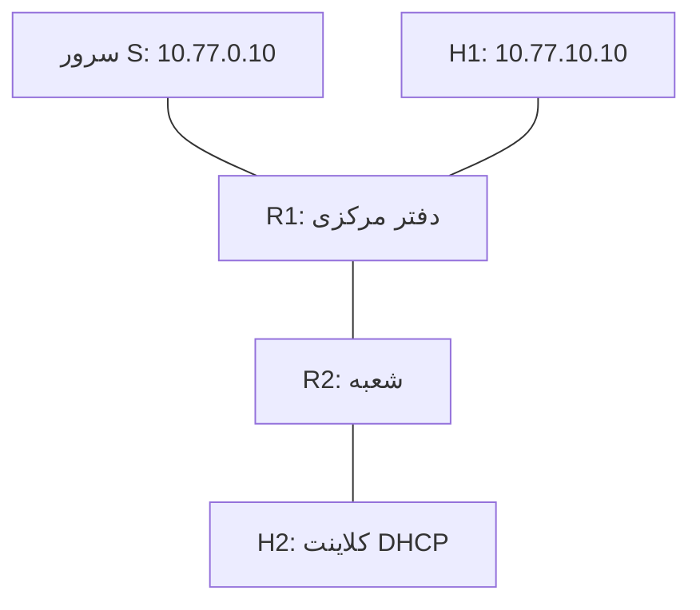

> پیش‌نویس مستقل دورهٔ مکتوب تهنت، تهران نتورک (Tehran Network / TehNet). وضعیت اجرا: `NOT_RUN`؛ اسکرین‌شات واقعی: `MISSING`؛ بازبینی فنی اجرایی: `PENDING`. همهٔ نتیجه‌های این درس «مورد انتظار» هستند و از اجرای واقعی استخراج نشده‌اند.

# پروژهٔ نهایی MTCNA: شبکهٔ یک شعبهٔ کوچک و عیب‌یابی مرحله‌به‌مرحله

در این پروژه، مفاهیم درس‌های قبل را در شبکه‌ای کوچک کنار هم قرار می‌دهیم: دو روتر، دو شبکهٔ داخلی و یک سرور آزمایشی. هدف این است که بتوانید مسیر رفت و برگشت بسته را توضیح دهید، پیش از افزودن هر سرویس پیش‌نیاز آن را بررسی کنید و هنگام خرابی، کوچک‌ترین تغییری را پیدا کنید که مسئله را رفع می‌کند. تمام شبکه در محیط ایزوله ساخته می‌شود؛ برای قبول شدن در این تمرین به اینترنت، حساب سرویس بیرونی یا اتصال به شبکهٔ محل کار نیاز ندارید.

این متن یک درس مستقل از تهران نتورک است. بخش Queue از محتوای آموزشی جدید این دوره است و نباید به ویدیوهای قدیمی نسبت داده شود. پروژه، معیار قبولی اجرایی و محل ثبت شاهد دارد، اما تا اجرای واقعی، ثبت نسخه و تهیهٔ تصاویر، وضعیت آن تکمیل‌شده یا آمادهٔ انتشار فنی محسوب نمی‌شود.

## ۱. قرارداد آزمایش و مسیر بازیابی

از دو ماشین CHR تازه یا snapshot تمیز استفاده کنید. عبارت «تمیز» یعنی در این سناریو Bridge، DHCP، NAT، Firewall و FastTrack از تمرین‌های قبلی باقی نمانده باشد؛ این شرط مجوز پاک کردن تنظیمات یک روتر واقعی نیست. اگر ماشین موجود دارید، ابتدا تنظیمات آن را بخوانید و برای این پروژه clone جدا بسازید. کنسول هر دو ماشین باید در تمام مراحل در دسترس باشد؛ اعمال Firewall از راه کنسول خطر قطع شدن تنها مسیر مدیریت را کاهش می‌دهد.

چهار شبکهٔ مجازی جدا برای WAN آزمایشی، LAN دفتر، لینک بین روترها و LAN شعبه بسازید. هیچ‌کدام را به کارت فیزیکی شبکهٔ واقعی bridge نکنید. DHCP خودکار هایپروایزر روی این شبکه‌ها باید خاموش باشد. نام کارت‌های مجازی را با MAC و وضعیت لینک تطبیق دهید؛ ترتیب نمایش کارت در نرم‌افزار مجازی‌سازی به‌تنهایی شاهد کافی برای تعیین `ether1` نیست.

پیش از تغییر، روی هر روتر دستورهای زیر را اجرا و نتیجهٔ واقعی را در پروندهٔ آزمایش ثبت کنید. نام فایل خروجی برای هر روتر متفاوت باشد. خروجی export و snapshot ممکن است اطلاعات خصوصی داشته باشند؛ نسخهٔ منتشرشدنی باید بازبینی و پاک‌سازی شود.

```routeros
/system resource print
/system package print
/interface print
/ip address print
/ip route print
/ip firewall filter print
/ip firewall nat print
/queue simple print
/export file=tehnet-l24-before
```

نسخهٔ RouterOS و WinBox واقعی، نوع مجوز CHR، نام اینترفیس‌ها، زمان آزمایش و نام snapshot را ثبت کنید. محدودیت مجوز CHR Free می‌تواند اندازه‌گیری سرعت را محدود کند؛ در این پروژه حد Queue عمداً پایین انتخاب شده است و باز هم باید خط پایهٔ واقعی اندازه‌گیری شود. اجرای بخش بی‌سیم درس‌های ۱۷ و ۱۸ نیازمند سخت‌افزار و بستهٔ مناسب است. CHR شاهدی برای کارکرد رادیو یا RouterBOOT فراهم نمی‌کند و این پروژه چنین آزمونی ندارد. [۱، ۷]

## ۲. توپولوژی و آدرس‌دهی

شبکهٔ WAN این درس فقط یک بخش آزمایشگاهی است. سرور S یک سرویس HTTP تحت کنترل شما دارد. مسیر پیش‌فرض اینترنت تعریف نمی‌کنیم تا نتیجهٔ پروژه به سرویس بیرونی وابسته نباشد.



| دستگاه و رابط | آدرس | نقش |
|---|---|---|
| R1، ether1 | `10.77.0.2/24` | اتصال به شبکهٔ سرور S |
| R1، bridge-lan شامل ether2 | `10.77.10.1/24` | دروازهٔ دفتر |
| R1، ether3 | `10.77.12.1/30` | لینک مستقیم به R2 |
| R2، ether1 | `10.77.12.2/30` | لینک مستقیم به R1 |
| R2، bridge-lan شامل ether2 | `10.77.20.1/24` | دروازه و DNS شعبه |
| H1 | `10.77.10.10/24` | دروازهٔ `10.77.10.1` |
| H2 | DHCP از `.100` تا `.199` در `10.77.20.0/24` | دروازه و DNS برابر `10.77.20.1` |
| S | `10.77.0.10/24` | HTTP روی TCP/8080 |

در تمرین‌هایی که برای H2 آدرس ثابت `10.77.20.10` داشتیم، این آدرس صرفاً نمونهٔ میزبان بود. در این پروژه H2 باید DHCP بگیرد و انتظار آدرس `.10` نداریم. قبل از شروع، تنظیم ثابت قبلی را روی همان کارت آزمایشگاهی بردارید. هیچ‌یک از این subnetها نباید روی کارت دیگری از میزبان‌ها تکرار شده باشد.

روی S یک HTTP server آزمایشی برای فایل‌های غیرحساس آماده کنید و اجازهٔ TCP/8080 را در Firewall خود سرور بدهید. سرویس باید روی `10.77.0.10` یا آدرس‌های محلی مناسب گوش کند، نه فقط `127.0.0.1`. فایل کوچک برای آزمون دسترسی و یک فایل بزرگ برای اندازه‌گیری انتقال داشته باشید. نام فایل و اندازهٔ واقعی را ثبت کنید؛ مسیر `/large.bin` در مثال‌ها باید با فایلی که خودتان آماده کرده‌اید منطبق باشد. نصب و فعال کردن یک وب‌سرور اینترنتی بخشی از این پروژه نیست.

## ۳. ساخت لایهٔ آدرس‌دهی و مسیرها

فرمان‌ها برای ماشین تمیز با نام اینترفیس‌های جدول نوشته شده‌اند و اجرای دوبارهٔ بی‌بررسی آن‌ها می‌تواند رکورد تکراری بسازد. پیش از هر `add` وضعیت را بخوانید. همهٔ اشیای پروژه با نام یا comment مشخص شده‌اند تا هنگام بازگشت، فقط همان‌ها حذف شوند.

روی R1:

```routeros
/interface bridge add name=bridge-lan comment="tehnet-l24"
/interface bridge port add bridge=bridge-lan interface=ether2 comment="tehnet-l24"
/ip address add address=10.77.0.2/24 interface=ether1 comment="tehnet-l24"
/ip address add address=10.77.10.1/24 interface=bridge-lan comment="tehnet-l24"
/ip address add address=10.77.12.1/30 interface=ether3 comment="tehnet-l24"
/ip route add dst-address=10.77.20.0/24 gateway=10.77.12.2 comment="tehnet-l24-branch-route"
```

روی R2:

```routeros
/interface bridge add name=bridge-lan comment="tehnet-l24"
/interface bridge port add bridge=bridge-lan interface=ether2 comment="tehnet-l24"
/ip address add address=10.77.12.2/30 interface=ether1 comment="tehnet-l24"
/ip address add address=10.77.20.1/24 interface=bridge-lan comment="tehnet-l24"
/ip route add dst-address=10.77.0.0/24 gateway=10.77.12.1 comment="tehnet-l24-server-route"
/ip route add dst-address=10.77.10.0/24 gateway=10.77.12.1 comment="tehnet-l24-office-route"
```

ابتدا همسایهٔ مستقیم لینک `/30` را از هر روتر ping کنید. سپس جدول مسیر را بخوانید. انتظار داریم شبکه‌های متصل مستقیم فعال باشند و مسیرهای ثابت با gateway قابل دسترس فعال شوند. فعال بودن یک route به‌تنهایی کارکرد سرویس نهایی یا وجود مسیر برگشت را ثابت نمی‌کند. اگر این مرحله شکست خورد، DHCP یا NAT اضافه نکنید؛ کابل مجازی، prefix و interface آدرس را اصلاح کنید. [۲]

## ۴. DHCP و نام محلی شعبه

R2 برای LAN شعبه DHCP Server است. محدودهٔ pool، آدرس دروازهٔ خود روتر را شامل نمی‌شود. یک رکورد DNS ثابت تعریف می‌کنیم تا هم ارتباط با DNS و هم تفکیک خطای نام از خطای IP قابل آزمایش باشد. تنظیم `allow-remote-requests=yes` باید همراه محدودیت Firewall مرحلهٔ بعد باشد؛ DNS عمومی یا باز از سمت شبکه‌های دیگر نمی‌سازیم. [۳، ۴]

روی R2:

```routeros
/ip pool add name=tehnet-pool24 ranges=10.77.20.100-10.77.20.199
/ip dhcp-server add name=tehnet-dhcp24 interface=bridge-lan address-pool=tehnet-pool24 lease-time=1h disabled=no
/ip dhcp-server network add address=10.77.20.0/24 gateway=10.77.20.1 dns-server=10.77.20.1 comment="tehnet-l24"
/ip dns set allow-remote-requests=yes
/ip dns static add name=branch-web.test address=10.77.0.10 comment="tehnet-l24"
```

H2 باید lease تازه بگیرد. آدرس، mask، gateway و DNS را روی خود H2 بخوانید و با `/ip dhcp-server lease print` روی R2 تطبیق دهید. وجود یک lease قدیمی به‌تنهایی نشان نمی‌دهد کلاینت فعلی تنظیم درست گرفته است. این سناریو فقط نام محلی `branch-web.test` را تضمین می‌کند؛ برای نام‌های اینترنتی resolver بالادستی یا مسیر اینترنت تعریف نشده است.

## ۵. سیاست دسترسی با ترتیب روشن

سیاست پروژه چنین است: کلاینت‌های دفتر و شعبه به HTTP سرور S دسترسی دارند؛ H1 برای عیب‌یابی می‌تواند میزبان شعبه را ping کند؛ H2 اجازهٔ شروع ارتباط به LAN دفتر ندارد. مدیریت IP روترها با SSH یا WinBox فقط از H1 مجاز است: برای R1 از `10.77.10.1` و برای R2 از `10.77.12.2` استفاده کنید. عبور ارتباط مدیریتی H1 تا R2 نیز صریحاً در forward روتر R1 مجاز شده است. باز شدن یک سرویس به معنی داشتن حساب معتبر یا سالم بودن Firewall میزبان مقصد نیست.

این قواعد برای Firewall خالی سناریو هستند. آن‌ها را از کنسول اعمال کنید و پیش از وصل کردن کلاینت‌ها ترتیب را بخوانید. در روتر دارای تنظیم موجود، الصاق این فهرست به انتهای جدول معادل سیاست زیر نیست. `input` ترافیک به خود روتر را کنترل می‌کند و `forward` ترافیک عبوری را. پاسخ ارتباط‌های مجاز با connection tracking پذیرفته می‌شود. در این پروژه FastTrack تعریف نمی‌کنیم تا آزمون Queue مسیر مورد انتظار را داشته باشد. [۵، ۶، ۸]

روی R1:

```routeros
/ip firewall filter
add chain=input action=accept connection-state=established,related comment="tehnet-l24"
add chain=input action=drop connection-state=invalid comment="tehnet-l24"
add chain=input action=accept in-interface=bridge-lan src-address=10.77.10.10 protocol=tcp dst-port=22,8291 comment="tehnet-l24"
add chain=input action=accept in-interface=bridge-lan src-address=10.77.10.0/24 protocol=icmp comment="tehnet-l24"
add chain=input action=accept in-interface=ether3 src-address=10.77.12.2 protocol=icmp comment="tehnet-l24"
add chain=input action=drop comment="tehnet-l24"
add chain=forward action=accept connection-state=established,related comment="tehnet-l24"
add chain=forward action=drop connection-state=invalid comment="tehnet-l24"
add chain=forward action=accept in-interface=bridge-lan out-interface=ether1 src-address=10.77.10.0/24 dst-address=10.77.0.10 protocol=tcp dst-port=8080 comment="tehnet-l24"
add chain=forward action=accept in-interface=ether3 out-interface=ether1 src-address=10.77.20.0/24 dst-address=10.77.0.10 protocol=tcp dst-port=8080 comment="tehnet-l24"
add chain=forward action=accept in-interface=bridge-lan out-interface=ether1 src-address=10.77.10.0/24 dst-address=10.77.0.10 protocol=icmp comment="tehnet-l24"
add chain=forward action=accept in-interface=ether3 out-interface=ether1 src-address=10.77.20.0/24 dst-address=10.77.0.10 protocol=icmp comment="tehnet-l24"
add chain=forward action=accept in-interface=bridge-lan out-interface=ether3 src-address=10.77.10.10 dst-address=10.77.20.0/24 protocol=icmp comment="tehnet-l24"
add chain=forward action=accept in-interface=bridge-lan out-interface=ether3 src-address=10.77.10.10 dst-address=10.77.12.2 protocol=tcp dst-port=22,8291 comment="tehnet-l24"
add chain=forward action=accept in-interface=bridge-lan out-interface=ether3 src-address=10.77.10.10 dst-address=10.77.12.2 protocol=icmp comment="tehnet-l24"
add chain=forward action=drop comment="tehnet-l24"
```

روی R2:

```routeros
/ip firewall filter
add chain=input action=accept connection-state=established,related comment="tehnet-l24"
add chain=input action=drop connection-state=invalid comment="tehnet-l24"
add chain=input action=accept in-interface=ether1 src-address=10.77.10.10 protocol=tcp dst-port=22,8291 comment="tehnet-l24"
add chain=input action=accept in-interface=ether1 src-address=10.77.10.10 protocol=icmp comment="tehnet-l24"
add chain=input action=accept in-interface=ether1 src-address=10.77.12.1 protocol=icmp comment="tehnet-l24"
add chain=input action=accept in-interface=bridge-lan src-address=10.77.20.0/24 protocol=icmp comment="tehnet-l24"
add chain=input action=accept in-interface=bridge-lan protocol=udp src-port=68 dst-port=67 comment="tehnet-l24"
add chain=input action=accept in-interface=bridge-lan src-address=10.77.20.0/24 protocol=udp dst-port=53 comment="tehnet-l24"
add chain=input action=accept in-interface=bridge-lan src-address=10.77.20.0/24 protocol=tcp dst-port=53 comment="tehnet-l24"
add chain=input action=drop comment="tehnet-l24"
add chain=forward action=accept connection-state=established,related comment="tehnet-l24"
add chain=forward action=drop connection-state=invalid comment="tehnet-l24"
add chain=forward action=accept in-interface=bridge-lan out-interface=ether1 src-address=10.77.20.0/24 dst-address=10.77.0.10 protocol=tcp dst-port=8080 comment="tehnet-l24"
add chain=forward action=accept in-interface=bridge-lan out-interface=ether1 src-address=10.77.20.0/24 dst-address=10.77.0.10 protocol=icmp comment="tehnet-l24"
add chain=forward action=accept in-interface=ether1 out-interface=bridge-lan src-address=10.77.10.10 dst-address=10.77.20.0/24 protocol=icmp comment="tehnet-l24"
add chain=forward action=drop comment="tehnet-l24"
```

محدودیت بالا مربوط به مدیریت IP است؛ MAC WinBox، MAC Telnet و Neighbor Discovery مسیرهای لایهٔ دوم جدا دارند و باید مطابق درس امن‌سازی اولیه بررسی و برای محیط هدف محدود شوند. برای حفظ مسیر بازیابی این پروژه به کنسول تکیه می‌کند. فهرست سرویس‌های IP و حساب‌ها را نیز طبق درس مدیریت امن بررسی کنید؛ قواعد Firewall جای رمز قوی و حساب مناسب را نمی‌گیرند.

## ۶. NAT فقط در مرز سرور آزمایشی

S مسیر مستقلی برای LANهای دفتر و شعبه ندارد. روی R1 فقط ترافیک این دو subnet به S را با آدرس ثابت خروجی R1 ترجمه می‌کنیم. NAT روی لینک R1–R2 لازم نیست؛ آدرس اصلی H1 و H2 روی آن لینک برای سیاست Firewall و عیب‌یابی حفظ می‌شود. چون آدرس R1 ثابت است از `src-nat` استفاده می‌کنیم. این انتخاب به معنی برتری همیشگی آن بر `masquerade` نیست؛ سناریوی خروجی با آدرس پویا تصمیم دیگری می‌طلبد. [۶]

```routeros
/ip firewall nat
add chain=srcnat src-address=10.77.10.0/24 dst-address=10.77.0.10 out-interface=ether1 action=src-nat to-addresses=10.77.0.2 comment="tehnet-l24"
add chain=srcnat src-address=10.77.20.0/24 dst-address=10.77.0.10 out-interface=ether1 action=src-nat to-addresses=10.77.0.2 comment="tehnet-l24"
```

پس از تغییر NAT، آزمون را با اتصال تازه انجام دهید؛ تصمیم NAT اتصال قبلی در connection tracking باقی می‌ماند. پاک کردن کل جدول اتصال لازم نیست. H2 ابتدا S را با IP و سپس URL نام‌دار `http://branch-web.test:8080/` آزمایش کند. مرورگر ممکن است HTTPS خودکار یا DNS اختصاصی داشته باشد؛ برای آزمون روشن از ابزار HTTP و resolver سیستم استفاده کنید. به عنوان مثال در کلاینتی که `curl` دارد، `curl --noproxy '*' http://branch-web.test:8080/` درخواست HTTP مستقیم می‌فرستد. تنظیم proxy عمومی دستگاه را برای این تمرین تغییر ندهید.

## ۷. سقف مشترک پهنای باند شعبه

ابتدا بدون Queue یک انتقال فایل بزرگ از S به H2 انجام دهید و سرعت واقعی را ثبت کنید. سپس روی R1 Queue زیر را اضافه کنید. `target` شبکهٔ شعبه است؛ ترتیب `max-limit` نسبت به target برابر upload و download است. سقف دانلود مشترک شعبه `512k` و سقف ارسال آن `256k` بیت بر ثانیه است، نه کیلوبایت بر ثانیه. [۷، ۸]

```routeros
/queue simple add name=tehnet-l24-branch target=10.77.20.0/24 max-limit=256k/512k comment="tehnet-l24"
/queue simple print stats where name="tehnet-l24-branch"
```

انتقال تازه‌ای با فایل کافی بزرگ آغاز کنید و چند نمونهٔ زمانی بگیرید. انتظار، نزدیک شدن نرخ انتقال به سقف با اثر سربار و شرایط آزمایش است؛ رسیدن دقیق به عدد اسمی تضمین نمی‌شود. خط پایه باید بالاتر از سقف انتخابی باشد، وگرنه آزمایش محدود شدن توسط Queue را ثابت نمی‌کند. یک HTTP GET فقط دانلود را می‌سنجد؛ برای ادعای آزمون upload باید سرور و ابزار مجاز مخصوص ارسال فایل نیز آماده و مستند شده باشد. در نسخهٔ فعلی هیچ‌کدام اجرا نشده‌اند.

دو کلاینت شعبه سقف مشترک دارند؛ این Simple Queue تضمین نمی‌کند سهم هر کاربر برابر باشد. برای بررسی تقسیم سهم به PCQ درس ۲۰ برگردید. هنگام اندازه‌گیری ابزارهایی مانند Torch را بی‌دلیل فعال نگه ندارید و وضعیت واقعی FastTrack را در گزارش بیاورید. در صورت باقی ماندن FastTrack از snapshot نامناسب، ابتدا خطای پیش‌شرط را اصلاح کنید، نه اینکه خروجی بدون شمارنده را موفق تلقی کنید.

## ۸. ماتریس پذیرش و محل شاهد واقعی

جدول زیر برنامهٔ آزمون است. ستون مشاهده عمداً نتیجهٔ ساختگی ندارد. برای هر ردیف، زمان، مبدأ، مقصد، فرمان یا ابزار و نتیجهٔ واقعی را پس از اجرا ثبت کنید. کاهش عدد یک شمارنده یا تصویر یک صفحه بدون نام دستگاه و جهت ترافیک شاهد کافی نیست.

| آزمون | نتیجهٔ مورد انتظار | مشاهدهٔ فعلی |
|---|---|---|
| H2 درخواست DHCP تازه می‌فرستد | lease از pool شعبه، gateway و DNS برابر `.20.1` | اجرا نشده |
| H2 نام `branch-web.test` را از R2 می‌پرسد | پاسخ `10.77.0.10` | اجرا نشده |
| H1 و H2 با HTTP به S وصل می‌شوند | پاسخ سرویس TCP/8080؛ شمارندهٔ قواعد مجاز افزایش می‌یابد | اجرا نشده |
| H1 به آدرس فعلی H2 ping می‌فرستد | پاسخ در صورت اجازهٔ ICMP در Firewall خود H2 | اجرا نشده |
| H2 اتصال تازه به H1 آغاز می‌کند | عبور آن در R2 توسط سیاست forward رد می‌شود | اجرا نشده |
| H1 به IP هر روتر روی SSH یا WinBox وصل می‌شود | دسترسی شبکه برقرار؛ ورود وابسته به حساب معتبر است | اجرا نشده |
| H2 تلاش تازه برای WinBox روتر می‌کند | اتصال به پورت مدیریت پذیرفته نمی‌شود | اجرا نشده |
| دانلود بزرگ H2 پس از افزودن Queue | افزایش شمارندهٔ Queue و سقف نزدیک به مقدار تعریف‌شده، با خط پایهٔ مناسب | اجرا نشده |
| بازگرداندن snapshot و تکرار پیش‌بررسی | وضعیت اولیهٔ ثبت‌شده دوباره قابل دسترس است | اجرا نشده |

## ۹. عیب‌یابی بر اساس شاهد

اگر H2 آدرس نمی‌گیرد، از اتصال کارت و عضویت `ether2` در Bridge شروع کنید. سپس وضعیت DHCP Server، pool و lease را بررسی کنید. آدرس خودکار `169.254.0.0/16` در برخی کلاینت‌ها به معنی گرفتن lease از این DHCP Server نیست. وجود DHCP دیگری روی شبکهٔ مجازی می‌تواند gateway اشتباه بدهد؛ آدرس DHCP Server دیده‌شده روی کلاینت را هم ثبت کنید.

اگر H2 دروازه را ping می‌کند اما S پاسخ نمی‌دهد، به ترتیب مسیر R2 به شبکهٔ S، سلامت لینک transit، شمارنده‌های `forward` دو روتر، NAT خروجی R1 و سرویس خود S را ببینید. هم‌زمان مسیر R1 به `10.77.20.0/24` را بررسی کنید: رفتن درخواست بدون مسیر برگشت برای پاسخ کافی نیست. خاموش کردن کامل Firewall ممکن است نشانه را پنهان کند و توضیحی دربارهٔ قاعدهٔ معیوب نمی‌دهد.

اگر HTTP با IP کار می‌کند ولی با نام شکست می‌خورد، مشکل را ابتدا در DNS کلاینت، رکورد ثابت R2 یا دسترسی UDP/TCP 53 جست‌وجو کنید. اگر نام درست resolve می‌شود ولی HTTP رد می‌شود، DNS دیگر فرضیهٔ اصلی نیست؛ پورت، پروتکل، proxy و listener سرور را بررسی کنید. موفقیت ping نیز وجود HTTP server را ثابت نمی‌کند.

اگر Queue شمارنده ندارد، IP فعلی H2، target، مسیری که ترافیک واقعاً طی می‌کند و FastTrack را بخوانید. اگر شمارنده افزایش دارد ولی سرعت پایین‌تر از سقف است، به خط پایه، مجوز CHR، منابع میزبان مجازی و اندازهٔ فایل رجوع کنید. پایین بودن سرعت، به‌تنهایی نشانهٔ درست کار کردن محدودکننده نیست.

برای ابزارهای خواندنی می‌توانید از موارد زیر استفاده کنید. هیچ خروجی نمونه‌ای در این فهرست ادعای اجرای موفق ندارد:

```routeros
/ip address print
/ip route print detail
/ip arp print
/ip firewall filter print stats where comment="tehnet-l24"
/ip firewall nat print stats where comment="tehnet-l24"
/queue simple print stats where name="tehnet-l24-branch"
/log print
```

## ۱۰. تمرین خرابی و پاسخ تشریحی

**تمرین اول:** پس از ثبت یک آزمون موفق واقعی، فقط route شعبه روی R1 را موقتاً غیرفعال کنید. پیش از اجرا بررسی کنید `find` دقیقاً همان یک route پروژه را پیدا می‌کند. از کنسول استفاده کنید و آزمون را با اتصال HTTP تازه از H2 تکرار کنید.

```routeros
/ip route print where comment="tehnet-l24-branch-route"
/ip route disable [find where comment="tehnet-l24-branch-route"]
```

سؤال این است که چرا H2 هنوز می‌تواند gateway محلی خود را ببیند، اما دریافت پاسخ از S مختل می‌شود. **پاسخ تشریحی:** DHCP و دسترسی به دروازهٔ شعبه داخل LAN R2 رخ می‌دهد. R2 همچنان مسیر شبکهٔ S را دارد و درخواست می‌تواند به R1 برسد. پاسخ S در R1 به مقصد اصلی شعبه بازترجمه می‌شود، اما R1 بدون route شعبه مسیر معتبر برای رساندن آن به H2 ندارد. در این آزمایش مسیر پیش‌فرض جایگزینی هم تعریف نکرده‌ایم. شاهد لازم، وضعیت غیرفعال همان route و شکست اتصال تازه همراه با سالم بودن بخش محلی است؛ timeout تنها، علت را ثابت نمی‌کند.

رفع خرابی فقط فعال کردن همان route است:

```routeros
/ip route enable [find where comment="tehnet-l24-branch-route"]
```

بعد از تعمیر، اتصال تازه بزنید و هر سه مرحلهٔ خرابی، تغییر اصلاحی و نتیجهٔ تکرار را ثبت کنید. اگر پس از فعال کردن route هنوز شکست وجود داشت، ادامهٔ عیب‌یابی لازم است و نباید گزارش را از روی انتظار تکمیل کنید.

**تمرین دوم:** روی H2 به‌طور موقت DNS را به یک آدرس بدون سرویس در شبکهٔ آزمایش تغییر دهید، ولی IP و gateway را دست نزنید. انتظار داریم URL مبتنی بر IP همچنان کار کند، اما پرس‌وجوی نام تازه به resolver نامعتبر پاسخ نگیرد. برای جلوگیری از اثر cache، نتیجه را با پرس‌وجوی مستقیم به DNS انتخاب‌شده بررسی کنید. **پاسخ:** تفاوت موفقیت IP و شکست نام، فرضیهٔ اختلال DNS را تقویت می‌کند؛ با خواندن تنظیم DNS و پرس‌وجوی مستقیم از `10.77.20.1` آن را بررسی کنید. بازگشت، دریافت دوبارهٔ DNS از DHCP است. تغییر NAT یا حذف Firewall برای این خرابی دلیلی ندارد.

## ۱۱. بازگشت و تحویل پروژه

روش اصلی بازگشت برای این آزمایش، قطع اتصال کارت‌های آزمایشگاهی و برگرداندن snapshot تمیز هر دو روتر و تنظیم اولیهٔ کلاینت‌هاست. ابتدا کنسول و نام snapshot را کنترل کنید. snapshot باید با جدول آدرس‌ها و وضعیت اولیهٔ ثبت‌شده تطبیق داشته باشد؛ بازگشت بدون بررسی، شاهد موفقیت نیست.

اگر بازگشت دستی را تمرین می‌کنید، از کنسول و فقط روی همین ماشین‌های پروژه انجام دهید. ابتدا Queue با نام `tehnet-l24-branch`، سپس DHCP Server و وابستگی‌های اختصاصی آن، DNS static با comment پروژه، NAT و Filter پروژه، routeهای دارای comment اختصاصی، آدرس‌ها و Bridge portها را حذف کنید و در آخر Bridge ساخته‌شده را بردارید. قبل از حذف هر گروه، رکوردهای انتخاب‌شده را با `print` ببینید. مقدار قبلی `allow-remote-requests` یک تنظیم سراسری است و باید از پیش‌ثبت بازیابی شود؛ حذف رکورد static آن را به حالت قبلی برنمی‌گرداند. فرمان حذف فراگیر، reset یا پاک کردن تمام connection tracking بخشی از بازگشت این درس نیست.

پروندهٔ تحویل شامل توپولوژی نهایی، جدول IP، نسخه‌ها، export پاک‌سازی‌شده، نتایج واقعی ماتریس پذیرش، یک خرابی قابل بازتولید، اصلاح آن و شاهد بازگشت است. تصویر لازم باید از همان آزمایش واقعی تهیه شود: وضعیت کارت‌ها، route دو روتر، lease شعبه، ترتیب Firewall، شمارندهٔ NAT و Queue و نتیجهٔ کلاینت. این درس تا اضافه شدن آن شواهد، در وضعیت `NOT_RUN` و `MISSING` باقی می‌ماند.

## منابع رسمی MikroTik

منابع زیر برای مراجعهٔ فنی آورده شده‌اند؛ متن درس بازنویسی مستقل است و تطبیق نهایی رفتار فرمان‌ها با نسخهٔ واقعی، بخشی از آزمون اجرا‌نشدهٔ این پروژه است.

۱. [مجوز CHR و محدودیت‌ها](https://manual.mikrotik.com/docs/getting-started/routeros-licensing/chr/chr-licensing/)

۲. [IP Routing](https://help.mikrotik.com/docs/spaces/ROS/pages/328084/IP+Routing)

۳. [DHCP](https://help.mikrotik.com/docs/spaces/ROS/pages/24805500/DHCP)

۴. [DNS](https://help.mikrotik.com/docs/spaces/ROS/pages/37748767/DNS)

۵. [Firewall Filter](https://help.mikrotik.com/docs/spaces/ROS/pages/48660574/Filter)

۶. [NAT](https://help.mikrotik.com/docs/spaces/ROS/pages/3211299/NAT)

۷. [Queues](https://help.mikrotik.com/docs/spaces/ROS/pages/328206/Queues)

۸. [Connection tracking و FastTrack](https://help.mikrotik.com/docs/spaces/ROS/pages/130220087/Connection+tracking)
