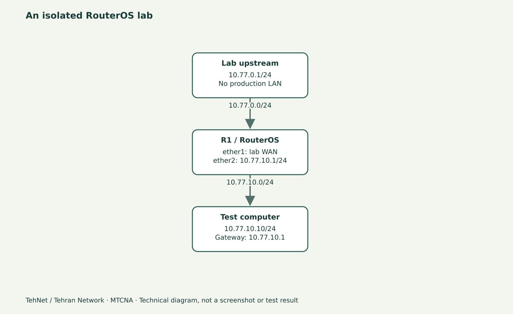

# MTCNA چیست؟ نقشهٔ یادگیری MikroTik و RouterOS 7

> این محتوای مستقل «تهنت؛ تهران نتورک» یک پیش‌نویس آموزشی است، نه سند اجرای آزمایش. فرمان‌ها پیش از انتشار باید روی نسخهٔ واقعی RouterOS آزموده و تصویر اصلی تهیه شود.



*شکل مفهومی شبکه؛ این تصویر اسکرین‌شات WinBox یا شاهد آزمایش واقعی نیست.*

## چرا MTCNA را به چند جلسه تقسیم کرده‌ایم؟
MTCNA نقطهٔ آغاز آموزش شبکه با محصولات میکروتیک است، نه مجوز رسمی کار روی شبکهٔ دیگران. در این دوره هر جلسه یک مهارت کوچک را با سناریوی قابل بررسی توضیح می‌دهد؛ از اتصال به روتر و آدرس‌دهی، تا Bridge، Routing، NAT، Firewall، Wireless، Queue و PPP. با دانستن تفاوت «حفظ کردن گزینه‌ها» و «درک مسیر بسته» در آزمون و در محیط واقعی بهتر عمل می‌کنید. گواهی رسمی فقط از مسیر آزمون‌های مجاز MikroTik صادر می‌شود، نه صرفاً خواندن این سایت.

## RouterOS، RouterBOARD و CHR چه فرقی دارند؟
RouterOS نرم‌افزار مدیریت شبکه است؛ RouterBOARD سخت‌افزارهای میکروتیک هستند؛ CHR نسخهٔ مجازی RouterOS برای Hypervisor است. رابط WinBox یک ابزار مدیریت است و مستقل از نوع دستگاه اجرا می‌شود. در CHR می‌توان بسیاری از رفتارهای IP، NAT، Queue، DHCP و Firewall را دید، اما رادیوی واقعی WiFi، قدرت سیگنال و عملکرد Bootloader سخت‌افزار RouterBOARD را نمی‌توان با آن اثبات کرد.

## نقشهٔ بسته در محیط آزمایشی
یک R1 با شبکهٔ WAN ایزوله `10.77.0.0/24` و LAN آزمایشی `10.77.10.0/24` بسازید و یک کلاینت با IP `10.77.10.10` داشته باشید. هدف این جلسه تنظیم روتر نیست؛ باید بتوانید در نمودار، مسیر بسته از کلاینت به Gateway و تفاوت رابط فیزیکی/مجازی را با اشاره نشان دهید. حتی بدون دسترسی اینترنت هم شروع دوره ممکن است.

## سه سؤال قبل از نخستین تغییر
- اگر IP روتر عوض شود، چگونه دوباره به آن وصل می‌شوید؟ کنسول VM یا مسیر مدیریت دوم را از قبل آماده کنید.
- آیا DHCP آزمایشی ممکن است وارد LAN خانه یا شرکت شود؟ کارت شبکهٔ VM را از شبکهٔ واقعی جدا کنید.
- از کجا می‌فهمیم راه‌اندازی موفق است؟ نسخهٔ نصب‌شده، رابط‌ها و نتیجهٔ ping را با زمان و خروجی واقعی ثبت کنید.

## واژه‌های مهم
**Subnet** محدوده‌ای از آدرس‌های قابل مسیریابی مستقیم است. **Gateway** روتر خروجی کلاینت از Subnet خودش است. **Bridge** اعضای لایهٔ دو را به هم متصل می‌کند؛ **Route** تصمیم لایهٔ سه برای بسته را مشخص می‌کند؛ **NAT** آدرس را تغییر می‌دهد؛ **Firewall** تصمیم دسترسی می‌گیرد. با جدا کردن این مفاهیم، عیب‌یابی نیز به جای حدس، ترتیبی می‌شود.

## تمرین خواندنی و معیار موفقیت
به ۵ سؤال پاسخ دهید: IP یک روتر در کدام مرحله به کار می‌آید؟ آیا WinBox جای RouterOS است؟ تفاوت CHR با RouterBOARD چیست؟ آیا Bridge جای Default Route است؟ چرا قبل از Firewall باید مسیر برگشت را شناخت؟ جواب‌ها را با یک نمودار ساده همراه کنید. موفقیت این جلسه یعنی بتوانید نقشهٔ آموزش را بدون اجرای فرمان خطرناک بازگو کنید.

## جمع‌بندی برای ویدیو
در دقیقهٔ اول مسئله را بیان کنید، تا دقیقهٔ چهارم سه محصول/ابزار را از هم جدا کنید، دقیقهٔ پنجم تا دهم توپولوژی را روی شکل توضیح دهید و باقی زمان را به سؤالات و تکرار نکات اختصاص دهید. این جلسه یک تصویر مفهومی دارد؛ اسکرین‌شات واقعی در جلسهٔ ساخت CHR تهیه خواهد شد.

## دستورهای مربوط به لاب (برچسب انتظار/نمونه)

```routeros
/system resource print
/interface print
```

## اشتباه‌های پرتکرار
- اشتباه گرفتن گواهی MTCNA با شرکت در یک دورهٔ مستقل
- منتظر WiFi واقعی بودن از CHR
- آغاز تمرین روی روتر شرکتی بدون مسیر بازگشت

## سؤالات متداول
**آیا برای MTCNA باید روتر فیزیکی خرید؟**

برای بیشتر مباحث پایه، CHR ایزوله مفید است؛ بعضی تمرین‌های WiFi و RouterBOOT به سخت‌افزار نیاز دارند.

**آیا این دوره مدرک MikroTik صادر می‌کند؟**

خیر؛ مسیر آموزش آزاد و مستقل است و مدرک معتبر فقط در آزمون رسمی صادر می‌شود.

## مسیر ادامه و منابع

درس‌های مرتبط در [هاب MTCNA](/learn/mikrotik/mtcna/)، [آزمایشگاه](/lab/) و [آموزش میکروتیک](/learn/mikrotik/) هستند. این بخش تنها آموزش نوشتاری مستقل است و به ویدیوی قدیمی خاصی نسبت داده نمی‌شود.

- https://mikrotik.com/training/about
- https://manual.mikrotik.com/docs/introduction/

_ویرایش محتوایی ۲۰۲۶-۱۱-۰۴؛ نسخهٔ مرجع مستندات ۷.۲۵.۱، اما نسخهٔ اجراشده هنوز ثبت نشده است._
