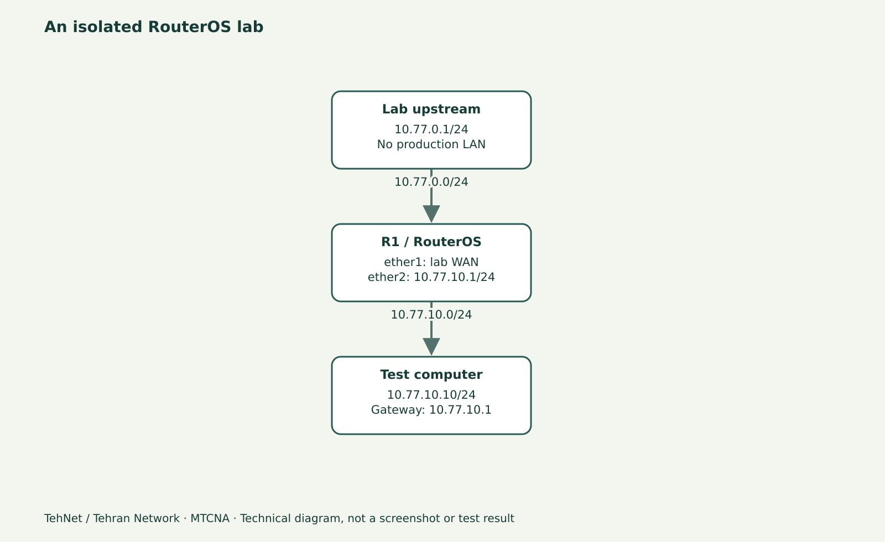

# DHCP Client در MikroTik؛ دریافت IP، Gateway و DNS از WAN

> این محتوای مستقل «تهنت؛ تهران نتورک» یک پیش‌نویس آموزشی است، نه سند اجرای آزمایش. فرمان‌ها پیش از انتشار باید روی نسخهٔ واقعی RouterOS آزموده و تصویر اصلی تهیه شود.



*شکل مفهومی شبکه؛ این تصویر اسکرین‌شات WinBox یا شاهد آزمایش واقعی نیست.*

## DHCP Client دقیقاً چه وظیفه‌ای دارد؟
وقتی یک روتر میکروتیک در نقش **کلاینت DHCP** به مودم یا روتر بالادستی وصل می‌شود، ممکن است IPv4، Subnet Mask، Gateway، DNS و بعضی Optionهای دیگر را دریافت کند. این با DHCP Server که به کاربران داخل LAN آدرس می‌دهد متفاوت است. DHCP Client را روی رابط WAN آزمایشی قرار می‌دهیم، نه روی همان Bridge که قرار است کاربران از آن آدرس بگیرند.

## سناریوی ۱۰ تا ۱۵ دقیقه‌ای
بالادست آزمایشی `10.77.0.1/24` روی شبکهٔ ایزوله فعال است و DHCP Server آن آدرسی در همان محدوده می‌دهد. روی R1 رابط `ether1` به WAN آزمایشی وصل است؛ LAN جداگانهٔ R1 از `ether2` استفاده می‌کند. پیش از اجرا، نام رابط واقعی را با `/interface print` و وجود DHCP Client قبلی را با `/ip dhcp-client print detail` بررسی کنید. اگر قبلاً یک DHCP Client فعال دارید، نسخهٔ دوم نسازید.

## چهار مرحلهٔ عملی
۱. از WinBox بخش **IP → DHCP Client** را باز کنید و رابط WAN صحیح را انتخاب کنید؛ نباید اشتباهاً روی LAN، Bridge یا پورت مشترک DHCP Client ایجاد شود.
۲. برای لاب، `Add Default Route` را با طرح مسیر سازگار کنید. اگر Route ثابت موجود است، Distance و Active بودن مسیرها را مقایسه کنید تا دو Default Route هم‌وزن بی‌دلیل نسازید.
۳. با `Use Peer DNS` تعیین کنید آیا DNS دریافتی بالادست به تنظیمات DNS RouterOS اضافه شود یا از Resolverهای مشخص آزمایشگاه استفاده شود. تغییر آن روی Router واقعی ممکن است رفتار کل کاربران را تحت تأثیر قرار دهد.
۴. وضعیت `bound`، آدرس، Gateway و DNS را بررسی کنید. یک IP گرفتن بدون Route برگشت یا Firewall مناسب، تضمین اتصال End-to-End نیست.

## خروجی قابل انتظار
در حالت موفق می‌توانید در DHCP Client وضعیت Bound ببینید؛ در IP Addresses، آدرس Dynamic و در Routes، مسیر پیش‌فرض Dynamic را مشاهده کنید. در نبود DHCP Server، وضعیت Bound نمی‌شود؛ این رخداد را باید ثبت کرد، نه اینکه خروجی موفقیت را ساخت.

## تشخیص خطا
اگر DHCP Client در حالت Searching می‌ماند، به ترتیب Link، VLAN/Bridge، وجود سرور DHCP بالادست و ترافیک Broadcast را کنترل کنید. اگر آدرس هست ولی Ping بیرون قطع است، Gateway، Return Route، Firewall و NAT مرزی را بررسی کنید. اگر نام دامنه Resolve نمی‌شود، اول IP Routing را از DNS جدا تست کنید.

## بازگشت
فقط DHCP Client آزمایشگاهی را حذف کنید؛ Routeها و DNSهای قدیمی را از روی Snapshot موجود بازگردانید. هیچ DHCP Client تولیدی را با شمارهٔ سطر متغیر حذف نکنید؛ از Comment و شناسهٔ دقیق استفاده کنید.

## دستورهای مربوط به لاب (برچسب انتظار/نمونه)

```routeros
/interface print
/ip dhcp-client print detail
/ip address print detail
/ip route print detail
/ip dns print
# Only in isolated lab, if there is no client on ether1:
/ip dhcp-client add interface=ether1 add-default-route=yes use-peer-dns=no disabled=no comment=TEHNET-LAB
```

## اشتباه‌های پرتکرار
- ساخت Client روی bridge-lan
- نادیده گرفتن Route موجود و Distance
- برابر دانستن Bound با موفقیت DNS یا NAT

## سؤالات متداول
**DHCP Client با DHCP Server چه فرقی دارد؟**

Client آدرس و Option دریافت می‌کند؛ Server برای دستگاه‌های دیگر IP تخصیص می‌دهد.

**اگر IP بگیرم ولی اینترنت کار نکند؟**

Gateway، مسیر برگشت، NAT/Firewall و DNS را جداگانه بررسی کنید.

## مسیر ادامه و منابع

درس‌های مرتبط در [هاب MTCNA](/learn/mikrotik/mtcna/)، [آزمایشگاه](/lab/) و [آموزش میکروتیک](/learn/mikrotik/) هستند. این بخش تنها آموزش نوشتاری مستقل است و به ویدیوی قدیمی خاصی نسبت داده نمی‌شود.

- https://help.mikrotik.com/docs/spaces/ROS/pages/24805500/DHCP
- https://manual.mikrotik.com/docs/introduction/

_ویرایش محتوایی ۲۰۲۶-۱۱-۰۴؛ نسخهٔ مرجع مستندات ۷.۲۵.۱، اما نسخهٔ اجراشده هنوز ثبت نشده است._
