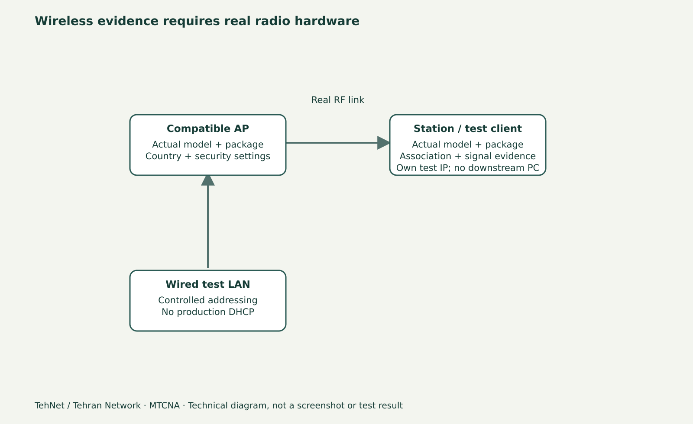

# Bridge بی‌سیم و Station Bridge؛ تفاوت لینک لایه دو و سه

> این محتوای مستقل «تهنت؛ تهران نتورک» یک پیش‌نویس آموزشی است، نه سند اجرای آزمایش. فرمان‌ها پیش از انتشار باید روی نسخهٔ واقعی RouterOS آزموده و تصویر اصلی تهیه شود.



*شکل مفهومی شبکه؛ این تصویر اسکرین‌شات WinBox یا شاهد آزمایش واقعی نیست.*

## چرا Station به معنی Bridge نیست؟
در WiFi معمولی، Station به Access Point متصل می‌شود؛ اما عبور شفاف همهٔ MAC Addressهای پشت Station به قابلیت Bridge در هر دو سمت وابسته است. در دستگاه‌هایی با بستهٔ قدیمی **wireless** یا بستهٔ جدید **wifi**، نام Mode و امکانات یکسان نیست؛ از روی یک ویدیوی قدیمی برای یک مدل دیگر دستور حفظ نکنید.

## سناریوی آزمایش
دو دستگاه واقعی و سازگار دارید: AP در سمت A و Station در سمت B. کلاینت اول به LAN سمت A و کلاینت دوم به Ethernet سمت B متصل است. قبل از هر تغییر، مدل، معماری، نسخه RouterOS، نام بسته، کشور/باند و روش رمزگذاری را ثبت کنید. این لاب را نمی‌توان فقط با CHR و بدون رادیوی فیزیکی صادقانه تأیید کرد.

## روش تشخیص Bridge واقعی
۱. بررسی کنید هر دو دستگاه چه بسته‌ای دارند و در WinBox، **WiFi** یا **Wireless** کدام منو دیده می‌شود؛ در دستگاه فاقد رادیو، دنبال این منو نگردید.
۲. نقش AP و Station، SSID، کانال مجاز و امنیت یکسان را در لاب تنظیم کنید؛ برای RF از قانون کشور و مجوز فرکانسی تبعیت کنید.
۳. روی AP و Station، Interfaceهای Ethernet/WiFi را در Bridge درست و بدون Loop قرار دهید. اگر Loop ساختید، RSTP را بررسی کنید اما آن را جای طراحی درست فرض نکنید.
۴. در سمت B یک کلاینت IP آزمایشی دریافت کند؛ این مرحله تنها DHCP را می‌سنجد، نه الزاماً عبور شفاف MAC. برای اثبات L2، جدول Hostهای Bridge و MACهای واقعی طرفین را از دو سمت مقایسه کنید.
۵. آزمایش آخر Ping و انتقال فایل از سمت B به A با کنترل تأخیر و Loss است. ضعف Link، Throughput یا قطع Lease می‌تواند به RF، Security، MTU یا سازگاری Mode مربوط باشد.

## انتخاب بین Layer 2 و Layer 3
اگر صرفاً هدف اتصال دو شبکه IP است، Routing با Subnet مستقل ممکن است امن‌تر و قابل تشخیص‌تر از Bridge گسترده باشد. Bridge هر Broadcast و بعضی خطاهای لایهٔ دو را منتقل می‌کند؛ با Loop اشتباه ممکن است کل LAN را مختل کند.

## معیار پذیرش و بازگشت
یک Client متصل به پشت Station باید بدون ایجاد DHCP دوم و Loop به Gateway مناسب دسترسی داشته باشد؛ نتیجهٔ MAC table و Signal/CCQ باید از رادیوی واقعی ثبت شود. سپس حالت قبلی Radio و Bridge را بازگردانید. دستگاه فیزیکی، Snapshot متنی و فهرست تنظیمات قبل از تغییر نیاز است.

## دستورهای مربوط به لاب (برچسب انتظار/نمونه)

```routeros
/system resource print
/system package print
/interface print
/interface bridge print detail
/interface bridge port print
/interface bridge host print
```

## اشتباه‌های پرتکرار
- تعبیر هر اتصال Station به Bridge شفاف
- ساخت Loop بین LAN کابلی و لینک RF
- نادیده گرفتن تفاوت منوهای WiFi و Wireless

## سؤالات متداول
**آیا CHR می‌تواند لینک WiFi واقعی را آزمایش کند؟**

خیر، بدون رادیوی سازگار کیفیت RF، Station Bridge و Association واقعی تأیید نمی‌شوند.

**چه موقع Route بهتر از Bridge است؟**

زمانی که دو شبکه مستقل دارید و نیازی به Broadcast Domain مشترک نیست.

## مسیر ادامه و منابع

درس‌های مرتبط در [هاب MTCNA](/learn/mikrotik/mtcna/)، [آزمایشگاه](/lab/) و [آموزش میکروتیک](/learn/mikrotik/) هستند. این بخش تنها آموزش نوشتاری مستقل است و به ویدیوی قدیمی خاصی نسبت داده نمی‌شود.

- https://manual.mikrotik.com/docs/introduction/
- https://mikrotik.com/training/about

_ویرایش محتوایی ۲۰۲۶-۱۱-۰۴؛ نسخهٔ مرجع مستندات ۷.۲۵.۱، اما نسخهٔ اجراشده هنوز ثبت نشده است._


## ثبت همگام‌سازی پیش‌نویس — ۲۰۲۶-۱۱-۱۱

نسخهٔ فارسیِ گسترده‌تر این منبع در WordPress Draft ID 285 با parent 40 ذخیره و از REST به شکل غیرعمومی بازخوانی شد. این فایل GitHub الزاماً کپی bytewise بدنهٔ Gutenberg نیست. عکس موجود فقط دیاگرام شماتیک است؛ شواهد معتبر چهار مرحلهٔ WinBox، آزمون روتر فیزیکی و Rollback برای این جلسه **NOT_RUN / NOT_CAPTURED** اند. تصاویر در Media Library آپلود نشدند؛ Gutenberg Editor Save و بازبینی تخصصی هنوز تأیید نشده‌اند. 
