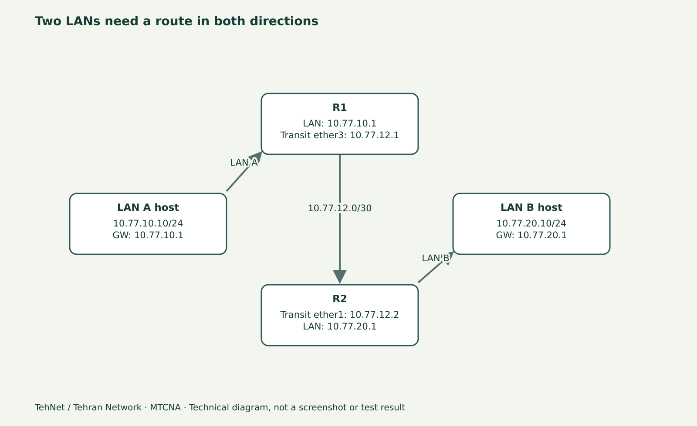

# Route Flags و مسیر Dynamic در MikroTik؛ خواندن جدول Route

> این محتوای مستقل «تهنت؛ تهران نتورک» یک پیش‌نویس آموزشی است، نه سند اجرای آزمایش. فرمان‌ها پیش از انتشار باید روی نسخهٔ واقعی RouterOS آزموده و تصویر اصلی تهیه شود.



*شکل مفهومی شبکه؛ این تصویر اسکرین‌شات WinBox یا شاهد آزمایش واقعی نیست.*

## چرا Route داخل جدول هست ولی استفاده نمی‌شود؟
وجود یک Route در `/ip route print` به معنی انتخاب آن برای ترافیک نیست. در RouterOS 7 نشانه‌های Dynamic، Active، Connected، Static و ستون Routing Table باید با واقعیت آدرس‌ها و Next-Hop تحلیل شوند. Route با Gateway نامعتبر یا Distance نامناسب ممکن است در جدول دیده شود ولی Packetها از مسیر دیگری خارج شوند.

## سناریوی مقایسه
R1 به LAN A `10.77.10.0/24` و لینک Transit `10.77.12.1/30` وصل است. R2 آدرس Transit `10.77.12.2/30` و LAN B `10.77.20.0/24` را دارد. هر آدرس LAN متصل یک مسیر Connected ایجاد می‌کند؛ برای رسیدن R1 به LAN B لازم است به R2 Route استاتیک آگاهانه اضافه شود و مسیر برگشت نیز در R2 وجود داشته باشد.

## سه نوع مسیر که باید از هم جدا شوند
**Connected** با افزودن IP روی Interface مربوطه وارد جدول می‌شود. **Static** را شما تعریف می‌کنید و تا زمانی که شرایط Active باشد در Forwarding نقش دارد. **Dynamic** می‌تواند از DHCP Client، پروتکل مسیریابی یا منبع دیگری آموخته شود؛ صرف دیدن D کافی نیست که بدانیم OSPF استفاده شده است.

## مراحل خواندن، نه ساختن حدسی
۱. IP Address و Interfaceهای Up را ثبت کنید؛ در غیر این صورت Gateway یا Connected route را اشتباه تفسیر می‌کنید.
۲. `/ip route print detail` را بررسی کنید؛ برای Route هدف، Destination، Gateway، Distance، Routing Table و Active/Inactive را بنویسید.
۳. اگر دو Default Route دیدید، Distance و Source آن‌ها را بررسی کنید؛ Route اضافی را بدون شناخت منبع پاک نکنید.
۴. با `ping` و `traceroute` از Source مشخص، مسیر بسته را بسنجید؛ Traceroute ممکن است ICMP را به دلیل سیاست شبکه نشان ندهد و به تنهایی اثبات خرابی نیست.
۵. مسیر برگشت را روی R2 کنترل کنید. اگر Echo Request می‌رسد ولی Reply برنمی‌گردد، روی Next-Hop/Firewall و Return Route تمرکز کنید.

## تفاوت با MTCRE
پیکربندی کامل OSPF/BGP موضوع پیشرفته‌تری است. این درس فقط توانایی **خواندن و تشخیص مسیرهای Dynamic** را پوشش می‌دهد و نباید آن را به عنوان آموزش کامل پروتکل‌ها معرفی کرد.

## معیار پذیرش
پیش از هر تغییر، برای هر مقصد یک مسیر مورد انتظار بنویسید. سپس با خروجی واقعی جدول Route مطابقت دهید؛ اگر Gateway غیرفعال است یا Route Active نیست، علت را با Link/Address و Gateway Resolve توضیح دهید. هیچ خروجی فابریکی را به‌عنوان تست انجام‌شده منتشر نکنید.

## دستورهای مربوط به لاب (برچسب انتظار/نمونه)

```routeros
/interface print
/ip address print
/ip route print detail
/ping 10.77.20.1 src-address=10.77.10.1 count=3
/tool traceroute 10.77.20.1
```

## اشتباه‌های پرتکرار
- یکی دانستن Dynamic با OSPF
- ندیدن route برگشت
- تعویض Default Route در روتر تولیدی برای تست

## سؤالات متداول
**Route با Flag D یعنی چیست؟**

Dynamic بودن مسیر به منبع آن اشاره می‌کند و لزوماً OSPF نیست.

**چرا Route هست ولی Active نیست؟**

ممکن است Gateway Resolve نشود، Distance/Route دیگری ترجیح داده شود یا Interface مربوطه Down باشد.

## مسیر ادامه و منابع

درس‌های مرتبط در [هاب MTCNA](/learn/mikrotik/mtcna/)، [آزمایشگاه](/lab/) و [آموزش میکروتیک](/learn/mikrotik/) هستند. این بخش تنها آموزش نوشتاری مستقل است و به ویدیوی قدیمی خاصی نسبت داده نمی‌شود.

- https://help.mikrotik.com/docs/spaces/ROS/pages/328084/IP+Routing
- https://manual.mikrotik.com/docs/introduction/

_ویرایش محتوایی ۲۰۲۶-۱۱-۰۴؛ نسخهٔ مرجع مستندات ۷.۲۵.۱، اما نسخهٔ اجراشده هنوز ثبت نشده است._
