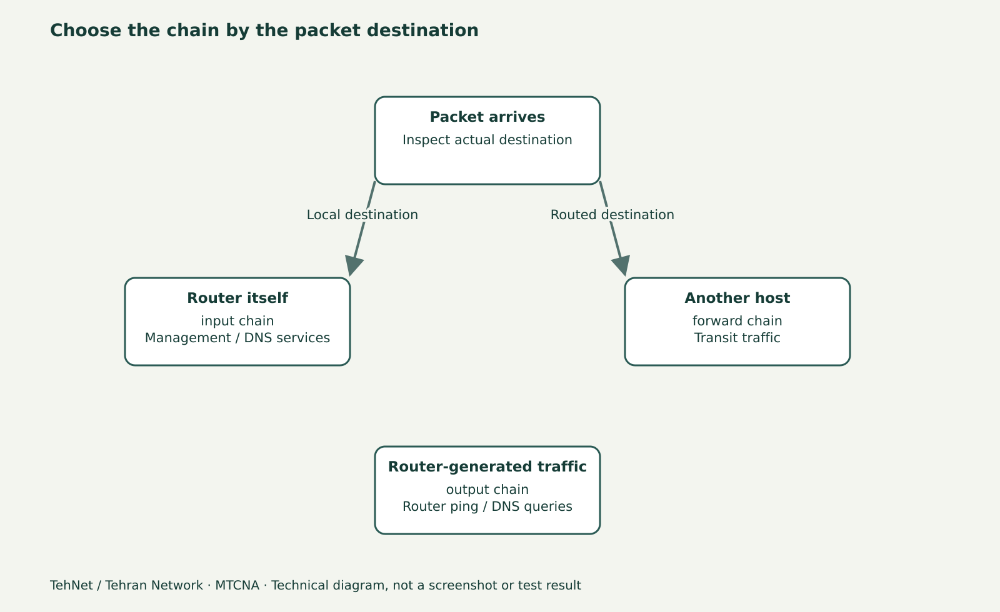

# سخت‌سازی اولیه Firewall میکروتیک؛ Input، Log و Rollback امن

> این محتوای مستقل «تهنت؛ تهران نتورک» یک پیش‌نویس آموزشی است، نه سند اجرای آزمایش. فرمان‌ها پیش از انتشار باید روی نسخهٔ واقعی RouterOS آزموده و تصویر اصلی تهیه شود.



*شکل مفهومی شبکه؛ این تصویر اسکرین‌شات WinBox یا شاهد آزمایش واقعی نیست.*

## قبل از نوشتن Drop چه چیزی را باید حفظ کنیم؟
ایمن‌سازی روتر از ایجاد چند Rule بزرگِ `drop` شروع نمی‌شود. ابتدا باید بدانید **کدام ترافیک مقصد خود روتر است** و کدام Packet از روتر عبور می‌کند. بسته‌ای که به IP مدیریت RouterOS می‌رود وارد زنجیرهٔ `input` می‌شود؛ عبور کلاینت LAN به سرور از زنجیرهٔ `forward` استفاده می‌کند. تغییر اشتباه زنجیرهٔ Input می‌تواند دسترسی مدیر را قطع کند.

## قرارداد محیط تمرین
R1 روی LAN آزمایشی `10.77.10.1/24` قرار دارد. رایانهٔ مدیریت `10.77.10.10` است. هنگام تغییر، یک کنسول VM خارج از مسیر Firewall داشته باشید. از `export` نسخهٔ پاک‌سازی‌شده تهیه کنید؛ در RouterOS واقعی هر Rule فعلی ممکن است دلیل تجاری داشته باشد و نباید برای اجرای یک آموزش حذف شود.

## پنج مرحلهٔ امن
۱. در WinBox بخش IP → Firewall → Filter Rules را باز و ابتدا `print stats` بگیرید؛ ترتیب و Chain هر Rule را ثبت کنید.
۲. به طور مفهومی سه دسته تعریف کنید: اتصال‌های موجود و معتبر، ترافیک محدود مدیریت از LAN مورد اعتماد، و ترافیک نامطلوب به IP خود روتر. بدون بررسی سیاست موجود، Ruleهای عمومی را جایگزین نکنید.
۳. یک Address List آزمایشی برای IP مدیر بسازید و با Rule صریحی که Comment دارد، فقط سناریوی تحت اختیار را بررسی کنید. اگر در فایروال فعلی مسیر مدیریت با Interface List یا Source Address دیگر تعریف شده، آن را حفظ کنید.
۴. Log با Prefix مشخص فقط روی یک Rule محدود و نرخ کنترل‌شده مفید است؛ Log کردن همهٔ بسته‌های اینترنت می‌تواند Disk/CPU را اشباع کند.
۵. اگر Rule جدید باعث قطع مدیریت شد، از Safe Mode یا کنسول برای بازگردانی استفاده کنید. وجود Session دوم تنها یک کمک است و جای Snapshot یا Checkpoint را نمی‌گیرد.

## تفاوت Counter و نتیجه
وقتی Counter یک Rule افزایش می‌یابد، یعنی Packet با شرایط آن Rule برخورد داشته است؛ این به تنهایی موفقیت ارتباط End-to-End را اثبات نمی‌کند. برای فایروال، با Client جداگانه و مبدأ مشخص، دسترسی مجاز و غیرمجاز را به صورت مثبت و منفی تست کنید.

## نمونهٔ تغییر محدود
دستورات بعدی صرفاً در R1 ایزوله، بعد از بررسی Ruleهای موجود و قبل از هر Drop عمومی مناسب‌اند. در شبکهٔ تولیدی بدون تحلیل ترتیب اجرا نکنید. برای تکرار آزمایش، Comment یکتا و شناسهٔ واقعی Rule را به جای شمارهٔ سطر متغیر استفاده کنید.

## بازگشت و سؤال کلیدی
دو تست را ثبت کنید: از IP مدیر، اتصال WinBox/SSH طبق سیاست برقرار است؛ از IP غیرمجاز، اتصال به سرویس مدیریت برقرار نیست. اگر نتیجه مطابق انتظار نیست، به جای افزودن Drop بیشتر، Log، Address List، ترتیب Rule و مسیر برگشت را بررسی کنید.

## دستورهای مربوط به لاب (برچسب انتظار/نمونه)

```routeros
/ip firewall filter print stats
/ip firewall address-list print
/ip service print
# Lab only; adapt to your verified interface and policies:
/ip firewall address-list add list=tehnet-admin-lab address=10.77.10.10 comment=TEHNET-LAB-ONLY
```

## اشتباه‌های پرتکرار
- قرار دادن Drop بالای Accept مدیریت
- بی‌توجهی به FastTrack و Connection Tracking
- Log همگانی بدون محدودیت

## سؤالات متداول
**آیا فایروال Input اینترنت کاربران را مسدود می‌کند؟**

Input برای بسته‌های مقصد خود روتر است؛ Forward ترافیک عبوری را کنترل می‌کند.

**اگر اتصال مدیر قطع شد؟**

از کنسول یا Safe Mode برای Undo تغییر آزمایشی استفاده کنید.

## مسیر ادامه و منابع

درس‌های مرتبط در [هاب MTCNA](/learn/mikrotik/mtcna/)، [آزمایشگاه](/lab/) و [آموزش میکروتیک](/learn/mikrotik/) هستند. این بخش تنها آموزش نوشتاری مستقل است و به ویدیوی قدیمی خاصی نسبت داده نمی‌شود.

- https://help.mikrotik.com/docs/spaces/ROS/pages/48660574/Filter
- https://manual.mikrotik.com/docs/introduction/

_ویرایش محتوایی ۲۰۲۶-۱۱-۰۴؛ نسخهٔ مرجع مستندات ۷.۲۵.۱، اما نسخهٔ اجراشده هنوز ثبت نشده است._
