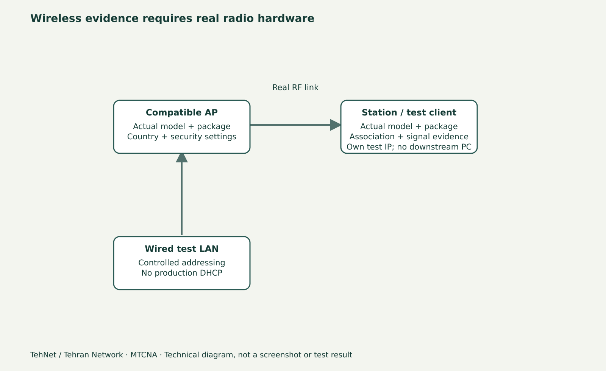

# Access List و Registration در وای‌فای MikroTik؛ سنجش اتصال

> **تهنت / تهران نتورک**: این پیش‌نویس برای مطالعهٔ فارسی و ویدیو آمادهٔ بازبینی است؛ خروجی‌ها و تصاویر، تا زمانی که لاب واقعی اجرا نشود، شاهد فنی یا اسکرین‌شات واقعی نیستند.



*نمودار شماتیک آموزشی؛ تصویر واقعی RouterOS نیست.*

## اتصال موفق چه معنی دارد؟
این‌که نام شبکهٔ WiFi در گوشی دیده می‌شود، به معنی Association یا دریافت IP نیست. برای بررسی ارتباط باید از لایهٔ رادیو آغاز کنید: Channel و Band قانونی، SSID، Security Profile، نوع بستهٔ `wifi` یا `wireless`، سپس ثبت شدن Station در Registration Table. تنها پس از Association می‌توانید DHCP و Routing را بسنجید.

## بستهٔ قدیمی و جدید یک مسیر یکسان ندارند
RouterOS 7 بسته به مدل رادیو و پکیج، منوی WiFi یا Wireless را نشان می‌دهد. Access List در برخی درایورها و نسخه‌ها مسیر و گزینه‌های متفاوت دارد. در این آموزش **دستورهای عمومی را کورکورانه روی هر دستگاه اعمال نمی‌کنیم**: ابتدا `/system resource print` و `/system package print` بگیرید؛ بعد منوی معتبر همان مدل را باز کنید. CHR بدون رادیوی فیزیکی نمی‌تواند Registration و قدرت سیگنال واقعی بسازد.

## آزمایش AP و دو کلاینت
یک AP واقعی و تحت اختیار با دو Station آزمایشی آماده کنید. پیش از تغییر، کانال مجاز کشور، SSID آزمایشی، WPA2-AES یا WPA3 در صورت پشتیبانی واقعی و رمز غیرتولیدی تعریف کنید. MAC هر دو کلاینت را از تنظیمات خودشان یا Registration Table بخوانید؛ قابلیت Random MAC موبایل ممکن است نتیجه را تغییر دهد. هرگز MAC Filtering را به جای احراز هویت و رمزنگاری امنیتی قوی معرفی نکنید.

## مشاهدهٔ Registration و ارزیابی Link
از WinBox منوی WiFi → Registration یا Wireless → Registration را با توجه به بسته بررسی کنید. برای هر Station زمان اتصال، نرخ Tx/Rx، سیگنال و دادهٔ عبوری را ثبت کنید. یک عدد «Signal» بدون فاصله، نویز، فرکانس و وضعیت محیط، نتیجه‌گیری قطعی از کیفیت نمی‌دهد. آزمایش Ping و انتقال فایل به کلاینت LAN مستقل انجام دهید تا ارتباط IP هم سنجیده شود.

## Access List و تفاوت Allow/Deny
فقط روی AP آزمایشگاهی یک Rule محدود تعریف کنید که رفتار یک MAC شناخته‌شده را تغییر دهد؛ قبل از Apply مشخص کنید Ruleهای قبلی و ترتیب آن‌ها چه اثری دارند و مسیر دسترسی مدیریت را روی Ethernet نگه دارید. ابتدا Rule را Disabled بگذارید و بعد از تأیید سناریوی تست، Enable کنید. اگر دستگاه بعد از تغییر Disconnect شد، به نسخهٔ Backup یا کنسول بازگردید. اگر از بستهٔ قدیمی Wireless استفاده می‌کنید، Connect List مربوط به Station را با Access List سمت AP اشتباه نگیرید.

## Snooper و انتخاب کانال
Snooper/Scan می‌تواند اطلاعاتی دربارهٔ کانال‌های پیرامون بدهد ولی روشن کردن Scan در بعضی Modeها می‌تواند سرویس رادیویی را مختل کند. برای سنجش غیرمخرب از ابزار و سخت‌افزار آزمایشی جداگانه استفاده کنید. وجود شبکهٔ هم‌کانال دلیل قطعی افت سرعت نیست؛ اندازه‌گیری نویز، ترافیک و زمان لازم است.

## تمرین کوتاه
دقیقهٔ ۰ تا ۳ تفاوت SSID/Association/IP را نشان دهید؛ دقیقهٔ ۳ تا ۷ Registration Table را بخوانید؛ دقیقهٔ ۷ تا ۱۱ در لاب یک Access List محدود را آزمایش و Undo کنید؛ دقیقهٔ ۱۱ تا ۱۵ نتایج Rate/Signal/Ping و راه حل را مقایسه کنید. اسکرین‌شات واقعی باید از تجهیزات همان تست گرفته شود.

## نمونهٔ دستورات برای لاب تحت اختیار

```routeros
/system resource print
/system package print
/interface print
# Identify package first; run the matching menu only:
/interface wifi registration-table print
# Legacy wireless alternative (if installed):
/interface wireless registration-table print
```

## اشتباه‌های متداول
- استفاده از آموزش wireless قدیمی روی منوی wifi جدید
- ساخت Rule اجازه/منع روی روتر سرویس‌دهندهٔ واقعی
- فرض امنیت از روی MAC Filtering یا RSSI تنها

## پرسش‌های پرتکرار
**آیا MAC Filtering جای WPA2 یا WPA3 را می‌گیرد؟**

خیر؛ فقط مکمل سیاست دسترسی است و MAC را می‌توان جعل کرد.

**چرا Device وصل است ولی IP نمی‌گیرد؟**

بعد از Association، Bridge و DHCP Server/Client و VLAN را بررسی کنید.

## منابع و ادامهٔ درس

- [تمام قسمت‌های MTCNA](/learn/mikrotik/mtcna/)
- [آزمایشگاه](/lab/)
- https://manual.mikrotik.com/docs/introduction/
- https://mikrotik.com/training/about

**ثبت تحریریه: ۴ نوامبر ۲۰۲۶.** مبنای فعلی نوشتار RouterOS 7.25.1 است؛ نسخهٔ اجراشده و نتیجهٔ آزمایش هنوز ثبت نشده‌اند.
