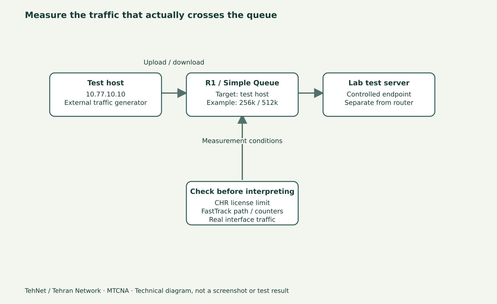

# PCQ چیست و چگونه پهنای باند را بین کاربران تقسیم می‌کند؟

> **تهنت / تهران نتورک**: این پیش‌نویس برای مطالعهٔ فارسی و ویدیو آمادهٔ بازبینی است؛ خروجی‌ها و تصاویر، تا زمانی که لاب واقعی اجرا نشود، شاهد فنی یا اسکرین‌شات واقعی نیستند.



*نمودار شماتیک آموزشی؛ تصویر واقعی RouterOS نیست.*

## چرا یک Simple Queue کافی نیست؟
وقتی برای یک کل Subnet تنها `max-limit` تعریف کنید، کاربران لزوماً سهم یکسانی نمی‌گیرند: یک دانلود پرحجم ممکن است در برخی شرایط بخش بزرگ‌تری از ظرفیت را مصرف کند. PCQ یا Per Connection Queue جریان‌ها را بر اساس Classifier به زیرصف تقسیم می‌کند تا بتوانید ظرفیت موجود را بین کاربران تقسیم کنید. PCQ تضمین پهنای باند نامحدود یا کاهش جادویی Latency نیست؛ محدودیت واقعی لینک و مسیر عبور Packetها همچنان مهم‌اند.

## طرح آزمایش
R1 یک LAN ایزوله `10.77.10.0/24` و یک Upstream آزمایشی جدا دارد؛ Client A آدرس `10.77.10.10` و Client B آدرس `10.77.10.11` دارد. Server تست ترافیک در سمت Routeشده و **خارج از خود روتر** قرار دارد. اگر ترافیک فقط در Bridge داخلی Switch شود ممکن است Queue عبوری از CPU آن را نبیند؛ پس ابتدا مسیر Packet را مشخص کنید.

## Classifier را درست انتخاب کنید
برای Upload کاربران معمولاً `src-address` معیار جداکردن Clientهاست؛ برای Download در سمت کاربران `dst-address`. اگر این دو را وارونه کنید، زیرصف‌ها به شکل مورد انتظار برای کاربران ایجاد نمی‌شوند. در PCQ، مقدار `pcq-rate=0` به معنی تقسیم ظرفیت در دسترس بین زیرصف‌هاست؛ اگر Rate را صریح تنظیم کنید برای هر زیرصف سقف جداگانه‌ای تعریف می‌شود.

## روش اجرای محدود در WinBox
در Queues → Queue Types دو نوع آزمایشی بسازید: `tehnet-pcq-up` با `src-address` و `tehnet-pcq-down` با `dst-address`. سپس در Simple Queue مربوط به Subnet آزمایشی از آن‌ها استفاده کنید. سقف مشترک را متناسب با ظرفیت واقعی لاب تعیین کنید، نه سرعت نوشته‌شده روی قرارداد اینترنت. اگر از CHR Free Trial استفاده می‌کنید، محدودیت License یا Virtual NIC می‌تواند تست سرعت را خراب کند.

## سه آزمایش که اصل PCQ را نشان می‌دهد
الف) فقط Client A دانلود کند؛ سهم استفاده‌شده نزدیک ظرفیت مجاز ممکن است برسد. ب) A و B هم‌زمان دانلود کنند؛ باید با مشاهدهٔ Counter و Traffic Source سهم تقسیم‌شده را تحلیل کنید. ج) Client B توقف کند؛ ممکن است A سهم بیشتری بگیرد. نتیجهٔ دقیق را با واحد bit/s یا byte/s، جهت Upload/Download و زمان ثبت کنید. عددهای ساختگی یا خروجی نمونه را نتیجهٔ واقعی معرفی نکنید.

## Burst و FastTrack را جدا کنید
اگر FastTrack ترافیک تست را از Queue عبور نمی‌دهد، Counter کم‌تغییر به معنی خرابی PCQ نیست. آزمایش جداگانهٔ کنترل‌شده‌ای برای FastTrack انجام دهید؛ تغییر عمومی آن روی شبکهٔ تولیدی مجاز نیست. Burst موضوع جلسهٔ بعدی است و نباید در تست اول PCQ فعال باشد.

## بازگشت
Rule و Queue Typeهای آزمایشی را با Comment یکتا حذف کنید، نه عدد ردیف متغیر. به تنظیمات پیش از تست برگردید و سرعت و پاسخ سرویس‌ها را مجدداً بسنجید.

## نمونهٔ دستورات برای لاب تحت اختیار

```routeros
/queue type print detail
/queue simple print detail
/queue simple print stats
/ip firewall filter print stats
# Lab only, after checking duplicates and traffic path:
/queue type add name=tehnet-pcq-up kind=pcq pcq-classifier=src-address pcq-rate=0
/queue type add name=tehnet-pcq-down kind=pcq pcq-classifier=dst-address pcq-rate=0
```

## اشتباه‌های متداول
- عوض‌کردن src-address و dst-address classifier
- اندازه‌گیری روی لینک Bridge بدون مسیر Routeشده
- تعبیر نتایج CHR License به عنوان ظرفیت اینترنت

## پرسش‌های پرتکرار
**pcq-rate=0 چه کار می‌کند؟**

ظرفیت در دسترس بین زیرصف‌ها تقسیم می‌شود؛ معادل سرعت نامحدود فیزیکی نیست.

**چرا Counter Queue تغییر نمی‌کند؟**

FastTrack، مسیر Bridge و Target را بررسی کنید؛ ممکن است ترافیک اصلاً از آن Queue عبور نکند.

## منابع و ادامهٔ درس

- [تمام قسمت‌های MTCNA](/learn/mikrotik/mtcna/)
- [آزمایشگاه](/lab/)
- https://help.mikrotik.com/docs/spaces/ROS/pages/328088/Queues
- https://help.mikrotik.com/docs/spaces/ROS/pages/137986099/PCQ%20example

**ثبت تحریریه: ۴ نوامبر ۲۰۲۶.** مبنای فعلی نوشتار RouterOS 7.25.1 است؛ نسخهٔ اجراشده و نتیجهٔ آزمایش هنوز ثبت نشده‌اند.

## وضعیت آرشیو WinBox واقعی و پیش‌نویس WordPress — ۹ نوامبر ۲۰۲۶

نسخهٔ خواندنی این درس به‌صورت <strong>Draft</strong> در WordPress با [ویرایش](https://tehnet.ir/wp-admin/post.php?post=281&action=edit) و [پیش‌نمایش](https://tehnet.ir/?page_id=281&preview=true) ذخیره و با REST readback بررسی شده است؛ لینک پیش‌نمایش نیازمند ورود به حساب مجاز است. دو تصویر واقعیِ **آرشیوی** WinBox Linux 4.5 / CHR RouterOS 7.25.1 با تاریخ ۲۰۲۶-۱۱-۰۴ در متن Gutenberg به‌شکل لینک GitHub و همراه alt فارسی و caption آمده‌اند:

- [نمای پنل آرشیوی — گام ۲](../screenshots/real-lab/2026-11-04/winbox40/lesson-28/02-panel.png)
- [فرم یا نمای فقط خواندنی آرشیوی — گام ۳](../screenshots/real-lab/2026-11-04/winbox40/lesson-28/03-form-or-readonly.png)

این تصاویر مدرک چهار گام معتبر، Apply/readback، اندازه‌گیری نتیجه یا آزمون بازگشت نیستند. آپلود Media Library انجام نشد (مسیر افزونهٔ WPVibe پاسخ 404 داد). این دو درس همچنان برای بازبینی تخصصی هستند، نه Ready یا Scheduled.
