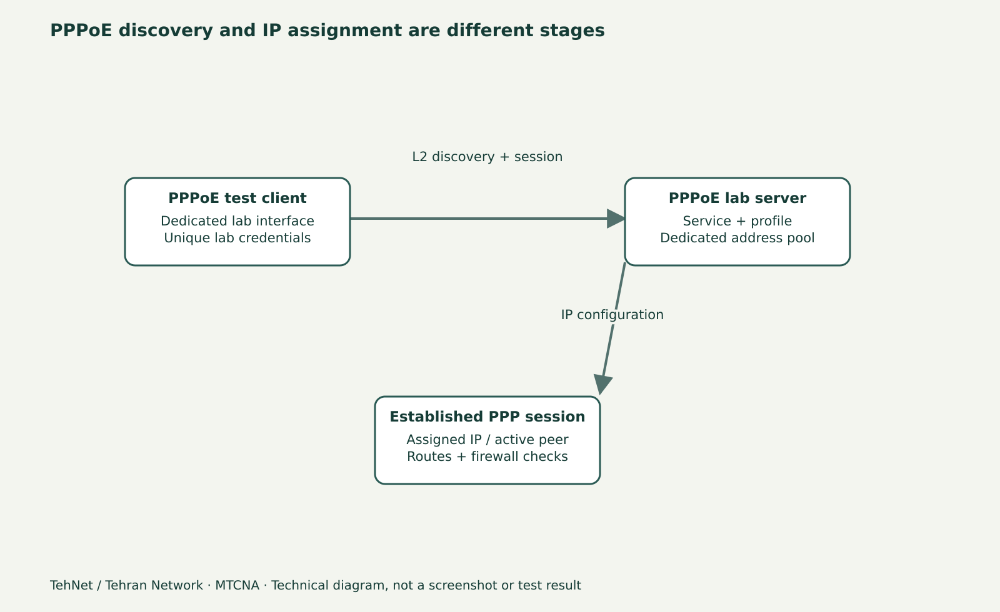

# PPP Profile، Secret و Address Pool در RouterOS 7

> **تهنت / تهران نتورک**: این پیش‌نویس برای مطالعهٔ فارسی و ویدیو آمادهٔ بازبینی است؛ خروجی‌ها و تصاویر، تا زمانی که لاب واقعی اجرا نشود، شاهد فنی یا اسکرین‌شات واقعی نیستند.



*نمودار شماتیک آموزشی؛ تصویر واقعی RouterOS نیست.*

## PPP چه چیزی را حل می‌کند؟
PPP یا Point-to-Point Protocol لایه‌ای برای برقراری یک Session بین دو انتها و مذاکرهٔ پارامترهای اتصال است؛ روی میکروتیک می‌تواند در سناریوهایی مانند PPPoE دیده شود. Profile، Secret و Pool سه مفهوم مستقل‌اند: Profile پارامترهای عمومی Session را مشخص می‌کند؛ Secret اطلاعات ورود و سیاست کاربر را نگه می‌دارد؛ Pool مجموعهٔ آدرس‌های قابل تخصیص را تعریف می‌کند. این جلسه **تنها آماده‌سازی PPP** است؛ ساخت PPPoE Client و Server در جلسهٔ بعد انجام می‌شود.

## توپولوژی و طرح IP
R1 سمت سرور آزمایشی است و Client R2 از پورت جداگانهٔ `ether1` به آن متصل می‌شود. برای PPP محلی می‌توان `10.77.30.1` را به عنوان Local Address و Range `10.77.30.10-10.77.30.30` برای Remote Address تعریف کرد. این شبکه نباید با DHCP LAN یا Subnet دیگر تداخل داشته باشد؛ Addressهای انتخابی صرفاً نمونهٔ آزمایش هستند.

## ترتیب درست ایجاد منابع
۱. از WinBox بخش IP → Pool را باز و Prefix/Range آزمایشی را بررسی کنید؛ Range شامل آدرس سرور نباشد.
۲. PPP → Profiles را باز و Local Address را به `10.77.30.1` و Remote Address را به نام Pool تنظیم کنید. گزینه‌های Encryption/Auth و Change TCP MSS وابسته به سرویس و MTU هستند؛ برای تمرین اول از Default یا مقدار تأییدشده استفاده کنید.
۳. PPP → Secrets را باز و یک حساب **آزمایشی** با رمز تصادفی منحصر به لاب ایجاد کنید. Service را مناسب سناریوی بعدی (مثلاً `pppoe`) محدود سازید؛ رمز واقعی مشتری را در محتوای آموزشی ذخیره نکنید.
۴. در PPP Active هنوز نباید Session ببینید؛ تا Client و Server ساخته نشده‌اند، نبود Session طبیعی است. بنابراین غیاب کاربر Active در این درس خطا نیست.

## Local و Remote Address
Local Address آدرس انتهای سمت Server یا Interface منطقی است؛ Remote Address از Pool به Peer اختصاص داده می‌شود. اگر هر دو یک IP بگیرند یا Pool با LAN هم‌پوشانی داشته باشد، Routing و Address Conflict پیش می‌آید. این تفاوت با DHCP Lease مستقل از PPP را به زبان ساده توضیح دهید.

## خطاهای پرتکرار
اگر Secret را با Service اشتباه محدود کنید، کاربر مجاز هنگام ایجاد Session رد می‌شود. اگر Range موجودی کافی نداشته باشد، Sessionهای جدید آدرس نمی‌گیرند. MTU/MRU ناسازگار و فایروال نیز در مرحلهٔ PPPoE می‌توانند باعث مشکل شوند. تنها اضافه کردن Secret **هیچ تونل فعال یا دسترسی اینترنتی ایجاد نمی‌کند**.

## تمرین ۱۰ تا ۱۵ دقیقه‌ای
ابتدا سه موجودیت را روی تصویر توضیح دهید؛ سپس روی لاب با نام‌های منحصربه‌فرد Pool، Profile و Secret بسازید و با `print detail` صحت مقادیر را بخوانید؛ در پایان آن‌ها را طبق وابستگی حذف کنید یا به Snapshot بازگردید. رمز را در ویدیو نمایش ندهید.

## نمونهٔ دستورات برای لاب تحت اختیار

```routeros
/ip pool print detail
/ppp profile print detail
/ppp secret print detail
/ppp active print
# Lab example; only if names do not exist:
/ip pool add name=tehnet-ppp-pool ranges=10.77.30.10-10.77.30.30
/ppp profile add name=tehnet-ppp-lab local-address=10.77.30.1 remote-address=tehnet-ppp-pool
```

## اشتباه‌های متداول
- تداخل Pool با DHCP LAN
- تعبیر PPP Secret به معنی اتصال برقرار
- انتشار رمز آزمایشی در تصویر یا Export

## پرسش‌های پرتکرار
**آیا برای هر PPP Secret باید Pool جدا بسازیم؟**

نه؛ معمولاً کاربران می‌توانند از Pool تعریف‌شده توسط Profile استفاده کنند مگر شرایط خاص.

**چرا Active خالی است؟**

هنوز Session Client/Server برقرار نشده؛ Secret به‌تنهایی Session ایجاد نمی‌کند.

## منابع و ادامهٔ درس

- [تمام قسمت‌های MTCNA](/learn/mikrotik/mtcna/)
- [آزمایشگاه](/lab/)
- https://manual.mikrotik.com/docs/introduction/
- https://help.mikrotik.com/docs/spaces/ROS/pages/132350049/PPP+AAA

**ثبت تحریریه: ۴ نوامبر ۲۰۲۶.** مبنای فعلی نوشتار RouterOS 7.25.1 است؛ نسخهٔ اجراشده و نتیجهٔ آزمایش هنوز ثبت نشده‌اند.

## وضعیت آرشیو WinBox واقعی و پیش‌نویس WordPress — ۹ نوامبر ۲۰۲۶

نسخهٔ خواندنی این درس به‌صورت <strong>Draft</strong> در WordPress با [ویرایش](https://tehnet.ir/wp-admin/post.php?post=282&action=edit) و [پیش‌نمایش](https://tehnet.ir/?page_id=282&preview=true) ذخیره و با REST readback بررسی شده است؛ لینک پیش‌نمایش نیازمند ورود به حساب مجاز است. دو تصویر واقعیِ **آرشیوی** WinBox Linux 4.5 / CHR RouterOS 7.25.1 با تاریخ ۲۰۲۶-۱۱-۰۴ در متن Gutenberg به‌شکل لینک GitHub و همراه alt فارسی و caption آمده‌اند:

- [نمای پنل آرشیوی — گام ۲](../screenshots/real-lab/2026-11-04/winbox40/lesson-30/02-panel.png)
- [فرم یا نمای فقط خواندنی آرشیوی — گام ۳](../screenshots/real-lab/2026-11-04/winbox40/lesson-30/03-form-or-readonly.png)

این تصاویر مدرک چهار گام معتبر، Apply/readback، اندازه‌گیری نتیجه یا آزمون بازگشت نیستند. آپلود Media Library انجام نشد (مسیر افزونهٔ WPVibe پاسخ 404 داد). این دو درس همچنان برای بازبینی تخصصی هستند، نه Ready یا Scheduled.
