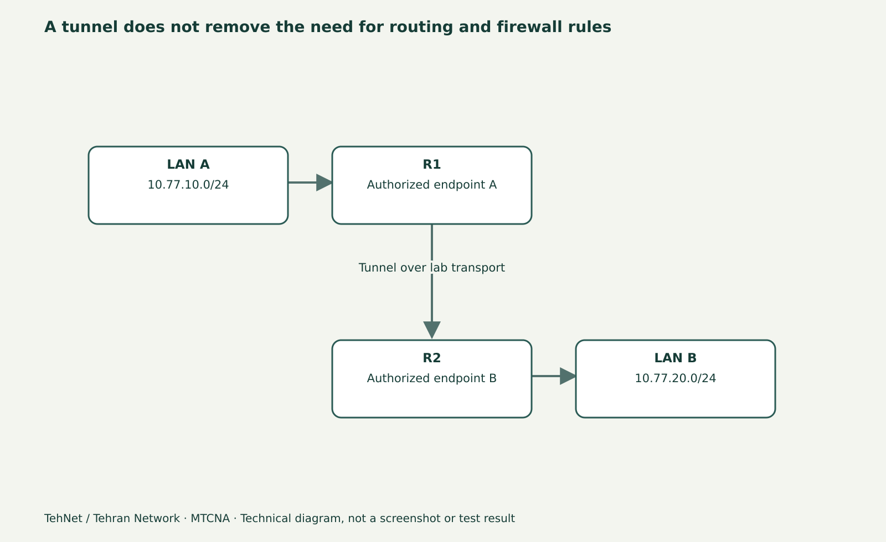

# PPTP و SSTP در میکروتیک؛ تفاوت امنیت و کاربرد تاریخی

> **تهنت / تهران نتورک**: این پیش‌نویس برای مطالعهٔ فارسی و ویدیو آمادهٔ بازبینی است؛ خروجی‌ها و تصاویر، تا زمانی که لاب واقعی اجرا نشود، شاهد فنی یا اسکرین‌شات واقعی نیستند.



*نمودار شماتیک آموزشی؛ تصویر واقعی RouterOS نیست.*

## هر Tunnel یک VPN امن نیست
در دورهٔ MTCNA شناخت انواع PPP Tunnel مهم است، ولی نباید نوع Tunnel را با **امنیت قابل قبول برای استفادهٔ امروز** یکی دانست. PPTP به دلیل ضعف‌های شناخته‌شده در طرح رمزنگاری و پروتکل احراز هویت، برای اطلاعات حساس و اتصال جدید توصیه نمی‌شود. SSTP از TLS استفاده می‌کند و به اعتبار گواهی سرور، TLS و انتخاب الگوریتم‌ها وابسته است. WireGuard به عنوان گزینهٔ معاصر در جلسهٔ بعد به شکل جدا بررسی می‌شود.

## جدول مفهومی
- **PPTP:** تونل قدیمی روی TCP/1723 همراه GRE؛ عبور از NAT یا Firewall خاص ممکن است پیچیده باشد، و ساختار امنیتی آن برای استقرار جدید مناسب نیست.
- **SSTP:** استفاده از TLS برای محافظت از Session، معمولاً روی TCP/443؛ اگر بررسی گواهی Server غیرفعال باشد، هدف امنیت TLS به خطر می‌افتد.
- **WireGuard:** از کلیدهای عمومی/خصوصی برای Peerها استفاده می‌کند و مدیریت Allowed Address و Route را جدا لازم دارد؛ «خودکار راه‌اندازی شدن» همهٔ ترافیک را تضمین نمی‌کند.

## تشخیص بدون ساخت تونل ناامن
ابتدا وضعیت Clientها و Serverهای موجود روی دستگاه آموزشی را با `print detail` **بخوانید**. در لاب، توپولوژی دو روتر را روی شکل ترسیم کنید و انتخاب Transport، احراز هویت، IP Address و مسیر برگشت را توضیح دهید. برای PPTP فقط تنظیمات قدیمی را شناسایی کنید و Connection جدیدِ متصل به اینترنت عمومی نسازید. آموزش نشان دادن یک پروتکل به معنی توصیهٔ استفاده از آن نیست.

## SSTP در محیط کنترل‌شده
SSTP نیاز به طرف Server و گواهی با هویت معتبر دارد. در لاب با Certificate داخلی معتبر برای همان نام Host، مطمئن شوید Client واقعاً گواهی را تأیید می‌کند. اگر نام، زمان سیستم، Chain گواهی یا DNS اشتباه باشد، اتصال امن ممکن است رد شود. خاموش کردن Certificate Validation برای رد شدن از خطا، یک «راه‌حل» قابل توصیه برای شبکهٔ واقعی نیست.

## Connection برقرار است ولی شبکهٔ مقصد باز نمی‌شود؟
فاز Session تنها یکی از مراحل است. Remote Address، Route به LAN مقابل، Return Route، Firewall، MTU و امکان NAT باید جدا کنترل شوند. اگر Ping از خود Router کار می‌کند ولی از Client نه، Source Address و Allowed Network و فایروال کلاینت را بررسی کنید. برای تشخیص، Capture یا Log را به شکل محدود با حذف اطلاعات حساس ثبت کنید.

## تمرین
تفاوت Protocol و Security را در سه دقیقه بیان کنید؛ در چهار دقیقه صفحهٔ PPP Client و گواهی SSTP را (بدون رمز) مرور کنید؛ در پنج دقیقه مثال Return Route را حل کنید؛ در سه دقیقه ریسک PPTP و راه جایگزین را جمع‌بندی کنید. نمایش زندهٔ PPTP ناامن ضرورت آموزشی ندارد؛ بهتر است با دیاگرام و تنظیمات Read-only تدریس شود.

## نمونهٔ دستورات برای لاب تحت اختیار

```routeros
/interface pptp-client print detail
/interface sstp-client print detail
/ppp active print
/ip route print detail
/certificate print
```

## اشتباه‌های متداول
- توصیه PPTP به عنوان VPN امن تازه
- غیرفعال کردن verify-server-certificate در استفادهٔ واقعی SSTP
- نتیجه‌گیری اتصال LAN فقط از Up شدن Tunnel

## پرسش‌های پرتکرار
**آیا PPTP هنوز برای ساخت VPN امن پیشنهاد می‌شود؟**

خیر؛ به دلیل ضعف امنیتی برای ارتباطات جدید مناسب نیست.

**آیا پورت TCP/443 به معنی امنیت SSTP است؟**

خیر؛ زنجیرهٔ گواهی و تنظیمات TLS باید معتبر باشند.

## منابع و ادامهٔ درس

- [تمام قسمت‌های MTCNA](/learn/mikrotik/mtcna/)
- [آزمایشگاه](/lab/)
- https://manual.mikrotik.com/docs/introduction/
- https://help.mikrotik.com/docs/spaces/ROS/pages/2031638/PPTP
- https://help.mikrotik.com/docs/spaces/ROS/pages/2031645/SSTP

**ثبت تحریریه: ۴ نوامبر ۲۰۲۶.** مبنای فعلی نوشتار RouterOS 7.25.1 است؛ نسخهٔ اجراشده و نتیجهٔ آزمایش هنوز ثبت نشده‌اند.


## WordPress checkpoint — 2026-11-10 (editorial draft only)

- Page: [edit](https://tehnet.ir/wp-admin/post.php?post=283&action=edit) / [authenticated preview](https://tehnet.ir/?page_id=283&preview=true); parent **40**, status **draft**, REST readback confirmed.
- Content in WP is an editorially expanded Gutenberg draft and **may differ from this original Markdown source**. The raw WordPress SHA-256, image and lab limits are in `microcourse-draft-receipts-2026-11-04.json`.
- Authentic WinBox/CHR screenshots are external links to the 2026-11-04 archive, not WordPress Media Library uploads and not a validated 4-step lab demonstration.
- No actual router change, complete Apply/OK screenshot sequence, tested rollback, expert qualification, or verified Gutenberg editor-save. Do **not** mark READY, SCHEDULED or PUBLISHED.
