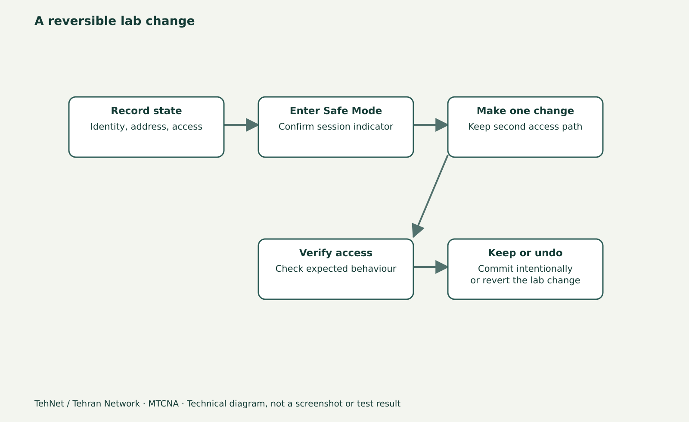

# Supout.rif و The Dude؛ جمع‌آوری شواهد برای عیب‌یابی میکروتیک

> **تهنت / تهران نتورک**: این پیش‌نویس برای مطالعهٔ فارسی و ویدیو آمادهٔ بازبینی است؛ خروجی‌ها و تصاویر، تا زمانی که لاب واقعی اجرا نشود، شاهد فنی یا اسکرین‌شات واقعی نیستند.



*نمودار شماتیک آموزشی؛ تصویر واقعی RouterOS نیست.*

## چرا یک Screenshot از Ping کافی نیست؟
وقتی مسئله تکرارشونده است، باید بتوانید نشان دهید در چه زمان و نسخه‌ای رخ داده، چه توپولوژی و مسیرهایی درگیر بوده‌اند و کدام تغییر واقعاً مشکل را برطرف کرده است. یک گزارش حرفه‌ای شامل Route، Interface، Firewall، Address List، Log بازهٔ رخداد، Timestamp، مدل و نسخهٔ سیستم است. فایل `supout.rif` برای پشتیبانی RouterOS شواهد فنی بیشتری جمع می‌کند؛ اما به تنهایی گزارش قابل ارسال عمومی نیست.

## Supout.rif چیست؟
Supout.rif خروجی باینری اطلاعات اشکال‌زدایی MikroTik است. از WinBox گزینهٔ Make Supout.rif یا از ترمینال فرمان `/system sup-output name=supout.rif` استفاده می‌شود. پس از ساخت، فایل در بخش Files روتر ظاهر می‌شود و می‌توان آن را برای پشتیبانی با روش مجاز دریافت کرد. محتوا شامل تنظیمات، رخدادها و مشخصات فنی است؛ حتی اگر طبق مستندات رمزهای حساس را به صورت مستقیم ذخیره نکند، به دلیل افشای ساختار شبکه و اطلاعات داخلی باید مانند دادهٔ محرمانه با آن برخورد کرد.

## چه زمانی Supout لازم است؟
وقتی Log و Print استاندارد مشکل را توضیح نمی‌دهند، با شرایط کنترل‌شده از Supout استفاده کنید. اگر دستگاه CPU یا Disk کم دارد، ایجاد فایل ممکن است فضای کافی نداشته باشد یا بر عملکرد اثر بگذارد. ابتدا Resource را بخوانید و فقط در دستگاه تحت اختیار با روش امن انجام دهید. فایل خروجی را در GitHub عمومی یا رسانهٔ اجتماعی بارگذاری نکنید.

## The Dude چه کمکی می‌کند؟
The Dude نرم‌افزار مانیتورینگ و ترسیم نقشهٔ شبکه در اکوسیستم MikroTik است. کار اصلی آن جمع‌آوری و مشاهدهٔ تغییر وضعیت سرویس‌ها، دستگاه‌ها و ارتباطات است؛ جایگزین Logic تحلیل مسیر یا گزارش Supout نیست. هنگام اضافه‌کردن Device واقعی، SNMP/Credential با حداقل دسترسی، آدرس‌های مدیریتی داخلی و محافظت از دسترسی داشبورد ضروری‌اند. کشف خودکار شبکه را بدون اجازه روی Subnet مشتری اجرا نکنید.

## الگوی گزارش پنج‌خطی
۱. **مسئله:** چه چیزی برای کدام کاربر و در چه زمانی خراب شد؟ ۲. **دامنه:** کدام Router/VLAN/Interface/Service درگیر است؟ ۳. **شواهد:** Ping/Route/Log/Counter مرتبط چه چیزی نشان می‌دهد؟ ۴. **اقدام:** دقیقاً چه Rule/Address تغییر کرد؟ ۵. **نتیجه و بازگشت:** وضعیت بعد از تغییر و مسیر Undo چیست؟ این قالب به اندازهٔ فایل باینری ارزش دارد زیرا علت و ارتباط منطقی مراحل را قابل پیگیری می‌کند.

## تمرین و معیار پذیرش
در لاب خود خروجی System Resource، Route و Log کوتاه با Timestamp ثبت کنید. یک فایل Supout صرفاً از روتر آزمایشی بسازید، وجود فایل را در Files بررسی و پس از نگهداری امن، نسخهٔ داخل روتر را طبق سیاست آزمایشگاه پاک کنید. در نهایت یک Diagram از دو روتر و دو LAN با IPهای غیرواقعی بسازید. اگر از The Dude استفاده نکرده‌اید، آن را «پیاده‌سازی‌شده» اعلام نکنید؛ معماری‌اش را توضیح دهید.

## نکتهٔ امنیت
در تمام تصاویر آموزشی، نام کاربری واقعی، Token، Serial Number حساس، IP عمومی، رمز، کلیدهای PPP/WireGuard و فایل کامل Supout را منتشر نکنید. حتی با پشتیبانی رسمی هم تنها از مسیر مجاز و امن به اشتراک بگذارید.

## نمونهٔ دستورات برای لاب تحت اختیار

```routeros
/system resource print
/system clock print
/interface print
/ip route print detail
/log print
# In isolated lab, only with free storage and authorization:
/system sup-output name=supout.rif
/file print
```

## اشتباه‌های متداول
- بارگذاری Supout در مخزن عمومی
- اجرای Discovery The Dude روی شبکهٔ بدون مجوز
- ثبت Log بدون زمان یا مقایسه قبل/بعد

## پرسش‌های پرتکرار
**Supout.rif جای Backup را می‌گیرد؟**

خیر؛ ابزار جمع‌آوری دادهٔ عیب‌یابی است، نه راه بازیابی کامل RouterOS.

**آیا The Dude جای RouterOS Firewall را می‌گیرد؟**

خیر؛ برای مانیتورینگ شبکه است و سیاست امنیتی را خودش اجرا نمی‌کند.

## منابع و ادامهٔ درس

- [تمام قسمت‌های MTCNA](/learn/mikrotik/mtcna/)
- [آزمایشگاه](/lab/)
- https://help.mikrotik.com/docs/spaces/ROS/pages/328106/Supout.rif
- https://manual.mikrotik.com/docs/introduction/

**ثبت تحریریه: ۴ نوامبر ۲۰۲۶.** مبنای فعلی نوشتار RouterOS 7.25.1 است؛ نسخهٔ اجراشده و نتیجهٔ آزمایش هنوز ثبت نشده‌اند.
