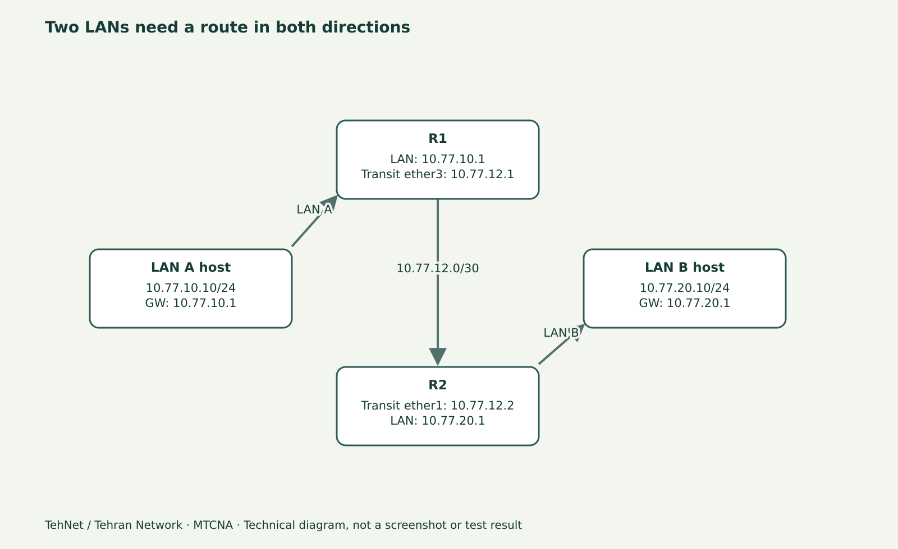

# جمع‌بندی MTCNA: آزمون عملی، چک‌لیست و مسیر یادگیری بعدی

> این درس پایانی مستقل از دورهٔ رایگان «تهنت؛ تهران نتورک» است. هیچ ادعایی دربارهٔ صدور گواهی رسمی MikroTik، اجرای لاب‌های اجرا‌نشده یا تضمین قبولی وجود ندارد. زمان هدف برای ویدیوی توضیحی ۱۰ تا ۱۵ دقیقه است.

*نمودار آموزشی، نه خروجی آزمون عملی.*

## از کجا بفهمیم مباحث را واقعاً یاد گرفته‌ایم؟

دانستن اینکه WinBox، DHCP یا NAT در کدام منو است، به‌تنهایی مهارت پیاده‌سازی شبکه نیست. یک کارآموز باید بتواند در یک لابِ جدا از شبکهٔ تولید، مسیر رفت و برگشت Packet را تحلیل کند، قبل از تغییر Backup و راه برگشت داشته باشد، از یک IP و Subnet درست استفاده کند و بدون حدس کورکورانه علت قطعی را محدود کند.

پروژهٔ نهایی سه‌بخشیِ قسمت‌های ۳۷، ۳۸ و ۳۹ تمام موضوعات پایه را کنار هم قرار داده است. این جلسه یک آزمون **غیررسمی و آموزشی** است؛ نه آزمون اختصاصی یا سؤالات افشا‌شدهٔ مؤسسهٔ سازنده.

## چک‌لیست توانمندی‌ها

- **مدیریت و بازیابی:** می‌توانم نسخهٔ RouterOS، نوع پکیج و Interfaceها را بخوانم؛ Safe Mode، Backup و Export را با هم اشتباه نمی‌گیرم؛ Reset و Netinstall را بدون برنامه روی دستگاه واقعی انجام نمی‌دهم.
- **لایهٔ دو:** می‌توانم نقش Bridge و Port را توضیح دهم و می‌دانم Loop، RSTP و عبور Broadcast چرا مهم‌اند.
- **آدرس و سرویس:** تفاوت DHCP Client و DHCP Server، Lease، DNS و ARP را می‌دانم و برای هرکدام یک روش آزمون دارم.
- **Routing:** می‌دانم Default Route با Route برگشت متفاوت است و صرف وجود یک Route به معنای Active بودن آن نیست.
- **Firewall/NAT:** بین Input و Forward و srcnat/dstnat تفاوت می‌گذارم و قبل از Rule Drop مسیر مدیریت را حفظ می‌کنم.
- **Wireless و Traffic:** بستهٔ `wifi` با `wireless` را براساس سخت‌افزار تشخیص می‌دهم؛ کیفیت RF را بدون رادیوی واقعی ادعا نمی‌کنم؛ Simple Queue و PCQ و اثر FastTrack را می‌فهمم.
- **PPP و عیب‌یابی:** نقش Profile، Secret و Pool را می‌دانم؛ از Ping/Traceroute/Torch/Log برای حدس‌زدایی و از Supout برای گزارش ایمن استفاده می‌کنم.

## دوازده سؤال تمرینی؛ بدون حفظ‌کردن خروجی

۱. اگر WinBox از IP وصل نمی‌شود ولی کنسول سالم است، سه فرضیهٔ کم‌ریسک چیست؟

۲. چرا Bridge روی رابط WAN ممکن است مشکل DHCP و امنیت بسازد؟

۳. در یک Subnet /24، کدام IPها نمی‌توانند آدرس Host عادی باشند و چرا؟

۴. تفاوت Dynamic DHCP Lease با آدرس ثابت روی Interface چیست؟

۵. اگر DNS کار نمی‌کند ولی Ping به IP عمومی موفق است، ابتدا کجا را بررسی می‌کنید؟

۶. اگر R1 به LAN B نمی‌رسد، چرا فقط Default Route کافی نیست؟

۷. اگر Rule فایروال Packet می‌شمارد اما ارتباط Client هنوز قطع است، چه چیزهایی را بررسی می‌کنید؟

۸. چرا Port Forward روی پشت CGNAT به تنهایی دسترسی از اینترنت را فراهم نمی‌کند؟

۹. چه زمانی FastTrack باعث می‌شود Simple Queue نتیجهٔ قابل انتظار ندهد؟

۱۰. چگونه با دو Client و سرور جدا، رفتار PCQ را بدون ساخت عدد آزمایشی بررسی می‌کنید؟

۱۱. اگر PPPoE Session برقرار شد ولی ترافیک LAN عبور نکرد، نقش Route و MTU چیست؟

۱۲. چه چیزی در یک گزارش پشتیبانی بهتر از «اینترنت کار نمی‌کند» است؟

## پاسخ‌های کوتاه برای بازبینی

برای هر سؤال باید بتوانید **وضعیت اولیه، فرضیه، دستور خواندنی یا پنل، نتیجهٔ مورد انتظار، مشاهدهٔ واقعی و روش بازگشت** را از هم جدا کنید. اگر فقط اسم فرمانی مانند `/ip route print` را به یاد دارید اما نمی‌دانید Flagها و Gateway چه می‌گویند، به درس Routing بازگردید. اگر Queue می‌سازید اما نمی‌دانید Packetها از آن عبور می‌کنند یا خیر، نخست توپولوژی و FastTrack را مرور کنید.

## ترتیب ضبط پیشنهادی

در دقیقه‌های ۰ تا ۲ هدف و محدودیت آزمون را توضیح دهید. دقیقهٔ ۲ تا ۶ چک‌لیست هفت‌بخشی را روی نمودار مرور کنید. دقیقهٔ ۶ تا ۱۲ چهار نمونهٔ خطای کلیدی از Routing، Firewall، DHCP و Queue را حل کنید. دقیقهٔ ۱۲ تا ۱۵ روش گزارش‌کردن شواهد و منابع بعدی را جمع‌بندی کنید.

## بعد از MTCNA چه بخوانیم؟

براساس کار خود، دوره‌های پیشرفتهٔ **MTCRE** (Routing)، **MTCTCE** (Traffic Control)، **MTCWE** (Wireless) یا **MTCSE** (Security) می‌توانند انتخاب‌های منطقی باشند؛ برنامهٔ رسمی و پیش‌نیاز گواهی را همیشه از سایت سازنده کنترل کنید. ممکن است برای ساخت شبکهٔ واقعی به لینوکس، امنیت، مانیتورینگ و تمرین عملی بیشتر نیاز داشته باشید.

برای مطالعه و تمرین به [صفحهٔ دوره](/learn/mikrotik/mtcna/)، [آزمایشگاه](/lab/) و [کانال تهران نتورک](https://www.youtube.com/@tehran.network021) مراجعه کنید.

**منبع رسمی:** https://mikrotik.com/training/about و https://manual.mikrotik.com/docs/introduction/

_ویرایش تحریریه: ۴ نوامبر ۲۰۲۶. لاب و اسکرین‌شات واقعی این قسمت هنوز ثبت نشده‌اند._
