# راهنمای تصویری Queue — اصل تصاویر لاب ابری

**VERIFIED_SYNTHETIC_CLOUD_STAGING_NOT_DEPLOYED؛ این راهنما هنوز روی سایت زنده منتشر نشده است.**

[اجرای واقعی](https://github.com/DashSaman/TehNet/actions/runs/42483186544)، source `4d5c3bafaf2d5b856b65625a5eca8f2b67ce4c22`؛ هر12PNG اصلی بدون تغییر پیکسل و با hash کنترل‌شده‌اند. راهنمای Gutenberg، CSS کادرهای نمایشی و manifest فقط برای همان owner67 آماده‌اند؛ scope محدود در همان operator/migrator موجود تکمیل و native/مرورگر/rollback روی fixture ساختگی ابری آزموده شده‌اند؛ رسید و محدودیت runtime در [شواهد staging](../../docs/evidence/2026-11-08/cloud-queue/native-staging.json) آمده‌اند. تصاویر این پیش‌نمایش، اصل بدون کادرند؛ کادر CSS در صفحهٔ staging آزموده شده است؛ [تصویر واقعی موبایل با کادر کلیک](../../docs/evidence/2026-11-08/cloud-queue/staging/callout-67-375-light.png) را ببینید.

## 1. اتصال و انتخاب Queues

در نوار پایین، هویت TN-LAB-R1 و نسخه را بخوانید. مدیریت این لاب از مسیر جداست؛ سپس روی Queues کلیک کنید. نشانی loopback عکس فقط داخل میزبان همین لاب کاربرد دارد.

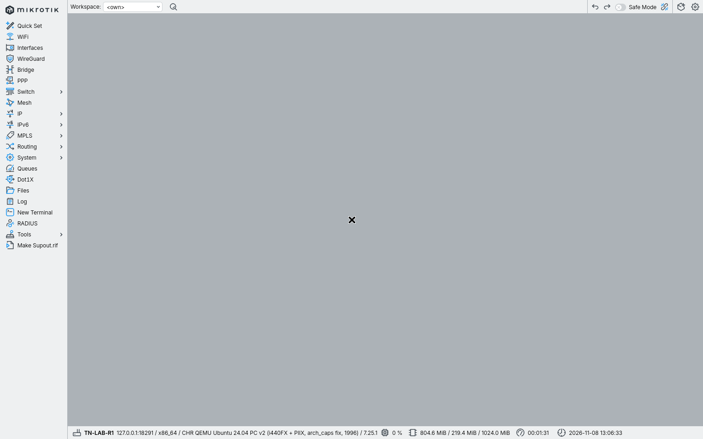

## 2. ساخت صف تازه

در زبانهٔ Simple Queues، جدول اولیهٔ خالی را ببینید و New را بزنید. روی روتر واقعی، خالی‌بودن یا مالکیت هیچ قانون قبلی را فرض نکنید.

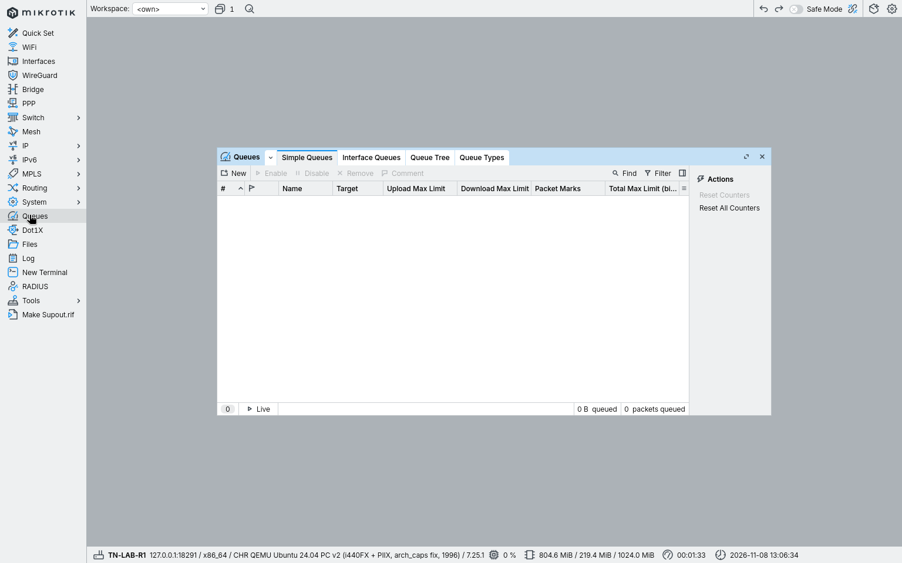

## 3. پیش‌فرض Target را بررسی کنید

در فرم تازه، Name و Target را پیدا کنید. مقدار پیش‌فرض 0.0.0.0/0 را بدون بررسی ذخیره نکنید؛ در این تمرین فقط یک کلاینت هدف است.

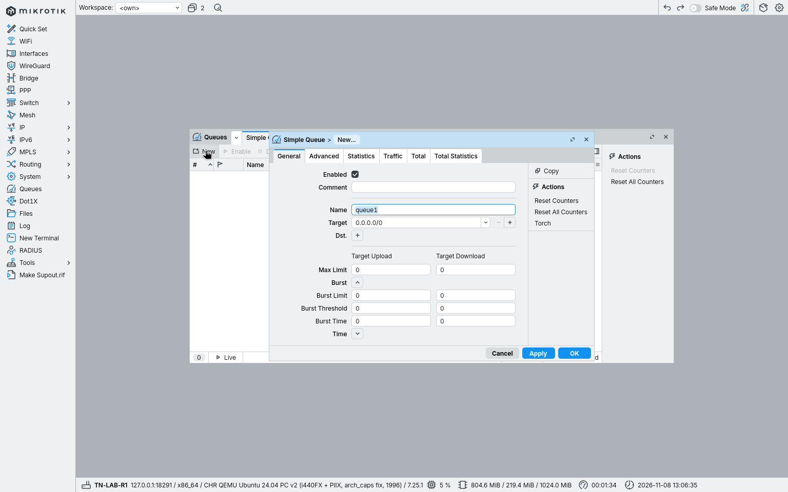

## 4. نام، Target و نشانهٔ مالکیت

در Name مقدار tn-cloud-cap، در Target مقدار 192.0.2.10/32 و در Comment مقدار TN-CLOUD-QUEUE-LAB را وارد کنید. Comment برای تشخیص قانون همین تمرین است.

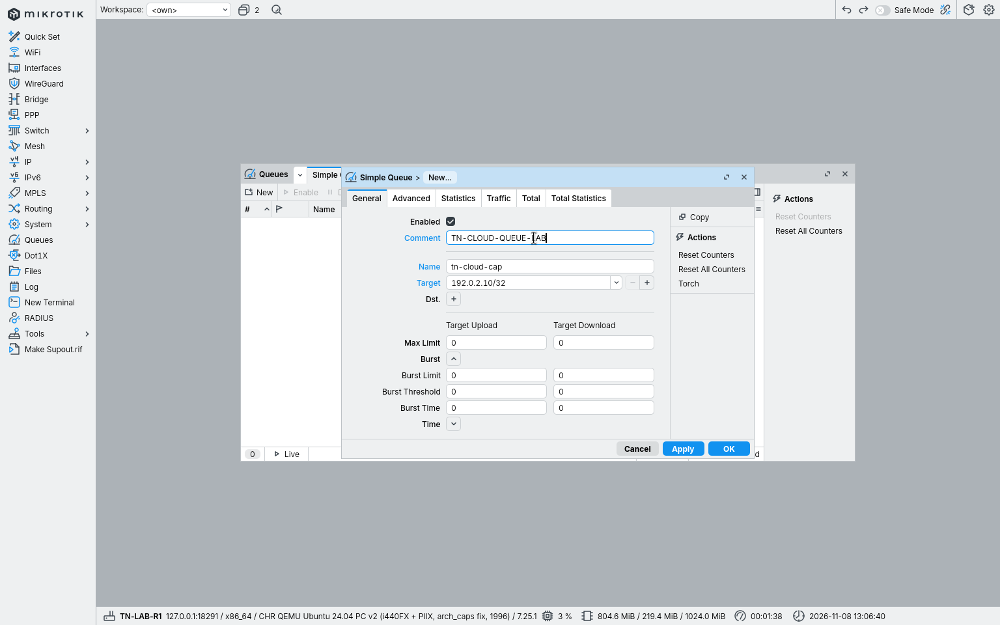

## 5. دو جهت Max Limit

زیر Target Upload مقدار 64k و زیر Target Download مقدار 128k را بنویسید. اولی سقف از Target و دومی سقف به Target است؛ واحد بیت‌برثانیه است. این دو عدد پیشنهاد تنظیم شبکهٔ سازمانی نیستند.

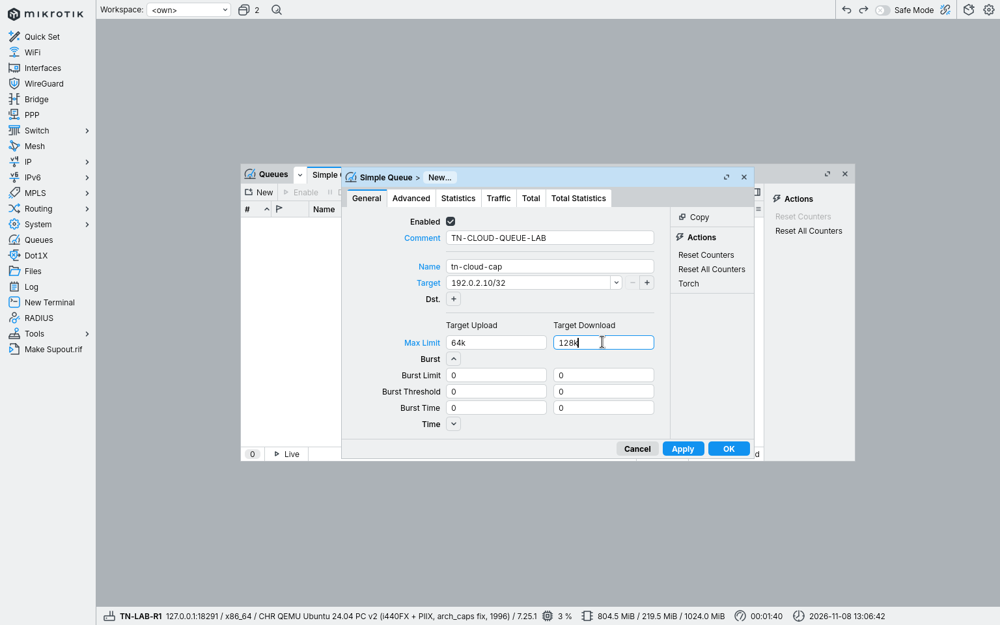

## 6. Apply و بازخوانی مقدار

روی Apply بزنید. نام صف در عنوان فرم و مقادیر ذخیره‌شده را دوباره بخوانید؛ مقدارگذاریِ داخل فرم به‌تنهایی اثبات ذخیره نیست.

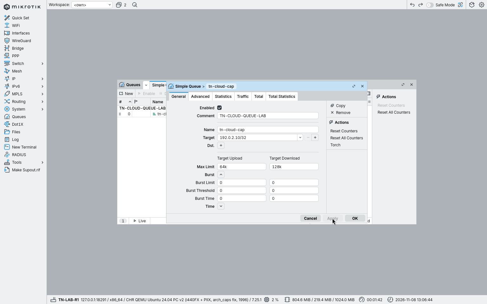

## 7. Statistics و ترافیک همان مسیر

روی Statistics بروید. ترافیک از کلاینت و R2، با مبدأ صریح همان توپولوژی، از R1 عبور داده شده است. Bytes و Dropped را جدا بخوانید؛ missing reply در ping الزاماً Drop صف نیست.

## 8. غیرفعال‌کردن همین صف

به General برگردید، تیک Enabled همین قانون را بردارید و Apply بزنید. همان بار آزمایشی تکرار می‌شود؛ قانون دیگری تغییر نمی‌کند.

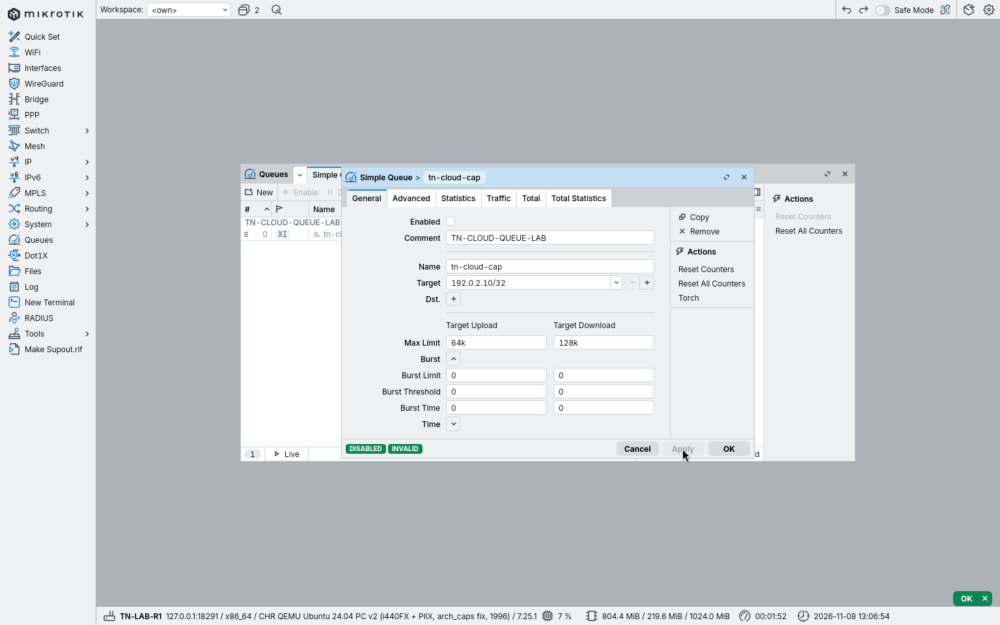

## 9. فعال‌کردن دوباره

تیک Enabled را دوباره بزنید و Apply کنید. مقدار Target و دو سقف باید همان مقدار قبلی بمانند.

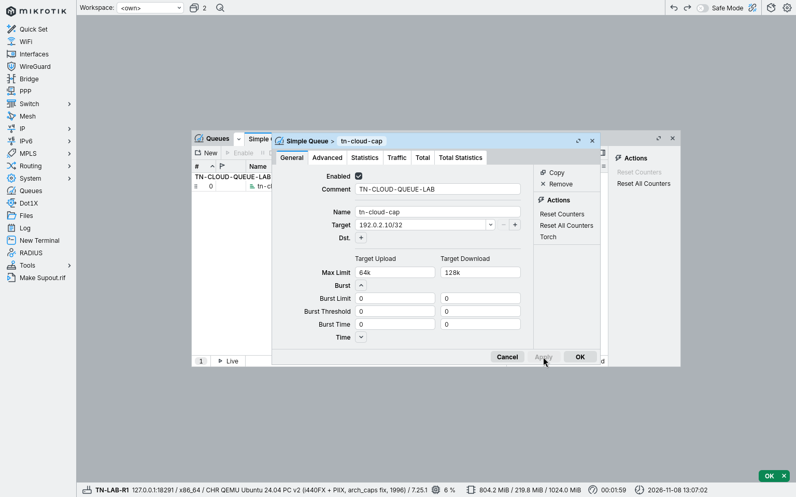

## 10. مقایسهٔ دوبارهٔ شمارنده‌ها

روی Statistics بزنید و افزایش دوبارهٔ Bytes را با حالت غیرفعال مقایسه کنید. نتیجهٔ آزمایش همان برداشت پایین آمده است؛ این تصویر جای تست سرعت اینترنت نیست.

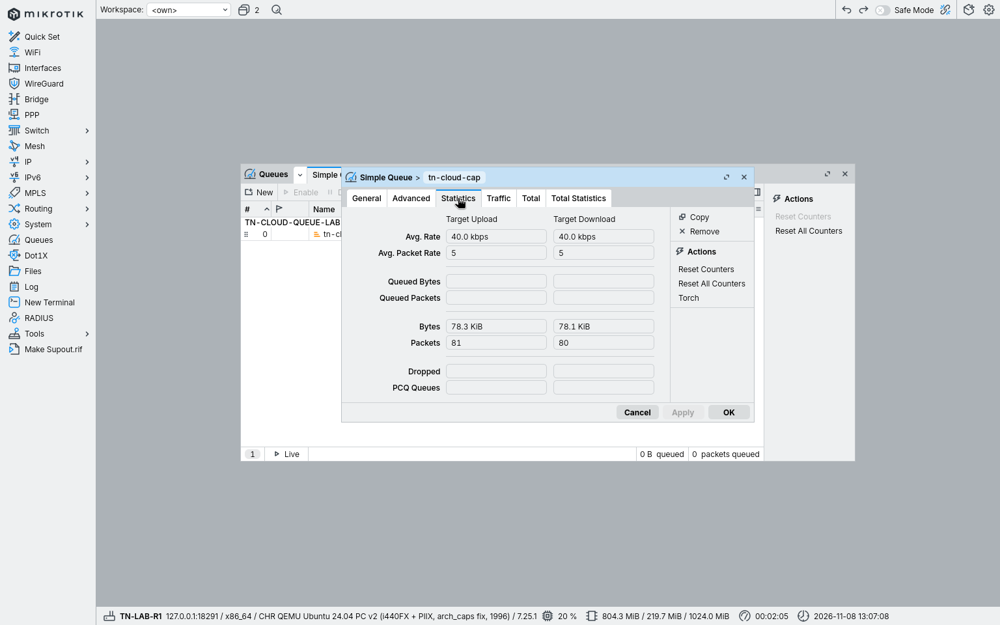

## 11. خواندن ردیف نهایی صف

به General برگردید و OK را بزنید تا ردیف ذخیره‌شده را در جدول ببینید. Name، Target و دو Max Limit را با فرم تطبیق دهید.

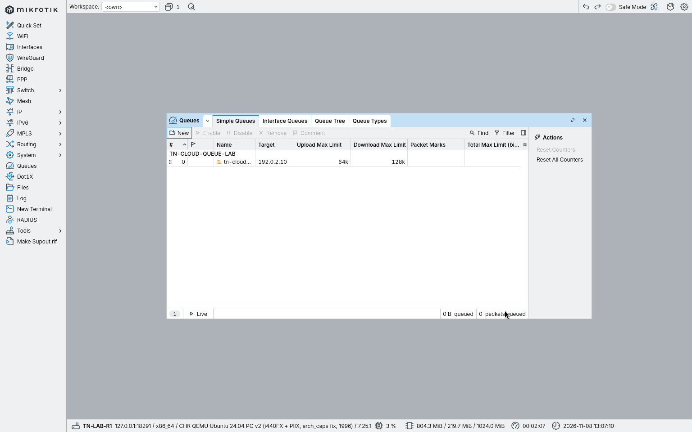

## 12. برگشت از تمرین

برای پایان همین لاب، فقط قانونی با Name و Comment دقیق همین تمرین حذف شد؛ جدول دوباره خالی و مسیر پاسخ و مدیریت دوباره آزموده شدند. فرمان حذف محدود پایین آمده است؛ این کار مجوز حذف قانون‌های شبکهٔ شما نیست.

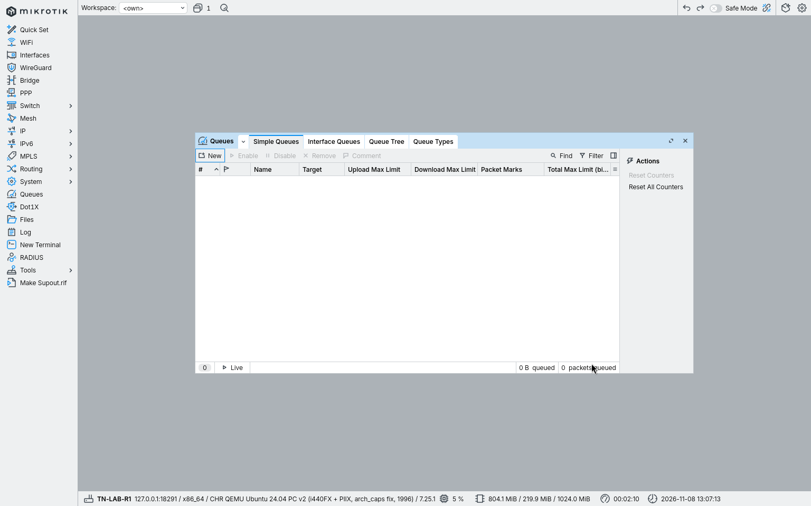

## نتایج واقعی، بدون ادعای نرخ یا ظرفیت

| حالت | کلاینت: پاسخ/20؛ میانگین RTT | R2: پاسخ/20؛ میانگین RTT |
|---|---|---|
| بدون صف | 20/20؛ 1.829ms | 20/20؛ 2.086ms |
| صف فعال | 9/20؛ 25.486ms | 8/20؛ 20.885ms |
| صف غیرفعال | 20/20؛ 2.094ms | 20/20؛ 1.95ms |
| پس از فعال‌سازی دوباره | 8/20؛ 21.311ms | 5/20؛ 41.145ms |

میانگین فقط برای پاسخ‌های دریافت‌شده است. Drop صف در این برداشت0/0 بود؛ missing reply در ping با Queue Drop یکی نیست. نرخ مستقل دریافت qualified نیست. جزئیات کامل در receipt همین بسته است. هیچ صفحه/تصویر production منتشر نشده؛ PR89–91 نیز نیازمند مجوز جدا هستند.
