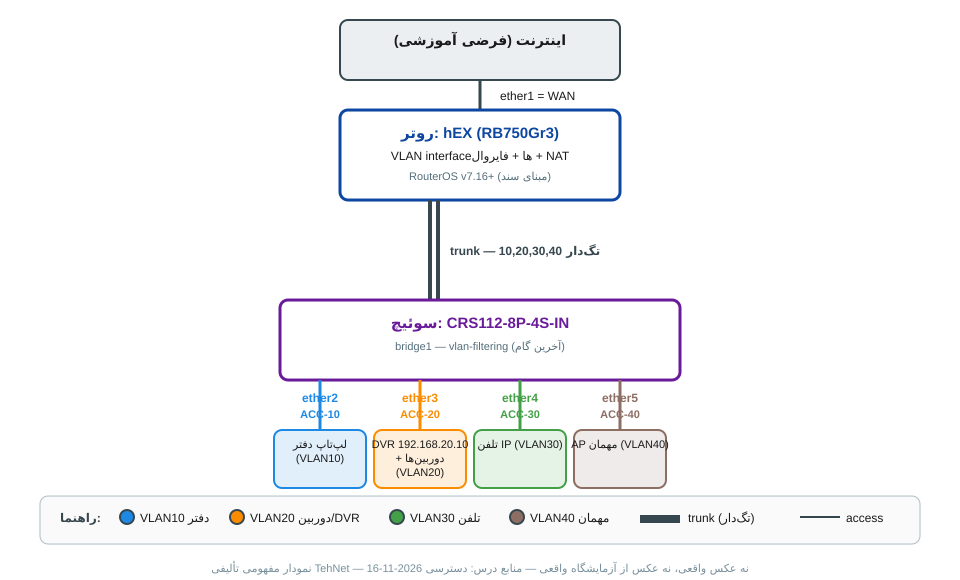

# VLAN برای دفتر کوچک — راهنمای تصویری MikroTik (M2)

> وضعیت درس: **DRAFT / NEEDS_CHANGES → بازنگری‌شده طبق MANAGER_REVIEW 6923833096 — در انتظار مرور.**
> آموزش تصویری از سری MikroTik و routing؛ مخاطب: کارشناس شبکهٔ مبتدی تا متوسط.
> سناریوی کاملاً فرضی و آموزشی با دادهٔ ساختگی؛ هیچ شبکهٔ واقعی دستکاری نشده است.
> نمودارها مفهومی و تألیفی هستند (نه عکس واقعی)؛ اجرای RouterOS این درس NOT_RUN است (بدون fixture مجاز — جدا از بررسی‌های استاتیک).

## پاسخ کوتاه

VLAN ترافیک را روی یک سوئیچ به بخش‌های منطقی جدا می‌کند: کاربران، دوربین، تلفن و مهمان هرکدام VLAN مستقل می‌گیرند. جداسازی، امنیت (جلوگیری از دسترسی بین بخش‌ها) و عیب‌یابی را ساده‌تر می‌کند. پیکربندی درست یعنی: جدول VLAN روی سوئیچ (access/trunk)، VLAN interface روی روتر برای مسیریابی بین VLANها، DHCP server به‌ازای هر VLAN **همراه با تنظیم network آن**، و فایروالی که سیاستِ اعلام‌شده را دقیق پیاده کند. فعال‌سازی vlan-filtering باید **آخرین گام** باشد تا دسترسی مدیریتی از دست نرود.

## پیش‌نیازها

- مبانی روتر و سوئیچ: [مقایسهٔ روترهای میکروتیک (M1)](../articles/mikrotik-routers.fa.md)
- WinBox یا SSH روی روتر و سوئیچ
- یک دستگاه آزمایشی (لپ‌تاپ) برای تست هر VLAN

## مبنا آزمایشگاه (Lab Baseline) — دقیق و کامل

> این بخش، مبنا واحد کل درس است. همهٔ دستورها فقط روی همین مبنا معنا دارند.

### نقش تجهیزات

| نقش | مدل | نرم‌افزار مرجع | توضیح |
|---|---|---|---|
| روتر (مسیریابی بین VLAN + فایروال + NAT) | hEX (RB750Gr3) | RouterOS v7.16 یا جدیدتر | ۵×GbE؛ فایروال stateful روی CPU همین دستگاه اجرا می‌شود |
| سوئیچ (access + trunk + جداسازی L2) | CRS112-8P-4S-IN | RouterOS v7.16 یا جدیدتر | 8×GbE + 4×SFP؛ قابلیت PoE این مدل در این درس استفاده نمی‌شود |
| کلاینت آزمایشی | لپ‌تاپ/موبایل فرضی | — | یک عدد به‌ازای هر VLAN برای تست |

نکتهٔ نگارش مرجع: رفتار «تگ‌شدن خودکار bridge در جدول VLAN» از RouterOS v7.16 سندشده است (به منبع Bridging and Switching زیر). اگر نگارش قدیمی‌تر دارید، عضویت تگ‌شدهٔ bridge را دستی اضافه کنید — در گام مربوط ذکر شده است.

### جدول پورت‌ها (پس از بازنگری)

| دستگاه | پورت | نقش | VLAN | برچسب پورت |
|---|---|---|---|---|
| hEX | ether1 | WAN (به مودم اینترنت) | — | WAN |
| hEX | ether2 | **trunk** به سوئیچ (تگ‌دار 10,20,30,40) | همه | TRUNK |
| hEX | ether3 | بلااستفاده (disabled در پایان کار) | — | — |
| CRS112 | ether1 | **trunk** به روتر (تگ‌دار 10,20,30,40) | همه | TRUNK |
| CRS112 | ether2 | access — کاربران دفتر | 10 | ACC-10 |
| CRS112 | ether3 | access — دوربین‌ها + DVR | 20 | ACC-20 |
| CRS112 | ether4 | access — تلفن IP | 30 | ACC-30 |
| CRS112 | ether5 | access — مهمان (به AP مهمان) | 40 | ACC-40 |
| CRS112 | ether6-8 | بلااستفاده | — | — |

### جدول VLAN و آدرس‌دهی

| VLAN | نام | زیرشبکه | Gateway (روی hEX) | Pool DHCP | رزرو ثابت |
|---|---|---|---|---|---|
| 10 | vlan10-office | 192.168.10.0/24 | 192.168.10.1 | 192.168.10.20-250 | — |
| 20 | vlan20-cctv | 192.168.20.0/24 | 192.168.20.1 | 192.168.20.20-250 | DVR = 192.168.20.10 (lease رزروی) |
| 30 | vlan30-voice | 192.168.30.0/24 | 192.168.30.1 | 192.168.30.20-250 | — |
| 40 | vlan40-guest | 192.168.40.0/24 | 192.168.40.1 | 192.168.40.20-250 | — |

### جای‌گذاری DVR (صریح)

DVR یک دستگاه داخل **VLAN 20** با آدرس رزروی **192.168.20.10** است (lease رزروی DHCP، نه IP دستی). دوربین‌ها هم داخل VLAN 20 هستند و به DVR **در همان زیرشبکه** وصل می‌شوند؛ این ترافیک L2 است و اصلاً از روتر عبور نمی‌کند — بنابراین «اجازهٔ دوربین→DVR» با فایروال اجرا نمی‌شود بلکه با عضویت مشترک VLAN20 تضمین می‌شود و فایروال فقط «عبور دوربین‌ها به بیرون از VLAN20» را می‌بندد.

### سیاست جریان‌ها (مجاز/غیرمجاز) — قرارداد این درس

| جریان | نتیجهٔ موردانتظار | سازوکار اجرا |
|---|---|---|
| دفتر (V10) → اینترنت | مجاز | forward accept به WAN |
| دفتر (V10) → DVR 192.168.20.10 (نمایش تصاویر) | مجاز | forward accept صریح به آن host |
| دفتر (V10) → سایر hostهای VLAN20 (دوربین‌ها) | غیرمجاز | forward drop |
| دفتر (V10) → تلفن‌ها (V30) | غیرمجاز | forward drop |
| دفتر (V10) → مهمان (V40) | غیرمجاز | forward drop |
| دوربین (V20) → DVR (داخل همان VLAN) | مجاز | L2 داخل زیرشبکه — از روتر عبور نمی‌کند |
| دوربین (V20) → هر مقصد بیرون از VLAN20 (شامل اینترنت) | غیرمجاز | forward drop کل subnet |
| تلفن (V30) → اینترنت | مجاز | forward accept به WAN |
| تلفن (V30) → هر مقصد داخلی RFC1918 | غیرمجاز | forward drop |
| مهمان (V40) → اینترنت | مجاز | forward accept به WAN |
| مهمان (V40) → هر مقصد داخلی RFC1918 | غیرمجاز | forward drop |
| مدیریت (WinBox/SSH/Web) از دفتر (V10) | مجاز | input accept از 192.168.10.0/24 |
| تشخیص (ping به خود روتر) از دفتر (V10) | مجاز | input accept ICMP از 192.168.10.0/24 فقط |
| تشخیص (ping به خود روتر) از VLANهای 20/30/40 | غیرمجاز | ICMP accept محدود است → input default drop (تست‌های 8 و 10 همین را انتظار دارند) |
| مدیریت از VLANهای 20/30/40 یا WAN | غیرمجاز | input default drop |

فرض‌های مبنا: تنظیمات کارخانهٔ hEX (کشف‌شده با reset)، بدون هیچ rule سفارشی قبلی؛ در ادامه هر دو زنجیرهٔ filter **کاملاً** با مجموعهٔ بستهٔ این درس جایگزین می‌شوند و NAT بازنویسی می‌شود. سوئیچ CRS112 با تنظیمات کارخانه شروع می‌شود. اگر روتر/سوئیچ شما ruleهای موجود دارد، این درس را روی آن اعمال نکنید — اول ادغام طراحی کنید.



**شرح متنی نمودار (جایگزین تصویر برای دسترس‌پذیری):** اینترنت از بالا به پورت ether1 روتر hEX (برچسب WAN) می‌رسد. از پورت ether2 روتر یک لینک trunk دوخطی به پورت ether1 سوئیچ CRS112 کشیده شده (حامل VLANهای 10/20/30/40 به‌صورت تگ‌دار). سوئیچ چهار پورت access دارد: ether2 به لپ‌تاپ دفتر (VLAN10 آبی)، ether3 به DVR و دو دوربین (VLAN20 نارنجی — DVR با آدرس 192.168.20.10 مشخص شده)، ether4 به تلفن IP (VLAN30 سبز)، ether5 به نقطهٔ دسترسی مهمان (VLAN40 خاکستری). راهنمای رنگ‌ها پایین نمودار آمده و همهٔ برچسب‌های پورت/VLAN در خود تصویر SVG نیز متن دارند.

## گام ۰: پشتیبان و مسیر بازیابی (قبل از هر تغییر)

```routeros
# روی hEX — قبل از هر تغییر:
/system backup save name=pre-vlan
/export file=pre-vlan
```

مسیر بازیابی طبق سند رسمی Bridging and Switching: پل را با `vlan-filtering=no` می‌سازیم و جدول VLAN را **قبل از** فعال‌کردن فیلترینگ کامل می‌کنیم؛ سند رسمی صراحتاً هشدار می‌دهد که فعال‌سازی فوری vlan-filtering می‌تواند دسترسی را قبل از تکمیل پیکربندی قطع کند. در WinBox همچنین «Safe Mode» در دسترس است: تا وقتی فعال است، اگر اتصال شما قطع شود تغییرات به‌خودی‌خود برمی‌گردند. پیکربندی را در Safe Mode اعمال و بعد از تست موفق، تأیید کنید. (Safe Mode قابلیت خود RouterOS است؛ این درس URL جداگانه‌ای برایش ادعا نمی‌کند.)

## گام ۱: سمت سوئیچ — پل، پورت‌ها و جدول VLAN (فیلترینگ هنوز خاموش)

```routeros
# CRS112-8P-4S-IN
/interface bridge
add name=bridge1 vlan-filtering=no protocol-mode=rstp

/interface bridge port
add bridge=bridge1 interface=ether1 frame-types=admit-only-vlan-tagged  # trunk به روتر
add bridge=bridge1 interface=ether2 pvid=10                             # کاربران
add bridge=bridge1 interface=ether3 pvid=20                             # دوربین/DVR
add bridge=bridge1 interface=ether4 pvid=30                             # تلفن
add bridge=bridge1 interface=ether5 pvid=40                             # مهمان

# جدول VLAN — قبل از فعال‌سازی فیلترینگ کامل می‌شود
/interface bridge vlan
add bridge=bridge1 vlan-ids=10 tagged=ether1,bridge1 untagged=ether2
add bridge=bridge1 vlan-ids=20 tagged=ether1            untagged=ether3
add bridge=bridge1 vlan-ids=30 tagged=ether1            untagged=ether4
add bridge=bridge1 vlan-ids=40 tagged=ether1            untagged=ether5
```

`bridge1` در ردیف VLAN10 به‌عنوان تگ‌دار آمده تا interface مدیریتیِ روی پل به CPU سوئیچ دسترسی داشته باشد (رفتار سندشده). از RouterOS v7.16 به بعد این عضویت هنگام ساخت VLAN interface روی پلِ فیلترشونده خودکار می‌شود؛ برای نگارش‌های قدیمی‌تر، `bridge1` را دستی در ستون tagged نگه دارید — همین که در بالا آمده است.

مدیریت سوئیچ — مسیر واقعی، در دو مرحله (قبل و بعد از فیلترینگ):

قبل از فعال‌سازی `vlan-filtering`، پل هنوز PVID و جدول VLAN را اعمال نمی‌کند؛ فریم بی‌تگ لپ‌تاپ روی ACC-10 به interface تگ‌دار `sw-mgmt10` **نمی‌رسد** و تست WinBox به آن در این مرحله دروغین است. مسیر واقعی مدیریتِ این مرحله، یک IP بی‌تگ روی خود پل است:

```routeros
# مرحلهٔ الف — مدیریت موقتِ untagged روی خود پل (فقط تا قبل از فیلترینگ)
/ip address
add address=192.168.10.2/24 interface=bridge1 comment="mgmt موقت untagged — پس از فیلترینگ حذف شود"
/ip route
add dst-address=0.0.0.0/0 gateway=192.168.10.1
```

کلاینت این مرحله: لپ‌تاپ روی ACC-10 با IP دستی **192.168.10.12/24** (DHCP هنوز تعریف نشده و آدرس .12 خارج از pool آیندهٔ 20-250 است). تست: WinBox به **192.168.10.2** باید باز شود.

مسیرهای بازیابی اگر این تست شکست خورد یا دسترسی بعداً قطع شد: WinBox با **MAC address** از طریق Neighbor Discovery (لایهٔ ۲ — مستقل از مسیر IP)، ‏Safe Mode گام ۰، و فایل‌های backup/export همان گام.

فقط در صورت موفقیت مرحلهٔ الف:

```routeros
# مرحلهٔ ب — انتقال مدیریت به مسیر تگ‌دار VLAN10 و سپس فعال‌سازی فیلترینگ
/ip address
remove [find comment="mgmt موقت untagged — پس از فیلترینگ حذف شود"]
/interface vlan
add name=sw-mgmt10 vlan-id=10 interface=bridge1
/ip address
add address=192.168.10.2/24 interface=sw-mgmt10
/interface bridge
set bridge1 vlan-filtering=yes
```

این گام عمداً آخرین گام سمت سوئیچ است — دقیقاً به همان ترتیبی که سند رسمی توصیه می‌کند. از این نقطه مسیر مدیریتی تگ‌دار است: فریم بی‌تگ لپ‌تاپ روی ACC-10 با `pvid=10` تگ می‌شود، تا `bridge1` (عضو تگ‌دار VLAN10 در جدول) می‌رسد و `sw-mgmt10` آن را می‌بیند؛ تست ۱۴ جدول پذیرش همین مسیر را می‌سنجد.

## گام ۲: سمت روتر — VLAN interfaceها و آدرس‌ها

در hEX با تنظیمات کارخانه، ether2 عضو پل `bridge` است؛ VLAN interfaceها را **روی پل** می‌سازیم (نه روی پورت فیزیکی) — مطابق سند رسمی:

```routeros
# hEX (RB750Gr3)
/interface vlan
add name=vlan10-office vlan-id=10 interface=bridge
add name=vlan20-cctv  vlan-id=20 interface=bridge
add name=vlan30-voice vlan-id=30 interface=bridge
add name=vlan40-guest vlan-id=40 interface=bridge

/ip address
add address=192.168.10.1/24 interface=vlan10-office
add address=192.168.20.1/24 interface=vlan20-cctv
add address=192.168.30.1/24 interface=vlan30-voice
add address=192.168.40.1/24 interface=vlan40-guest

/interface list member
add list=LAN interface=vlan10-office
add list=LAN interface=vlan20-cctv
add list=LAN interface=vlan30-voice
add list=LAN interface=vlan40-guest
```

## گام ۳: DHCP به‌ازای هر VLAN — pool + server + **network**

سند رسمی DHCP Server چهار شرط دارد: IP روی interface سرویس‌دهنده (وگرنه server به‌صورت invalid نشان داده می‌شود)، pool (آدرس خود روتر داخل pool نباشد)، تنظیم **network** با پارامترهایی که به کلاینت‌ها می‌رسد، و خود server که interface را به pool گره می‌زند. هر چهار جزء برای هر VLAN:

```routeros
# pools — آدرس gateway هر VLAN داخل pool نیست (رزرو .1 و .10 خارج از محدودهٔ pool)
/ip pool
add name=pool10 ranges=192.168.10.20-192.168.10.250
add name=pool20 ranges=192.168.20.20-192.168.20.250
add name=pool30 ranges=192.168.30.20-192.168.30.250
add name=pool40 ranges=192.168.40.20-192.168.40.250

# network هر VLAN — gateway و DNS برای کلاینت‌ها (گام مکمل اجباری، نه اختیاری)
/ip dhcp-server network
add address=192.168.10.0/24 gateway=192.168.10.1 dns-server=192.168.10.1
add address=192.168.20.0/24 gateway=192.168.20.1 dns-server=192.168.20.1
add address=192.168.30.0/24 gateway=192.168.30.1 dns-server=192.168.30.1
add address=192.168.40.0/24 gateway=192.168.40.1 dns-server=192.168.40.1

# serverها — گره‌زدن interface به pool
/ip dhcp-server
add name=dhcp10 interface=vlan10-office address-pool=pool10 lease-time=8h disabled=no
add name=dhcp20 interface=vlan20-cctv  address-pool=pool20 lease-time=8h disabled=no
add name=dhcp30 interface=vlan30-voice address-pool=pool30 lease-time=8h disabled=no
add name=dhcp40 interface=vlan40-guest address-pool=pool40 lease-time=8h disabled=no

# رزرو DVR — lease رزروی مدیریت‌شده توسط سرور (تفاوتش با IP دستی در M3 توضیح داده می‌شود)
/ip dhcp-server lease
add address=192.168.20.10 mac-address=AA:BB:CC:DD:EE:10 server=dhcp20 comment="DVR (آموزشی)"
```

## گام ۴: NAT و فایروال — مجموعهٔ کامل و بسته

مبنا: هر دو زنجیرهٔ filter **از صفر** بازنویسی می‌شوند (پشتیبان گرفته شد؛ Safe Mode فعال است). ruleها را **به همین ترتیب** وارد کنید؛ هر rule `comment` دارد تا در `/ip firewall filter print` قابل حسابرسی باشد. NAT کارخانه فقط 192.168.88.0/24 را masquerade می‌کند — برای زیرشبکه‌های این درس بازنویسی می‌شود:

```routeros
# NAT — یک rule صریح برای همهٔ زیرشبکه‌های آزمایشگاه
/ip firewall nat
remove [find chain=srcnat]
add chain=srcnat action=masquerade out-interface-list=WAN src-address=192.168.0.0/16 comment="TN-M2 NAT"

# فهرست مقصدهای خصوصی RFC1918 — برای قواعد drop تلفن/مهمان (سیاست «هر مقصد داخلی»)
/ip firewall address-list
add list=TN-M2-private address=10.0.0.0/8 comment="TN-M2 RFC1918"
add list=TN-M2-private address=172.16.0.0/12 comment="TN-M2 RFC1918"
add list=TN-M2-private address=192.168.0.0/16 comment="TN-M2 RFC1918"

# فایروال — جایگزینی کامل (پشتیبان در گام ۰ گرفته شده)
/ip firewall filter
remove [find]

# ---- زنجیرهٔ input ----
add chain=input action=accept connection-state=established,related,untracked comment="TN-M2 est/rel"
add chain=input action=drop connection-state=invalid comment="TN-M2 invalid"
add chain=input action=accept protocol=icmp src-address=192.168.10.0/24 comment="TN-M2 ping/diag فقط از دفتر"
add chain=input action=accept protocol=udp dst-port=67 in-interface-list=LAN comment="TN-M2 DHCP"
add chain=input action=accept protocol=udp dst-port=53 in-interface-list=LAN comment="TN-M2 DNS udp (در M3 مشروط‌تر می‌شود)"
add chain=input action=accept protocol=tcp dst-port=53 in-interface-list=LAN comment="TN-M2 DNS tcp (در M3 مشروط‌تر می‌شود)"
add chain=input action=accept protocol=tcp dst-port=8291 src-address=192.168.10.0/24 comment="TN-M2 winbox فقط دفتر"
add chain=input action=accept protocol=tcp dst-port=22 src-address=192.168.10.0/24 comment="TN-M2 ssh فقط دفتر"
add chain=input action=accept protocol=tcp dst-port=80,443 src-address=192.168.10.0/24 comment="TN-M2 webfig فقط دفتر"
add chain=input action=drop comment="TN-M2 input default drop"

# ---- زنجیرهٔ forward ----
add chain=forward action=accept connection-state=established,related,untracked comment="TN-M2 est/rel"
add chain=forward action=drop connection-state=invalid comment="TN-M2 invalid"
add chain=forward action=accept src-address=192.168.10.0/24 dst-address=192.168.20.10 comment="TN-M2 دفتر→DVR مجاز"
add chain=forward action=drop src-address=192.168.10.0/24 dst-address=192.168.20.0/24 comment="TN-M2 دفتر→سایر VLAN20 ممنوع"
add chain=forward action=drop src-address=192.168.10.0/24 dst-address=192.168.30.0/24 comment="TN-M2 دفتر→تلفن ممنوع"
add chain=forward action=drop src-address=192.168.10.0/24 dst-address=192.168.40.0/24 comment="TN-M2 دفتر→مهمان ممنوع"
add chain=forward action=drop src-address=192.168.20.0/24 comment="TN-M2 دوربین→بیرون VLAN20 ممنوع (دسترسی DVR داخل همان VLAN و L2 است)"
add chain=forward action=drop src-address=192.168.30.0/24 dst-address-list=TN-M2-private comment="TN-M2 تلفن→هر مقصد خصوصی (RFC1918) ممنوع، اینترنت آزاد"
add chain=forward action=drop src-address=192.168.40.0/24 dst-address-list=TN-M2-private comment="TN-M2 مهمان→هر مقصد خصوصی (RFC1918) ممنوع، اینترنت آزاد"
add chain=forward action=accept in-interface-list=LAN out-interface-list=WAN comment="TN-M2 LAN→اینترنت"
add chain=forward action=drop comment="TN-M2 forward default drop"
```

چند نکتهٔ صریح دربارهٔ همین مجموعه:

- «دوربین فقط DVR» با یک rule واحد به‌شکل قدیمی (`dst-address=!192.168.10.0/24`) نوشته نشده — آن نگارش، کل subnet دفتر را مستثنا می‌کرد و هیچ host مشخصی برای DVR تعریف نمی‌کرد. اینجا DVR یک host رزروشدهٔ 192.168.20.10 است و دو rule جدا «اجازهٔ همان host» و «ممنوعیت بقیهٔ VLAN20» را دقیق جدا می‌کنند.
- قواعد تلفن/مهمان با `dst-address-list=TN-M2-private` به **هر سه رنج RFC1918** (10/8، ‏172.16/12، ‏192.168/16) اعمال می‌شوند، نه فقط 192.168 — ادعای «هر مقصد خصوصی ممنوع» واقعاً اجرا می‌شود.
- ICMP ورودی فقط از subnet دفتر مجاز است؛ بنابراین ping به خود روتر از تلفن/مهمان/دوربین در **INPUT** بسته می‌شود — همین چیزی است که تست‌های 8 و 10 انتظار timeout دارند (این بسته‌ها از زنجیرهٔ input می‌گذرند نه forward).
- ترافیک مهمان هم به‌علاوهٔ RFC1918، با default drop انتهایی بسته می‌شود؛ یعنی «فقط اینترنت» به یک rule تکی وابسته نیست.
- ruleها به ایندکس تکیه نمی‌کنند: ترتیب کامل از پیش اعلام شده و آخرین rule صریحاً بسته‌کننده است.

## گام ۵: تست پذیرش — هم مثبت، هم منفی

هر ردیف: یک کلاینت واقعی روی پورت مشخص، یک دستور، و نتیجهٔ موردانتظار. اگر هر ردیف با جدول نخواند، قبل از تأیید Safe Mode متوقف کنید.

| # | کلاینت روی پورت | دستور/عمل | نتیجهٔ موردانتظار | نوع تست |
|---|---|---|---|---|
| 1 | دفتر ACC-10 | `ping 8.8.8.8` و بازکردن یک سایت | موفق | مثبت |
| 2 | دفتر ACC-10 | بازکردن صفحهٔ وب DVR در 192.168.20.10 | موفق | مثبت |
| 3 | دفتر ACC-10 | `ping 192.168.20.21` (یک دوربین) | timeout | منفی |
| 4 | دفتر ACC-10 | `ping 192.168.40.31` (لپ‌تاپ مهمان) | timeout | منفی |
| 5 | دوربین ACC-20 | `ping 192.168.20.10` (DVR) | موفق | مثبت |
| 6 | دوربین ACC-20 | `ping 8.8.8.8` | timeout | منفی |
| 7 | تلفن ACC-30 | `ping 8.8.8.8` | موفق | مثبت |
| 8 | تلفن ACC-30 | `ping 192.168.10.1` | timeout | منفی |
| 9 | مهمان ACC-40 | بازکردن یک سایت | موفق | مثبت |
| 10 | مهمان ACC-40 | `ping 192.168.10.1` و `ping 192.168.20.10` | هر دو timeout | منفی |
| 11 | دفتر ACC-10 | WinBox به 192.168.10.1 | موفق | مثبت |
| 12 | مهمان ACC-40 | WinBox به 192.168.10.1 | رد (input drop) | منفی |
| 13 | هر پورت | `/ip dhcp-server lease print` روی hEX | lease هر VLAN از pool همان VLAN | مثبت |
| 14 | ACC-10 | WinBox به 192.168.10.2 (مدیریت سوئیچ) | موفق | مثبت |

بررسی‌های سمت روتر برای عیب‌یابی:

```routeros
/ip dhcp-server lease print
/ip firewall connection print
/ip firewall filter print stats
```

## عیب‌یابی رایج

| نشانه | علت محتمل | بررسی | راه‌حل |
|---|---|---|---|
| کلاینت اصلاً IP نمی‌گیرد | missing `dhcp-server network` یا server روی interface غلط | `/ip dhcp-server print` (وضعیت invalid؟) + `/ip dhcp-server network print` | network همان subnet با gateway/DNS اضافه شود؛ interface درست باشد |
| IP می‌گیرد ولی اینترنت ندارد | NAT بازنویسی نشده یا ruleهای forward ناتمام | `/ip firewall nat print` + `/ip firewall filter print stats` | rule TN-M2 NAT با src-address=192.168.0.0/16 |
| دسترسی مدیریتی بعد از vlan-filtering قطع شد | جدول VLAN قبل از فعال‌سازی کامل نشده بود | پشتیبان گام ۰ یا Safe Mode | عضویت tagged bridge در VLAN10 را چک/اضافه کنید؛ vlan-filtering را دوباره فقط آخر کار بزنید |
| دوربین‌ها DVR را می‌بینند ولی «قانون فایروال» را نمی‌بینید | طبیعی است | `/ip firewall filter print stats` — شمارندهٔ rule دوربین‌ها فقط برای عبور از روتر می‌شمارد | ترافیک دوربین→DVR داخل VLAN20 و L2 است؛ از روتر عبور نمی‌کند |
| loop/رشد MAC روی سوئیچ | فعال‌سازی فیلترینگ قبل از تکمیل پورت‌ها یا کابل اضافهٔ تصادفی | `/interface bridge monitor bridge1` | RSTP فعال بماند؛ حین پیکربندی فقط مسیر کابلی اعلام‌شده وجود داشته باشد |

## تمرین کوتاه (با پاسخ موردانتظار)

1. اگر فقط `/ip pool` و `/ip dhcp-server` بسازید و `/ip dhcp-server network` را جا بیندازید، کلاینت چه چیزی کم می‌آورد؟ — **پاسخ موردانتظار:** کلاینت gateway و DNS نمی‌گیرد (پارامترهای network همان چیزی است که به کلاینت می‌رسد) و در برخی حالت‌ها server هم invalid نشان داده می‌شود.
2. چرا rule «دوربین فقط به DVR» در فایروالِ این درس دیده نمی‌شود؟ — **پاسخ موردانتظار:** چون دوربین و DVR هر دو در VLAN20 هستند؛ ترافیک‌شان L2 و داخل زیرشبکه است و از روتر عبور نمی‌کند. فایروال فقط عبور دوربین‌ها به بیرون VLAN20 را می‌بندد.
3. چرا vlan-filtering در آخرین گام سمت سوئیچ فعال می‌شود؟ — **پاسخ موردانتظار:** چون فعال‌سازی فوری آن ترافیک را فوراً محدود و امکان قفل‌شدن قبل از تکمیل جدول VLAN را ایجاد می‌کند؛ سند رسمی همین ترتیب را می‌خواهد.
4. در تست ردیف 3، اگر `ping 192.168.20.21` موفق شد، کدام rule کار نکرده؟ — **پاسخ موردانتظار:** `TN-M2 دفتر→سایر VLAN20 ممنوع`؛ با `print stats` شمارندهٔ صفر می‌ماند — معمولاً به‌خاطر جاافتادن rule یا ترتیب نادرست ورود دستی.

## چک‌لیست تحویل

- [ ] پشتیبان backup/export قبل از تغییر گرفته شده و مسیر بازیابی آزموده است
- [ ] سوئیچ: پل با vlan-filtering=no ساخته، جدول VLAN کامل، فیلترینگ آخرین گام بوده
- [ ] روتر: VLAN interfaceها روی پل، آدرس gateway هر VLAN، عضویت LAN برای هر چهار VLAN
- [ ] برای هر VLAN: pool + server + **network** (gateway و DNS) هر سه موجود
- [ ] DVR در VLAN20 با lease رزروی 192.168.20.10 مشخص و مستند
- [ ] NAT با src-address=192.168.0.0/16 بازنویسی شده
- [ ] مجموعهٔ کامل filter با commentهای TN-M2 وارد شده و ۱۴ تست جدول بالا ثبت است (مثبت + منفی)
- [ ] مدیریتی فقط از VLAN10: تست 11/12/14 پاس شده
- [ ] Safe Mode بعد از تست موفق تأیید و پشتیبان پس از تغییر هم گرفته شده

## منابع رسمی (فetched با تاریخ)

- Bridging and Switching — ترتیب vlan-filtering، هشدار قفل‌شدن، عضویت tagged پل، رفتار v7.16: https://manual.mikrotik.com/docs/bridging-and-switching/ (دسترسی 2026-11-16)
- DHCP Server — چهار شرط (IP روی interface، pool، network، server): https://manual.mikrotik.com/docs/network-management/dhcp/server/ (دسترسی 2026-11-16)
- صفحهٔ رسمی hEX (RB750Gr3): https://mikrotik.com/product/hex_r (دسترسی 2026-11-16)
- صفحهٔ رسمی CRS112-8P-4S-IN: https://mikrotik.com/product/crs112_8p_4s_in (دسترسی 2026-11-16)

## آموزش‌های مرتبط و مسیر خدمت

| پیوند | مقصد |
|---|---|
| درس قبلی (پیش‌نیاز مفهومی) | [مقایسهٔ روترهای میکروتیک (M1)](../articles/mikrotik-routers.fa.md) |
| درس بعدی | [DHCP و DNS در MikroTik (M3)](m3-dhcp-dns.fa.md) |
| نقشهٔ کامل سری | [topic map](../topic-map.md) |
| اجرا/کانفیگ VLAN برای سازمان شما | [خدمات میکروتیک TehNet](https://tehnet.ir/services/mikrotik-tehran/) |
| نگهداری دوره‌ای و عیب‌یابی | [خدمات پشتیبانی شبکهٔ تهران](https://tehnet.ir/services/network-support-tehran/) |
