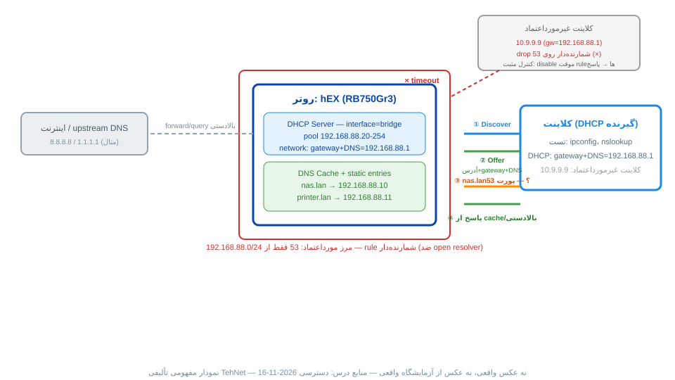

# DHCP و DNS در MikroTik — راهنمای تصویری پیکربندی و عیب‌یابی (M3)

> وضعیت درس: **DRAFT / NEEDS_CHANGES → بازنگری‌شده طبق MANAGER_REVIEW 6923833096 — در انتظار مرور.**
> آموزش تصویری از سری MikroTik و routing؛ مخاطب: کارشناس شبکهٔ مبتدی.
> سناریوی کاملاً فرضی و آموزشی با دادهٔ ساختگی؛ هیچ شبکهٔ واقعی دستکاری نشده است.
> نمودار مفهومی و تألیفی است (نه عکس واقعی)؛ اجرای RouterOS این درس NOT_RUN است (بدون fixture مجاز — جدا از بررسی‌های استاتیک).

## پاسخ کوتاه

DHCP Server روی MikroTik چهار جزء لازم دارد (IP روی interface، pool، تنظیم network، خود server) و DNS Cache سرعت حل نام را بالا می‌برد. با `allow-remote-requests=yes` روتر روی UDP/TCP 53 همهٔ آدرس‌هایش گوش می‌دهد — پس مرزِ «کلاینت مورداعتماد» باید با فایروال تعریف شود وگرنه روتر open resolver می‌شود. اگر دستگاهی IP نمی‌گیرد، ترتیب بررسی: lease فعال است؟ pool هست؟ **network** تعریف شده؟ interface درست گره خورده؟

## پیش‌نیازها — گره‌خورده به همین سناریو

- درس قبل: [VLAN برای دفتر کوچک (M2)](m2-vlan-small-office.fa.md) — مفهوم interface و pool از آنجا می‌آید
- مبانی انتخاب روتر: [مقایسهٔ روترهای میکروتیک (M1)](../articles/mikrotik-routers.fa.md)
- WinBox یا SSH

**قید صریح پیش‌نیاز (بخشی از مبنا):** DHCP server این درس روی interface **`bridge`** بسته می‌شود و gateway کلاینت‌ها **192.168.88.1** است — همان آدرسی که روی `bridge` تنظیم می‌کنیم. اگر IP شما روی interface دیگری است، همهٔ `interface=` و `gateway=` همین درس را با نام همان interface جایگزین کنید؛ بدون این گره‌زدن، هیچ گام این درس معنا ندارد.

## مبنا آزمایشگاه (Lab Baseline) — دقیق و کامل

| نقش | مدل/مقدار | توضیح |
|---|---|---|
| روتر | hEX (RB750Gr3)، RouterOS v7.16+ | تنظیمات کارخانه (reset شده)؛ ether1 در لیست WAN، ether2-5 عضو `bridge` |
| LAN | `bridge` با 192.168.88.1/24 | gateway کلاینت‌ها؛ همان interface که DHCP server کارخانه به آن گره خورده |
| DHCP موجود | server کارخانه (`defconf`) + pool پیش‌فرض (`default-dhcp`، رنج کارخانه 10-254) | این درس آبجکت‌های **موجود** را بازرسی و به‌روز می‌کند — سرور دوم روی همان bridge ساخته نمی‌شود (سند رسمی: یک سرور مستقیم برای کلاینت‌های هر interface) |
| WAN | ether1 به مودم | NAT کارخانه (masquerade 192.168.88.0/24) دست‌نخورده |
| کلاینت آزمایشی | یک لپ‌تاپ DHCP-گیرنده | برای تست‌های مثبت |
| کلاینت «غیرمورداعتماد» | همان لپ‌تاپ با IP دستی 10.9.9.9/24 و gateway=192.168.88.1 | فقط برای تست منفی DNS — فیکسچر کامل در گام ۴ |

### جدول آدرس‌دهی

| مقصد | آدرس | نحوهٔ تخصیص |
|---|---|---|
| روتر (gateway/DNS) | 192.168.88.1 | روی `bridge` — خارج از pool |
| NAS | 192.168.88.10 | **lease رزروی** مدیریت‌شدهٔ DHCP (خارج از pool جدید؛ سرور آن را به دیگری نمی‌دهد) |
| Printer | 192.168.88.11 | lease رزروی مدیریت‌شدهٔ DHCP |
| رنج IP دستی مجاز (فقط در صورت ضرورت) | 192.168.88.2-9 | خارج از pool؛ تخصیص دستی روی دستگاه |
| pool دینامیک (پس از به‌روزرسانی) | 192.168.88.20-254 | همان pool کارخانه با رنج بازنگری‌شده |
| subnet تست منفی (موقت) | 10.9.9.9/24، gateway=192.168.88.1 | کلاینت دستی + مسیر برگشت موقت روی روتر (بعد از تست حذف می‌شود) |



**شرح متنی نمودار (جایگزین تصویر برای دسترس‌پذیری):** سمت راست، لپ‌تاپ کلاینت (DHCP گیرنده). وسط، روتر hEX با دو بلوک داخلی: «DHCP Server (گره‌خورده به bridge، pool 20-254، network با gateway/DNS)» و «DNS Cache + static entries (nas.lan → 192.168.88.10)». سمت چپ، اینترنت/forwardکنندهٔ بالادستی. چهار فلش توالی: (1) Discover از کلاینت، (2) Offer با آدرس+gateway 192.168.88.1+DNS 192.168.88.1، (3) پرس‌وجوی نام کلاینت به 192.168.88.1 روی پورت 53، (4) پاسخ از cache یا بالادستی. یک مرز خط‌چین قرمز «مرز مورداعتماد: 53 فقط از 192.168.88.0/24، با شمارندهٔ default drop» دور بلوک روتر کشیده شده و یک کلاینت خاکستری بیرون مرز نشان داده شده که پرس‌وجویش توسط مرز (acceptهای src-restricted + default drop شمارنده‌دار) بسته می‌شود — و کنترل مثبت مسیر (accept موقتِ فقط-کلاینت‌آزمایشی) سالم بودن رفت‌وبرگشت را جدا از فیلترینگ اثبات می‌کند.

## گام ۰: پشتیبان و بازیابی

```routeros
/system backup save name=pre-dhcp-dns
/export file=pre-dhcp-dns
```

پیکربندی را در Safe Mode وین‌باکس اعمال کنید؛ تا زمان تأیید تست‌ها، قطع اتصال یعنی بازگشت خودکار تغییرات. (Safe Mode قابلیت خود RouterOS است؛ URL جداگانه‌ای برایش ادعا نمی‌شود.)

## گام ۱: DHCP — بازرسی آبجکت‌های کارخانه و به‌روزرسانی همان‌ها

تنظیمات کارخانهٔ hEX روی همین `bridge` یک DHCP server آماده دارد (نام `defconf`، pool پیش‌فرض `default-dhcp` با رنج کارخانه 10-254، و network با gateway/DNS خود روتر). سند رسمی برای کلاینت‌های هر interface یک سرور مستقیم کافی می‌داند؛ پس **server دوم ساخته نمی‌شود** — اول بازرسی، بعد به‌روزرسانی همان آبجکت‌ها:

```routeros
# (۰) بازرسی — خروجی واقعی محیط خودتان را ثبت کنید
/ip dhcp-server print
/ip pool print
/ip dhcp-server network print
/ip dns print

# (۱) IP روی interface سرویس‌دهنده — از قبل روی bridge هست (سرور کارخانه به آن گره خورده)

# (۲) pool — همان default-dhcp با رنج بازنگری‌شده؛ آدرس خود روتر داخل pool نیست
/ip pool
set [find name="default-dhcp"] ranges=192.168.88.20-192.168.88.254 comment="TN-M3"

# (۳) network — همان ردیف؛ gateway/DNS همان آدرس پل که به کلاینت می‌رسد
/ip dhcp-server network
set [find address="192.168.88.0/24"] gateway=192.168.88.1 dns-server=192.168.88.1 comment="TN-M3"

# (۴) server — همان defconf گره‌خورده به bridge (اگر در بازرسی disabled بود، disabled=no کنید)

# رزروهای مدیریت‌شده روی همان server کارخانه (تفاوت با IP دستی: جدول عیب‌یابی)
/ip dhcp-server lease
add address=192.168.88.10 mac-address=AA:BB:CC:DD:EE:10 server=defconf comment="NAS"
add address=192.168.88.11 mac-address=AA:BB:CC:DD:EE:11 server=defconf comment="Printer"
```

اگر نام آبجکت‌ها در بازرسی محیط شما متفاوت بود، `set` را با نام همان آبجکت‌های موجود بزنید — هیچ `add` جدیدی برای pool/server/network در این درس وجود ندارد.

## گام ۲: DNS — cache، forwarder و نام‌های داخلی

```routeros
/ip dns
set servers=8.8.8.8,1.1.1.1 allow-remote-requests=yes cache-size=4096KiB

/ip dns static
add name=nas.lan address=192.168.88.10
add name=printer.lan address=192.168.88.11
add name=router.lan address=192.168.88.1
```

از این لحظه روتر روی **UDP و TCP پورت 53 روی همهٔ آدرس‌هایش** پاسخ می‌دهد — دقیقاً همان رفتاری که سند رسمی DNS هشدارش را می‌دهد: دیوارآتش پیش‌فرض پرس‌وجوهای از اینترنت را می‌اندازد، اما «اگر فایروال خودتان را دارید، خودتان هم drop کنید تا روتر open resolver نشود». گام ۳ همین مرز را می‌سازد.

## گام ۳: مرز DNS مورداعتماد (ضد open resolver)

دو حالت صریح:

**حالت الف — فایروال کارخانه (این مبنا):** زنجیرهٔ input پیش‌فرضِ hEX ترافیک ناشناس از WAN را می‌اندازد؛ پرس‌وجوی 53 از اینترنت پاسخ نمی‌گیرد. هنوز باید پذیرشش را با تست منفیِ گام ۴ (شمارندهٔ drop) ثبت کنید.

**حالت ب — اگر زنجیرهٔ input را جایگزین می‌کنید (مثل رویکرد M2):** مجموعهٔ کامل با قید source:

```routeros
# جایگزینی کامل input (پشتیبان گام ۰ گرفته شده) — فقط بخش مرتبط با 53 و بستن پایانی:
/ip firewall filter
remove [find chain=input]
add chain=input action=accept connection-state=established,related,untracked comment="TN-M3 est/rel"
add chain=input action=drop connection-state=invalid comment="TN-M3 invalid"
add chain=input action=accept protocol=icmp src-address=192.168.88.0/24 comment="TN-M3 ping/diag فقط از subnet مورداعتماد"
add chain=input action=accept protocol=udp dst-port=67 in-interface-list=LAN comment="TN-M3 DHCP"
add chain=input action=accept protocol=udp dst-port=53 src-address=192.168.88.0/24 comment="TN-M3 DNS udp فقط مورداعتماد"
add chain=input action=accept protocol=tcp dst-port=53 src-address=192.168.88.0/24 comment="TN-M3 DNS tcp فقط مورداعتماد"
add chain=input action=accept protocol=tcp dst-port=8291,22 src-address=192.168.88.0/24 comment="TN-M3 winbox/ssh محلی"
add chain=input action=accept protocol=tcp dst-port=80,443 src-address=192.168.88.0/24 comment="TN-M3 webfig محلی"
add chain=input action=drop comment="TN-M3 input default drop (شامل WAN و هر منبع غیرمورداعتماد)"
```

دقت همسان‌سازی: ICMP ورودی فقط از `192.168.88.0/24` پذیرفته می‌شود؛ پس ping کلاینت غیرمورداعتماد به خود روتر (تست ۸) به‌جا timeout می‌گیرد — به‌واسطهٔ rule محدود و default drop، نه نبود مسیر.

**محدودهٔ آزمون منفی — حالت ب فقط:** در حالت الف (فایروال کارخانه) هیچ rule شمارنده‌داری برای 53 وجود ندارد و رفتار کارخانه با منابع LAN لیست‌شده قابل‌شمارش نیست؛ بنابراین آزمون «کلاینت غیرمورداعتماد روی LAN» در حالت الف **قابل‌اجرا نیست** (NOT_APPLICABLE برای این مبنا). آزمون منفیِ حالت الف فقط دربارهٔ منابع سمت اینترنت معنا دارد و اجرای آن نیازمند یک خط آزمایش سمت WAN است که در این درس در دسترس نیست — صادقانه **NOT_RUN** ثبت می‌شود.

بعد از اعمال، شمارندهٔ rule آخر را ببینید:

```routeros
/ip firewall filter print stats where chain=input
```

هر افزایش شمارنده روی ruleهای drop هنگام پرس‌وجوی 53 از منبع غیرمورداعتماد = مرز کار می‌کند.

## گام ۴: تست پذیرش — هم مثبت، هم منفی (سمت کلاینت، نه فقط روتر)

تست سمت روتر (`:resolve`) فقط cache خود روتر را می‌سنجد و **پذیرش سمت کلاینت نیست** — پذیرش با کلاینت واقعی انجام می‌شود.

### فیکسچر کلاینت غیرمورداعتماد — مسیر رفت/برگشت با تنظیم دقیق سمت کلاینت

gateway بیرون از subnet به‌خودی‌خود با «عبارت ARP» برقرار نمی‌شود؛ مسیر باید با تنظیم و احراز صریح سمت کلاینت ساخته شود:

1. کلاینت روی یکی از پورت‌های LAN (مثلاً ether3)، ویندوز، تنظیم دقیق:
   ```bat
   netsh interface ip set address "Ethernet" static 10.9.9.9 255.255.255.0 192.168.88.1
   ```
   یعنی IP=10.9.9.9/24 و **default gateway=192.168.88.1**؛ چون gateway در subnet دیگری است، ویندوز برای هر مقصد از طریق gateway می‌فرستد و next-hop (همان 192.168.88.1) را روی همین لینک ARP می‌کند — روتر چون مالک آن IP روی پل است پاسخ ARP می‌دهد.
2. احراز مسیر سمت کلاینت: `route print -4` باید مسیر `0.0.0.0/0 → 192.168.88.1` روی Ethernet نشان دهد؛ پس از اولین پروب، `arp -a` باید ورودی `192.168.88.1` با MAC روتر را نشان دهد (اثبات لایهٔ ۲).
3. مسیر برگشت روی روتر (موقت — فقط تا پاسخ فرضی بتواند برگردد؛ به‌تنهایی برای رفت کافی نیست):
   ```routeros
   /ip route
   add dst-address=10.9.9.0/24 gateway=bridge comment="TN-M3 مسیر برگشتِ فقط-تست — بعد از تست حذف شود"
   ```

### کنترل مثبت — accept موقتِ فقط-کلاینت‌آزمایشی، قبل از default drop واقعی

کد واقعی زنجیرهٔ input دو **accept** محدود دارد و بستنِ بقیه با default drop آخر است (rule drop جداگانه‌ای برای 53 وجود ندارد). کنترل مثبت یعنی افزودن دو accept موقتِ فقط برای کلاینت آزمایشی، **بلافاصله قبل از همان default drop**.

**نکتهٔ کنسولی الزامی:** متغیر `:local` بین خط‌های تعاملی جدا زنده نمی‌ماند — کل توالی باید در یک بلاک `{ }` قرار گیرد تا متغیرها در scope باقی بمانند. همچنین شمارهٔ ردیف print هویت پایدار rule نیست — هدف باید با comment یکتا **find** شود و قبل از هر add، «دقیقاً یک» هدف وجود داشته باشد (در غیر این صورت fail closed):

```routeros
{
    :local targets [/ip firewall filter find where chain="input" and action="drop" and comment~"TN-M3 input default drop"]
    :if ([:len $targets] != 1) do={ :error "TN-M3: exactly 1 default-drop expected, found [:len $targets] — aborting" }
    /ip firewall filter add chain=input action=accept protocol=udp dst-port=53 src-address=10.9.9.9 comment="TN-M3 کنترل موقت udp — حذف پس از تست" place-before=[:pick $targets 0]
    /ip firewall filter add chain=input action=accept protocol=tcp dst-port=53 src-address=10.9.9.9 comment="TN-M3 کنترل موقت tcp — حذف پس از تست" place-before=[:pick $targets 0]
}
```

با هر دو rule کنترل، پرس‌وجوی کلاینت آزمایشی باید موفق شود (مسیر رفت+برگشت سالم). سپس مرز **بازگردانده می‌شود** (حذف با شمارش و تأیید):

```routeros
{
    :local tmpUdp [:len [/ip firewall filter find where comment~"TN-M3 کنترل موقت udp"]]
    :local tmpTcp [:len [/ip firewall filter find where comment~"TN-M3 کنترل موقت tcp"]]
    :if ($tmpUdp != 1 or $tmpTcp != 1) do={ :error "TN-M3: expected exactly 1 udp + 1 tcp temp rule, found udp=$tmpUdp tcp=$tmpTcp — aborting" }
    /ip firewall filter remove [/ip firewall filter find where comment~"TN-M3 کنترل موقت udp"]
    /ip firewall filter remove [/ip firewall filter find where comment~"TN-M3 کنترل موقت tcp"]
    :local afterUdp [:len [/ip firewall filter find where comment~"TN-M3 کنترل موقت udp"]]
    :local afterTcp [:len [/ip firewall filter find where comment~"TN-M3 کنترل موقت tcp"]]
    :if ($afterUdp = 0 and $afterTcp = 0) do={ :put "TN-M3: boundary restored" } else={ :error "TN-M3: cleanup incomplete — udp=$afterUdp tcp=$afterTcp" }
}
```

اگر گام کنترل ≠ 1 بود یا هر remove چیزی حذف نکرد، **fail closed** — بدون شمارندهٔ قابل‌استناد، timeout قابل‌تفسیر نیست.

**ترتیب تفسیر (الزامی):** تا کنترل مثبت موفق نشده، timeout را اثر فایروال ننامید — timeout بدون کنترل فقط می‌تواند بی‌مسیری باشد.

### تفکیک UDP/TCP و شمارنده‌ها — جریان تازه و دلتای ≥1

- پروب UDP: `nslookup nas.lan 192.168.88.1` (حالت پیش‌فرض UDP)
- پروب TCP: `nslookup -vc nas.lan 192.168.88.1` (پرس‌وجوی TCP — فرمان جدا)
- **یک فرمان ≠ یک بسته:** یک nslookup ممکن است چند پرس‌وجو/تلاش مجدد بسازد و handshake رد‌شدهٔ TCP می‌تواند retransmit داشته باشد — پس وعدهٔ «دقیقاً +1» نادرست است.
- **جریان تازه:** هر فراخوانی nslookup یک فراخوانی جدید است (پورت مبدأ جدید → ورودی conntrack جدید) و مسیر «established/related accept → default drop» را دور نمی‌زند. حذف ruleهای کنترل، وضعیت اتصال‌های قبلی را پاک نمی‌کند — اگر ورودی conntrack قدیمی مشکوک بود، `/ip firewall connection print` را ببینید یا قبل از پروب بعدی همان رخداد را با فراخوانی تازه بسازید.
- **روش دلتا (به‌جای عددمیثاق):** قبل از هر پروب، شمارندهٔ default drop را یادداشت کنید؛ بعد از پروب، دلتای مثبت (≥1) با همان جهت پروتکل = بسته(ها) رسیده و مرز بسته است. بدون دلتا یا بدون کنترل مثبت، timeout قابل‌تفسیر نیست.

جدول تست:

| # | کلاینت | عمل | نتیجهٔ موردانتظار | نوع |
|---|---|---|---|---|
| 1 | لپ‌تاپ DHCP | `ipconfig /all` (ویندوز) | IPv4 از 192.168.88.20-254؛ Gateway=192.168.88.1؛ DHCP Server=192.168.88.1؛ DNS=192.168.88.1 | مثبت |
| 2 | همان کلاینت | `nslookup nas.lan` (بدون تعیین سرور) | 192.168.88.10 از DNS روتر | مثبت |
| 3 | همان کلاینت | `nslookup printer.lan` | 192.168.88.11 | مثبت |
| 4 | همان کلاینت | `nslookup -vc nas.lan` (پروب TCP) | پاسخ TCP | مثبت |
| 5 | همان کلاینت | `nslookup www.google.com` | پاسخ (از cache/بالادستی) | مثبت |
| 6 | کلاینت غیرمورداعتماد (تنظیم فیکسچر بالا) + دو accept کنترل موقت در | پروب UDP و پروب TCP | **هر دو موفق** — اثبات مسیر رفت‌وبرگشت (پیش‌شرط تفسیر هر timeout) | کنترل |
| 7 | همان کلاینت، پس از remove دو rule کنترل | پروب UDP سپس پروب TCP (با فاصله، هرکدام فراخوانی تازه) | هر دو timeout؛ شمارندهٔ default drop برای هر پروب **دلتای مثبت (≥1)** نشان می‌دهد — عددمیثاق «دقیقاً +1» ادعا نمی‌شود | منفی |
| 8 | همان کلاینت | `ping 192.168.88.1` | timeout — ICMP فقط از مورداعتماد (شاهد: رشد شمارندهٔ default drop) | منفی |
| 9 | سمت روتر | `:put [:resolve nas.lan]` | 192.168.88.10 — فقط بررسی cache روتر؛ **به‌جای تست 1-4 نیست** | ابزار |

مشاهدهٔ تکمیلی اختیاری: `/tool sniffer quick port=53 interface=bridge` هنگام پروب‌ها Query رسیده را نشان می‌دهد و پس از بازگرداندن مرز پاسخی خارج نمی‌شود.

### پاک‌سازی پس از تست (الزامی)

```routeros
/ip route
remove [find comment="TN-M3 مسیر برگشتِ فقط-تست — بعد از تست حذف شود"]
```

سمت کلاینت، بازگشت به DHCP:

```bat
netsh interface ip set address "Ethernet" dhcp
```

بررسی‌های روتری برای عیب‌یابی:

```routeros
/ip dhcp-server lease print
/ip dhcp-server print stats
/ip dns cache print
/log print where message~"dhcp"
```

## عیب‌یابی — با تفکیک «رزرو مدیریت‌شده» از «IP دستی»

این تفکیک مهم است: **lease رزروی** یعنی سرور خودش آدرس را برای یک MAC رزرو کرده — تعارض ندارد و خطا نیست، هر جا هم که باشد (داخل یا خارج pool) سرور مالکیتش را می‌شناسد. خطری که وجود دارد **IP دستیِ روی NIC دستگاهِ داخل رنج pool** است: سرور ممکن است همان آدرس را به دستگاه دیگری بدهد و پیام conflict بیاید.

| نشانه | علت محتمل | بررسی | راه‌حل |
|---|---|---|---|
| کلاینت IP نمی‌گیرد | server disabled یا invalid | `/ip dhcp-server print` | اگر invalid: IP روی interface نیست → گام ۱ جزء (۱) |
| کلاینت IP می‌گیرد ولی gateway ندارد | جزء (۳) network تعریف نشده | `/ip dhcp-server network print` | network با gateway/DNS همان subnet |
| «conflicting» روی دستگاه | IP دستی روی NIC داخل رنج pool | `/ip dhcp-server lease print` + آدرس‌های دستی دستگاه‌ها | رزروی کنید (lease) یا IP دستی را به 192.168.88.2-9 ببرید؛ lease رزروی خودش خطا نیست |
| `nas.lan` حل نمی‌شود از کلاینت | DNS کلاینت روی روتر نیست | `ipconfig /all` | در network، `dns-server=192.168.88.1` |
| `nas.lan` حل نمی‌شود حتی از روتر | static entry جا افتاد یا آدرسش با رزرو نمی‌خواند | `/ip dns static print` | نام/آدرس را با جدول آدرس‌دهی هم‌تراز کنید |
| پرس‌وجوی 53 از اینترنت جواب می‌گیرد | فایروال سفارشی بدون drop، یا allow-remote-requests با مرز تعریف‌نشده | شمارنده‌های `/ip firewall filter print stats` | گام ۳ حالت ب را کامل اعمال کنید |
| lease زودخالی می‌شود | lease-time خیلی کوتاه | `/ip dhcp-server print` | 8h یا بیشتر برای LAN پایدار |

## تمرین کوتاه (با پاسخ موردانتظار)

1. کدام جزء از چهار جزء DHCP همان چیزی است که کلاینت به‌عنوان gateway/DNS می‌گیرد؟ — **پاسخ موردانتظار:** جزء (۳) `/ip dhcp-server network`؛ pool فقط مخزن آدرس است.
2. چرا `:put [:resolve nas.lan]` روی روتر «پذیرش» حساب نمی‌شود؟ — **پاسخ موردانتظار:** چون فقط مسیر cache خود روتر را می‌سنجد؛ پذیرش یعنی کلاینت واقعی با تنظیمات دریافتی DHCP به همان نتیجه برسد (تست‌های 1-4).
3. NAS آدرس 192.168.88.30 داخل pool به‌صورت دستی روی NIC گرفته؛ به‌جایش چه کنید؟ — **پاسخ موردانتظار:** یا lease رزروی همان MAC (سرور مالکیت را می‌شناسد) یا انتقال IP دستی به رنج رزرو 192.168.88.2-9؛ رهاکردن IP دستی داخل pool ریسک conflict دارد.
4. چه چیزی روتر را open resolver می‌کند و چه چیزی جلویش را می‌گیرد در حالت ب؟ — **پاسخ موردانتظار:** `allow-remote-requests=yes` روی همهٔ آدرس‌ها روی 53 گوش می‌دهد؛ قید `src-address=192.168.88.0/24` روی acceptهای 53 و default drop انتهایی مانع پاسخ به غیرمورداعتماد (شامل WAN) می‌شود.

## چک‌لیست تحویل

- [ ] پیش‌نیاز گره‌خورده: IP روی `bridge` = 192.168.88.1/24 و همان gateway در network
- [ ] هر چهار جزء DHCP موجود: IP روی interface، pool بدون آدرس خود روتر، network، server
- [ ] رزروها به‌صورت lease مدیریت‌شده (نه IP دستی داخل pool)
- [ ] DNS: forwarder + static entries هم‌تراز با جدول آدرس‌دهی
- [ ] مرز 53: حالت الف (پیش‌فرض) یا ب (src-restricted + default drop) — و تست منفی ثبت‌شده
- [ ] تست‌های 1-5 مثبت، 6 کنترل مسیر و 7-8 منفی روی کلاینت واقعی اجرا و ثبت شده‌اند (شمارندهٔ ruleهای 53-drop ثبت شد؛ اجرای این درس در نویسنده NOT_RUN است)
- [ ] مسیر آزمایشی 10.9.9.0/24 بعد از تست حذف شده
- [ ] پشتیبان قبل/بعد و Safe Mode تأیید شده

## منابع رسمی (fetch شده با تاریخ)

- DHCP Server — چهار شرط اجزا، pool بدون آدرس خود روتر، پلِ خالی: https://manual.mikrotik.com/docs/network-management/dhcp/server/ (دسترسی 2026-11-16)
- DNS — allow-remote-requests و هشدار open resolver، static entries و cache: https://manual.mikrotik.com/docs/network-management/dns/ (دسترسی 2026-11-16)
- Bridging and Switching — VLAN interface روی پل و ترتیب فیلترینگ: https://manual.mikrotik.com/docs/bridging-and-switching/ (دسترسی 2026-11-16)
- صفحهٔ رسمی hEX (RB750Gr3): https://mikrotik.com/product/hex_r (دسترسی 2026-11-16)

## آموزش‌های مرتبط و مسیر خدمت

| پیوند | مقصد |
|---|---|
| درس قبلی (پیش‌نیاز) | [VLAN برای دفتر کوچک (M2)](m2-vlan-small-office.fa.md) |
| مفهوم انتخاب روتر | [مقایسهٔ روترهای میکروتیک (M1)](../articles/mikrotik-routers.fa.md) |
| نقشهٔ کامل سری | [topic map](../topic-map.md) |
| عیب‌یابی/کانفیگ DHCP-DNS سازمان شما | [خدمات میکروتیک TehNet](https://tehnet.ir/services/mikrotik-tehran/) |
| درس‌های بعدی سری (M4 inter-VLAN، M5 VPN، M6 dual-WAN) | در نوبت‌های بعد تولید می‌شوند — فعلاً فقط در [topic map](../topic-map.md) |
