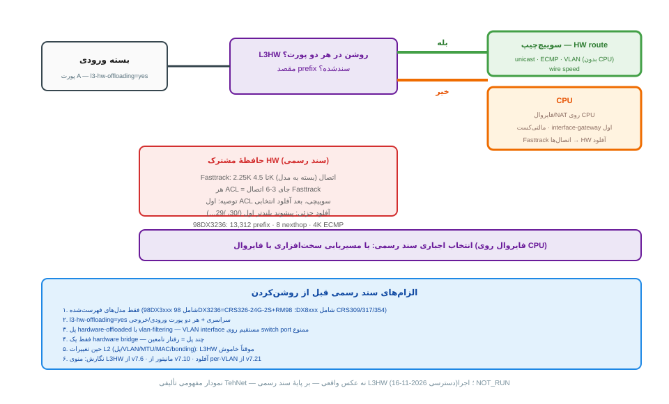

# inter-VLAN و L3HW — مسیریابی سخت‌افزاری و مرزهای آن (M4)

> وضعیت درس: **DRAFT / NOT_DEPLOYED — در انتظار مرور.**
> آموزش تصویری از سری MikroTik؛ مخاطب: کارشناس شبکهٔ ارشد.
> سناریوی کاملاً فرضی و آموزشی با دادهٔ ساختگی؛ هیچ شبکهٔ واقعی دستکاری نشده و هیچ اجرای واقعی NOT_RUN است.
> نمودار مفهومی و تألیفی است (نه عکس واقعی).

## پاسخ کوتاه

inter-VLAN یعنی مسیریابی بین VLANها روی روتر (الگوی M2 — همهٔ ترافیک بین-VLAN از CPU روتر می‌گذرد). ‏L3HW روی بعضی سوئیچ‌های CRS3xx همان مسیریابی را به **سوییچ‌چیپ** می‌سپارد تا سرعت سیم (wire speed) ممکن شود — اما سه الزام سندشده دارد: فقط روی مدل‌های فهرست‌شده، روی پلِ vlan-filtering با ‏L2HW فعال، و **انتخاب بین فایروال یا مسیریابی سخت‌افزاری** (فایروال روی CPU اجرا می‌شود). بدون خواندن این مرزها، ‏L3HW روشن‌کردن یک کلید خطرناک است نه بهینه‌سازی.

## پیش‌نیازها

- ساخت VLAN: [VLAN برای دفتر کوچک (M2)](m2-vlan-small-office.fa.md)
- مقایسهٔ سوئیچ‌ها: [S1](../articles/mikrotik-switches-crs.fa.md) · بودجهٔ توان: [S2](s2-poe-budget.fa.md)

## مبنا آزمایشگاه (Lab Baseline) — دقیق و کامل

| بند | مقدار فرضی |
|---|---|
| سوئیچ | CRS326-24G-2S+RM — چیپ ‏98DX3236 (در فهرست پشتیبانی‌شدهٔ ‏L3HW سند رسمی) |
| ‏VLANها | 10 دفتر ‏(192.168.10.0/24) · ‏20 دوربین ‏(192.168.20.0/24) — همان الگوی M2 |
| مسیریابی بین-VLAN | روی خود سوئیچ با ‏L3HW (به‌جای روتر جدا) — سناریوی این درس |
| نگارش مبنا | RouterOS v7.16+ (منوی ‏L3HW از ‏v7.6؛ مانیتور از ‏v7.10 — سند رسمی) |
| اجرای واقعی | **NOT_RUN** — همهٔ دستورها روال سندشده‌اند |

## HW در برابر CPU — چه چیزی سخت‌افزاری می‌شود؟

| ترافیک/مسیر | سند رسمی |
|---|---|
| ‏IPv4/IPv6 unicast، ‏ECMP، ‏blackhole، پل‌ها، ‏VLAN، ‏bonding ‏(802.3ad/balance-xor) | **HW** |
| مالتی‌کست ‏IPv4/IPv6 | ‏CPU |
| مسیرهای interface-gateway | اول ‏CPU (حل ‏ARP) سپس ‏HW |
| ‏Firewall/NAT | روی ‏CPU؛ اتصال‌های ‏Fasttrack به ‏HW آفلود می‌شوند (شامل NAT) |
| همراه با ‏L3HW ناممکن | ‏MLAG، ‏VRF، ‏VRRP، ‏CB/PE، ‏Traffic-Flow |

## شش الزام/هشدار سندشده — قبل از روشن‌کردن

| # | الزام/هشدار |
|---|---|
| ‏۱ | فقط مدل‌های فهرست‌شده: سری ‏98DX3xxx ‏(شامل ‏98DX3236 → ‏CRS326-24G-2S+) و ‏98DX8xxx/98DX4xxx/98DX325x ‏(CRS309/312/317/354/…) — مدل بیرون فهرست = بدون ‏L3HW |
| ‏۲ | روشن بودن هم‌زمان سراسری و per-port: ترافیک فقط وقتی ‏HW-route می‌شود که **هر دو پورت ورودی و خروجی** فعال باشند |
| ‏۳ | ‏L3HW روی ‏L2HW سوار است → پل باید ‏hardware-offloaded و **vlan-filtering** داشته باشد؛ و **«VLAN interface مستقیم روی switch port ندهید»** |
| ‏۴ | فقط **یک hardware bridge**؛ چند پل «ممکن است رفتار نامعین ایجاد کند» |
| ‏۵ | حین تغییرات لایهٔ 2 (پل/VLAN/MTU/MAC/bonding) توصیهٔ رسمی: ‏L3HW را موقتاً خاموش کنید |
| ‏۶ | انتخاب اجباری: **یا مسیریابی سخت‌افزاری یا فایروال** — ruleهای فایروال روی CPU اجرا می‌شوند؛ Fasttrack اتصال‌ها (با ‏NAT) را به ‏HW می‌سپارد |

## تلهٔ Fasttrack و حافظهٔ ACL — سند رسمی

- حافظهٔ ‏Fasttrack سخت‌افزاری کوچک است: از ‏2.25K تا ‏4.5K اتصال (بسته به مدل) و با حافظهٔ ‏ACL شریک است: «یک rule ‏ACL می‌تواند حافظهٔ ‏3-6 اتصال ‏Fasttrack را اشغال کند».
- توصیهٔ رسمی: «همیشه تا حد ممکن از ‏Switch Rules ‏(ACL) استفاده کنید»؛ اول ترافیک ‏CPU را با ACL کم کنید، بعد فقط انتخابی با ruleهای `hw-offload=yes/no` آفلود کنید.
- آفلود جزئی: وقتی حافظهٔ HW پر شود، فقط routeهای با پیشوند بلندتر (/30، /29، …) آفلود می‌شوند و پیشوندهای کوتاه روی ‏CPU می‌مانند — با `suppress-hw-offload` و routing filter قابل تنظیم.
- سقف‌های نمونهٔ سندشده: ‏98DX3236: ‏13,312 پیشوند ‏IPv4/IPv6، ‏8 nexthop، ‏4K مسیر ‏ECMP؛ ‏CRS317 ‏(98DX8216): تا ‏240K مسیر ‏IPv4، ‏64K host، ‏8K nexthop، ‏4.5K ‏Fasttrack.
- نکتهٔ مدیریتی: روی ‏98DX8xxx/98DX4xxx/98DX325x با روشن‌بودن ‏L3HW، ‏MAC telnet قطع می‌شود مگر با rule ‏ACL پورت ‏UDP ‏20561 به ‏CPU هدایت شود.

## دستورهای مبنا (روال سندشده — اجرا NOT_RUN)

```routeros
# ۱) L2HW پایه: پل vlan-filtering (الگوی M2/N4) — و نه VLAN interface روی switch port
/interface bridge set bridge vlan-filtering=yes hw=yes

# ۲) روشن‌کردن L3HW سراسری و per-port
/interface ethernet switch set 0 l3-hw-offloading=yes
/interface ethernet switch port set 0-23 l3-hw-offloading=yes

# ۳) مانیتور پس از اعمال (v7.10+)
/interface ethernet switch l3-hw-offloading print stats
```

در حین تغییرات لایهٔ 2: `set 0 l3-hw-offloading=no` → تغییر → بازگشت (الزام ۵).

## تصمیم‌گیری — کِی ‏L3HW و کِی نه؟

| وضعیت | انتخاب سندشده‌وار |
|---|---|
| بین-VLAN سنگین بین دو VLAN با پل سالم و مدل فهرست‌شده | ‏L3HW + ‏ACL سوییچی برای بستن‌ها |
| نیازمند ruleهای فایروال پیچیده بین VLANها | فایروال روی CPU (یا نصف‌کردن: بخش HW با ACL، بخش policy روی CPU) |
| ‏MLAG/VRF/VRRP لازم است | ‏L3HW جواب نیست (سند رسمی: همراه این‌ها ناممکن) |
| مدل بیرون فهرست | مسیر روتر جدا (الگوی M2) |



**شرح متنی نمودار (جایگزین تصویر برای دسترس‌پذیری):** بسته از پورت A وارد سوئیچ می‌شود؛ اگر ‏L3HW روشن و هر دو پورت عضو باشند و مقصد یک پیشوند سندشده باشد، سوییچ‌چیپ مسیر را در HW انجام می‌دهد (مسیر سبز — بدون CPU). در غیر این صورت به CPU می‌رود: فایروال/NAT/مسیرهای باقی (مسیر نارنجی). حاشیهٔ نمودار: جعبهٔ «یا HW-روت یا فایروال» و جعبهٔ حافظهٔ مشترک ‏Fasttrack/ACL. برچسب «تألیفی/مفهومی».

## خطاهای رایج

| نشانه | علت محتمل | بررسی | راه‌حل |
|---|---|---|---|
| ‏L3HW روشن ولی بین-VLAN از ‏CPU می‌رود | یکی از دو پورت per-port خاموش؛ یا پل بدون vlan-filtering/hw | مانیتور ‏v7.10 | الزام‌های ۲ و ۳ |
| ‏VLAN interface روی switch port ساخته‌اید | نقض الزام ۳ | `/interface vlan print` | VLAN interface روی پل (الگوی M2) |
| فایروال بین VLANها اثر نمی‌کند | فایروال روی CPU است؛ ترافیک HW از آن رد نمی‌شود | انتخاب طراحی | ACL سوییچی یا کنارگذاشتن ‏HW برای آن ترافیک |
| ‏Fasttrack‌ها افت کردند بعد از افزودن ‏ACL | حافظهٔ مشترک ‏HW | شمارش ruleها | کاهش ACL / اولویت‌دهی (توصیهٔ رسمی) |
| ‏MAC telnet قطع شد (98DX8xxx…) | رفتار سندشده با ‏L3HW | سند رسمی | rule ‏ACL برای ‏UDP ‏20561 به ‏CPU |
| بعضی prefixها روی CPU مانده‌اند | آفلود جزئی با پرشدن حافظه | مانیتور | suppress-hw-offload/routing filter |

## تمرین کوتاه (با پاسخ موردانتظار)

1. روی CRS326-24G-2S+RM ‏L3HW ممکن است؟ مبنای شما؟ — **پاسخ موردانتظار:** بله؛ چیپ ‏98DX3236 در فهرست پشتیبانی سند رسمی است.
2. قانون «هر دو پورت» چیست؟ — **پاسخ موردانتظار:** ترافیک فقط وقتی ‏HW-route می‌شود که ورودی و خروجی هر دو `l3-hw-offloading=yes` داشته باشند.
3. بین ‏L3HW و ruleهای فایروال پیچیده چه تعارضی هست؟ — **پاسخ موردانتظار:** فایروال روی CPU اجراست؛ سند رسمی می‌گوید باید انتخاب کنید — یا HW-روت یا فایروال؛ ترکیب با ‏Fasttrack/ACL ظریف است.
4. یک ACL تازه اضافه کردید و اتصال‌های Fasttrack کم شدند؛ چرا؟ — **پاسخ موردانتظار:** حافظهٔ HW مشترک است؛ هر ‏ACL معادل ‏3-6 اتصال ‏Fasttrack جا می‌گیرد (سند رسمی).

## چک‌لیست تحویل

- [ ] مدل در فهرست پشتیبانی سند رسمی است (چیپ چک شده)
- [ ] پل: hardware-offloaded + vlan-filtering؛ بدون ‏VLAN interface روی switch port
- [ ] فقط یک hardware bridge
- [ ] ‏L3HW سراسری + per-port هر دو فعال
- [ ] تصمیم فایروال-یا-مسیریابی مستند شده (نه هر دو بی‌تصمیم)
- [ ] حافظهٔ ‏Fasttrack/ACL در نظر گرفته شده
- [ ] حین تغییرات L2، ‏L3HW موقتاً خاموش شده
- [ ] مانیتور ‏v7.10+ اجرا و خروجی ثبت شده (اجرای واقعی NOT_RUN — مبنا فرضی)

## منابع رسمی (fetch شده با تاریخ)

- ‏L3 Hardware Offloading — فهرست دستگاه‌ها/چیپ‌ها، الزام پل و per-port، ‏HW/CPU، فایروال/فاست‌ترک، حافظهٔ مشترک ‏ACL، آفلود جزئی، نگارش‌ها: https://help.mikrotik.com/docs/display/ROS/L3+Hardware+Offloading (دسترسی 2026-11-16)
- Packet Flow (کدام زنجیره): https://manual.mikrotik.com/docs/firewall-and-quality-of-service/packet-flow-in-routeros/ (دسترسی 2026-11-16)
- Bridging and Switching (الگوی پل/VLAN): https://manual.mikrotik.com/docs/bridging-and-switching/ (دسترسی 2026-11-16)

## آموزش‌های مرتبط و مسیر خدمت

| پیوند | مقصد |
|---|---|
| درس‌های مرتبط | [M2 VLAN](m2-vlan-small-office.fa.md) · [S1 سوئیچ‌ها](../articles/mikrotik-switches-crs.fa.md) · [S3 ماژول‌ها](s3-sfp-dac-fiber.fa.md) |
| نقشهٔ کامل سری | [topic map](../topic-map.md) |
| طراحی L3 و ‏L3HW برای سازمان شما | [خدمات میکروتیک تهران](https://tehnet.ir/services/mikrotik-tehran/) |
| درس بعدی سری | M5 — انتخاب VPN برای شعبه (تولید در نوبت بعدی؛ فعلاً فقط در topic map) |
