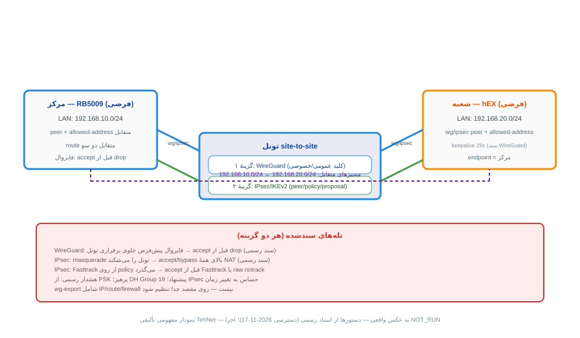

# انتخاب VPN برای شعبه — WireGuard یا IPsec؟ (M5)

> وضعیت درس: **DRAFT / NOT_DEPLOYED — در انتظار مرور.**
> آموزش تصویری از سری MikroTik؛ مخاطب: مدیر IT و کارشناس شبکه.
> سناریوی کاملاً فرضی و آموزشی با دادهٔ ساختگی؛ هیچ شبکهٔ واقعی دستکاری نشده و هیچ اجرای واقعی NOT_RUN است.
> نمودار مفهومی و تألیفی است (نه عکس واقعی).

## پاسخ کوتاه

در RouterOS v7 دو گزینهٔ سندشدهٔ اصلی برای site-to-site شعبه: **WireGuard** (سند رسمی: «ساده، سریع و مدرن»؛ تنظیم با کلید عمومی/خصوصی و allowed-address؛ مناسب لینک اختصاصی دو سرِ RouterOS) و **IPsec/IKEv2** (استاندارد سازمانی؛ برای هم‌جوشی با تجهیزات multi-vendor و نیاز به policy-based). سه پرسش انتخاب: دستگاه‌های دو سر چی‌اند؟ آیا استاندارد/سیاست سازمانی فیلتر دارد؟ چه چیزی وسط مسیر است (NAT/آدرس دینامیک)؟ ‏L2TP/SSTP/OpenVPN فقط برای سازگاری کلاینت‌های خاص — خارج دامنهٔ این درس.

## پیش‌نیازها

- مسیر و VLAN: [M2](m2-vlan-small-office.fa.md) · مسیر رخداد برای قطع تونل: [N6](n6-incident-path.fa.md)

## مبنا آزمایشگاه (Lab Baseline) — دقیق و کامل

| بند | مقدار فرضی |
|---|---|
| دفتر مرکزی | RB5009 فرضی، ‏RouterOS v7.16+، ‏LAN ‏192.168.10.0/24 |
| شعبه | hEX فرضی، ‏RouterOS v7.16+، ‏LAN ‏192.168.20.0/24 |
| هدف | دسترسی متقابل شبکه‌ها از طریق تونل (site-to-site) |
| اجرای واقعی | **NOT_RUN** — دستورها روال سندشده‌اند |

## جدول مقایسه — فقط از اسناد رسمی (fetch ‏2026-11-17)

| بند | WireGuard (سند رسمی) | IPsec (سند رسمی ‏v7.26) |
|---|---|---|
| توصیف رسمی | «simple, fast, and modern»; «faster, simpler, and leaner than IPsec, and considerably more performant than OpenVPN» | چانه‌زنی دو‌فازی ‏IKE؛ ‏IKEv2 با تغییر `exchange-mode=ike2` |
| کلید/احراز | جفت کلید خودکار هنگام ساخت interface؛ ‏peer با کلید عمومی طرف مقابل | ‏Peer + Policy + Proposal؛ هشدار رسمی: «از ‏PSK پرهیز کنید» (حملهٔ آفلاین)؛ پیشنهاد: ‏DH ‏Group ‏19؛ ‏Group ‏2 با احتیاط |
| مسیر ترافیک به تونل | IP روی interface ‏wireguard + route به `gateway=wireguard1` با ‏allowed-address | ‏policy با `tunnel=yes action=encrypt` و src/dst subnet؛ ترتیب policy مهم است |
| تله‌های سندشده | «فایروال پیش‌فرض RouterOS جلوی برقراری تونل را می‌گیرد» → accept قبل از drop؛ ‏wg-export شامل IP/route/firewall نیست؛ در ‏multi-WAN handshake دو اتصال جدا دیده می‌شود (گزینهٔ responder) | ‏Masquerade تونل را می‌شکند → rule accept قبل از همهٔ NAT؛ «اگر ‏Fasttrack فعال باشد بسته از policyهای IPsec می‌گذرد» → accept قبل از Fasttrack یا raw notrack (~30٪ کاهش CPU)؛ حساسیت شدید به تغییر زمان |
| شتاب سخت‌افزاری | — (روی CPU) | «شتاب‌دهی سخت‌افزاری رمزنگاری با موتور داخل CPU» — پشتیبانی وابسته به CPU (جدول per-CPU سند رسمی) |
| حالت مبتنی بر مسیر | ذاتاً route-based | ‏XFRM interfaces ‏(MTU پیش‌فرض ‏1400؛ flag بعد از برقراری ‏SA) — امکان OSPF روی تونل |

## مثال کارشده — اسکلت WireGuard site-to-site (روال سندشده؛ اجرا NOT_RUN)

```routeros
# دفتر مرکزی (192.168.10.0/24)
/interface wireguard
add name=wg-branch listen-port=13231 comment="TN-M5 مرکز"
/ip address
add address=10.255.255.1/30 interface=wg-branch
:put [/interface/wireguard/get [find name=wg-branch] public-key]
# کلید عمومی بالا را در تنظیم peerِ شعبه بگذارید

/interface wireguard peers
add interface=wg-branch public-key="<public-key شعبه>" \
    allowed-address=192.168.20.0/24,10.255.255.2/32 \
    endpoint-address="<آدرس عمومی شعبه>" endpoint-port=13231 \
    persistent-keepalive=25s comment="TN-M5 شعبه"
/ip route
add dst-address=192.168.20.0/24 gateway=wg-branch comment="TN-M5"
# فایروال: accept برایwg-branch قبل از هر drop (سند رسمی)
```

```routeros
# شعبه (192.168.20.0/24) — آینهٔ همین تنظیم با کلیدهای خودش
/ip route
add dst-address=192.168.10.0/24 gateway=wg-branch comment="TN-M5"
```

allowed-address هم‌زمان «چه ترافیکی مجاز است» و «چه چیزی از این peer می‌آید» را تعیین می‌کند (سند رسمی) — بازتر از نیاز ننویسید.

## جدول تصمیم — سناریو → انتخاب سندشده‌وار

| سناریو | انتخاب | دلیل |
|---|---|---|
| دو سر هر دو RouterOS v7، لینک اختصاصی | ‏WireGuard | سادگی تنظیم + کارایی (سند رسمی) |
| هم‌جوشی با فایروال/سوئیچ vendor دیگر | ‏IPsec/IKEv2 | استاندارد صنعتی ‏(MSA‌گونه برای تونل) |
| هر دو سر آدرس دینامیک | ‏WireGuard با ‏persistent-keepalive ‏(25s سند مثال) یا ‏IPsec با تنظیم مناسب؛ سناریوی دقیق per-محیط | ‏UNKNOWN جزئیات |
| نیاز به OSPF روی تونل | ‏IPsec با ‏XFRM ‏(route-based، ‏MTU ‏1400) | سند رسمی |

## نمودار معماری



**شرح متنی نمودار (جایگزین تصویر برای دسترس‌پذیری):** دو ساختمان: شعبه ‏(hEX، ‏LAN ‏192.168.20.0/24) و مرکز ‏(RB5009، ‏LAN ‏192.168.10.0/24). بین دو روتر یک تونل رسم‌شده با دو گزینهٔ روی نمودار: ‏WireGuard ‏(کلید عمومی/خصوصی، ‏allowed-address، ‏keepalive ‏25s) یا ‏IPsec/IKEv2 ‏(peer/policy/proposal + ruleهای accept قبل از NAT و Fasttrack). زیر تونل: مسیرهای متقابل ‏192.168.20.0/24 ↔ ‏192.168.10.0/24. برچسب «تألیفی/مفهومی» و یادداشت NOT_RUN.

## خطاهای رایج (همه سندشده)

| نشانه | علت محتمل | بررسی | راه‌حل |
|---|---|---|---|
| ‏WireGuard اصلاً handshake نمی‌شود | فایروال پیش‌فرض جلوی تونل | سند رسمی صراحت دارد | accept ورودی ‏wg-branch قبل از dropها |
| تونل بالا ولی ترافیک نمی‌رود | allowed-address تنگ/اشتباه یا route جا افتاده | `/interface wireguard peers print` + `/ip route print` | allowed-address دقیق + route هر طرف |
| ‏IPsec با ‏masquerade بالا نمی‌آید | ‏NAT آدرس مبدأ را قبل از رمزنگاری می‌شکند (سند رسمی) | ترتیب NAT | accept/bypass قبل از masquerade |
| ‏IPsec بعد از گذشت زمان قطع شد | حساسیت شدید به تغییر زمان (سند رسمی) | ساعت/NTP | هم‌زمان‌سازی NTP |
| ‏PSK استفاده شده | هشدار رسمی حملهٔ آفلاین | سند رسمی | کلید دیجیتال/گروه ‏DH ‏19 |
| روی ‏multi-WAN لنگ می‌زند | handshake دو اتصال جدا دیده می‌شود | سند رسمی | گزینهٔ responder |

## تمرین کوتاه (با پاسخ موردانتظار)

1. برای دو روتر RouterOS v7 با لینک اختصاصی، کدام را شروع می‌کنید و چرا؟ — **پاسخ موردانتظار:** ‏WireGuard؛ سادگی/کارایی سندشده؛ تنظیم با کلید عمومی و ‏allowed-address.
2. چرا ‏PSK هشدار رسمی دارد؟ — **پاسخ موردانتظار:** حملهٔ آفلاین حتی در main/ike2 ممکن است؛ کلید دیجیتال + ‏DH ‏19.
3. با ‏Fasttrack فعال، ترافیک IPsec چه می‌شود؟ — **پاسخ موردانتظار:** از policyها می‌گذرد (سند رسمی)؛ accept قبل از Fasttrack یا raw notrack.
4. ‏wg-export چه چیزهایی را شامل نمی‌شود؟ — **پاسخ موردانتظار:** ‏IPها، ‏routeها و ‏فایروال — روی مقصد جدا تنظیم می‌شوند (سند رسمی).

## چک‌لیست تحویل

- [ ] انتخاب بر پایهٔ جدول تصمیم مستند شده (نه سلیقه)
- [ ] کلیدها: خصوصی فقط روی صاحبش؛ عمومی در peer طرف مقابل (سند رسمی)
- [ ] ‏allowed-address دقیق = فقط subnetهای همان شعبه
- [ ] ‏WireGuard: accept فایروال قبل از dropها / ‏IPsec: bypass قبل از NAT و Fasttrack
- [ ] مسیرهای متقابل هر دو سر ثبت شده
- [ ] بازیابی‌آزمون فصلی شامل تونل هم باشد (الگوی N5/N2)
- [ ] اجرای واقعی این درس NOT_RUN (مبنا فرضی)

## منابع رسمی (fetch شده با تاریخ)

- ‏WireGuard ‏| ‏RouterOS Manual: https://manual.mikrotik.com/docs/virtual-private-networks/wireguard/ (دسترسی 2026-11-17)
- ‏IPsec ‏| ‏RouterOS Manual ‏(v7.26): https://manual.mikrotik.com/docs/virtual-private-networks/ipsec/ (دسترسی 2026-11-17)

## آموزش‌های مرتبط و مسیر خدمت

| پیوند | مقصد |
|---|---|
| درس‌های مرتبط | [M2 VLAN](m2-vlan-small-office.fa.md) · [M4 L3HW](m4-intervlan-l3hw.fa.md) · [N1 عیب‌یابی](n1-network-troubleshooting.fa.md) |
| نقشهٔ کامل سری | [topic map](../topic-map.md) |
| اتصال امن شعب برای سازمان شما | [خدمات میکروتیک تهران](https://tehnet.ir/services/mikrotik-tehran/) |
| درس بعدی سری | M6 — dual-WAN و failover (تولید در نوبت بعدی؛ فعلاً فقط در topic map) |
