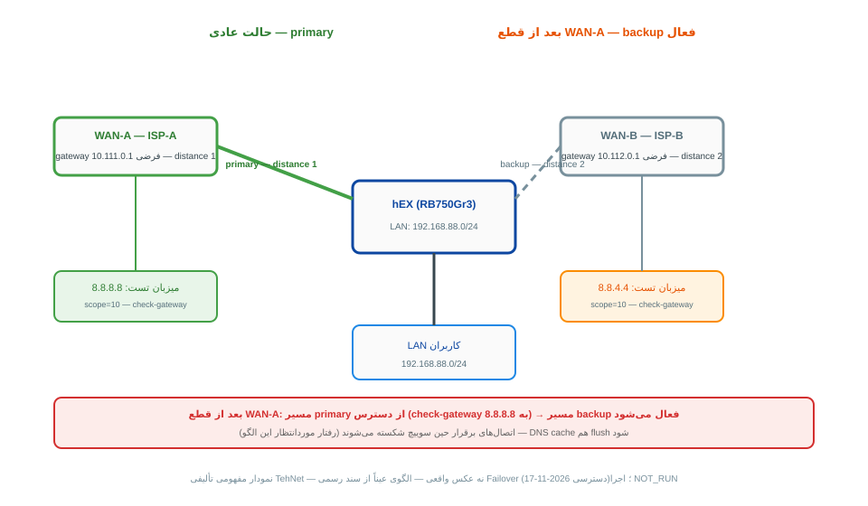

# dual-WAN و failover — دو اینترنت با مسیر پشتیبان (M6)

> وضعیت درس: **DRAFT / NOT_DEPLOYED — در انتظار مرور.**
> آموزش تصویری از سری MikroTik؛ مخاطب: مدیر شبکه.
> سناریوی کاملاً فرضی و آموزشی با دادهٔ ساختگی؛ هیچ شبکهٔ واقعی دستکاری نشده و هیچ اجرای واقعی NOT_RUN است.
> نمودار مفهومی و تألیفی است (نه عکس واقعی).

## پاسخ کوتاه

failover سندشدهٔ RouterOS = دو default route با **distance متفاوت** (اصلی=1، پشتیبان=2) که هرکدام با `check-gateway=ping` یک **مقصد خارج از شبکه** را مانیتور می‌کنند — نه فقط gateway ISP، چون ممکن است لینک بالا باشد ولی اینترنت قطع. برای gatewayهای از طریق میانی، الگوی رسمی **recursive routing** (مسیر میزبان تست با scope=10 و default با target-scope=11) است. دو یادآوری مهم: NAT باید برای **هر دو** WAN تعریف شود؛ و با سوییچ مسیر، اتصال‌های برقرار می‌شکنند (حالت اتصال‌محور پیشرفته، خارج دامنهٔ این درس).

## پیش‌نیازها

- مبنا و NAT: [M3](m3-dhcp-dns.fa.md) · ثبت قبل/بعد: [N4](n4-delivery-acceptance.fa.md) · عیب‌یابی لایه‌ای: [N1](n1-network-troubleshooting.fa.md)

## مبنا آزمایشگاه (Lab Baseline) — دقیق و کامل

| بند | مقدار فرضی |
|---|---|
| روتر | hEX (RB750Gr3)، ‏RouterOS v7.16+ |
| ‏WAN-A اصلی | ether1 — ‏gateway فرضی ‏10.111.0.1 (ISP-A) |
| ‏WAN-B پشتیبان | ether5 — ‏gateway فرضی ‏10.112.0.1 (ISP-B) |
| مقصدهای تست خارج از شبکه | ‏8.8.8.8 (از WAN-A) · ‏8.8.4.4 (از WAN-B) — عین الگوی سند رسمی |
| LAN | ‏192.168.88.0/24 روی `bridge` (مبناى M3) |
| اجرای واقعی | **NOT_RUN** — دستورها عیناً از سند رسمی failover با مبنا وصل‌شده |

## جدول مقایسهٔ روش‌ها — چه می‌گیرد / چه نمی‌گیرد

| روش | می‌گیرد | نمی‌گیرد | پیچیدگی |
|---|---|---|---|
| ‏check-gateway فقط روی gateway ISP | قطع لینک مستقیم | «لینک بالا، اینترنت قطع» (خرابی میانی ISP) | کم |
| ‏recursive به مقصد خارج از شبکه (الگوی رسمی) | خرابی میانی هم؛ هر WAN با مقصد خودش | اگر خود مقصد تست قطع شود (faux failover) → گام دوم: میزبان دوم | متوسط |
| دو میزبان تست برای هر WAN | کاهش ‏faux failover | سند رسمی: با ‏ECMP، failover کامل فقط وقتی **همه** میزبان‌ها از دسترس خارج شوند | متوسط |
| ‏ECMP به‌عنوان failover | — | ‏ECMP توزیع بار است نه failover؛ اتصال‌ها می‌شکنند | — |

## دستورهای مبنا — عین الگوی سند رسمی (اجرا NOT_RUN)

```routeros
# NAT برای هر دو WAN (سند رسمی: هر uplink یک masquerade)
/ip firewall nat
add chain=srcnat action=masquerade out-interface=ether1 comment="TN-M6 WAN-A"
add chain=srcnat action=masquerade out-interface=ether5 comment="TN-M6 WAN-B"

# مسیرهای میزبان تست (scope=10) — الگوی recursive سند رسمی
/ip route
add dst-address=8.8.8.8 scope=10 gateway=10.111.0.1 comment="TN-M6 تست WAN-A"
add dst-address=8.8.4.4 scope=10 gateway=10.112.0.1 comment="TN-M6 تست WAN-B"

# default اصلی و پشتیبان — target-scope=11 از مسیرهای تست حل می‌شود
add distance=1 gateway=8.8.8.8 target-scope=11 check-gateway=ping comment="TN-M6 primary"
add distance=2 gateway=8.8.4.4 target-scope=11 check-gateway=ping comment="TN-M6 backup"
```

سند رسمی توضیح می‌دهد: default routeها «به‌طور recursive از طریق میزبان‌های تست حل می‌شوند» و «بدون مسیرهای میزبان، هر دو default غیرفعال می‌مانند» — یعنی دو ردیف scope=10 شرط کارکرد کل الگو است.

## سناریوی آزمون failover (الگوی N4 — ثبت قبل/بعد)

| گام | عمل | انتظار | شاهد |
|---|---|---|---|
| ‏۰ | وضعیت عادی: `/ip route print` — primary ‏active، backup غیرفعال | فقط primary active | خروجی print |
| ‏۱ | قطع WAN-A (کابل ether1 — فرض سناریو) | route backup ‏active می‌شود؛ ترافیک از WAN-B | route print + `ping 8.8.8.8` موفق |
| ‏۲ | برگشت WAN-A | primary دوباره ‏active (distance کمتر برمی‌گردد) | route print |
| ‏۳ | ثبت اثر | اتصال‌های برقرار حین سوییچ شکستند (رفتار موردانتظار این الگو)؛ لاگ رخداد ثبت شد | گزارش قبل/بعد |

توضیح صادقانه: این الگو failover «مسیر» را سند می‌کند؛ حفظ اتصال‌های موجود حین سوییچ نیازمند طراحی اتصال‌محور (routing-table + mangle) است که خارج دامنهٔ این درس و برای پروژهٔ واقعی یک بند SOW جداگانه است.

## نمودار



**شرح متنی نمودار (جایگزین تصویر برای دسترس‌پذیری):** روتر hEX در مرکز با دو خروجی: ‏WAN-A به ISP-A ‏(gateway ‏10.111.0.1 — مسیر سبز اصلی) و ‏WAN-B به ISP-B ‏(gateway ‏10.112.0.1 — مسیر خاکستری پشتیبان). از هر ‏WAN یک خط به مقصد تست خارج از شبکه ‏(8.8.8.8 از A و ‏8.8.4.4 از B) کشیده شده — همان چیزی که ‏check-gateway مانیتور می‌کند. نیمهٔ پایین: حالت «بعد از قطع WAN-A» — مسیر سبز با ضربدر و مسیر پشتیبان فعال با فلش. برچسب «تألیفی/مفهومی» و یادداشت NOT_RUN.

## خطاهای رایج

| نشانه | علت محتمل | بررسی | راه‌حل |
|---|---|---|---|
| failover انجام نشد ولی اینترنت قطع بود | check-gateway فقط gateway ISP را می‌پینگد — لینک up بود | الگوی recursive با مقصد خارج از شبکه | الگوی این درس |
| هر دو default غیرفعال ماندند | مسیرهای میزبان تست (scope=10) جا افتاده | سند رسمی: «بدون آن‌ها هر دو default غیرفعال می‌مانند» | افزودن دو مسیر میزبان |
| failover نیمه‌کاره با دو میزبان | رفتار سندشدهٔ ‏ECMP: بستن فقط با از دسترس‌رفتن **همهٔ** میزبان‌ها | طراحی را با نیاز بسنجید | تک‌میزبان برای failover سریع؛ یا پذیرش رفتار |
| بعد از failover سایت‌ها کند/خطا | cache DNS کلاینت/روتر از مسیر قبلی | flush + تست مجدد | مورد عیب‌یابی عملیاتی، نه rule |
| ‏WAN-B کار نمی‌کند وقتی لازم شد | NAT برای WAN-B تعریف نشده | `/ip firewall nat print` | هر دو masquerade (الگوی سند رسمی) |

## تمرین کوتاه (با پاسخ موردانتظار)

1. چرا check-gateway روی gateway ISP کافی نیست؟ — **پاسخ موردانتظار:** لینک تا ISP می‌تواند بالا باشد ولی اینترنت قطع؛ مانیتور باید مقصد خارج از شبکه باشد (الگوی recursive سند رسمی).
2. نقش scope=10 و target-scope=11 چیست؟ — **پاسخ موردانتظار:** میزبان‌های تست با scope=10 تعریف می‌شوند و default با target-scope=11 فقط از طریق آن‌ها حل می‌شود؛ بدون آن‌ها defaultها غیرفعال می‌مانند (سند رسمی).
3. ‏ECMP را برای failover انتخاب می‌کنید؟ — **پاسخ موردانتظار:** خیر؛ ‏ECMP توزیع بار است و اتصال‌ها می‌شکنند؛ به‌عنوان افزایش قابلیت‌اتکای تشخیص با پذیرش «بستن فقط با از دسترس‌رفتن همهٔ میزبان‌ها» سند شده.
4. بعد از failover کاربران می‌گویند بعضی سایت‌ها نمی‌آیند؛ اولین بررسی؟ — **پاسخ موردانتظار:** cache DNS (کلاینت/روتر) و اتصال‌های شکسته؛ flush و اتصال مجدد — رفتار موردانتظار الگو.

## چک‌لیست تحویل

- [ ] NAT هر دو WAN تعریف شده
- [ ] الگوی recursive با دو مقصد تست خارج از شبکه (scope=10 / target-scope=11)
- [ ] primary/backup با distance=1/2 و check-gateway=ping
- [ ] سناریوی آزمون سه‌گامی با ثبت قبل/بعد اجرا شده (اجرای واقعی این درس NOT_RUN)
- [ ] رفتار شکستن اتصال‌ها به مشتری اعلام شده (بند SOW)
- [ ] استثنای ISP/قطعه در مسیر رخداد (N6) و قرارداد (N3) هم‌سو است

## منابع رسمی (fetch شده با تاریخ)

- ‏Failover ‏(WAN ‏Backup) — الگوی recursive با scope/target-scope، دستورهای عیناً نقل‌شده، رفتار ‏ECMP: https://manual.mikrotik.com/docs/high-availability-solutions/load-balancing/failover-wan-backup/ (دسترسی 2026-11-17) و نسخهٔ help: https://help.mikrotik.com/docs/spaces/ROS/pages/26476608/Failover+WAN+Backup (دسترسی 2026-11-17)
- Packet Flow (کدام زنجیره هنگام تفسیر لاگ‌ها): https://manual.mikrotik.com/docs/firewall-and-quality-of-service/packet-flow-in-routeros/ (دسترسی 2026-11-16)

## آموزش‌های مرتبط و مسیر خدمت

| پیوند | مقصد |
|---|---|
| درس‌های مرتبط | [N1](n1-network-troubleshooting.fa.md) · [N4](n4-delivery-acceptance.fa.md) · [N6](n6-incident-path.fa.md) · [M3](m3-dhcp-dns.fa.md) |
| نقشهٔ کامل سری | [topic map](../topic-map.md) |
| طراحی dual-WAN برای سازمان شما | [خدمات میکروتیک تهران](https://tehnet.ir/services/mikrotik-tehran/) |
| پایان خوشهٔ M درس‌های فرضی؛ درس‌های بعدی سری | در topic map ثبت است |
