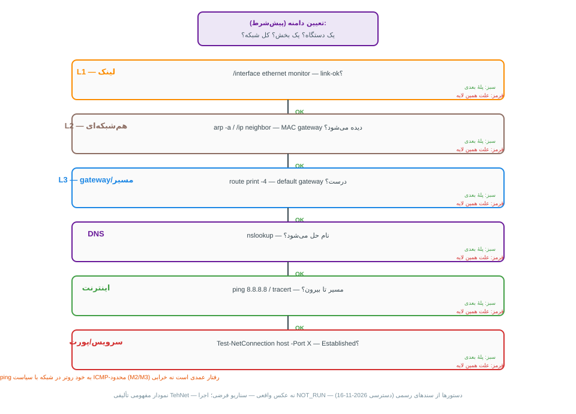

# عیب‌یابی شبکه — از کجا شروع کنم؟ (N1)

> وضعیت درس: **DRAFT / NOT_DEPLOYED — در انتظار مرور.**
> آموزش تصویری از سری پشتیبانی و عیب‌یابی؛ مخاطب: کاربر/مدیر شبکه.
> سناریوی کاملاً فرضی و آموزشی با faultهای تزریق‌شدهٔ ساختگی؛ هیچ شبکهٔ واقعی دستکاری نشده و هیچ اجرای واقعی NOT_RUN است.
> نمودار مفهومی و تألیفی است (نه عکس واقعی).

## پاسخ کوتاه

از **تعیین دامنه** شروع کنید (فقط یک دستگاه؟ یک بخش؟ کل شبکه؟) و سپس **لایه‌به‌لایه از فیزیکی به بالا** تست کنید: لینک (L1) → هم‌شبکه‌ای (L2) → gateway/ping (L3) → DNS → اینترنت → سرویس/پورت. نیمی از قطعی‌های رایج در L1/L3 است (کابل/پورت/تنظیم IP). دو دام مهم: «سایت باز نمی‌شود» لزوماً «اینترنت قطع» نیست (DNS جدا از اتصال است)؛ و timeout روی ping به خود روتر در شبکه‌هایی با سیاست ICMP-محدود (مثل درس‌های M2/M3) رفتار عمدی است نه خرابی.

## پیش‌نیازها

- تنظیمات لایهٔ 2/3 و سیاست فایروال: [VLAN برای دفتر کوچک (M2)](m2-vlan-small-office.fa.md) و [DHCP و DNS (M3)](m3-dhcp-dns.fa.md)
- خواندن جدول مسیر ویندوز (سند رسمی مایکروسافت): [route command](https://learn.microsoft.com/en-us/windows-server/administration/windows-commands/route_ws2008) (دسترسی 2026-11-16)

## مبنا آزمایشگاه (Lab Baseline) — دقیق و کامل

| نقش | دستگاه | توضیح |
|---|---|---|
| روتر | hEX (RB750Gr3)، ‏RouterOS v7.16+ | LAN=192.168.88.1/24 روی `bridge` (مبنا درس M3) |
| سوئیچ | یک سوئیچ فرضی unmanaged | کلاینت به آن وصل است |
| کلاینت | ویندوز فرضی | DHCP-گیرنده |
| faultهای تزریق‌شدهٔ آموزشی | سه حالت جدا: ‏**F1** کابل کلاینت جدا · ‏**F2** gateway دستیِ غلط (192.168.88.254 به‌جای .1) · ‏**F3** DNS دستیِ غلط (8.8.4.4 بجای روتر با فیلتر داخلی) | هر fault جدا تزریق و عیب‌یابی می‌شود |

هر سه fault صرفاً آموزشی و روی مبناى فرضی است؛ اجرای واقعی هیچ‌کدام NOT_RUN است.

### جدول عیب‌یابی لایه‌ای — ستون فقرات درس

| لایه | سؤال | دستور کلاینت (ویندوز) | دستور روتر (RouterOS) | سالم | خراب |
|---|---|---|---|---|---|
| ‏L1 لینک | کارت لینک دارد؟ | — | `/interface ethernet monitor ether2` (status=link-ok؟ rate؟) | link-ok | no-link → کابل/پورت/سوئیچ |
| ‏L2 هم‌شبکه‌ای | gateway در ARP هست؟ | `arp -a` (ورودی gateway با MAC) | `/ip neighbor print` | MAC روتر دیده می‌شود | incomplete → VLAN/پورت/IP اشتباه |
| ‏L3 gateway | مسیر به روتر سالم؟ | `ping 192.168.88.1` — ⚠️ در شبکه با سیاست ICMP-محدود timeout طبیعی است (درس M2/M3)؛ ملاک: سایر ترافیک | — | reply (یا ترافیک سرویس عبور می‌کند) | — |
| ‏L3 مسیر | default gateway درست است؟ | `route print -4` (سطر ‏0.0.0.0) | `/ip route print` | gateway=روتر | gateway غلط/حذف → اصلاح تنظیم کلاینت |
| DNS | نام حل می‌شود؟ | `nslookup nas.lan` و `nslookup www.google.com` | `/ip dns cache print` | پاسخ از روتر | timeout/ServFail → DNS کلاینت یا سرویس DNS روتر |
| اینترنت | مسیر به بیرون سالم؟ | `ping 8.8.8.8` و `tracert 8.8.8.8` | `/tool traceroute 8.8.8.8` | reply/hops | قطع در hop اول = سمت روتر/NAT |
| سرویس/پورت | سرویس مقصد پاسخ می‌دهد؟ | `Test-NetConnection host -Port X` (PowerShell) | `/ip firewall connection print` | Established | رد → فایروال/سرویس down |

منبع دستورهای RouterOS: سند رسمی Packet Flow در RouterOS (تعیین می‌کند هر بسته از کدام زنجیرهٔ input/forward می‌گذرد — کلید تشخیص «کدام rule»): https://manual.mikrotik.com/docs/firewall-and-quality-of-service/packet-flow-in-routeros/ (دسترسی 2026-11-16)

**شرح متنی نمودار (جایگزین تصویر برای دسترس‌پذیری):** نردبان شش‌پله‌ای از پایین به بالا: ‏L1 لینک → ‏L2 هم‌شبکه‌ای (ARP) → ‏L3 gateway (route/ping با هشدار سیاست ICMP) → ‏DNS → اینترنت → سرویس/پورت. هر پله یک جعبه با «دستور تست» و دو خروجی سبز/قرمز: سبز = پلهٔ بعدی؛ قرمز = علت همان لایه و توقف. پایین نمودار جعبهٔ «تعیین دامنه» (یک دستگاه/بخش/کل شبکه) به‌عنوان پیش‌شرط، و برچسب «تألیفی/مفهومی».

## مثال کارشده — walkthrough کامل fault F2

1. **تعیین دامنه:** فقط یک کلاینت قطع است؛ همکار کناری سالم → مشکل محلیِ همان دستگاه.
2. ‏L1: چراغ کارت روشن و `/interface ethernet monitor` سمت روتر link-ok → L1 سالم.
3. ‏L2: `arp -a` → ورودی gateway وجود ندارد؛ ولی `arp -a` مال MAC سوئیچ…؛ سایر دستگاه‌ها gateway را می‌بینند → به L3 مسیر مشکوک شو.
4. ‏L3 مسیر: `ipconfig /all` → gateway=**192.168.88.254** (تایپ‌و غلط! به‌جای .1)؛ `route print -4` سطر default با gateway .254؛ `arp -a` برای .254 incomplete (هیچ دستگاهی آن IP را ندارد).
5. **ریشه پیدا شد:** gateway غلط. اصلاح (به DHCP یا static درست .1) و تأیید: `nslookup nas.lan` و بازکردن سایت موفق.
6. **ثبت قبل/بعد:** خروجی‌های گام ۴ (قبل) و نتیجهٔ پس از اصلاح در گزارش عیب‌یابی ثبت می‌شود — تحویل بدون ثبت، نصف کار.

## خطاهای رایج در فرایند عیب‌یابی

| خطا | چرا غلط است | درست |
|---|---|---|
| «سایت باز نمی‌شود = اینترنت قطع» | DNS جدا از اتصال است | اول `ping 8.8.8.8` (اتصال) بعد `nslookup` (نام) |
| timeout روی ping روتر = خرابی | در شبکه با سیاست ICMP-محدود (M2/M3) عمدی است | ملاک را ترافیک واقعی سرویس بگیرید؛ policy را بخوانید |
| عیب‌یابی کل شبکه برای مشکل یک دستگاه | دامنه تعیین نشده | اول scope؛ سپس لایه‌ای |
| تعویض قطعات به‌ترتیب حدسی | بدون تست لایه‌ای، علت تغییر می‌کند نه مشکل | هر گام یک فرضیه + یک تست |
| بدون ثبت قبل/بعد بستن تیکت | پذیرش و عودت مبهم می‌شود | گزارش قبل/بعد + دستورهای اجراشده |

## تمرین کوتاه (با پاسخ موردانتظار)

1. کل یک طبقه قطع است ولی طبقات دیگر سالم‌اند؛ از کجا شروع کنید؟ — **پاسخ موردانتظار:** دامنه=بخش → مشترکِ همان بخش: کابل uplink/پورت سوئیچ طبقه/VLAN آن بخش — نه کلاینت‌ها.
2. `ping 8.8.8.8` موفق ولی هیچ سایتی باز نمی‌شود؛ لایهٔ مشکل؟ — **پاسخ موردانتظار:** DNS؛ تست `nslookup` و اصلاح DNS کلاینت/روتر.
3. در شبکهٔ درس M2، از پورت مهمان `ping 192.168.10.1` timeout است؛ خرابی؟ — **پاسخ موردانتظار:** خیر؛ سیاست M2 ping به روتر از غیر-دفتر را می‌بندد (input) — رفتار عمدی؛ ملاک ترافیک مجاز است.
4. `tracert` وسط مسیر ستاره می‌شود ولی مقصد جواب می‌دهد؛ قطع هست؟ — **پاسخ موردانتظار:** خیر؛ hopهای میانی ممکن است ICMP را فیلتر کنند؛ جواب مقصد = مسیر کار می‌کند.

## چک‌لیست تحویل

- [ ] دامنه ثبت شده (دستگاه/بخش/کل)
- [ ] گام‌های لایه‌ای از L1 به بالا به‌ترتیب اجرا و خروجی‌ها ثبت شده
- [ ] فرضیهٔ هر گام + نتیجه‌اش مستند (نه تعویض حدسی)
- [ ] اصلاح با ثبت قبل/بعد و تأیید با همان تست‌ها
- [ ] سیاست ICMP/fایروال شبکه قبل از تفسیر timeout خوانده شده (ارجاع درس M2/M3)
- [ ] اجرای واقعی این درس NOT_RUN (مبنا فرضی)

## منابع (fetch/تأیید شده با تاریخ)

- Packet Flow در RouterOS — زنجیره‌های input/forward/output و ترتیب: https://manual.mikrotik.com/docs/firewall-and-quality-of-service/packet-flow-in-routeros/ (دسترسی 2026-11-16)
- دستور route ویندوز (خواندن جدول مسیر کلاینت) — سند رسمی مایکروسافت: https://learn.microsoft.com/en-us/windows-server/administration/windows-commands/route_ws2008 (دسترسی 2026-11-16)
- سند DNS RouterOS (مرز 53 و cache): https://manual.mikrotik.com/docs/network-management/dns/ (دسترسی 2026-11-16)
- تجربهٔ فنی عمومی لایه‌ای-عیب‌یابی — به‌عنوان روش، بدون ادعای آمار/مورد واقعی

## آموزش‌های مرتبط و مسیر خدمت

| پیوند | مقصد |
|---|---|
| تنظیمات لایهٔ 2/3 مبنا | [VLAN (M2)](m2-vlan-small-office.fa.md) · [DHCP و DNS (M3)](m3-dhcp-dns.fa.md) |
| بودجهٔ توان هنگام قطعی‌های PoE | [بودجهٔ PoE (S2)](s2-poe-budget.fa.md) |
| نقشهٔ کامل سری | [topic map](../topic-map.md) |
| عیب‌یابی/پشتیبانی شبکهٔ شما | [خدمات پشتیبانی شبکهٔ تهران](https://tehnet.ir/services/network-support-tehran/) |
| درس بعدی سری | N4 — چک‌لیست پذیرش تحویل (تولید در نوبت بعدی؛ فعلاً فقط در topic map) |
