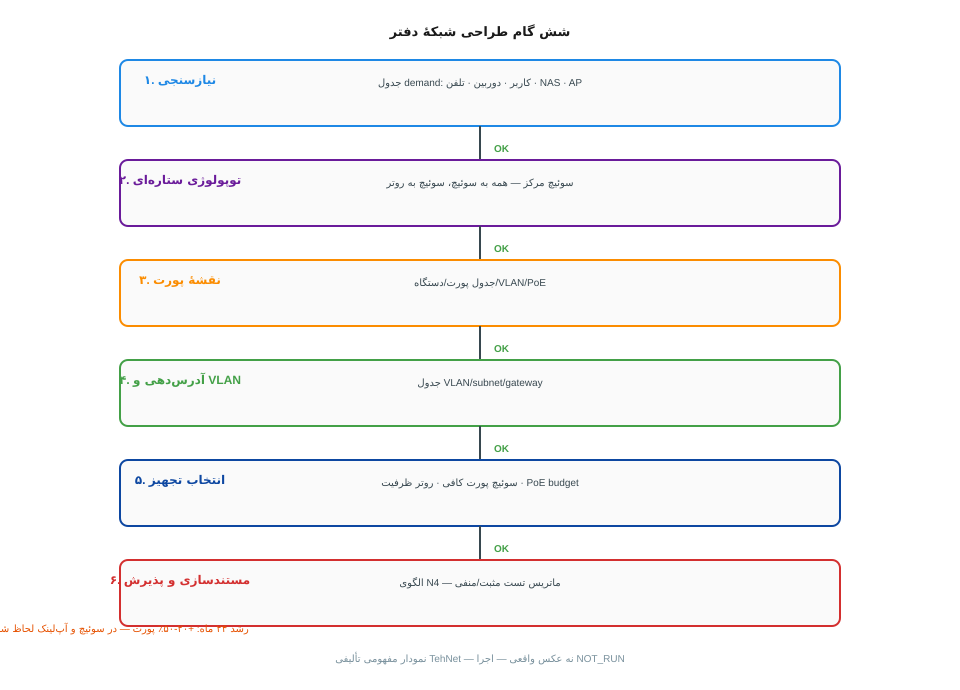

# طراحی شبکهٔ دفتر — از نیازسنجی تا نقشهٔ نهایی (N1)

> وضعیت درس: **DRAFT / NOT_DEPLOYED — در انتظار مرور.** (درس مصوب سرفصل ‏N1: طراحی دفتر)
> آموزش تصویری از سری پشتیبانی؛ مخاطب: مدیر IT و کارشناس شبکه.
> سناریوی کاملاً فرضی و آموزشی با دادهٔ ساختگی؛ هیچ شبکهٔ واقعی دستکاری نشده و هیچ اجرای واقعی NOT_RUN است.
> نمودار مفهومی و تألیفی است (نه عکس واقعی).

## پاسخ کوتاه

طراحی شبکهٔ دفتر شش گام دارد: **نیازسنجی** (تعداد کاربر/سرویس/رشد) → **انتخاب توپولوژی** (ستاره‌ای — سوئیچ مرکز) → **نقشهٔ پورت** (هر پورت چه دستگاهی؟) → **آدرس‌دهی** (subnet + VLAN) → **انتخاب تجهیز** (سوئیچ/روتر/AP/آپ‌لینک) → **مستندسازی و آزمون پذیرش** (الگوی N4). طراحی خوب از برگهٔ نیازسنجی شروع می‌شود؛ طراحی بد از «اول سوئیچ بخریم بعد ببینیم چی لازمه».

## پیش‌نیازها

- VLAN و ترانک: [M2](m2-vlan-small-office.fa.md) · بودجهٔ PoE: [S2](s2-poe-budget.fa.md) · آپ‌لینک: [S5](s5-uplink-trunk.fa.md) · پذیرش: [N4](n4-delivery-acceptance.fa.md)

## مبنا آزمایشگاه (Lab Baseline) — پروژهٔ فرضی

| بند | مقدار فرضی |
|---|---|
| سازمان | دفتر کوچک — ‏۱۲ نفر + ‏۴ دوربین + ‏۴ تلفن IP + ‏۱ NAS + ‏۱ سرور |
| رشد | ‏+۵۰٪ در ۲۴ ماه |
| اینترنت | ‏فیبر ‏100 Mbps (ISP) |
| فضا | یک طبقه — یک رک شبکه |
| بودجه | متوسط — بدون ‏redundancy سخت‌افزاری در این فاز |
| اجرای واقعی | **NOT_RUN** — طراحی آموزشی |

## گام ۱: نیازسنجی — جدول demand

| سرویس | تعداد | مشخصه | VLAN | PoE |
|---|---|---|---|---|
| کاربران دفتر | ‏۱۲ | ‏PC + تلفن IP (هر دو روی یک پورت با VLAN voice) | 10 + 30 | بله (تلفن) |
| دوربین IP | ‏۴ | ‏PoE + ‏VLAN جدول | 20 | بله |
| تلفن IP | ‏۴ | ‏PoE + ‏VLAN voice | 30 | بله |
| ‏NAS | ‏۱ | ‏1G (فعلاً) — ارتقای ‏10G فاز بعد | 40 | خیر |
| سرور | ‏۱ | ‏1G (فعلاً) | 40 | خیر |
| چاپگر شبکه | ‏۱ | ‏1G | 10 | خیر |
| AP مهمان | ‏۱ | ‏VLAN جدا | 50 | بله (اختیاری) |
| **جمع پورت‌های سوئیچ** | | ‏۱۲ کاربر+تلفن + ‏۴ دوربین + ‏۱ AP + ‏آپ‌لینک = **≥ ۱۸ پورت** | | |

## گام ۲: توپولوژی — ستاره‌ای با سوئیچ مرکز

```text
              اینترنت (فیبر 100 Mbps)
                   │
              ┌────┴────┐
              │  hEX    │  روتر — فایروال/NAT/DHCP/DNS
              └────┬────┘
                   │ (uplink 1G)
              ┌────┴────────┐
              │ CRS326      │  سوئیچ ۲۴ پورت — VLAN trunk
              └──┬──┬──┬──┬─┘
        ┌────────┘  │  │  └────────┐
   ┌────┴───┐  ┌────┴─┐ ┌┴──────┐ ┌──┴─────┐
   │ کاربران│  │دوربین│ │ تلفن  │ │ NAS/سرور│
   │ VLAN10 │  │VLAN20│ │VLAN30 │ │ VLAN40 │
   └────────┘  └──────┘ └───────┘ └────────┘
```

### انتخاب سوئیچ

| معیار | محاسبه | نتیجه |
|---|---|---|
| پورت لازم | ‏۱۲ کاربر+تلفن + ‏۴ دوربین + ‏۱ AP + ‏۱ NAS/سرور + ‏۱ آپ‌لینک + رشد ‏۳ = **≥ ۲۲ پورت** | CRS326-24G-2S+RM ‏(۲۴ پورت + ‏۲×SFP+) |
| PoE budget | ‏۴ تلفن × ‏5W + ‏۴ دوربین × ‏12W = ‏68W | CRS326 ‏PoE budget کافی ‏(سند رسمی) |
| آپ‌لینک | ‏SFP+ ‏1G (فعلاً؛ رشد → ‏10G) | — |

## گام ۳: نقشهٔ پورت

| پورت سوئیچ | دستگاه | VLAN | PoE |
|---|---|---|---|
| ether1-4 | کاربران ‏۱-۴ ‏(VLAN10 access) | 10 | خیر |
| ether5-8 | کاربران ‏۵-۸ + تلفن‌ها ‏(VLAN10+30) | 10 + 30 | بله (تلفن) |
| ether9-12 | کاربران ‏۹-۱۲ + تلفن‌ها ‏(VLAN10+30) | 10 + 30 | بله (تلفن) |
| ether13-16 | دوربین‌ها ‏(VLAN20 access) | 20 | بله |
| ether17 | ‏NAS ‏(VLAN40 access) | 40 | خیر |
| ether18 | سرور ‏(VLAN40 access) | 40 | خیر |
| ether19 | چاپگر ‏(VLAN10 access) | 10 | خیر |
| ether20 | ‏AP مهمان ‏(VLAN50 access) | 50 | بله |
| ether21-24 | آزاد ‏(رشد) | — | — |
| sfp-sfpplus1 | آپ‌لینک به hEX ‏(ترانک) | trunk | — |

## گام ۴: آدرس‌دهی و VLAN

| VLAN | نام | subnet | gateway |
|---|---|---|---|
| 10 | کاربران | ‏192.168.10.0/24 | ‏192.168.10.1 |
| 20 | دوربین | ‏192.168.20.0/24 | ‏192.168.20.1 |
| 30 | تلفن | ‏192.168.30.0/24 | ‏192.168.30.1 |
| 40 | سرور/NAS | ‏192.168.40.0/24 | ‏192.168.40.1 |
| 50 | مهمان | ‏192.168.50.0/24 | ‏192.168.50.1 |
| 88 | مدیریت | ‏192.168.88.0/24 | ‏192.168.88.1 |

## گام ۵: انتخاب تجهیز

| نقش | مدل | دلیل |
|---|---|---|
| روتر | ‏hEX ‏(RB750Gr3) — ‏۱۲ کاربر | کافی؛ ارتقا به ‏RB5009 با رشد |
| سوئیچ | ‏CRS326-24G-2S+RM | ‏۲۴ پورت + ‏۲×SFP+ آپ‌لینک |
| ‏AP مهمان | هر ‏AP با ‏VLAN tagging | ‏VLAN50 |

## گام ۶: مستندسازی و آزمون پذیرش

مستندات تحویل: نقشهٔ پورت، جدول VLAN/آدرس، ‏export پیکربندی نهایی، ماتریس پذیرش تکمیل‌شده ‏(الگوی N4). آزمون پذیرش: از هر VLAN یک تست مثبت + یک منفی (الگوی M2 جدول ۱۴ ردیفی).



**شرح متنی نمودار (جایگزین تصویر برای دسترس‌پذیری):** شش گام از چپ به راست: ‏«۱ نیازسنجی» ‏(جدول demand) → ‏«۲ توپولوژی ستاره‌ای» → ‏«۳ نقشهٔ پورت» ‏(جدول پورت/دستگاه/VLAN) → ‏«۴ آدرس‌دهی» ‏(جدول VLAN/subnet) → ‏«۵ انتخاب تجهیز» ‏(روتر/سوئیچ/AP) → ‏«۶ مستندسازی و پذیرش» ‏(الگوی N4). زیر نمودار: جعبهٔ «رشد ۲۴ ماه» با فلش به گام ۱. برچسب «تألیفی/مفهومی».

## خطاهای رایج

| خطا | چرا گران است | درست |
|---|---|---|
| بدون نیازسنجی سوئیچ خریدن | پورت/ظرفیت کم یا بیش از حد | جدول demand اول؛ بعد سوئیچ |
| آپ‌لینک فراموش‌شده | سوئیچ دوم بدون مسیر به روتر | آپ‌لینک در نقشهٔ پورت |
| بدون VLAN از روز اول | بعداً افزودن VLAN = دستکاری همهٔ پورت‌ها | از روز اول VLAN طراحی شود حتی اگر فعلاً فقط VLAN10 استفاده می‌شود |
| رشد نادیده گرفته شده | ‏۶ ماه بعد سوئیچ دوم لازم می‌شود | ‏+۲۰-۵۰٪ رشد در تعداد پورت |
| بدون مستندات تحویل | هر تغییر بعدی بدون مرجع | الگوی N4: ‏۶ سند تحویل |

## تمرین کوتاه (با پاسخ موردانتظار)

1. ‏۱۲ کاربر + ‏۴ دوربین + ‏۱ NAS — حداقل چند پورت سوئیچ؟ — **پاسخ موردانتظار:** ‏۱۲+۴+۱ NAS/سرور + ‏۱ آپ‌لینک = ‏۱۸؛ اما با رشد حداقل ‏۲۲ (CRS326-24G-2S+RM).
2. چرا VLAN از روز اول؟ — **پاسخ موردانتظار:** افزودن VLAN بعداً = دستکاری همهٔ پورت‌ها و جدول VLAN؛ طراحی اولیه ارزان‌تر.
3. چرا PoE در انتخاب سوئیچ مهم است؟ — **پاسخ موردانتظار:** تلفن و دوربین و ‏AP به ‏PoE نیاز دارند؛ سوئیچ بدون ‏PoE = آداپتور جدا برای هر دستگاه.
4. چرا آپ‌لینک 1G فعلاً کافی؟ — **پاسخ موردانتظار:** اینترنت ‏100 Mbps است؛ آپ‌لینک 1G > اینترنت؛ رشد فایل‌سروری سنگین → ارتقا به ‏SFP+ ‏10G (الگوی S3).

## چک‌لیست تحویل

- [ ] جدول demand تکمیل شده با تعداد/مشخصه/VLAN/PoE
- [ ] نقشهٔ پورت پورت‌به‌پورت نوشته شده
- [ ] جدول VLAN/آدرس‌دهی تکمیل شده
- [ ] سوئیچ با پورت کافی + PoE budget کافی انتخاب شده
- [ ] روتر با ظرفیت کافی انتخاب شده
- [ ] رشد ۲۴ ماه در انتخاب لحاظ شده
- [ ] مستندات تحویل آماده (الگوی N4)
- [ ] اجرای واقعی این درس NOT_RUN (طراحی آموزشی)

## منابع (fetch/تأیید شده با تاریخ)

- Bridging and Switching (الگوی پل/VLAN): https://manual.mikrotik.com/docs/bridging-and-switching/ (دسترسی 2026-11-16)
- الگوهای تست پذیرش: [N4 چک‌لیست پذیرش](n4-delivery-acceptance.fa.md)
- تجربهٔ فرایندی عمومی طراحی شبکه — بدون ادعای آمار/پروژهٔ واقعی

## آموزش‌های مرتبط و مسیر خدمت

| پیوند | مقصد |
|---|---|
| درس‌های مرتبط | [M2](m2-vlan-small-office.fa.md) · [S2](s2-poe-budget.fa.md) · [S5](s5-uplink-trunk.fa.md) · [N4](n4-delivery-acceptance.fa.md) |
| نقشهٔ کامل سری | [topic map](../topic-map.md) |
| طراحی شبکهٔ دفتر شما | [خدمات راه‌اندازی شبکهٔ تهران](https://tehnet.ir/services/network-setup-tehran/) |
| درس بعدی سری | N2 — رک و کابل‌کشی (تولید در نوبت بعدی؛ فعلاً فقط در topic map) |
