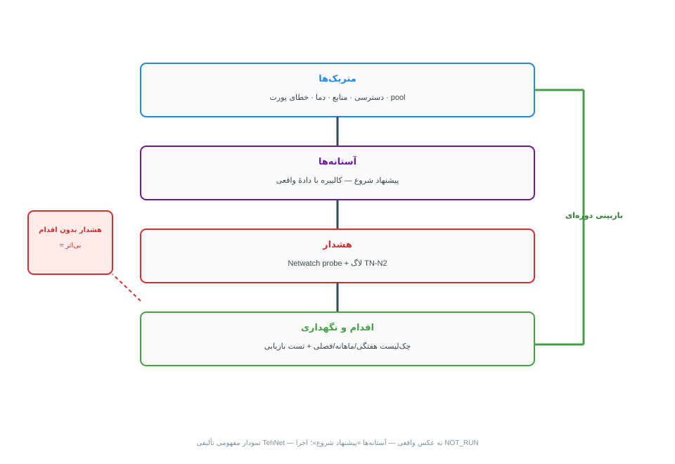

# مانیتورینگ و نگهداری دوره‌ای — متریک، هشدار و چک‌لیست (N2)

> وضعیت درس: **DRAFT / NOT_DEPLOYED — در انتظار مرور.**
> آموزش تصویری از سری پشتیبانی؛ مخاطب: مدیر IT.
> سناریوی کاملاً فرضی و آموزشی با دادهٔ ساختگی؛ هیچ شبکهٔ واقعی دستکاری نشده و هیچ اجرای واقعی NOT_RUN است.
> نمودار مفهومی و تألیفی است (نه عکس واقعی).

## پاسخ کوتاه

مانیتور یعنی: چند **متریک کلیدی** را دوره‌ای اندازه بگیرید، برای هرکدام یک **آستانهٔ هشدار** تعریف کنید و برای هشدار یک **اقدام مشخص** داشته باشید — مانیتور بدون اقدام فقط دفترچهٔ زنگ‌های بی‌پاسخ می‌شود. شروعِ کوچکِ درست، پنج متریک است: در دسترس بودن (loss/ping)، منابع روتر (CPU/RAM/دیسک)، دما، خطای پورت‌ها (errors/drops) و فضای DHCP pool. ابزار: همان RouterOS بدون نصب هیچ نرم‌افزار جدیدی — ‏Netwatch برای probe دورها، لاگ و resource برای خود روتر، و چک‌لیست هفتگی/ماهانه/فصلی برای نگهداری.

## پیش‌نیازها

- مبنا و سیاست‌ها: [DHCP و DNS (M3)](m3-dhcp-dns.fa.md) · [عیب‌یابی (N1)](n1-network-troubleshooting.fa.md)
- ثبت قبل/بعد و پذیرش: [چک‌لیست پذیرش تحویل (N4)](n4-delivery-acceptance.fa.md)

## مبنا آزمایشگاه (Lab Baseline) — دقیق و کامل

| نقش | دستگاه/مقدار | توضیح |
|---|---|---|
| روتر مانیتورشونده | hEX (RB750Gr3)، ‏RouterOS v7.16+ | همان مبناى M3: ‏LAN=192.168.88.1/24 |
| مقصدهای probe | gateway داخلی؟ (خود روتر) → مقصدها: ‏NAS ‏192.168.88.10 · ‏Printer ‏192.168.88.11 · ‏اینترنت ‏8.8.8.8 | سه Netwatch probe |
| کلاینت مدیریتی | ویندوز فرضی | مشاهدهٔ لاگ/منابع با WinBox |

## متریک‌های پایه — جدول متریک/آستانه/اقدام

آستانه‌ها **پیشنهاد شروع**‌اند و per-سازمان تنظیم می‌شوند (UNKNOWN عمومی؛ با دادهٔ واقعی کالیبره می‌شود):

| متریک | ابزار/دستور | آستانهٔ هشدار شروع | اقدام |
|---|---|---|---|
| دسترسی NAS/Printer | ‏Netwatch probe (icmp) هر ‏30s | down حتی یک پروب | لاگ warning + بررسی فیزیکی/سرویس |
| دسترسی اینترنت | ‏Netwatch probe به ‏8.8.8.8 هر ‏30s | down | لاگ + چک NAT/WAN (N1 نردبان) |
| CPU | `/system resource print` دوره‌ای | ‏>70٪ پایدار | بررسی process/connection؛ ریسک فایروال ری‌استارت |
| RAM/دیسک | همان | RAM ‏>80٪ · دیسک ‏>90٪ | پاک‌سازی لاگ/فایل؛ بررسی ruleهای زیاد |
| دما | همان (temperature) | ‏>60-65°C بسته به محیط | تهویه/جای نصب — قبل از خاموشی محافظتی |
| خطای پورت | `/interface ethernet print stats` دوره‌ای | رشد errors/drops | کابل/دوپلکس/ماژول (S3 قواعد) |
| فضای DHCP pool | `/ip pool print` + شمارش lease | ‏>80٪ پر | بزرگ‌کردن pool یا رزروها (M3 قواعد) |

دستورهای بالا قابلیت‌های سندشدهٔ RouterOS‌اند (resource/interface/poe/netwatch در درخت مستندات رسمی)؛ در این درس URL بخشی برایشان ساخته نشده (الگوی صادقانهٔ S2) — فقط صفحات fetch‌شده URL دارند.

## نمونهٔ Netwatch (قابلیت سندشدهٔ RouterOS — اجرا NOT_RUN)

```routeros
/tool netwatch
add host=192.168.88.10 interval=30s type=simple comment="TN-N2 NAS probe" \
    down-script="/log warning message=\"TN-N2: NAS (192.168.88.10) DOWN\"" \
    up-script="/log info message=\"TN-N2: NAS back UP\""
add host=8.8.8.8 interval=30s type=simple comment="TN-N2 internet probe" \
    down-script="/log warning message=\"TN-N2: INTERNET DOWN\"" \
    up-script="/log info message=\"TN-N2: internet back UP\""
```

- اقدام این نمونه فقط **لاگ** است (کم‌ریسک‌ترین اقدام خودکار)؛ اسکریپت‌های خودکار سنگین (ری‌استارت پورت/سوئیچ‌اوور) در این درس توصیه نمی‌شود و باید در پروژهٔ واقعی با تست جداگانه سند شود.
- هشدار را حتماً **ببینید**: بازبینی منظم لاگ (`/log print`) در چک‌لیست هفتگی است — لاگ بدون خواندن = بدون مانیتور.

## چک‌لیست نگهداری دوره‌ای

| دوره | موارد |
|---|---|
| هفتگی | مرور لاگ هشدارها · ‏netwatch status · ‏CPU/RAM/دما · خطای پورت‌ها |
| ماهانه | backup + export جدید و ثبت digest · فضای دیسک · فضای DHCP pool · مرور leaseهای ناشناس · بروزرسانی جدول رزروها با تغییرات |
| فصلی | تست بازیابی از backup (تا فایل backup بدون بازیابی‌آزمون، پشتیبان حساب نمی‌شود) · مرور سیاست فایروال با واقعیت فعلی · بازبینی آستانه‌ها با دادهٔ انباشته · سخت‌افزار: دما/گردوغبار/اتصالات |

قاعدهٔ N4 هم‌چنان برقرار است: هر نگهداری با ثبت قبل/بعد و در پنجرهٔ توافق‌شده.

## مثال کارشده — راه‌اندازی مانیتور مینیمال روی مبنا

1. سه probe گام قبل تعریف می‌شود (NAS/Printer/اینترنت؛ هر ۳۰ ثانیه؛ اقدام=لاگ).
2. چک‌لیست هفتگی ۱۵ دقیقه‌ای: `/log print where message~"TN-N2"` + `/system resource print` + یک `ping` نمونه.
3. سناریوی فرضی: لاگ «NAS DOWN» پنج دقیقه و برگشت → بررسی: کابل NAS جابه‌جا شده بود → اقدام فیزیکی + ثبت رخداد (الگوی N6 مسیر رخداد — درس بعدی سری).
4. نتیجهٔ آموزشی: بدون هیچ نرم‌افزار جدیدی، قطعی ۵دقیقه‌ایِNAS از «نامرئی» به «ثبت‌شده با زمان» تبدیل شد.



**شرح متنی نمودار (جایگزین تصویر برای دسترس‌پذیری):** حلقهٔ چهار‌مرحله‌ای: ‏«متریک‌ها» (دسترسی/منابع/دما/خطای پورت/pool) → ‏«آستانه‌ها» (پیشنهاد شروع، کالیبره با داده) → ‏«هشدار» (Netwatch probe + لاگ TN-N2) → ‏«اقدام و نگهداری» (چک‌لیست هفتگی/ماهانه/فصلی + تست بازیابی) و بازگشت به متریک‌ها. یک شاخهٔ «بدون اقدام = بی‌اثر» جدا شده است. برچسب «تألیفی/مفهومی».

## خطاهای رایج

| خطا | چرا گران است | درست |
|---|---|---|
| آستانهٔ خیلی حساس | هشدار پیوسته → بی‌اعتمادی و بی‌توجهی | شروع سست + کالیبره با دادهٔ واقعی |
| مانیتور بدون اقدام ثبت‌شده | زنگ بی‌پاسخ | برای هر هشدار اقدام مشخص بنویسید |
| اسکریپت خودکار سنگین بدون تست | ریسک رفتار پیش‌بینی‌نکرده روی تولید | اول فقط لاگ؛ اقدام خودکار با تست جداگانه |
| بکاپ ماهانه بدون بازیابی‌آزمون | فایل خراب کشف نمی‌شود | فصلی: restore تست (تا پذیرفته، پشتیبان نیست) |
| نگهداری فقط وقتی خراب می‌شود | دوره‌ای حذف می‌شود و رویداد تکراری می‌ماند | چک‌لیست تقویمی با ثبت انجام‌شده‌ها |

## تمرین کوتاه (با پاسخ موردانتظار)

1. سه probe مینیمال این مبنا کدام‌اند و چرا این سه؟ — **پاسخ موردانتظار:** ‏NAS، ‏Printer، ‏اینترنت — ردهای رزرو/وابستهٔ جدول آدرس‌دهی + خروج به بیرون؛ کوچک، واقعی و پوشش‌دهندهٔ کل مسیر.
2. چرا اقدام خودکار نمونه فقط لاگ است؟ — **پاسخ موردانتظار:** کم‌ریسک‌ترین اقدام؛ اقدام‌های مؤثرتر (toggle پورت و…) بدون تست جداگانه ریسک تولید دارند و خارج دامنهٔ این درس‌اند.
3. دیسک روتر ۹۵٪ پر شده؛ دو اقدام اول؟ — **پاسخ موردانتظار:** مرور/پاک‌سازی لاگ و فایل‌های اضافه + بررسی منبع رشد؛ سپس سیاست نگهداری لاگ (ماهانه) — قبل از هر重启.
4. چرا آستانه‌های این درس «پیشنهاد شروع»‌اند؟ — **پاسخ موردانتظار:** چون کالیبراسیون نیاز به دادهٔ واقعی هر سازمان دارد؛ عدد عمومی تضمینی وجود ندارد — UNKNOWN ثبت شده است.

## چک‌لیست تحویل

- [ ] پنج متریک پایه با ابزار RouterOS سندشده پیاده/برنامه‌ریزی شده
- [ ] حداقل سه Netwatch probe با اقدام لاگ و comment قابل‌شناسایی
- [ ] چک‌لیست هفتگی/ماهانه/فصلی در تقویم ثبت شده (نه حافظه)
- [ ] بازیابی‌آزمون فصلی backup در تقویم است
- [ ] آستانه‌ها به‌عنوان «پیشنهاد شروع + کالیبره‌شونده» مستند شده
- [ ] اجرای واقعی این درس NOT_RUN (مبنا فرضی)

## منابع (تأیید/تاریخ‌دار)

- صفحات fetch شدهٔ رسمی همین سری با ارقام/قواعد مرتبط: ‏netPower ‏16P ‏(S2)، ماژول‌ها ‏(S3)، ‏Packet Flow / ‏DHCP ‏Server / ‏DNS / ‏Bridging ‏(M2/M3/N1) — URLها در همان درس‌ها با تاریخ دسترسی ثبت‌اند
- ‏Netwatch، ‏resource، ‏poe monitor، ‏log: قابلیت‌های سندشدهٔ RouterOS — در این درس فقط نام‌شان استفاده شده و URL بخش مستندات‌شان جداگانه تأیید نشده (عیناً URL ساخته نشده — الگوی صادقانهٔ S2)
- تجربهٔ فرایندی عمومی مانیتورینگ — روش، بدون ادعای آمار/مورد واقعی

## آموزش‌های مرتبط و مسیر خدمت

| پیوند | مقصد |
|---|---|
| درس‌های مرتبط | [N1 عیب‌یابی](n1-network-troubleshooting.fa.md) · [N4 پذیرش تحویل](n4-delivery-acceptance.fa.md) · [M3 DHCP/DNS](m3-dhcp-dns.fa.md) |
| نقشهٔ کامل سری | [topic map](../topic-map.md) |
| مانیتورینگ و نگهداری دوره‌ای شبکهٔ شما | [خدمات پشتیبانی شبکهٔ تهران](https://tehnet.ir/services/network-support-tehran/) |
| درس بعدی سری | N3 — قرارداد و SLA (تولید در نوبت بعدی؛ فعلاً فقط در topic map) |
