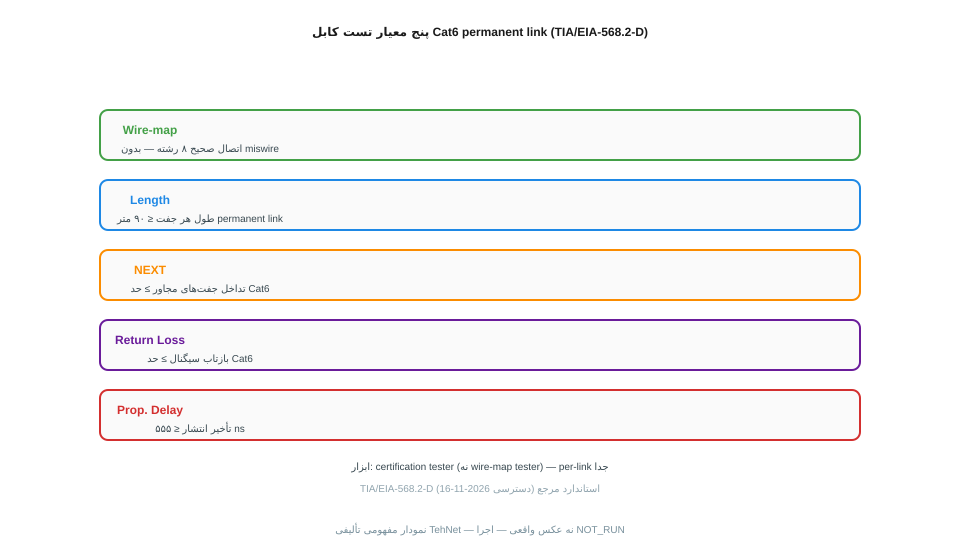

# گزارش تست کابل — معیارها، ابزار و قالب (N3)

> وضعیت درس: **DRAFT / NOT_DEPLOYED — در انتظار مرور.** (درس مصوب سرفصل ‏N3: گزارش تست کابل)
> آموزش تصویری از سری پشتیبانی؛ مخاطب: کارشناس شبکه.
> سناریوی کاملاً فرضی و آموزشی با دادهٔ ساختگی؛ هیچ شبکهٔ واقعی دستکاری نشده و هیچ اجرای واقعی NOT_RUN است.
> نمودار مفهومی و تألیفی است (نه عکس واقعی).

## پاسخ کوتاه

گزارش تست کابل یعنی: برای هر لینک، پنج معیار ‏(wire-map، ‏length، ‏NEXT، ‏return loss، ‏propagation delay) با ابزار تستر مناسب اندازه‌گیری، به‌صورت عددی ثبت و با حد آستانه مقایسه شود. گزارش بدون اعداد یا با «OK» کلی قابل‌استناد نیست. ابزار تستر ‏cable-certification‌level ‏(نه صرفاً ‏wire-map tester) برای شبکهٔ ۱ گیگابیت کافی است؛ برای ‏10G ‏Cat6a لازم است.

## پیش‌نیازها

- کابل‌کشی: [N2 رک و کابل](n2-rack-cable.fa.md) · عیب‌یابی لایه‌ای: [N1 عیب‌یابی](n1-network-troubleshooting.fa.md)

## مبنا آزمایشگاه (Lab Baseline) — دقیق و کامل

| بند | مقدار فرضی |
|---|---|
| شبکه | دفتر ‏۱۲ کاربر — ‏۱۲ لینک Cat6 از ‏patch panel تا کاربر |
| تستر | ‏Cable certification tester ‏(مثل ‏Fluke ‏DSX-5000 یا مشابه — مدل دقیق از پروژه واقعی) |
| استاندارد تست | ‏TIA/EIA-568.2-D ‏Cat6 permanent link |
| اجرای واقعی | **NOT_RUN** — قالب آموزشی |

## پنج معیار تست کابل — سند رسمی

| معیار | تعریف | آستانهٔ قبول ‏(Cat6 permanent link) | ابزار |
|---|---|---|---|
| ‏Wire-map | اتصال صحیح ‏۸ رشته | بدون ‏miswire/short/open | هر تستر |
| ‏Length | طول هر جفت ≤ ‏90 متر ‏(permanent link) | ‏≤ ‏90m ± ‏10% | تستر با ‏TDR |
| ‏NEXT ‏(Near-End Crosstalk) | تداخل جفت‌های مجاور | ≥ حد Cat6 در فرکانس تست | certification tester |
| ‏Return Loss | بازتاب سیگنال از ناهمگونی امپدانس | ≥ حد Cat6 | certification tester |
| ‏Propagation Delay | تأخیر انتشار | ≤ ‏555 ns برای ‏90m | certification tester |

سند رسمی TIA/EIA-568.2-D این آستانه‌ها را تعریف می‌کند — در این درس فقط نام برده شده و اعداد دقیق per-frequency در سند رسمی است (URL عمومی بدون نیاز به fetch خاص).

## قالب گزارش تست — جدول per-link

| لینک | ‏Wire-map | ‏Length ‏(m) | ‏NEXT ‏(dB) | ‏Return Loss ‏(dB) | ‏Delay ‏(ns) | حکم |
|---|---|---|---|---|---|---|
| ‏A-101-P01→SW1:ether1 | ✓ | ‏28 | ‏44.3 | ‏23.1 | ‏482 | **PASS** |
| ‏A-101-P02→SW1:ether2 | ✓ | ‏31 | ‏43.8 | ‏22.7 | ‏495 | **PASS** |
| ... | ... | ... | ... | ... | ... | ... |
| ‏A-101-P07→SW1:ether7 | ✗ miswire | ‏22 | — | — | — | **FAIL** |

(اعداد بالا **نمونهٔ قالب آموزشی**‌اند — NOT_RUN؛ تست واقعی با عدد واقعی جایگزین می‌شود.)

## قواعد گزارش — حداقل‌های قابل‌استناد

| قاعده | دلیل |
|---|---|
| هر لینک جدا تست شود | یک لینک خراب، کل شبکه را تحت تأثیر قرار می‌دهد |
| اعداد خام + حد آستانه ثبت شود | «OK» کلی قابل‌ررسی نیست |
| مدل تستر و نسخهٔ firmware ثبت شود | قابل‌تکرار بودن تست |
| ‏PASS/FAIL per-link (نه per-batch) | هر لینک مستقل ارزیابی می‌شود |
| لینک FAIL → تصویر/کپی خروجی تستر ضمیمه | قابل‌ررسی برای پیمانکار |

## خطاهای رایج

| نشانه | علت محتمل | بررسی | راه‌حل |
|---|---|---|---|
| ‏NEXT پایین | کابل نزدیک منبع مغناطیسی یا جفت‌ها جدا نشده | مسیر کابل + جدا‌کردن جفت‌ها در ترمینال | باز‌ترمینال با جدایی صحیح |
| ‏Length > 90m | طول فیزیکی از حد | اندازه‌گیری واقعی | کوتاه‌کردن یا ‏switch میانی |
| ‏Return Loss پایین | امپدانس ناهمگونی ‏(کابل/کانکتور) | کانکتور‌ها را چک کنید | باز‌ترمینال با کانکتور استاندارد |
| کابل بدون برچسب | عدم برچسب‌گذاری در نصب | ‏wire-map + بررسی فیزیکی | برچسب‌گذاری مجدد |
| لینک ‏10G ناممکن روی Cat5e | کابل Cat5 حد Cat6 را ندارد | تست ‏certification | کابل Cat6/Cat6a تعویض |

## تمرین کوتاه (با پاسخ موردانتظار)

1. چرا wire-map tester برای شبکهٔ ۱ گیگابیت کافی است ولی برای ‏10G نه؟ — **پاسخ موردانتظار:** ‏1G ‏(1000BASE-T) فقط wire-map و طول را نیاز دارد؛ ‏10G ‏(10GBASE-T) روی ‏Cat6a با NEXT/Return Loss سختگیرانه‌تر — تستر certification لازم.
2. «پنج لینک از ‏۱۲ PASS شدند» — کافی برای گزارش؟ — **پاسخ موردانتظار:** خیر؛ هر ‏۱۲ لینک جدا با اعداد خام باید ثبت شود — خلاصه‌سازی قابل‌استناد نیست.
3. کابل ‏95 متر با wire-map درست ولی ‏NEXT پایین — مشکل چیست؟ — **پاسخ موردانتظار:** طول از ‏90 متر permanent link گذشته (حد Cat6) → کابل کوتاه‌تر یا Cat6a.
4. بعد از تعویض patch cable، لینک وصل شد — آیا گزارش قبلی هنوز معتبر است؟ — **پاسخ موردانتظار:** خیر؛ بعد از هر تغییر فیزیکی باید تست مجدد انجام و گزارش جدید ثبت شود.

## چک‌لیست تحویل

- [ ] هر ‏۱۲ لینک جدا تست شده با پنج معیار
- [ ] مدل تستر و نسخهٔ firmware ثبت شده
- [ ] استاندارد تست ‏(TIA/EIA-568.2-D ‏Cat6 permanent link) مشخص
- [ ] اعداد خام + حد آستانه + حکم PASS/FAIL per-link
- [ ] لینک‌های FAIL با خروجی تستر ضمیمه شده
- [ ] بعد از هر تغییر فیزیکی، تست مجدد انجام شده
- [ ] اجرای واقعی این درس NOT_RUN (قالب آموزشی)

## منابع

- ‏TIA/EIA-568.2-D (استاندارد کابل‌کشی ساختاریافته — مرجع عمومی؛ اعداد per-frequency در سند اصلی)
- تجربهٔ فرایندی عمومی تست کابل — بدون ادعای آمار/مورد واقعی

## آموزش‌های مرتبط و مسیر خدمت

| پیوند | مقصد |
|---|---|
| درس‌های مرتبط | [N2 رک و کابل](n2-rack-cable.fa.md) · ‏[N1 عیب‌یابی](n1-network-troubleshooting.fa.md) |
| نقشهٔ کامل سری | [topic map](../topic-map.md) |
| تست کابل استاندارد برای سازمان شما | [خدمات راه‌اندازی شبکهٔ تهران](https://tehnet.ir/services/network-setup-tehran/) |
| درس بعدی سری | در topic map ثبت است |
