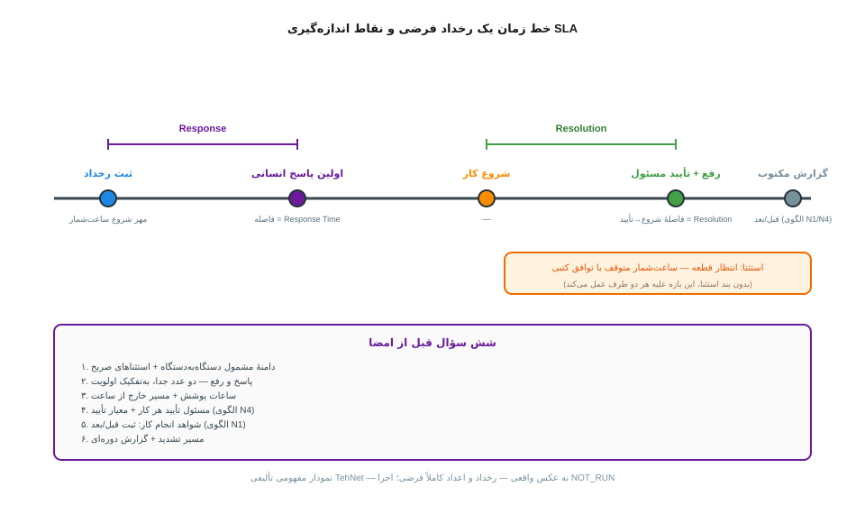

# قرارداد پشتیبانی و SLA — سؤالات کلیدی قبل از امضا (N3)

> وضعیت درس: **DRAFT / NOT_DEPLOYED — در انتظار مرور.**
> آموزش از سری پشتیبانی؛ مخاطب: مدیر کسب‌وکار و مدیر IT.
> سناریوی کاملاً فرضی و آموزشی با دادهٔ ساختگی؛ هیچ پیمانکار/قیمت/پروژهٔ واقعی‌ای در این درس نیست و هیچ اجرای واقعی NOT_RUN است.
> نمودار مفهومی و تألیفی است (نه عکس واقعی).

## پاسخ کوتاه

دو پیشنهاد پشتیبانی وقتی قابل‌مقایسه می‌شوند که شش چیز صریح باشند: **دامنهٔ سرویس‌ها** (چه چیزهایی مشمول است)، **زمان اولین پاسخ و زمان رفع** (دو عدد جدا، نه یک «ریسپانسیو» مبهم)، **مسئول تأیید** هر کار، **استثناها** (قطعی اینترنت ISP، تأمین قطعه، سخت‌افزار مشتری)، **شواهد انجام کار** (ثبت قبل/بعد + گزارش) و **مسیر تشدید** وقتی کار جلو نمی‌رود. بدون این‌ها، هر دو پیشنهاد «پشتیبانی» خوانده می‌شوند ولی دو چیز کاملاً متفاوت را می‌فروشند.

## پیش‌نیازها

- الگوی ثبت رخداد و تست پذیرش: [عیب‌یابی (N1)](n1-network-troubleshooting.fa.md) · [چک‌لیست پذیرش تحویل (N4)](n4-delivery-acceptance.fa.md)
- مبانی DHCP/DNS برای درک دامنهٔ سرویس: [M3](m3-dhcp-dns.fa.md)

## مبنا آزمایشگاه — سناریوی مقایسهٔ فرضی

| بند | مقدار فرضی آموزشی |
|---|---|
| سازمان | دفتر ۲۵ نفره + اتاق سرور کوچک (فرضی) |
| سرویس‌های مشمول فرضی | شبکهٔ LAN، اینترنت دفتر، ‏NAS، چاپگر شبکه |
| خارج از دامنه فرضی | سرور فیزیکی، ‏Wi-Fi، نرم‌افزارهای کسب‌وکار |
| هدف درس | ساخت «برگهٔ سؤالات قبل از امضا» و «جدول مقایسهٔ ساختاریافته» دو پیشنهاد فرضی A/B |

پیشنهادهای A و B کاملاً ساختگی و فقط برای آموزش ساختار مقایسه‌اند؛ هیچ شباهتی به پیشنهاد واقعی هیچ شرکتی ادعا نمی‌شود.

## شش سؤال کلیدی قبل از امضا

| # | سؤال | چرا گران است اگر نباشد | خروجی قابل‌ثبت |
|---|---|---|---|
| ‏۱ | دامنهٔ سرویس دقیقاً چیست؟ (دستگاه‌به‌دستگاه یا «شبکه»؟) | «شبکه» می‌تواند یعنی فقط روتر | فهرست دستگاه/سرویس مشمول + استثناهای صریح |
| ‏۲ | زمان اولین **پاسخ** و زمان **رفع** چند است؟ (دو عدد جدا) | پاسخ فوری با رفع هفته‌ای بعد، هم SLA خوانده می‌شود | دو عدد به‌تفکیک اولویت (بحرانی/عادی) |
| ‏۳ | ساعات پوشش چیست؟ (کاری/‏24-7/تعطیلات) | رخداد جمعه‌شب، دوشنبه صبح حساب می‌شود | جدول ساعت‌ها + مسیر تماس خارج از ساعت |
| ‏۴ | مسئول تأیید اتمام هر کار کیست؟ | «تمام شد» بدون تأیید کارفرما قابل‌چالش است | نام/نقش تأییدکننده + معیار تأیید (الگوی N4) |
| ‏۵ | استثناها چیست؟ (ISP، تأمین قطعه، سخت‌افزار مشتری) | بدون استثنا، SLA برای چیزی که کنترل ندارید تعهد می‌شود | فهرست استثنا + رفتار در استثنا (اطلاع‌رسانی/توقف ساعت) |
| ‏۶ | شواهد انجام کار چیست؟ | «بررسی شد» بدون خروجی قابل‌ررسی نیست | الگوی N1/N4: ثبت قبل/بعد + دستورهای اجراشده |

## SLA سنجش‌پذیر — از عبارت به عدد

| عبارت مبهم | نسخهٔ سنجش‌پذیر | نحوهٔ اندازه‌گیری |
|---|---|---|
| «پاسخ‌گوییم» | «اولین پاسخ غیر‌خودکار حداکثر ‏2 ساعت کاری از ثبت رخداد» | مهر زمان ثبت تا مهر زمان اولین پاسخ انسانی |
| «سریع رفع می‌کنیم» | «رفع حداکثر ‏8 ساعت کاری برای رخداد بحرانی» (بحرانی=کل دفتر قطع) | تعریف بحرانی از قبل نوشته شود |
| «پشتیبانی دورهای داریم» | «یک بازدید/بررسی دوره‌ای ماهانه با گزارش مکتوب» | گزارش ماهانه با چک‌لیست (الگوی N2) |
| «در دسترس بودن شبکه» | عددی فقط با مانیتور قابل‌ادعا است | بدون مانیتور (N2) هیچ SLA در دسترس بودن قابل‌سنجش نیست — **UNKNOWN برای مبنا بدون ابزار** |

نمودار زیر توالی یک رخداد و نقاط اندازه‌گیری SLA را نشان می‌دهد.

**شرح متنی نمودار (جایگزین تصویر برای دسترس‌پذیری):** خط زمان از چپ به راست: ‏«ثبت رخداد» (مهر شروع) → «اولین پاسخ انسانی» (فاصله = Response Time) → «شروع کار» → «رفع و تأیید مسئول» (فاصلهٔ شروع تا تأیید = Resolution Time) → «گزارش مکتوب». زیر خط، بازه‌های استثنا با رنگ متفاوت (مثلاً انتظار قطعه — ساعت‌شمار متوقف با توافق). برچسب «تألیفی/مفهومی».

## جدول مقایسهٔ ساختاریافتهٔ A/B (نمونهٔ خالی برای پرکردن)

| بند سنجش | پیشنهاد A (فرضی) | پیشنهاد B (فرضی) |
|---|---|---|
| دامنه: دستگاه/سرویس مشمول | | |
| پاسخ بحرانی/عادی (ساعت کاری) | | |
| رفع بحرانی/عادی (ساعت کاری) | | |
| ساعات پوشش + مسیر خارج‌ساعت | | |
| استثناها (ISP/قطعه/سخت‌افزار) | | |
| شواهد انجام کار (قبل/بعد) | | |
| مسیر تشدید + نام مسئول | | |
| گزارش دوره‌ای | | |

قاعده: تا هر دو ستون پر نشوند، «ارزان‌تر/بهتر» معنا ندارد.

## خطاهای رایج قبل از امضا

| خطا | چرا گران است | درست |
|---|---|---|
| مقایسهٔ فقط قیمت | ‏SLA بی‌عدد و بی‌دامنه با نصف قیمت، سرویس متفاوتی است | جدول ساختاریافتهٔ بالا پر شود |
| اشتباه Response با Resolution | «پاسخ در ‏15دقیقه» یعنی رفع نیست | دو عدد جدا بخواهید |
| SLA برای وابستگی خارج از کنترل | قطعی ISP یا تأمین قطعه، ساعت‌شمار را منصفانه نمی‌بندد | استثناها صریح + رفتار هنگام استثنا |
| «ریسپانسیو بودن» بدون ثبت | بدون مهر زمان و لاگ، هیچ ادعایی قابل‌اثبات نیست | ثبت رخداد (الگوی N1) شرط است |
| نبود مسئول تأیید | پایان کار جدل‌برانگیز می‌شود | تأییدکننده + معیار (الگوی N4) |

## تمرین کوتاه (با پاسخ موردانتظار)

1. پیشنهادی می‌گوید «پاسخ در ‏15 دقیقه»؛ دو سؤال فوری شما؟ — **پاسخ موردانتظار:** پاسخ انسانی یا خودکار؟ و بعد از پاسخ، رفع تا کِی (Resolution جدا)؟
2. قطعی اینترنت از سمت ISP رخ داده و رفع ‏6 ساعت طول کشیده؛ SLA شکسته؟ — **پاسخ موردانتظار:** اگر استثنای ISP صریح باشد، ساعت‌شمار متوقف/معاف است — به‌شرط ثبت زمان‌ها؛ بدون بند استثنا، قابل‌چالش است.
3. «پشتیبانی دوره‌ای» را چطور سنجش‌پذیر کنید؟ — **پاسخ موردانتظار:** تعداد/دورهٔ بازدید + گزارش مکتوب با چک‌لیست (الگوی N2) — بدون گزارش، انجام‌شده حساب نمی‌شود.
4. برای مقایسهٔ A/B از کجا شروع کنید؟ — **پاسخ موردانتظار:** پرکردن جدول ساختاریافتهٔ ۸ بندی برای هر دو؛ تا پر نشود هیچ مقایسه‌ای معتبر نیست.

## چک‌لیست تحویل (قبل از امضا)

- [ ] دامنهٔ مشمول/استثنا دستگاه‌به‌دستگاه فهرست شده
- [ ] Response و Resolution جدا، به‌تفکیک اولویت و ساعت کاری عددی شده
- [ ] استثناها (ISP/قطعه/سخت‌افزار) + رفتار ساعت‌شمار صریح است
- [ ] مسئول تأیید + معیار تأیید هر کار مشخص است
- [ ] شواهد انجام کار (ثبت قبل/بعد — الگوی N1/N4) الزامی شده
- [ ] مسیر تشدید و گزارش دوره‌ای تعریف شده
- [ ] جدول مقایسهٔ A/B هر دو ستونش کامل است
- [ ] این درس فرضی است؛ اجرا/خرید واقعی NOT_RUN

## منابع (تأیید/تاریخ‌دار)

- الگوهای ثبت رخداد/پذیرش: درس‌های [N1](n1-network-troubleshooting.fa.md) و [N4](n4-delivery-acceptance.fa.md) همین سری
- تعریف زنجیره‌ها برای تشخیص «کدام rule» در اختلاف‌های فنی: https://manual.mikrotik.com/docs/firewall-and-quality-of-service/packet-flow-in-routeros/ (دسترسی 2026-11-16)
- تجربهٔ فرایندی عمومی قرارداد — روش، بدون ادعای قیمت/پیمانکار/پروژهٔ واقعی

## آموزش‌های مرتبط و مسیر خدمت

| پیوند | مقصد |
|---|---|
| درس‌های مرتبط | [N1](n1-network-troubleshooting.fa.md) · [N4](n4-delivery-acceptance.fa.md) · [N2](n2-monitoring-maintenance.fa.md) |
| نقشهٔ کامل سری | [topic map](../topic-map.md) |
| پشتیبانی شبکهٔ سازمان شما | [خدمات پشتیبانی شبکهٔ تهران](https://tehnet.ir/services/network-support-tehran/) |
| درس بعدی سری | N5 — backup و export پیکربندی MikroTik (تولید در نوبت بعدی؛ فعلاً فقط در topic map) |
