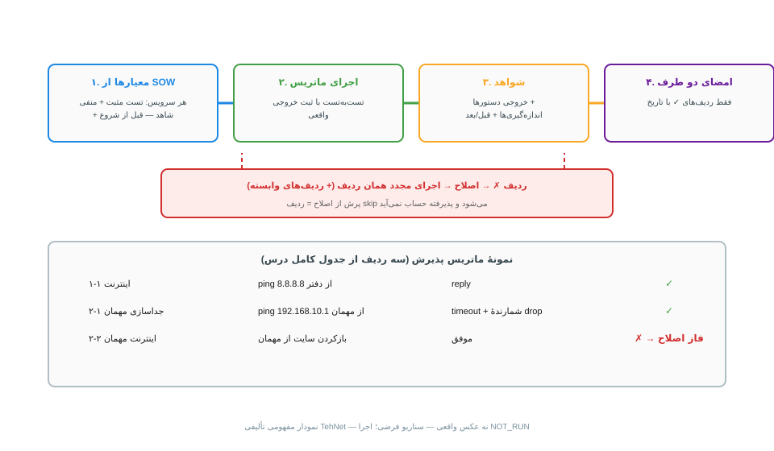

# چک‌لیست پذیرش تحویل شبکه — تست مثبت/منفی و ثبت شواهد (N4)

> وضعیت درس: **DRAFT / NOT_DEPLOYED — در انتظار مرور.**
> آموزش تصویری از سری پشتیبانی و پذیرش؛ مخاطب: مدیر کسب‌وکار + کارشناس شبکه.
> سناریوی کاملاً فرضی و آموزشی با دادهٔ ساختگی؛ هیچ شبکهٔ واقعی دستکاری نشده و هیچ اجرای واقعی NOT_RUN است.
> نمودار مفهومی و تألیفی است (نه عکس واقعی).

## پاسخ کوتاه

پذیرش تحویل یعنی: هر سرویسِ اعلام‌شده در قرارداد/پیشنهاد، با یک **تست مثبت** (باید کار کند) و یک **تست منفی** (باید بسته بماند) روی همان محیط اجرا و **شاهدش ثبت** شود — خروجی دستور یا اندازه‌گیری، نه «چشم‌بسته امضا». چیزی که تست نشده یا معیارش از قبل نوشته نشده، پذیرفته‌شده حساب نمی‌شود؛ و تست منفی هم‌وزن تست مثبت است: جداسازی مهمان که فقط «اجازه» تست شده باشد، ثابت نکرده مهمان به شبکهٔ داخلی هم نمی‌رسد.

## پیش‌نیازها

- الگوهای تست مثبت/منفی همین سری: [VLAN (M2)](m2-vlan-small-office.fa.md) · [DHCP و DNS (M3)](m3-dhcp-dns.fa.md) · [بودجهٔ PoE (S2)](s2-poe-budget.fa.md) · [ماژول‌ها (S3)](s3-sfp-dac-fiber.fa.md) · [عیب‌یابی (N1)](n1-network-troubleshooting.fa.md)
- خواندن جدول مسیر کلاینت: [route command — سند رسمی مایکروسافت](https://learn.microsoft.com/en-us/windows-server/administration/windows-commands/route_ws2008) (دسترسی 2026-11-16)

## مبنا آزمایشگاه (Lab Baseline) — پروژهٔ فرضی تحویل

| بند | محتوای اعلام‌شده (SOW فرضی) | الگوی تست از سری |
|---|---|---|
| سرویس ۱ | اینترنت برای همهٔ کاربران | M2 تست‌های ۱/۹ |
| سرویس ۲ | چهار VLAN با جداسازی (دفتر/دوربین/تلفن/مهمان) | M2 جدول سیاست + تست‌های ۲-۴/۸-۱۰ |
| سرویس ۳ | DHCP و نام‌های داخلی | M3 تست‌های ۱-۴ |
| سرویس ۴ | ‏PoE برای دوربین/تلفن با بودجهٔ محاسبه‌شده | S2 روش پنج‌مرحله‌ای |
| سرویس ۵ | لینک 10G رک-سرور | S3 انتخاب/اجرای ماژول |
| خارج از دامنه | سرور فیزیکی، بکاپ سرور، Wi-Fi | خارج از چک‌لیست پذیرش — فقط ثبت می‌شود |

قاعدهٔ کلیدی: چک‌لیست پذیرش از **SOW** ساخته می‌شود نه از «چیزهایی که نصب شد». هر سرویس اعلام‌شده = حداقل یک تست مثبت + یک تست منفی + شاهد.

### ماتریس نمونهٔ پذیرش (برای مبناى بالا — بخشی از جدول کامل)

| # | سرویس | تست | انتظار | شاهد ثبت‌شونده | نتیجه |
|---|---|---|---|---|---|
| ‏۱-۱ | اینترنت | از کلاینت دفتر `ping 8.8.8.8` | reply | خروجی دستور با تاریخ | ☐ |
| ‏۲-۱ | جداسازی مهمان | از پورت مهمان `ping 192.168.10.1` | timeout | خروجی + شمارندهٔ drop input | ☐ |
| ‏۲-۲ | جداسازی مهمان | از پورت مهمان بازکردن سایت | موفق | — | ☐ |
| ‏۳-۱ | DHCP/Naming | `nslookup nas.lan` از کلاینت دفتر | 192.168.88.10 | خروجی | ☐ |
| ‏۴-۱ | ‏PoE | جمع demand ≤ بودجه؛ ‏monitor هر پورت | زیر سقف | خروجی monitor | ☐ |
| ‏۵-۱ | ‏10G | لینک ‏SFP+ سرور/NAS با ماژول انتخابی S3 | ‏10G link | `/interface ethernet monitor` | ☐ |
| ‏۶-۱ | مدیریت | ‏WinBox از مهمان | رد | خروجی/شمارنده | ☐ |

ردیف‌های ۱-۱ و ۲-۱/۲-۲ جفت «مثبت+منفی» را نشان می‌دهند؛ برای هر سرویس مشابه تکمیل می‌شود.



**شرح متنی نمودار (جایگزین تصویر برای دسترس‌پذیری):** چهار فاز از چپ به راست: ‏«۱. معیارها از SOW» (قبل از شروع، هر سرویس = تست مثبت + منفی + شاهد) → ‏«۲. اجرای ماتریس» (تست‌به‌تست با ثبت خروجی) → ‏«۳. شواهد» (خروجی دستورها، اندازه‌گیری‌ها، قبل/بعد) → ‏«۴. امضای دو طرف» (فقط برای ردیف‌های ✓). زیر نمودار: ردیف‌های ✗ به فاز ۲ برمی‌گردند (اصلاح و اجرای مجدد همان ردیف). برچسب «تألیفی/مفهومی».

## ثبت قبل/بعد — شرط بازگشت‌پذیری

```routeros
# قبل از شروع تغییرات پذیرش:
/system backup save name=pre-acceptance
/export file=pre-acceptance
```

- گزارش تغییر = diff دو export (قبل/بعد) که نشان می‌دهد دقیقاً چه چیزهایی عوض شد.
- هر اصلاح حین پذیرش (مثلاً رفع یک rule جاافتاده) خودش قبل/بعد دارد و ردیف ماتریس مربوطه از نو اجرا می‌شود.
- اجرای این دستورها در این درس NOT_RUN (مبنا فرضی) — در پروژهٔ واقعی خروجی‌ها به‌عنوان شواهد ضمیمه می‌شوند.

## بستهٔ مستندات تحویل

| سند | محتوا |
|---|---|
| ‏config export نهایی | خروجی متنی پیکربندی نهایی (بدون پسوردها — رمزها خارج این سند در مدیر رمز) |
| نقشهٔ توپولوژی | پورت‌به‌پورت با VLAN/آدرس‌ها |
| جدول آدرس‌دهی و رزروها | مشابه جدول درس M3 |
| ماتریس پذیرش تکمیل‌شده | همهٔ ردیف‌ها ✓ با تاریخ/شاهد |
| گزارش تغییرات | قبل/بعد هر اصلاح حین پذیرش |
| راهنمای عملیات پایه | روش backup/restore و مسیر عیب‌یابی اولیه (ارجاع N1) |

**قید داده:** هیچ رمز، دادهٔ مشتری یا توپولوژی واقعی محرمانه در این اسناد آموزشی نمی‌آید.

## خطاهای رایج پذیرش

| خطا | چرا گران است | درست |
|---|---|---|
| امضای کور («کارش می‌کنه دیگه») | بعداً هر ایراد = اختلاف‌برانگیز | معیار قبل از اجرا نوشته و ماتریس اجرا شود |
| فقط تست مثبت | جداسازی/بستن‌ها اثبات نمی‌شوند | هر policy جفت مثبت+منفی |
| تست فقط از یک VLAN/یک دستگاه | خرابی بخش‌های دیگر پذیرفته می‌شود | نمونه‌گیری از همهٔ بخش‌های اعلام‌شده |
| پذیرش بدون معیار در قرارداد | «درست بودن» برداشت سلیقه‌ای می‌شود | معیارها ضمیمهٔ قرارداد؛ چک‌لیست از آن ساخته شود |
| حذف حاشیهٔ امن برای قبول‌شدن (مثل بودجهٔ PoE) | فردا با رشد، سقف می‌زند | حاشیهٔ سندشده دست‌نخورده؛ کسری = ردیف اصلاح |
| اشتباه‌گرفتن timeout سیاستی با خرابی | policy عمدی را خراب گزارش می‌کند | سیاست را بخوانید (الگوی N1 و M2/M3) |

## تمرین کوتاه (با پاسخ موردانتظار)

1. پیمانکار می‌گوید «جداسازی انجام شد، فقط دوربین‌ها را تست نکردیم»؛ وضعیت ردیف جداسازی دوربین چیست؟ — **پاسخ موردانتظار:** پذیرفته‌شده نیست؛ تست مثبت (دوربین→DVR) و منفی (دوربین→بیرون VLAN) هر دو باید اجرا و شاهد ثبت شود.
2. چرا تست منفی مهمان‌→داخلی هم‌وزن تست مثبت مهمان‌→اینترنت است؟ — **پاسخ موردانتظار:** چون «اینترنت فقط» یعنی هم اجازهٔ بیرون و هم ردِ داخلی؛ بدون منفی، سیاست نیمه‌اجرا پذیرفته می‌شود.
3. حین پذیرش یک rule جاافتاده اصلاح می‌شود؛ ثبت لازم؟ — **پاسخ موردانتظار:** قبل/بعد همان اصلاح + اجرای مجدد ردیف ماتریس مربوطه (و ردیف‌های وابسته) + افزودن به گزارش تغییرات.
4. دو سرویس «کار می‌کند» ولی معیار پذیرش‌شان در قرارداد نیامده؟ — **پاسخ موردانتظار:** قبل از امضا معیار نوشته و توافق می‌شود؛ یا ردیف به‌صورت مشروط/غیرپذیرفته ثبت می‌گردد — امضای کور نه.

## چک‌لیست تحویل (خودِ فرایند پذیرش)

- [ ] ماتریس از SOW ساخته شده (نه از لیست نصب‌شده‌ها)
- [ ] هر سرویس: تست مثبت + منفی + شاهد قابل‌ثبت دارد
- [ ] backup/export قبل از شروع و گزارش diff تغییرات موجود است
- [ ] ردیف‌های ✗ اصلاح و مجدداً اجرا شده‌اند (نه skip)
- [ ] بستهٔ مستندات تحویل (۶ سند بالا) کامل و بدون دادهٔ حساس است
- [ ] امضا فقط برای ردیف‌های ✓ با تاریخ و شاهد
- [ ] اجرای واقعی این درس NOT_RUN (مبنا فرضی)

## منابع (تأیید/تاریخ‌دار)

- الگوهای تست مثبت/منفی و جداول انتظار: مستقیماً از درس‌های همین سری — ‏M2 (۱۴ ردیف)، ‏M3 (۹ ردیف)، ‏S2 (روش ۵مرحله‌ای)، ‏S3 (قواعد سازگاری)، ‏N1 (نردبان لایه‌ای)
- Packet Flow در RouterOS (تشخیص اینکه هر تست کدام زنجیره را می‌سنجد): https://manual.mikrotik.com/docs/firewall-and-quality-of-service/packet-flow-in-routeros/ (دسترسی 2026-11-16)
- route command ویندوز: https://learn.microsoft.com/en-us/windows-server/administration/windows-commands/route_ws2008 (دسترسی 2026-11-16)
- تجربهٔ فرایندی عمومی پذیرش — به‌عنوان روش، بدون ادعای آمار/پروژهٔ واقعی

## آموزش‌های مرتبط و مسیر خدمت

| پیوند | مقصد |
|---|---|
| الگوهای تست | [M2](m2-vlan-small-office.fa.md) · [M3](m3-dhcp-dns.fa.md) · [S2](s2-poe-budget.fa.md) · [S3](s3-sfp-dac-fiber.fa.md) · [N1](n1-network-troubleshooting.fa.md) |
| نقشهٔ کامل سری | [topic map](../topic-map.md) |
| اجرا و پذیرش پروژهٔ شبکهٔ شما | [خدمات راه‌اندازی شبکهٔ تهران](https://tehnet.ir/services/network-setup-tehran/) |
| پشتیبانی پس از تحویل | [خدمات پشتیبانی شبکهٔ تهران](https://tehnet.ir/services/network-support-tehran/) |
| درس بعدی سری | N2 — مانیتورینگ و نگهداری دوره‌ای (تولید در نوبت بعدی؛ فعلاً فقط در topic map) |
