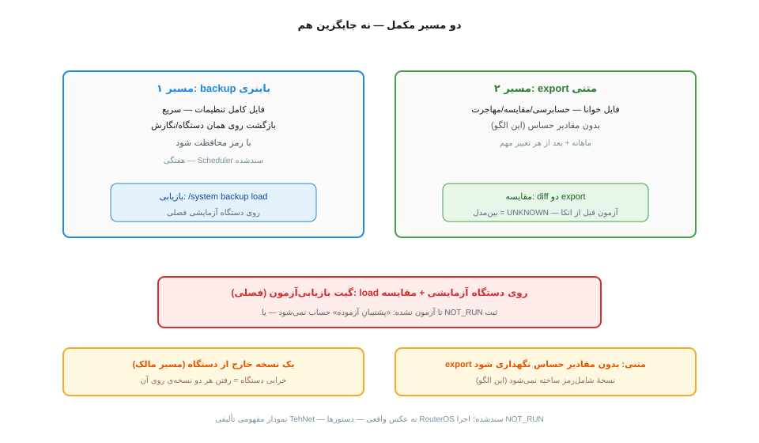

# backup و export پیکربندی MikroTik — تفاوت، زمان‌بندی و آزمون بازیابی (N5)

> وضعیت درس: **DRAFT / NOT_DEPLOYED — در انتظار مرور.**
> آموزش تصویری از سری پشتیبانی؛ مخاطب: کارشناس شبکه.
> سناریوی کاملاً فرضی و آموزشی با دادهٔ ساختگی؛ هیچ شبکهٔ واقعی دستکاری نشده و هیچ اجرای واقعی NOT_RUN است.
> نمودار مفهومی و تألیفی است (نه عکس واقعی).

## پاسخ کوتاه

دو ابزار مکمل‌اند نه جایگزین هم: **backup** (فایل باینری کامل، سریع برای بازگرداندن روی همان دستگاه/نگارش) و **export** (فایل متنی خوانا برای حسابرسی، مقایسه و مهاجرت). هیچ‌کدام به‌تنهایی «پشتیبان» نیستند تا یک‌بار **بازیابی‌آزمون** شوند (قاعدهٔ درس N2). نسخه‌ها را تاریخ‌دار نگه دارید، یک نسخه را **خارج از دستگاه** نگه دارید و به‌خاطر داشته باشید export می‌تواند شامل رمزها باشد — نگهداری‌اش امن، مثل خود رمز.

## پیش‌نیازها

- مبنا: [DHCP و DNS (M3)](m3-dhcp-dns.fa.md) — همین hEX فرضی
- قاعدهٔ بازیابی‌آزمون: [چک‌لیست پذیرش (N4)](n4-delivery-acceptance.fa.md) و چک‌لیست فصلی [N2](n2-monitoring-maintenance.fa.md)

## مبنا آزمایشگاه (Lab Baseline) — دقیق و کامل

| بند | مقدار فرضی |
|---|---|
| دستگاه | hEX (RB750Gr3)، ‏RouterOS v7.16+ (مبناى M3) |
| فایل backup | `hex-backup-YYYY-MM-DD.backup` با رمز (فرض آموزشی) |
| فایل export | `hex-export-YYYY-MM-DD.rsc` متنی |
| نگهداری نسخه‌ها | روی دستگاه (پوشهٔ فایل‌ها) + **یک نسخهٔ خارج از دستگاه** (درایو/سرویس نگهداری فایل مالک — خارج دامنهٔ این درس) |
| زمان‌بندی | backup هفتگی خودکار با Scheduler + export ماهانه دستی/زمان‌بندی‌شده + export فوری بعد از هر تغییر مهم |

## backup در برابر export — دو مسیر متفاوت

| بند | backup (باینری) | export (متنی .rsc) |
|---|---|---|
| ماهیت | تصویر کامل تنظیمات | فرمان‌های بازسازی تنظیمات به‌صورت متنی |
| بهترین کاربرد | بازگشت سریع روی **همان دستگاه/نگارش** | حسابرسی، مقایسهٔ نسخه‌ها، مهاجرت، مستندسازی |
| خوانایی | غیرقامل‌مطالعه | خوانا و قابل‌diff |
| رمزها | فایل با رمز محافظت می‌شود (`password=`) | به‌صورت پیش‌فرض مقادیر حساس حذف می‌شوند؛ با پارامتر حساس‌نما شامل می‌شوند — این درس فقط نسخهٔ حذف‌شده تولید می‌کند و نسخهٔ شامل‌رمز را نمی‌سازد |
| وابستگی | به مدل/نگارش RouterOS حساس‌تر | عمومی‌تر؛ برخی تنظیمات وابسته به سخت‌افزار ممکن است روی مدل دیگر معنی ندهد — **UNKNOWN** برای هر مهاجرت بین‌مدل؛ قبل از اتکا، بازیابی‌آزمون |



**شرح متنی نمودار (جایگزین تصویر برای دسترس‌پذیری):** دو مسیر مکمل کنار هم: مسیر اول ‏backup باینری رمزدار (هفتگی با Scheduler؛ کاربرد: بازگشت سریع روی همان دستگاه؛ بازیابی از طریق `/system backup load` روی دستگاه آزمایشی در آزمون فصلی) و مسیر دوم ‏export متنی بدون مقادیر حساس (ماهانه؛ کاربرد: حسابرسی، مقایسه با diff، مهاجرت با هشدار UNKNOWN بین‌مدل). زیر این دو، گیت قرمز «بازیابی‌آزمون فصلی» آمده: تا load روی دستگاه آزمایشی و مقایسه انجام نشده، پشتیبان «آزموده» حساب نمی‌شود و صادقانه NOT_RUN ثبت می‌گردد. دو جعبهٔ زرد پایین: یک نسخه خارج از دستگاه (چون خرابی دستگاه هر دو نسخه روی آن را می‌برد) و نگهداری امن export بدون مقادیر حساس. برچسب «تألیفی/مفهومی».

دستورهای مبنا (اجرا NOT_RUN):

```routeros
# backup هفتگی — با رمز؛ تاریخ در نام
/system backup save name="hex-backup-2026-11-16" password="********" comment="TN-N5 weekly"

# export متنی ماهانه — بدون مقادیر حساس
/export file="hex-export-2026-11-16"
```

## زمان‌بندی خودکار — با Scheduler سندشدهٔ RouterOS

قابلیت Scheduler بخشی از RouterOS است (در این درس فقط نام قابلیت؛ URL بخش مستندات جداگانه تأیید نشده و عیناً ساخته نشده — الگوی صادقانهٔ S2). نمونهٔ الگو (اجرا NOT_RUN):

```routeros
/system scheduler
add name=tn-n5-weekly-backup interval=7d on-event="/system backup save name=\"hex-backup-auto\" password=\"********\" comment=\"TN-N5 auto\"" start-time=03:30:00 comment="TN-N5 weekly"
```

- اقدام زمان‌بندی‌شده فقط **ساخت فایل روی خود دستگاه** است؛ انتقال فایل به بیرون دستگاه در این درس نیست (نیازمند تصمیم مسیر امن مالک).
- ساعت اجرا خارج ساعات کاری انتخاب شده؛ بدون هیچ اقدام مؤثر دیگر.

## بازیابی و آزمون بازیابی

| مسیر | دستور مبنا | محدودیت سندشده‌وار |
|---|---|---|
| بازگرداندن backup | `/system backup load name="hex-backup-..." password="********"` | بهترین بازگشت روی همان دستگاه و نگارش نزدیک |
| اعمال export روی دستگاه تازه | import فایل rsc از File list | **UNKNOWN بین‌مدل**؛ قبل از اتکا: آزمون روی دستگاه آزمایشی |

رویهٔ آزمون بازیابی (فصلی — قاعدهٔ N2): فایل backup را روی **دستگاه آزمایشی** (نه روتر تولید) با نگارش نزدیک load کنید، سپس مقایسهٔ export دستگاه آزمایشی با export اصلی — تطبیق ساختار = آزمون موفق. اگر دستگاه آزمایشی ندارید، آزمون انجام نشده است و صادقانه NOT_RUN ثبت می‌شود؛ فایل پشتیبانِ بدون آزمون را «آزموده» ننویسید.

## خطاهای رایج

| خطا | چرا گران است | درست |
|---|---|---|
| فقط backup و هرگز export | حسابرسی/مقایسه/مهاجرت ناممکن می‌شود | هر دو، هفتگی/ماهانه |
| export شامل‌رمز روی اشتراک‌فایل | فایل متنیِ شامل رمز = لو رفتن رمز | export بدون حساس‌ها برای نگهداری متنی |
| backup روی همان دستگاه به‌عنوان «خارج» | خرابی دستگاه = رفتن هر دو نسخه | یک نسخه واقعاً خارج دستگاه |
| بازیابی بین‌مدل بدون آزمون | UNKNOWN بین‌مدل | آزمون روی دستگاه آزمایشی قبل از اتکا |
| نام فایل بدون تاریخ | ناآگاهی از کهنه/تازه بودن | تاریخ در نام + comment |

## تمرین کوتاه (با پاسخ موردانتظار)

1. کدام برای مقایسهٔ تنظیمات دیروز و امروز مناسب‌تر است؟ — **پاسخ موردانتظار:** export متنی (قابل‌diff)؛ backup باینری برای این کار خوانا نیست.
2. فایل backup بدون رمز روی دستگاه مانده؛ ریسک؟ — **پاسخ موردانتظار:** هرکس به فایل دسترسی داشته باشد کل تنظیمات را بازیابی می‌کند؛ فایل backup همیشه با رمز و نگهداری امن.
3. «ماهانه export می‌گیریم» کدام نیاز حسابرسی را پوشش نمی‌دهد؟ — **پاسخ موردانتظار:** بازگشت سریع به تنظیمات قبلی پس از خرابی — آن نیاز مسیر backup است؛ دو مسیر مکمل‌اند.
4. بازیابی بین‌مدل (hEX به RB5009) چرا نیاز به آزمون دارد؟ — **پاسخ موردانتظار:** UNKNOWN بین‌مدل سندشده‌وار — برخی تنظیمات وابسته به سخت‌افزار/نگارش روی مدل دیگر معنی یا اعتبار ندارند.

## چک‌لیست تحویل

- [ ] هر دو مسیر فعال: backup هفتگی (رمزدار) + export ماهانه متنی
- [ ] Scheduler تعریف‌شده با نام/comment قابل‌شناسایی (اجرای واقعی NOT_RUN)
- [ ] یک نسخه خارج از دستگاه نگهداری می‌شود (مسیر مالک)
- [ ] بازیابی‌آزمون فصلی برنامه‌ریزی شده؛ وضعیت فعلی NOT_RUN ثبت شده
- [ ] نام‌فایل‌ها تاریخ‌دار و commentدار
- [ ] export نگهداری‌شده بدون مقادیر حساس است
- [ ] UNKNOWN بین‌مدل در سند مهاجرت ثبت شده

## منابع (تأیید/تاریخ‌دار)

- قابلیت‌های ‏backup، ‏export، ‏scheduler: بخش‌های سندشدهٔ RouterOS — در این درس **فقط نام قابلیت** استفاده شده و URL بخش مستندات‌شان جداگانه تأیید نشده است (عیناً URL ساخته نشده — الگوی صادقانهٔ S2؛ مدیریت سیستم، شبکهٔ واقعی دست‌نخورده)
- قاعدهٔ بازیابی‌آزمون و ثبت قبل/بعد: درس‌های [N2](n2-monitoring-maintenance.fa.md) و [N4](n4-delivery-acceptance.fa.md) همین سری
- تجربهٔ فرایندی عمومی نگهداری پشتیبان — بدون ادعای آمار/مورد واقعی

## آموزش‌های مرتبط و مسیر خدمت

| پیوند | مقصد |
|---|---|
| درس‌های مرتبط | [N2 نگهداری دوره‌ای](n2-monitoring-maintenance.fa.md) · [N4 پذیرش تحویل](n4-delivery-acceptance.fa.md) · [M3 مبنا](m3-dhcp-dns.fa.md) |
| نقشهٔ کامل سری | [topic map](../topic-map.md) |
| نگهداری و پشتیبان‌گیری شبکهٔ شما | [خدمات پشتیبانی شبکهٔ تهران](https://tehnet.ir/services/network-support-tehran/) |
| درس بعدی سری | N6 — مسیر رخداد و تشدید (تولید در نوبت بعدی؛ فعلاً فقط در topic map) |
