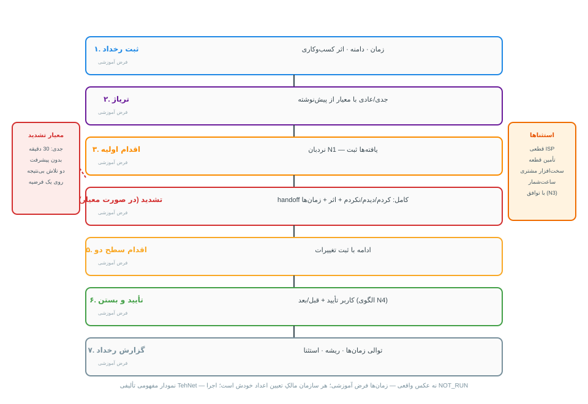

# مسیر رخداد و تشدید — از ثبت تا بستن (N6)

> وضعیت درس: **DRAFT / NOT_DEPLOYED — در انتظار مرور.**
> آموزش تصویری از سری پشتیبانی؛ مخاطب: مدیر کسب‌وکار + کارشناس شبکه.
> سناریوی کاملاً فرضی و آموزشی با دادهٔ ساختگی؛ هیچ شبکهٔ واقعی دستکاری نشده و هیچ اجرای واقعی NOT_RUN است.
> زمان‌های جدول‌ها «فرض آموزشی»‌اند نه SLA واقعی (SLA → درس N3).
> نمودار مفهومی و تألیفی است (نه عکس واقعی).

## پاسخ کوتاه

مسیر رخداد یعنی یک توالی ثبت‌شدهٔ از پیش‌موافق: **ثبت** (زمان/دامنه/اثر کسب‌وکاری) → **تریاژ** (جدی/عادی با معیار از پیش‌نوشته) → **اقدام** (الگوی نردبان N1) → در صورت نیاز **تشدید** (با معیارِ از پیش‌موافق و handoff کامل) → **تأیید و بستن** (با ثبت قبل/بعد — الگوی N4). بدون مسیرِ از پیش‌موافق، هر رخداد به تماس‌های پراکنده، «فردا درست می‌شه» و اختلاف بعدی تبدیل می‌شود. استثناها (قطعی ISP، تأمین قطعه، سخت‌افزار مشتری) از قبل تعریف می‌شوند تا ساعت‌شمار منصفانه باشد (الگوی N3).

## پیش‌نیازها

- نردبان عیب‌یابی: [N1](n1-network-troubleshooting.fa.md) · پذیرش/ثبت قبل-بعد: [N4](n4-delivery-acceptance.fa.md) · استثناهای قراردادی: [N3](n3-support-contract-sla.fa.md) · مانیتور: [N2](n2-monitoring-maintenance.fa.md)

## مبنا آزمایشگاه (Lab Baseline) — سناریوی فرضی رخداد

| بند | مقدار فرضی آموزشی |
|---|---|
| سازمان | دفتر ۲۵ نفره (مبنای N3) |
| رخداد فرضی | اتاق سرور از ساعت ‏09:10 در دسترس نیست؛ ‏۱۲ نفر کارشان ایستاده |
| اثر کسب‌وکاری (ثبت‌شونده) | تعداد کاربر متأثر + سرویس‌های قطع + مدت |
| اعداد زمان‌سنج جدول‌ها | «فرض آموزشی» — هر سازمان خودش را تعیین می‌کند (UNKNOWN عمومی) |
| اجرای واقعی | NOT_RUN — همهٔ ثبت‌ها نمونهٔ ساختگی |

## جدول مراحل — مسئول و ثبت هر گام (زمان‌ها = فرض آموزشی)

| مرحله | چه کسی | چه ثبت می‌شود | زمان فرض |
|---|---|---|---|
| ‏۱ ثبت رخداد | هر کاربر/کارشناس | زمان، دامنه، اثر (چند نفر/چه سرویسی)، گزارشگر | لحظهٔ گزارش |
| ‏۲ تریاژ | کارشناس پذیرنده | جدی/عادی (معیار از پیش‌نوشته: «کل دفتر یا سرور = جدی») | ≤ ‏۱۵ دقیقه فرض |
| ‏۳ اقدام اولیه | کارشناس | نردبان N1 شروع شد؛ یافتهٔ اول | ≤ ‏۳۰ دقیقه فرض |
| ‏۴ تشدید (در صورت معیار) | کارشناس → سطح دو/مدیر | handoff کامل (پایین را ببینید) | معیار: ‏۳۰ دقیقه بدون پیشرفت در جدی (فرض) |
| ‏۵ اقدام سطح دو | سطح دو | ادامهٔ ثبت + تغییرات با قبل/بعد | — |
| ‏۶ تأیید و بستن | کاربر/مسئول تأیید (الگوی N4) | تأیید کاربر + قبل/بعد + دستورها | — |
| ‏۷ گزارش رخداد | کارشناس | توالی زمان‌ها، ریشه، اقدام، استثنا (در صورت بود) | پس از بستن |



**شرح متنی نمودار (جایگزین تصویر برای دسترس‌پذیری):** هفت جعبهٔ پشت‌سرهم از بالا به پایین: ‏۱ ثبت رخداد ‏(زمان/دامنه/اثر)، ‏۲ تریاژ با معیار از پیش‌نوشته، ‏۳ اقدام اولیه با نردبان N1، ‏۴ تشدید در صورت معیار با ‏handoff کامل، ‏۵ اقدام سطح دو، ‏۶ تأیید کاربر و بستن با ثبت قبل/بعد، ‏۷ گزارش نهایی ریشه و استثنا. جعبهٔ قرمز کناری معیار تشدید ‏(جدی: ‏۳۰ دقیقه بدون پیشرفت؛ دو تلاش بی‌نتیجه روی یک فرضیه) و جعبهٔ نارنجی سمت دیگر سه استثنا با رفتار ساعت‌شمار را نشان می‌دهد. زمان‌ها «فرض آموزشی»‌اند و هر سازمان مالک تعیین اعداد خودش است. برچسب «تألیفی/مفهومی».

## تشدید — معیار از پیش‌موافق و handoff کامل

معیار تشدید باید **قبل از رخداد** نوشته شود؛ پیشنهاد الگو (فرض آموزشی):

- رخداد جدی: ‏۳۰ دقیقه اقدام بدون پیشرفت → تشدید به سطح دو + اطلاع مدیر.
- دو تلاش ناموفق روی یک فرضیه → فرضیه را رها کنید و به سطح دو با ثبت آن دو تلاش.

**handoff کامل هنگام تشدید** (چیزی که تشدید را از «پاس‌دادن مشکل» جدا می‌کند):

```text
چه کردم:  گام‌های نردبان N1 که اجرا شد + نتیجهٔ هر گام
چه دیدم:  مشاهدات (link-ok، gateway درست، لاگ مرتبط، شمارنده‌ها)
چه نکرده‌ام: فرضیه‌های تست‌نشده + علت (دسترسی/ابزار)
اثر:      تعداد کاربر/سرویس/مدت تا الان
زمان‌ها:  ثبت، پاسخ، شروع، آخرین اقدام
```

## استثناهای وابسته به اینترنت/قطعه (الگوی N3)

| استثنا | رفتار ساعت‌شمار (فرض توافق) | ثبت لازم |
|---|---|---|
| قطعی ISP | تشخیص سمت ISP → ساعت‌شمار متوقف تا برگشت سرویس؛ اطلاع به کارفرما | زمان تشخیص + شمارهٔ پیگیری ISP |
| تأمین قطعه | توقف ساعت‌شمار از سفارش تا رسید قطعه (با توافق کتبی) | سفارش/مدت اعلامی تأمین‌کننده |
| سخت‌افزار مشتری | خارج از دامنهٔ پیمانکار؛ راهنمایی داده می‌شود | ثبت راهنمایی |

همسانی با N3: این استثناها باید **در قرارداد** هم آمده باشند — درس N3 همان بندها را پرچم می‌کند.

## ثبت اثر اختلال — چرا و چگونه

ثبت اثر (تعداد کاربر متأثر × مدت × سرویس) سه کار می‌کند: اولویت‌گذاری تریاژ، سنجش واقعی SLA، و گزارش دوره‌ای برای جلوگیری از تکرار. قالب یک‌خطی:

```text
09:10 | ۱۲ کاربر | اتاق سرور از دسترس | گزارش: مدیر داخلی
```

## خطاهای رایج

| خطا | چرا گران است | درست |
|---|---|---|
| رخداد فقط تلفنی ثبت می‌شود | زمان‌ها و اثر بعداً قابل‌اثبات نیست | ثبت مکتوب لحظهٔ گزارش |
| تریاژ بدون معیار از پیش‌نوشته | هر بار جدی/عادی سلیقه‌ای می‌شود | معیار از قبل نوشته و امضا |
| تشدید بدون handoff | سطح دو از اول شروع می‌کند = دوباره‌کاری | handoff کامل چهار‌بندی بالا |
| بستن بدون تأیید کاربر | «رفع شد» قابل‌چالش است | تأیید کاربر + قبل/بعد (N4) |
| حذف استثنا برای قبول‌شدن | منصفانه نیست و اعتماد می‌شکند | استثناها از قبل (N3) و ثبت‌شده |
| علت «نامشخص» بستن می‌شود | رویداد تکراری می‌ماند | حتی «علت نامشخص» با شرح کامل ثبت و پیگیری دوره‌ای (N2) |

## تمرین کوتاه (با پاسخ موردانتظار)

1. رخداد جدی، ‏۴۵ دقیقه اقدام بی‌نتیجه توسط سطح یک؛ الان باید چه شود؟ — **پاسخ موردانتظار:** با معیار فرض ‏۳۰ دقیقه، تشدید قبلاً لازم بوده؛ handoff کامل چهار‌بندی + اطلاع مدیر + ادامه در سطح دو.
2. تشدید یعنی مشکل را بدهیم به نفر بعدی و بریم؟ — **پاسخ موردانتظار:** خیر؛ تشدید یعنی handoff کامل (چه کردم/دیدم/نکرده‌ام + اثر + زمان‌ها) — وگرنه دوباره‌کاری.
3. قطعه تا فردا می‌رسد؛ ساعت‌شمار چه می‌شود؟ — **پاسخ موردانتظار:** طبق بند استثنای تأمین قطعه (N3) با توافق کتبی متوقف و با ثبت سفارش/مدل اعلامی — بدون بند، قابل‌چالش.
4. رخداد بسته شد ولی ریشه نامشخص بود؛ کافی است؟ — **پاسخ موردانتظار:** بستن مجاز است اگر تأیید کاربر و شرح کامل ثبت شده باشد؛ اما در بازبینی دوره‌ای (N2) به‌عنوان «علت نامشخص» پیگیری می‌شود.

## چک‌لیست تحویل

- [ ] مسیر رخداد از پیش‌موافق و مکتوب (مراحل/مسئول/زمان‌های فرض هر سازمان خودش)
- [ ] معیار تریاژ و معیار تشدید از قبل نوشته و امضا شده
- [ ] قالب ثبت رخداد (زمان/دامنه/اثر) در دسترس همه
- [ ] قالب handoff چهار‌بندی آماده
- [ ] استثناهای ISP/قطعه/سخت‌افزار با رفتار ساعت‌شمار صریح (هم‌سو با N3)
- [ ] بستن = تأیید کاربر + قبل/بعد + گزارش رخداد
- [ ] اجرای واقعی این درس NOT_RUN (مبنا فرضی)

## منابع (تأیید/تاریخ‌دار)

- الگوها از درس‌های همین سری: ‏[N1 نردبان](n1-network-troubleshooting.fa.md) · ‏[N3 استثناها](n3-support-contract-sla.fa.md) · ‏[N4 تأیید/ثبت](n4-delivery-acceptance.fa.md) · ‏[N2 بازبینی دوره‌ای](n2-monitoring-maintenance.fa.md)
- Packet Flow در RouterOS برای تشخیص لایهٔ درگیر حین رخداد: https://manual.mikrotik.com/docs/firewall-and-quality-of-service/packet-flow-in-routeros/ (دسترسی 2026-11-16)
- تجربهٔ فرایندی عمومی مسیر رخداد — بدون ادعای آمار/پروژهٔ واقعی

## آموزش‌های مرتبط و مسیر خدمت

| پیوند | مقصد |
|---|---|
| درس‌های مرتبط | [N1](n1-network-troubleshooting.fa.md) · [N2](n2-monitoring-maintenance.fa.md) · [N3](n3-support-contract-sla.fa.md) · [N4](n4-delivery-acceptance.fa.md) |
| نقشهٔ کامل سری | [topic map](../topic-map.md) |
| مسیر رخداد و پشتیبانی برای سازمان شما | [خدمات پشتیبانی شبکهٔ تهران](https://tehnet.ir/services/network-support-tehran/) |
| درس بعدی سری | M4 — inter-VLAN و L3HW (تولید در نوبت بعدی؛ فعلاً فقط در topic map) |
