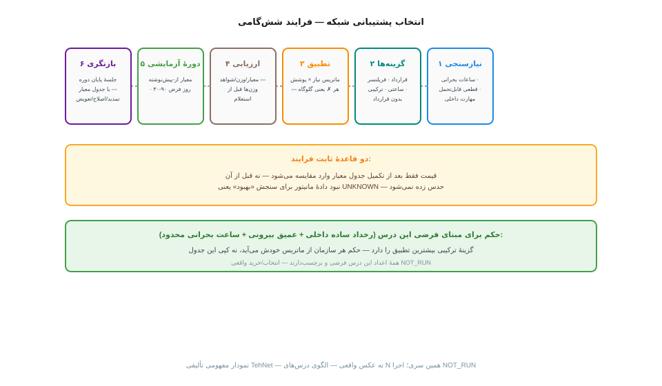

# انتخاب پشتیبانی شبکه — از نیازسنجی تا دورهٔ آزمایشی (N6)

> وضعیت درس: **DRAFT / NOT_DEPLOYED — در انتظار مرور.** (درس مصوب سرفصل ‏N6: انتخاب پشتیبانی)
> آموزش از سری پشتیبانی؛ مخاطب: مدیر کسب‌وکار و مدیر IT.
> سناریوی کاملاً فرضی و آموزشی با دادهٔ ساختگی؛ هیچ پیمانکار/قیمت/پروژهٔ واقعی‌ای در این درس نیست و هیچ اجرای واقعی NOT_RUN است.
> نمودار مفهومی و تألیفی است (نه عکس واقعی).

## پاسخ کوتاه

انتخاب پشتیبانی شبکه یک **فرایند شش‌گامی** است: **نیازسنجی** ‏(ساعات بحرانی، حداکثر قطعی قابل‌تحمل، مهارت داخلی، دارایی‌ها) → **فهرست گزینه‌ها** ‏(قرارداد پیمانکار، فریلنسر ساعتی، ترکیبی، بدون قرارداد) → **تطبیق نیاز با پوشش** ‏(هر نیاز کدام گزینه جواب می‌دهد؟) → **ارزیابی ساختاریافته** ‏(جدول معیار/وزن با شواهد، نه حس) → **دورهٔ آزمایشی کوتاه با معیار از-پیش‌نوشته** → **بازنگری دوره‌ای**. اشتباه رایج: انتخاب با قیمت اولیه یا رابطهٔ شخصی، بدون نوشتن «چه چیزی باید پوشش داده شود» — نتیجه، قراردادی است که در اولین قطعی واقعی جواب نمی‌دهد. سؤالات قرارداد/SLA بلافاصله بعد از انتخاب ساختار می‌آیند (درس مکمل قرارداد و SLA).

## پیش‌نیازها

- نیازسنجی و طراحی دفتر: [N1 طراحی شبکهٔ دفتر](n1-office-design.fa.md) · دادهٔ مانیتور برای نیازسنجی: [N2 مانیتورینگ](n2-monitoring-maintenance.fa.md) · سؤالات قرارداد/SLA: [مکمل قرارداد و SLA](n3-support-contract-sla.fa.md) · شواهد انجام کار: [N4 عیب‌یابی](n1-network-troubleshooting.fa.md)

## مبنا آزمایشگاه (Lab Baseline) — سناریوی فرضی

| بند | مقدار فرضی |
|---|---|
| سازمان | دفتر ‏۱۲ نفره + ‏۴ دوربین + ‏NAS — بدون کارمند IT تمام‌وقت ‏(فرضی) |
| دارایی‌های شبکه | روتر ‏hEX + سوئیچ ‏CRS326 + ‏AP + ‏NAS ‏(فرضی، الگوی N1) |
| الگوی رخداد فرضی | ماهانه ‏۱-۲ رخداد؛ بیشتر «قطعی دسترسی» و «کندی»؛ هر فصل یک رخداد سخت‌افزاری ‏(فرض آموزشی) |
| مهارت داخلی | یک کارمند آشنا با مقدمات ‏(برق‌اندازی، کابل) — نه پیکربندی |
| ساعت بحرانی | ‏۸:۳۰ تا ‏۱۷:۰۰ شنبه تا چهارشنبه |
| بودجه | متوسط — عدد واقعی ‏UNKNOWN تا استعلام؛ در این درس فقط ساختار مقایسه |
| اجرای واقعی | **NOT_RUN** — انتخاب آموزشی |

## گام ۱: نیازسنجی — قبل از دیدن هیچ پیشنهادی

| سؤال نیازسنجی | چرا تعیین‌کننده است | منبع پاسخ |
|---|---|---|
| ساعات بحرانی دقیقاً کیست؟ | پوشش ‏24-7 هزینه و مکانیزم جدا می‌خواهد؛ اگر قطعی جمعه‌شب بی‌اثر است، ‏24-7 نخرید | صاحب کسب‌وکار + جدول ساعات کار |
| حداکثر قطعی قابل‌تحمل چند ساعت است؟ | فاصلهٔ این عدد با «زمان رفع» پیشنهادها معیار اصلی تطبیق است | صاحب کسب‌وکار + تجربهٔ رخدادهای قبلی |
| چه چیزی داخلی حل می‌شود؟ | برق‌اندازی/کابل/ری‌استارت = داخلی؛ پیکربندی/عیب عمیق = بیرونی | مصاحبه با کارمند آشنا + ثبت رخدادهای گذشته ‏(الگوی N4) |
| دارایی‌ها و پیچیدگی چیست؟ | تعداد دستگاه و ‏VLAN‌ها دامنهٔ پشتیبانی را تعیین می‌کند | فهرست دارایی از مستندات ‏(الگوی N1/N4) |
| دادهٔ واقعی از وضعیت موجود هست؟ | مانیتورینگ ‏(الگوی N2) عدد می‌دهد؛ بدون آن نیازسنجی حدسی است | گزارش مانیتور یا ثبت رخدادها — نبود = **UNKNOWN** با برچسب صریح |

## گام ۲: فهرست گزینه‌ها — چهار ساختار پایه

| گزینه | ساختار | مزیت | ریسک | مناسب برای ‏(فرض) |
|---|---|---|---|---|
| قرارداد پیمانکار | مبلغ دوره‌ای + دامنهٔ تعریف‌شده | پاسخ‌گویی ثابت، رابطهٔ پایدار | هزینهٔ ثابت حتی در ماه بی‌رخداد؛ کیفیت به دامنهٔ قرارداد بستگی دارد ‏(سؤالات مکمل قرارداد) | سازمان بدون مهارت داخلی با رخداد مستمر |
| فریلنسر ساعتی | تماس به‌هنگام + نرخ ساعتی | هزینه فقط با مصرف؛ انعطاف | دسترس‌پذیری تضمین‌شده نیست؛ دانش شبکه نزد فرد می‌ماند نه سند | رخداد کم و غیربحرانی |
| ترکیبی ‏(داخلی + بیرونی) | رخداد ساده داخلی، عمیق بیرونی | هزینهٔ کمتر؛ سرعت برای موارد ساده | مرز «ساده/عمیق» باید نوشته شود وگرنه فرار به بیرونی یا دست‌کاری خطرناک داخلی | سازمان با کارمند نیمه‌آشنا — مثل مبنای این درس |
| بدون قرارداد | فقط در رخداد جست‌وجو | صفر هزینهٔ دوره‌ای | در رخداد بحرانی، پیدا کردن کمک زمان می‌برد؛ شواهد و مسئولیت مبهم | تقریباً هیچ سازمان وابسته به شبکه‌ای — پرریسک‌ترین گزینه |

هیچ‌کدام از این چهار ساختار ذاتاً «بهتر» نیست — خروجی گام ۳ تعیین می‌کند کدام با نیاز شما می‌خواند.

## گام ۳: تطبیق نیاز با پوشش — ماتریس

| نیاز ‏(از گام ۱) | قرارداد | فریلنسر ساعتی | ترکیبی | بدون قرارداد |
|---|---|---|---|---|
| پاسخ در ساعت بحرانی ‏(مبنای فرضی: ‏۸:۳۰-۱۷) | ✓ اگر ساعات قرارداد بپوشاند | △ اگر در دسترس باشد | ✓ بخش داخلی فوری است | ✗ |
| رخداد عمیق ‏(پیکربندی/روتینگ) | ✓ | ✓ ساعتی | ✓ بخش بیرونی | △ جست‌وجوی زمان‌بر |
| رخداد ساده ‏(برق‌اندازی/کابل) | △ ممکن است بیرونی گران باشد | △ | ✓ داخلی | ✓ داخلی |
| دانش مستندشده نزد سازمان | ✓ گزارش قراردادی | ✗ معمولاً فردی | △ به نظم بستگی دارد | ✗ |
| هزینهٔ ماه بی‌رخداد | ثابت | تقریباً صفر | کمتر از قرارداد کامل | صفر |

قاعدهٔ خواندن ماتریس: هر ردیف «✗» یعنی همان نیاز در رخداد واقعی گلوگاه می‌شود. اگر مبنای فرضی این درس باشد ‏(رخداد ساده داخلی حل می‌شود، عمیق بیرونی می‌خواهد، ساعت بحرانی محدود) → گزینهٔ ترکیبی بیشترین تطبیق را دارد؛ همین حکم برای سازمان دیگر باید از ماتریس خودش بیاید، نه کپی این جدول.

**شرح متنی نمودار (جایگزین تصویر برای دسترس‌پذیری):** شش جعبهٔ متوالی از راست به چپ ‏(RTL): «۱ نیازسنجی» ‏(ساعات بحرانی/قطعی قابل‌تحمل/مهارت داخلی) → «۲ گزینه‌ها» ‏(قرارداد/فریلنسر/ترکیبی/بدون قرارداد) → «۳ تطبیق» ‏(ماتریس نیاز×پوشش) → «۴ ارزیابی ساختاریافته» ‏(معیار/وزن/شواهد — وزن‌ها قبل از استعلام) → «۵ دورهٔ آزمایشی» ‏(معیار از-پیش‌نوشته) → «۶ بازنگری دوره‌ای». زیر نمودار: یادداشت «قیمت بعد از جدول معیار» و «نبود دادهٔ مانیتور = UNKNOWN». برچسب «تألیفی/مفهومی».

## گام ۴: ارزیابی ساختاریافته — معیار/وزن/شواهد

| معیار | وزن پیشنهادی ‏(قابل‌تغییر) | شواهد مطلوب — نه ادعا | عدد ‏(نمونهٔ خالی برای پرکردن) |
|---|---|---|---|
| تطبیق ساعات پوشش با ساعات بحرانی | ‏۲۰٪ | جدول ساعات مکتوب در پیشنهاد | |
| تعریف صریح دامنه و استثناها | ‏۲۰٪ | فهرست دستگاه/سرویس + استثناها ‏(سؤال ۱ و ۵ مکمل قرارداد) | |
| زمان اولین پاسخ و زمان رفع — عددی | ‏۲۰٪ | دو عدد جدا به‌تفکیک اولویت | |
| شواهد انجام کار ‏(ثبت قبل/بعد + گزارش) | ‏۱۵٪ | نمونهٔ گزارش واقعی از کارهای قبلی ‏(بدون دادهٔ محرمانهٔ مشتریان قبلی) | |
| مسیر تشدید وقتی کار جلو نمی‌رود | ‏۱۰٪ | متن مسیر تشدید در پیشنهاد | |
| مستندسازی و تحویل سند به سازمان | ‏۱۰٪ | تعهد گزارش/سند در قرارداد | |
| مراجع قابل‌استعلام ‏(بدون دادهٔ شناساگر) | ‏۵٪ | پاسخ رضایت مشتریان قبلی به سؤالات ساختاریافته | |

نکتهٔ صداقت: وزن‌ها پیشنهاد ساختاری‌اند، نه استاندارد sourced؛ هر سازمان باید قبل از دیدن پیشنهادها وزن‌ها را بنویسد وگرنه وزن‌ها به نفع پیشنهاد قبلی تنظیم می‌شوند. قیمت بعد از اتمام این جدول وارد مقایسه می‌شود — نه قبل.

## گام ۵: دورهٔ آزمایشی کوتاه و معیار بازنگری

| بند دورهٔ آزمایشی ‏(مثال ‏۳۰-۹۰ روزه — فرض) | معیار از-پیش‌نوشته |
|---|---|
| زمان اولین پاسخ در رخدادهای دوره | ≤ عدد قرارداد در ‏≥ حد نصاب مکتوب ‏(مثلاً ‏۸۰٪ موارد) |
| کیفیت شواهد | هر کار با ثبت قبل/بعد ‏(الگوی N4) تحویل شده |
| رخداد تکرار‌شونده | علت ریشه‌ای همان علت قبلی نباشد — اگر شد، در بازنگری مطرح |
| مستندسازی | هر تغییر پیکربندی با export/بکاپ ثبت ‏(الگوی مکمل بکاپ) |
| پایان دوره | جلسهٔ بازنگری با جدول معیار گام ۴ — تمدید/اصلاح/تعویض |

## خطاهای رایج

| خطا | چرا گران است | درست |
|---|---|---|
| انتخاب فقط با قیمت اولیه | ارزان‌ترین پیشنهاد بدون دامنهٔ صریح، در اولین رخداد عمیق جواب نمی‌دهد | اول ماتریس تطبیق و جدول معیار، بعد قیمت |
| خرید ‏24-7 بدون نیاز واقعی | هزینه برای پوششی که استفاده نمی‌شود | ساعات بحرانی از گام ۱؛ پوشش را همان تعیین کند |
| بدون دورهٔ آزمایشی | اشتباه انتخاب تا پایان قرارداد گران می‌ماند | دورهٔ کوتاه با معیار از-پیش‌نوشته |
| وزن‌دهی معیارها بعد از دیدن پیشنهادها | وزن‌ها به نفع گزینهٔ مطلوب تنظیم می‌شوند | وزن‌ها قبل از استعلام مکتوب شوند |
| بدون مانیتورینگ، «بهبود» سنجیده شود | بدون عدد پایه ‏(الگوی N2) هیچ بهبودی قابل‌اثبات نیست | قبل از شروع پشتیبانی، مبنا اندازه‌گیری شود — نبود = **UNKNOWN** |
| دانش شبکه نزد فرد بماند | خروج فرد = گم‌شدن سازمان | تعهد مستندسازی/تحویل سند در هر ساختاری بنویسید |

## تمرین کوتاه (با پاسخ موردانتظار)

1. چرا نیازسنجی قبل از دیدن پیشنهادهاست؟ — **پاسخ موردانتظار:** چون در غیر این صورت پیشنهادها معیار را تعریف می‌کنند؛ نیازسنجی مکتوب باعث می‌شود شما معیار را به پیشنهادها تحمیل کنید نه برعکس.
2. مبنای فرضی این درس ‏(رخداد ساده داخلی، عمیق بیرونی، ساعت بحرانی محدود) کدام گزینه را ترجیح می‌دهد؟ — **پاسخ موردانتظار:** ترکیبی ‏(داخلی برای ساده، بیرونی برای عمیق) — طبق ماتریس گام ۳؛ حکم برای سازمان دیگر باید از ماتریس خودش بیاید.
3. چرا «زمان اولین پاسخ» و «زمان رفع» دو معیار جداست؟ — **پاسخ موردانتظار:** پاسخ سریع با رفع دیر هفته‌ها قطعی می‌تواند همراهی شوند؛ جدا گرفتن هر کدام قابل‌چالش است.
4. بدون مانیتورینگ موجود، کدام ستون ارزیابی مشکوک می‌ماند؟ — **پاسخ موردانتظار:** هر ادعای بهبود/در-دسترس-بودن — بدون عدد پایه ‏(الگوی N2) UNKNOWN است؛ دورهٔ آزمایشی هم بدون مبنا قابل‌سنجش نیست.
5. دورهٔ آزمایشی با کدام معیار تمام می‌شود؟ — **پاسخ موردانتظار:** جلسهٔ بازنگری با جدول معیار گام ۴ و معیارهای از-پیش‌نوشته — تمدید/اصلاح/تعویض؛ نه بر اساس حس.

## چک‌لیست تحویل

- [ ] جدول نیازسنجی ‏(گام ۱) قبل از استعلام تکمیل شده
- [ ] چهار گزینه در برابر نیازهای خودتان ماتریس شده ‏(گام ۳)
- [ ] وزن معیارها قبل از دیدن پیشنهادها مکتوب شده ‏(گام ۴)
- [ ] دورهٔ آزمایشی با معیار از-پیش‌نوشته و جلسهٔ بازنگری تعریف شده ‏(گام ۵)
- [ ] سؤالات قرارداد/SLA از درس مکمل برای گزینهٔ منتخب آماده است
- [ ] نبود دادهٔ مانیتور به‌عنوان UNKNOWN ثبت شده، نه حدس
- [ ] انتخاب واقعی/خرید واقعی این درس NOT_RUN ‏(فریم‌ورک آموزشی)

## منابع

- الگوهای درون‌سری: [N1 طراحی دفتر](n1-office-design.fa.md) · [N4 عیب‌یابی](n1-network-troubleshooting.fa.md) · [N5 مانیتورینگ](n2-monitoring-maintenance.fa.md) · [مکمل قرارداد و SLA](n3-support-contract-sla.fa.md) · [مکمل بکاپ](n5-config-backup-export.fa.md) · [مکمل مسیر رخداد](n6-incident-path.fa.md)
- تجربهٔ فرایندی عمومی انتخاب پشتیبانی — روش و ساختار، بدون ادعای قیمت/پیمانکار/آمار واقعی
- هیچ عدد SLA/قیمتی در این درس sourced نیست؛ همهٔ اعداد نمونه فرضی و برچسب‌دارند

## آموزش‌های مرتبط و مسیر خدمت

| پیوند | مقصد |
|---|---|
| درس‌های مرتبط | [مکمل قرارداد و SLA](n3-support-contract-sla.fa.md) · [N4 عیب‌یابی](n1-network-troubleshooting.fa.md) · [N5 مانیتورینگ](n2-monitoring-maintenance.fa.md) |
| نقشهٔ کامل سری | [topic map](../topic-map.md) |
| پشتیبانی شبکهٔ سازمان شما | [خدمات پشتیبانی شبکهٔ تهران](https://tehnet.ir/services/network-support-tehran/) |
| درس بعدی سری | — (آخرین درس سری N در سرفصل مصوب؛ مکمل‌های بکاپ/مسیر رخداد در topic map) |
