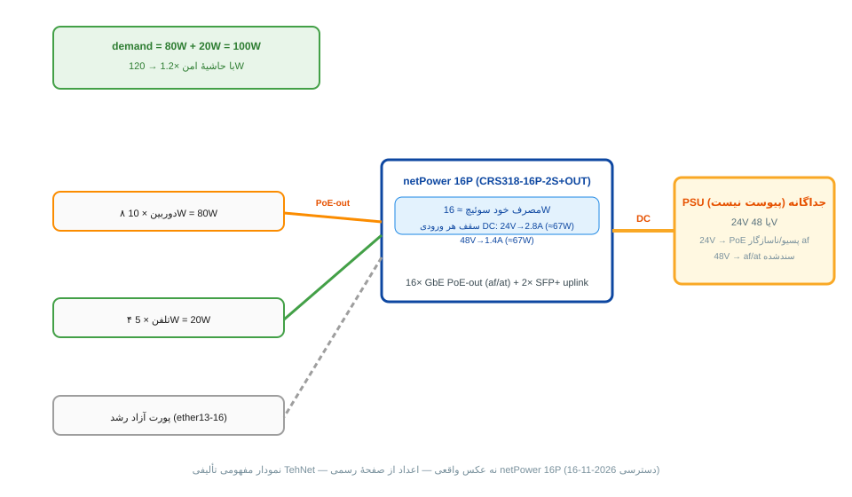

# بودجهٔ PoE — محاسبهٔ توان، استاندارد و PSU (S2)

> وضعیت درس: **DRAFT / NOT_DEPLOYED — در انتظار مرور.**
> آموزش تصویری از سری switching و PoE؛ مخاطب: کارشناس شبکهٔ مبتدی تا متوسط.
> سناریوی کاملاً فرضی و آموزشی با دادهٔ ساختگی؛ هیچ شبکهٔ واقعی دستکاری نشده است.
> نمودار مفهومی و تألیفی است (نه عکس واقعی)؛ اجرای RouterOS این درس NOT_RUN است (بدون fixture مجاز).

## پاسخ کوتاه

بودجهٔ PoE = جمع مصرف ماکسیمم همهٔ دستگاه‌های PoE + حاشیهٔ امن (~۲۰٪) و باید از «توان قابل‌تامین PSU منهای مصرف خود سوئیچ» کوچکتر باشد. سه چیز را همزمان چک کنید: **استاندارد** (دستگاه af است یا at؟)، **ولتاژ/جریان** (PSU چه ولتاژی می‌دهد و سوئیچ هر پورت/مجموع چند آمپر اجازه می‌دهد؟) و **PSU** (بعضی سوئیچ‌ها مثل netPower 16P اصلاً PSU ندارند). اگر جمع از بودجه گذشت، راه‌حل دوتاست: مصرف واقعی را دقیق بگیرید یا به سوئیچ/PSU بزرگ‌تر مهاجرت کنید — نه کاهش حاشیهٔ امن.

## پیش‌نیازها

- مبانی سوئیچ: [مقایسهٔ سوئیچ‌های CRS میکروتیک (S1)](../articles/mikrotik-switches-crs.fa.md)
- توپولوژی VLAN: [VLAN برای دفتر کوچک (M2)](m2-vlan-small-office.fa.md)
- برگهٔ مشخصات (datasheet) هر دستگاه PoEگیرنده

## مبنا آزمایشگاه (Lab Baseline) — دقیق و کامل

### سوئیچ مبنا — مشخصات سندشدهٔ رسمی (fetch شده با تاریخ)

| مشخصه | مقدار رسمی (صفحهٔ محصول netPower 16P) | SKU رسمی |
|---|---|---|
| SKU | netPower 16P (CRS318-16P-2S+OUT) | — |
| پورت PoE-out | 16× Gigabit (همهٔ ۱۶ پورت مسی PoE-out دارند) | ether1-16 |
| آپ‌لینک | 2× SFP+ (فیبر 10G) — PoE ندارند | sfp-sfpplus1/2 |
| استاندارد PoE-out | 802.3af/at | — |
| ولتاژ PoE-out | **بدون مبدل داخلی**: با PSU ‏24V خروجی 24V می‌شود؛ با PSU ‏48V خروجی ‏48V (برای af/at) | ورودی DC: ‏18-30V یا ‏48-57V |
| سقف جریان هر پورت | 24V: ‏1.1A ‏(≈26W) · ‏48V: ‏0.6A ‏(≈29W) | derived از حد جریان |
| سقف جریان کل هر ورودی DC | 24V: ‏2.8A ‏(≈67W) · ‏48V: ‏1.4A ‏(≈67W) | derived؛ دو ورودی DC مستقل |
| PSU پیوست | **ندارد** — «Power supply is NOT included with the product» | PSU جداگانه الزامی |
| Max power consumption | ‏316W (با متعلقات) · ‏16W بدون متعلقات | مصرف خود سوئیچ ≈16W مبنا |

**نکتهٔ صادقانه دربارهٔ بودجهٔ نهایی:** رابطهٔ بین «سقف جریان هر ورودی DC» و رقم «Max consumption ‏316W» در صفحهٔ رسمی تفصیل داده نشده (وابسته به جفت-PSU و ولتاژ). این درس هر دو عدد را **عیناً** گزارش می‌کند و محاسبه را با «حد جریان ورودی» انجام می‌دهد — محافظه‌کارانه‌ترین تفسیر سندشده. رقم 316W به‌عنوان سقف سیستم با PSU جفت مناسب ثبت می‌شود؛ **UNKNOWN**: بودجهٔ دقیق PoE-out تضمین‌شده برای هر ترکیب PSU — نیازمند تأیید رسمی ( marked UNKNOWN، نه حدس).

### جدول دستگاه‌های سناریو (مصرف = فرض صریح از datasheet-نوع)

| دستگاه | تعداد | مصرف ماکسیمم فرضی هر واحد | استاندارد موردنیاز | جمع |
|---|---|---|---|---|
| دوربین IP (بدون ایرلایت/هیزر) | 8 | 10W | af کافی (≤15.4W) | 80W |
| تلفن IP | 4 | 5W | af | 20W |
| **جمع PoE demanded** | — | — | — | **100W** |

فرض صریح: ارقام 10W/5W «مصرف ماکسیمم تیپیکال»‌اند نه مقدار تضمینی سازنده؛ قبل از خرید، datasheet همان مدل دوربین/تلفن ملاک است. دوربین با هیزر/IR بلند، تا 25-30W می‌رود (at لازم) — در این مبنا نیست.

### جدول پورت‌ها

| سوئیچ | پورت | اتصال | PoE |
|---|---|---|---|
| netPower 16P | ether1-8 | 8 دوربین | af/at خروجی |
| netPower 16P | ether9-12 | 4 تلفن | af خروجی |
| netPower 16P | ether13-16 | آزاد (رشد) | — |
| netPower 16P | sfp-sfpplus1 | آپ‌لینک 10G به روتر/سوئیچ بالادست | بدون PoE |



**شرح متنی نمودار (جایگزین تصویر برای دسترس‌پذیری):** از راست: PSU جداگانه (۲۴ یا ۴۸ ولت، پیوست نیست) → ورودی DC سوئیچ netPower 16P → داخل سوئیچ دو مسیر: مصرف خود سوئیچ (≈16W) و خروجی PoE با سقف جریان هر ورودی (24V: ‏2.8A ≈ ‏67W · ‏48V: ‏1.4A ≈ ‏67W) → از پورت‌ها به ۸ دوربین (۸۰W) و ۴ تلفن (۲۰W) و پورت‌های آزاد رشد. حاشیهٔ امن ۲۰٪ روی جمع demand نمایش داده شده و برچسب «تألیفی/مفهومی» پایین تصویر هست.

## محاسبهٔ بودجه — روش پنج‌مرحله‌ای

```text
۱) جمع demand:        Σ(مصرف ماکسیمم هر دستگاه)             = 80 + 20        = 100W
۲) حاشیهٔ امن ۲۰٪:    demand × 1.2                           = 100 × 1.2      = 120W
۳) توان قابل‌تامین:    PSU − مصرف خود سوئیچ                    = PSU_W − 16W
۴) سقف ورودی DC:      24V → 2.8A (≈67W) · 48V → 1.4A (≈67W) per input
۵) قبول/رد:           (۳) ≥ (۲) و سقف پورت هر دستگاه تأمین باشد
```

### مثال کارشده — انتخاب PSU برای همین مبنا

- demand+margin = 120W؛ مصرف خود سوئیچ ≈16W → PSU باید ≥ ‏136W تحویل دهد.
- سقف ورودی DC سندشده ≈67W به‌ازای هر ورودی است؛ با **یک** PSU/یک ورودی، سقف ≈67W از 120W کمتر است → در این تفسیر محافظه‌کارانه، کافی نیست.
- با **دو ورودی DC** (قابلیت سندشدهٔ این SKU: دو جک مستقل): 2×67W ≈ ‏134W ≥ ‏120W → **قبول مشروط** به PSU جفت مناسب از فهرست سازگار رسمی (مثلاً دو عدد از PSUهای 24V فهرست‌شده در صفحهٔ محصول)؛ توازن بار بین دو ورودی و رفتار سهم‌گیری صفحهٔ رسمی تفصیل نداده → **UNKNOWN**، اجرا با اندازه‌گیری واقعی (اندازه‌گیری PoE-out واقعی: `/interface ethernet poe monitor` سندشدهٔ RouterOS — اجرای آن در این درس NOT_RUN).
- اگر demand بالاتر رود (مثلاً ۱۲ دوربین ×12W + ‏۴ تلفن ×6W = ‏168W → ‏202W با حاشیه): از سقف دو ورودی (≈134W در تفسیر محافظه‌کارانه) گذر می‌کند → مهاجرت به کلاس سوئیچ PoE بزرگ‌تر (خانوادهٔ CRS354-48P یا بررسی رسمی ترکیب PSU قوی‌تر) — نه حذف حاشیهٔ امن.

> **پرچم ناسازگاری برای مرور:** سناریوی مقالهٔ S1 همین مخزن (۱۲ دوربین + ‏۴ تلفن = ‏168W روی netPower 16P) با تفسیر محافظه‌کارانهٔ «حد جریان ورودی» که بالا آمد سازگار نیست؛ این درس عمداً تفسیر سندشده را مبنا گرفت و ناسازگاری را به‌جای پنهان‌کردن، پرچم می‌زند — تصمیم اصلاح مقالهٔ S1 با مرور مدیر.

## خطاهای رایج

| نشانه | علت محتمل | بررسی | راه‌حل |
|---|---|---|---|
| دستگاه بالا می‌آید و ری‌استارت چرخه‌ای می‌شود | demand لحظه‌ای (surge) از بودجه گذشت | جمع ماکسیمم‌ها + حاشیه را بازمحاسبه کنید؛ `/interface ethernet poe monitor` | PSU بزرگ‌تر/دوم؛ توزیع پورت‌ها بین دو سوئیچ |
| دستگاه af اصلاً روشن نمی‌شود | PSU ‏24V نصب شده (خروجی 24V پسیو/ناسازگار با af) | ولتاژ خروجی پورت را چک کنید | PSU ‏48V برای af/at (سند رسمی: 48V برای IEEE af/at) |
| دوربین at با 24V بالا نمی‌آید | at به 48V نیاز دارد | استاندارد دستگاه | همان ردیف بالا |
| جمع حساب می‌شود ولی وسط روز افت دارید | مصرف واقعی > فرض تیپیکال (هیزر/IR شبانه) | اندازه‌گیری واقعی پورت | گرفتن ماکسیمم واقعی از datasheet/اندازه‌گیری |
| PSU گرم/خاموشی محافظتی | PSU زیر بار دائم نزدیک سقف خودش | توان اسمی PSU در برابر (۳) | PSU با توان اسمی ≥ ‏(۲)+مصرف سوئیچ |

## تمرین کوتاه (با پاسخ موردانتظار)

1. برای مبناى این درس، بدون حاشیهٔ امن، demand چقدر است و با کدام سقف مقایسه می‌شود؟ — **پاسخ موردانتظار:** ‏100W؛ با «توان قابل‌تامین PSU − ‏16W» و سقف جریان ورودی DC (≈67W به‌ازای هر ورودی سندشده).
2. چرا در این SKU «PSU 24V یعنی خروجی 24V»؟ — **پاسخ موردانتظار:** چون مبدل ولتاژ داخلی ندارد؛ ولتاژ خروجی PoE همان ولتاژ PSU ورودی است (سند رسمی) و af/at به ‏48V نیاز دارد.
3. دوربین هیزردار 28W روی این سوئیچ جا می‌شود؟ — **پاسخ موردانتظار:** به سقف پورت نزدیک/فراتر (48V: ‏0.6A ≈ ‏29W) و به بودجهٔ کل فشار می‌آورد؛ فقط بعد از بازمحاسبهٔ کامل بودجه و ترجیحاً با تأیید رسمی؛ در این مبنا خیر.
4. سه چیز که باید قبل از خرید همزمان چک شود؟ — **پاسخ موردانتظار:** استاندارد دستگاه (af/at)، ولتاژ/جریان (PSU و سقف‌های سوئیچ)، و PSU (پیوست/جدا و توان اسمی).

## چک‌لیست تحویل

- [ ] SKU رسمی و برگهٔ مشخصات سوئیچ + datasheet تک‌تک دستگاه‌ها جمع شده
- [ ] جدول demand با مصرف ماکسیمم و فرض‌های صریح نوشته شده
- [ ] ‏(۱) تا (۵) محاسبهٔ پنج‌مرحله‌ای مستند و سقف‌های ولتاژ/جریان ورودی چک شده
- [ ] PSU با توان اسمی ≥ ‏demand×1.2 + مصرف سوئیچ انتخاب و PSU پیوست‌نبودن چک شده
- [ ] UNKNOWNها (بودجهٔ تضمینی هر ترکیب PSU، سهم‌گیری دو ورودی) به‌عنوان UNKNOWN ثبت شده‌اند، نه حدس
- [ ] اجرای RouterOS (`/interface ethernet poe monitor`) در صورت وجود fixture مجاز؛ در غیر این صورت NOT_RUN ثبت شده

## منابع رسمی (fetch شده با تاریخ)

- صفحهٔ رسمی netPower 16P (CRS318-16P-2S+OUT) — ‏PoE-out ‏af/at، ‏۱۶×GbE + ‏۲×SFP+، بدون PSU، سقف‌های جریان ورودی/پورت، ‏PSUهای سازگار: https://mikrotik.com/product/netpower_16p (دسترسی 2026-11-16)
- دستور مانیتور PoE-out (`/interface ethernet poe monitor`) قابلیت سندشدهٔ RouterOS است؛ در این درس فقط نام برده شده و URL بخش مستندات آن جداگانه تأیید نشده — به‌جای URL تأییدنشده، عیناً URL ساخته نشده است
- مقایسهٔ سوئیچ‌ها (S1) و جدول catalog: [مقایسهٔ سوئیچ‌های CRS](../articles/mikrotik-switches-crs.fa.md) + switch-catalog.csv

## آموزش‌های مرتبط و مسیر خدمت

| پیوند | مقصد |
|---|---|
| درس قبلی (مبانی سوئیچ) | [مقایسهٔ سوئیچ‌های CRS میکروتیک (S1)](../articles/mikrotik-switches-crs.fa.md) |
| درس مرتبط | [VLAN برای دفتر کوچک (M2)](m2-vlan-small-office.fa.md) |
| نقشهٔ کامل سری | [topic map](../topic-map.md) |
| طراحی/اجرای PoE برای سازمان شما | [خدمات راه‌اندازی شبکهٔ تهران](https://tehnet.ir/services/network-setup-tehran/) |
| درس بعدی سری | S3 — راهنمای SFP/DAC/فیبر (تولید در نوبت بعدی؛ فعلاً فقط در topic map) |
