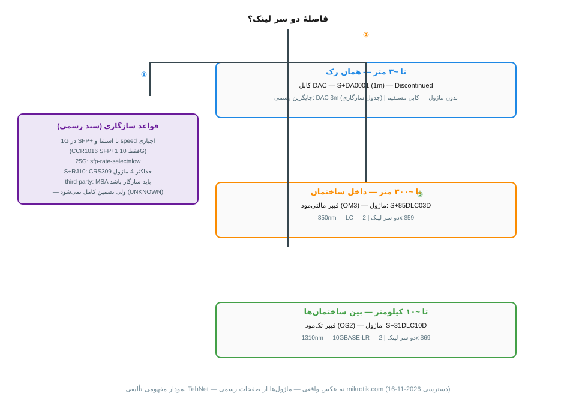

# SFP، DAC و فیبر — انتخاب و سازگاری ماژول‌ها (S3)

> وضعیت درس: **DRAFT / NOT_DEPLOYED — در انتظار مرور.**
> آموزش تصویری از سری switching؛ مخاطب: کارشناس شبکهٔ مبتدی تا متوسط.
> سناریوی کاملاً فرضی و آموزشی با دادهٔ ساختگی؛ هیچ شبکهٔ واقعی دستکاری نشده است.
> نمودار مفهومی و تألیفی است (نه عکس واقعی)؛ اجرای RouterOS این درس NOT_RUN است (بدون fixture مجاز).

## پاسخ کوتاه

ماژول را با **فاصله و محیط** انتخاب کنید، نه با قیمت: درون همان رک (تا ~۳ متر) کابل DAC؛ داخل ساختمان (تا ~۳۰۰ متر) فیبر مالتی‌مود با ماژول ‏850nm؛ بین ساختمان‌ها/شهر (تا ‏10km) فیبر تک‌مود با ماژول ‏1310nm. سازگاری هم قانون دارد: پورت‌های ‏SFP+ معمولاً ماژول ‏1G را هم می‌پذیرند **اما با استثناهای سندشده و تنظیم اجباری سرعت**؛ و ماژول‌های MSA-مطابق غیرمیکروتیک «باید سازگار باشند» ولی سازنده تضمین کامل نمی‌دهد.

## پیش‌نیازها

- مبانی سوئیچ: [مقایسهٔ سوئیچ‌های CRS میکروتیک (S1)](../articles/mikrotik-switches-crs.fa.md)
- بودجهٔ توان (برای مصرف ماژول‌ها در سوئیچ‌های PoE): [بودجهٔ PoE (S2)](s2-poe-budget.fa.md)

## مبنا آزمایشگاه (Lab Baseline) — دقیق و کامل

| نقش | دستگاه | پورت‌های مرتبط |
|---|---|---|
| سوئیچ 10G مرکز رک | CRS309-1G-8S+IN | ‏8× SFP+ |
| سرور | سرور فرضی با کارت شبکهٔ ‏10G ‏SFP+ | — |
| NAS | NAS فرضی با پورت ‏SFP+ | — |
| سوئیچ طبقهٔ دیگر | CRS326-24G-2S+RM (فرضی، طبقهٔ بالا) | ‏2× SFP+ |
| ساختمان دوم | سوئیچ فرضی با ‏SFP+ | — |

### جدول ماژول‌های سندشدهٔ رسمی (fetch شده با تاریخ)

| ماژول | نوع | سرعت | فاصله/رسانه | مشخصهٔ کلیدی | قیمت پیشنهادی | وضعیت |
|---|---|---|---|---|---|---|
| S+DA0001 | DAC (کابل مستقیم) | ‏10G (+FC) | ‏1m | ‏SFP/SFP+ هر دو سر، MSA-مطابق، «low power» | ‏$29 | **Discontinued** (صفحهٔ رسمی) |
| S+85DLC03D | نوری | ‏10G | تا ‏300m، فیبر **مالتی‌مود**، ‏850nm، LC | — | ‏$59 | فعال |
| S+31DLC10D | نوری | ‏10G (و ‏1G) | تا ‏10km، فیبر **تک‌مود**، ‏1310nm، LC دوبل | ‏10GBASE-LR (SFF-8431) | ‏$69 | فعال |

مکمل سندشدهٔ خانواده: DAC ‏3 متری (S+DA0003) در جدول سازگاری رسمی آمده است.

## قواعد سازگاری — عیناً از سند رسمی Wired Interface Compatibility

| قاعده | جزئیات سندشده |
|---|---|
| ‏1G در cage ‏SFP+ | بسیاری از دستگاه‌ها سازگارند **اما استثنا دارد**: ‏CCR1016-12S-1S+ و ‏CRS212-1G-10S-1S+ پورت ‏SFP+1 فقط روی ‏10G کار می‌کند؛ ‏CRS226-24G-2S+/CRS210-8G-2S+ فقط ‏SFP+1 از ‏1G پشتیبانی می‌کند و ‏SFP+2 فقط ‏10G |
| تنظیم اجباری سرعت برای ‏1G نوری در ‏SFP+ | `/interface ethernet set sfp-sfpplus1 auto-negotiation=no speed=1G-baseX` ‏(v7.12+) |
| ماژول‌های ‏25G در پورت‌های پایین‌تر | نیازمند `sfp-rate-select=low` «برای جلوگیری از خرابی داده» |
| ‏DAC/AOC | ‏DACهای ‏SFP+ ‏1m/3m و ‏AOC ‏S+AO0005 در جدول سازگاری رسمی‌اند |
| ‏S+RJ10 (مسی) | فقط در cage ‏SFP+؛ فقط auto-negotiation؛ سقف تعداد per-device (مثلاً ‏CRS309 حداکثر ‏4)؛ هشدار گرمایش در دستگاه‌های passive |
| پورت‌های Combo | فقط ‏1G و ‏10G (بدون ‏2.5G/5G) |
| ماژول غیرمیکروتیک | «MSA-مطابق باید سازگار باشد» اما «تضمین کامل با همهٔ سازندگان نمی‌شود» — **UNKNOWN** برای هر ماژول خاص خارج از فهرست رسمی |

**شرح متنی نمودار (جایگزین تصویر برای دسترس‌پذیری):** فلوچارت تصمیم از بالا: «فاصلهٔ دو سر لینک؟» سه شاخه: ‏«تا ~۳ متر، همان رک» → کابل ‏DAC ‏(S+DA0001/0003، بدون ماژول)؛ ‏«تا ~۳۰۰ متر، داخل ساختمان» → فیبر مالتی‌مود + ماژول ‏S+85DLC03D ‏(850nm)؛ ‏«تا ‏10km، بین ساختمان‌ها» → فیبر تک‌مود + ماژول ‏S+31DLC10D ‏(1310nm، ‏10GBASE-LR). حاشیه: یادآوری قواعد سازگاری ‏(1G در SFP+ با speed اجباری و استثناهای سندشده) و برچسب «تألیفی/مفهومی».

## مثال کارشده — سه سناریوی مبنا

| سناریو | فاصله/محیط | انتخاب سندشده | محاسبهٔ هزینهٔ ماژول (دو سر) |
|---|---|---|---|
| سرور و NAS در همان رک CRS309 | ‏~1-2m | ‏DAC ‏(S+DA0001 — توجه: Discontinued؛ جایگزین رسمی: DAC ‏3m از جدول سازگاری) | ‏کابل واحد؛ دو ماژول لازم ندارد → ‏$29 |
| اتصال به CRS326 طبقهٔ بالا | ‏~80m داکت داخل ساختمان | فیبر مالتی‌مود + ‏2× ‏S+85DLC03D ‏(850nm) | ‏2× ‏$59 = ‏$118 |
| اتصال به ساختمان دوم | ‏~2km بیرون | فیبر تک‌مود + ‏2× ‏S+31DLC10D ‏(1310nm، ‏10GBASE-LR) | ‏2× ‏$69 = ‏$138 |

نکتهٔ اجرا: ماژول نوری دو‌تایی است — دو سر لینک باید هم‌نوع باشند (هر دو ‏850nm مالتی‌مود یا هر دو ‏1310nm تک‌مود با فیبر همان نوع)؛ قاطی‌کردن نوع فیبر با نوع ماژول، لینک نمی‌زند.

## خطاهای رایج

| نشانه | علت محتمل | بررسی | راه‌حل |
|---|---|---|---|
| لینک ‏1G روی پورت ‏SFP+ بالا نمی‌آید | سرعت اجباری تنظیم نشده یا دستگاه جزو استثناهاست | `/interface ethernet print` + سند سازگاری همان مدل | `auto-negotiation=no speed=1G-baseX`؛ در استثناها از پورت دیگر استفاده کنید |
| فیبر نو ولی لینک ندارد | نوع فیبر با ماژول نمی‌خواند (MM با ماژول SM) | برچسب فیبر ‏(OM3/OS2) و مشخصهٔ ماژول | هم‌نوع‌سازی فیبر و ماژول |
| ‏DAC 3متری لینک نمی‌زند | خارج از طول سندشده یا جنس نامرغوب | طول/کد رسمی | فقط طول‌های سندشدهٔ جدول سازگاری |
| ماژول third-party لینک ناپایدار | تضمین رسمی نمی‌شود | تست با ماژول رسمی به‌عنوان مرجع | ماژول رسمی یا مدل تست‌شده؛ UNKNOWN را UNKNOWN نگه دارید |
| ‏CRS309 با چند ‏S+RJ10 ناپایدار/داغ | سقف ‏۴ ماژول و هشدار passive cooling | تعداد/دما | سقف سندشده؛ خنک‌کاری یا ماژول نوری |

## تمرین کوتاه (با پاسخ موردانتظار)

1. لینک ‏1G روی پورت ‏SFP+ ‏CCR1016-12S-1S+ (پورت ‏SFP+1) ممکن است؟ — **پاسخ موردانتظار:** خیر؛ استثنای سندشده: آن پورت فقط ‏10G کار می‌کند.
2. برای ‏80m داخل ساختمان با فیبر موجود «OM3» چه ماژولی؟ — **پاسخ موردانتظار:** ‏S+85DLC03D ‏(850nm مالتی‌مود، تا ‏300m) — دو عدد، دو سر.
3. چرا برای فاصلهٔ بین‌ساختمانی 2km ‏DAC یا ماژول ‏850nm انتخاب غلط است؟ — **پاسخ موردانتظار:** ‏DAC سقف چند‌متری دارد؛ ‏850nm مالتی‌مود تا ‏~300m سندشده؛ ‏2km خارج هر دو → تک‌مود ‏1310nm ‏(S+31DLC10D).
4. پرسش قبل از خرید ماژول third-party؟ — **پاسخ موردانتظار:** سازنده تضمین کامل نمی‌دهد (فقط «باید سازگار باشد»)؛ بدون تست/فهرست رسمی، سازگاری UNKNOWN است.

## چک‌لیست تحویل

- [ ] فاصله/محیط هر لینک اندازه‌گیری و ثبت شده (نه حدس)
- [ ] ماژول دو سر لینک هم‌نوع (سرعت/طول‌موج/فیبر) انتخاب شده
- [ ] استثناهای سازگاری مدل دقیق شما از سند رسمی چک شده (به‌ویژه برای ‏1G)
- [ ] تنظیم اجباری سرعت برای ماژول‌های زیرسرعت اعمال/مستند شده (اجرای واقعی NOT_RUN)
- [ ] طول DAC داخل سقف سندشده
- [ ] ماژول third-party: وضعیت UNKNOWN ثبت شده و تست مرجع با ماژول رسمی انجام شده
- [ ] برچسب/مدل فیبر ‏(OM3/OS2) با ماژول مطابق است

## منابع رسمی (fetch شده با تاریخ)

- ‏S+DA0001 — ‏DAC ‏1m، ‏MSA، ‏low power، ‏Discontinued: https://mikrotik.com/product/SplusDA0001 (دسترسی 2026-11-16)
- ‏S+85DLC03D — ‏10G ‏SFP+، ‏850nm، تا ‏300m مالتی‌مود: https://mikrotik.com/product/Splus85DLC03D (دسترسی 2026-11-16)
- ‏S+31DLC10D — ‏10GBASE-LR، ‏1310nm، تا ‏10km تک‌مود، ‏1G/10G: https://mikrotik.com/product/s_31dlc10d (دسترسی 2026-11-16)
- سند Wired Interface Compatibility — قواعد ‏1G/SFP+، استثناها، تنظیم سرعت، ‏rate-select، ‏DAC/AOC، ‏S+RJ10، ‏combo: https://help.mikrotik.com/docs/spaces/ROS/pages/220233794/MikroTik+wired+interface+compatibility (دسترسی 2026-11-16)

## آموزش‌های مرتبط و مسیر خدمت

| پیوند | مقصد |
|---|---|
| درس قبلی (مبانی سوئیچ) | [مقایسهٔ سوئیچ‌های CRS میکروتیک (S1)](../articles/mikrotik-switches-crs.fa.md) |
| درس قبلی (توان) | [بودجهٔ PoE (S2)](s2-poe-budget.fa.md) |
| نقشهٔ کامل سری | [topic map](../topic-map.md) |
| طراحی/اجرای فیبر و 10G برای سازمان شما | [خدمات راه‌اندازی شبکهٔ تهران](https://tehnet.ir/services/network-setup-tehran/) |
| درس بعدی سری | N1 — عیب‌یابی شبکه (تولید در نوبت بعدی؛ فعلاً فقط در topic map) |
