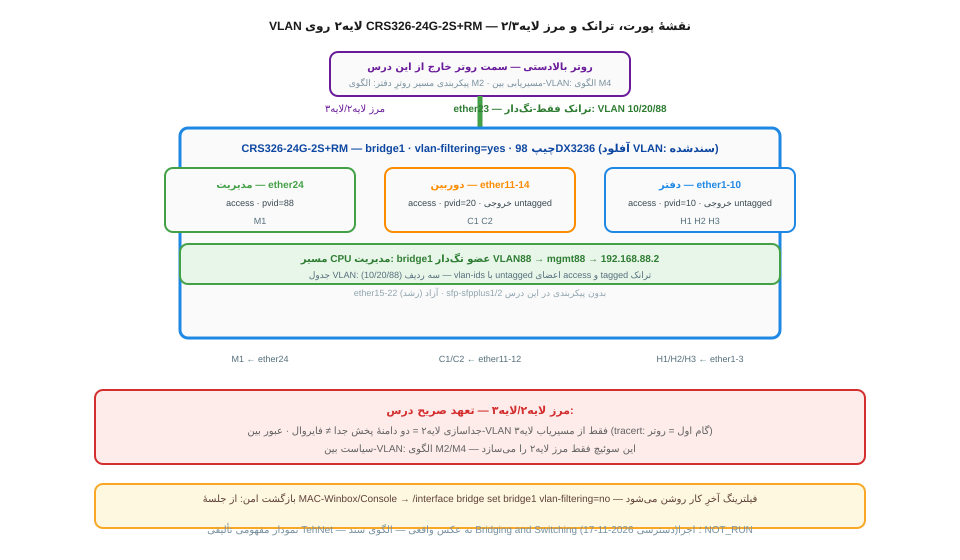

# VLAN روی سوئیچ، لایه۲ — طراحی و اجرا روی CRS326 ‏(S4)

> وضعیت درس: **DRAFT / NOT_DEPLOYED — در انتظار مرور.** (درس مصوب سرفصل ‏S4: VLAN روی سوئیچ)
> آموزش از سری switching؛ مخاطب: کارشناس شبکه.
> سناریوی کاملاً فرضی و آموزشی با دادهٔ ساختگی؛ هیچ شبکهٔ واقعی دستکاری نشده و هیچ اجرای واقعی NOT_RUN است.
> نمودار مفهومی و تألیفی است (نه عکس واقعی).

## پاسخ کوتاه {#short-answer}

VLAN روی سوئیچ یعنی یک سوئیچ را به چند **دامنهٔ پخش جدا** تقسیم کنیم: هر پورت access با `pvid` فریم‌های **untagged ورودی** را به یک VLAN طبقه‌بندی می‌کند و در خروجی دوباره untagged می‌شود؛ پذیرش ورودی ‏(tagged/untagged) با `frame-types` کنترلی **جدا** است و باید صریح تنظیم شود؛ فقط ترانکِ فقط-تگ‌دار VLANها را به روتر می‌دهد و مسیر CPU برای مدیریت با عضویت تگ‌دار خودِ پل در VLAN مدیریت ساخته می‌شود. چهار نکتهٔ تعیین‌کننده: ‏(۱) فیلترینگ VLAN **آخرِ کار** فعال شود وگرنه دسترسی مدیریت قطع می‌شود؛ ‏(۲) روی CRS326 ‏(چیپ ‏98DX3236) فیلترینگ VLAN پل با آفلود سخت‌افزاری سازگار است — بازرسی پرچم `H` یک **چک موردانتظر ‏(NOT_RUN)** در طرح این درس است، نه چیزی که اجرا شده باشد؛ ‏(۳) **این درس فقط datapath لایه۲ پیکربندی می‌کند** و مسیریابی/سیاست بین-VLAN را به روتر واگذار می‌کند — ‏CRS326 با RouterOS قابلیت مسیریابی دارد؛ این سناریوی آموزشی از آن استفاده نمی‌کند؛ ‏(۴) ساخت کامل داخل **یک بلوک ‏stop-on-error** با گارد مبنای آزمایشگاهی انجام می‌شود: عدم انطباق دستگاه با مبنی فرضی = توقف بدون هیچ تغییری.

## فهرست {#toc}

1. [پاسخ کوتاه](#short-answer) — چهار نکتهٔ کلیدی
2. [پیش‌نیازها](#prereqs)
3. [مبنا آزمایشگاه یکتا، نقشهٔ پورت/VLAN و جدول endpoint سنتز](#lab-baseline)
4. [گام ۱: گارد مبنای آزمایشگاهی و بلوک stop-on-error ساخت](#step1-inspect-bridge)
5. [گام ۲: قطعهٔ access با pvid و پذیرش ورودی](#step2-access-pvid)
6. [گام ۳: قطعهٔ جدول VLAN و ترانک تگ‌دار](#step3-vlan-table-trunk)
7. [گام ۴: قطعهٔ مسیر CPU مدیریت](#step4-cpu-mgmt)
8. [گام ۵: قطعهٔ فیلترینگ آخر و پرچم H](#step5-filtering-hw)
9. [مرز لایه۲ و لایه۳ — جداسازی ≠ فایروال](#l2-l3-boundary)
10. [آزمون پذیرش مثبت/منفی — قابل‌تکرار با endpoint سنتز](#acceptance-tests)
11. [بازگشت امن و بازیابی](#rollback-recovery)
12. [عیب‌یابی](#troubleshooting)
13. [تمرین کوتاه](#exercises)
14. [چک‌لیست تحویل](#checklist)
15. [منابع](#sources)
16. [آموزش‌های مرتبط و مسیر خدمت](#related-lessons)

## پیش‌نیازها {#prereqs}

- مفهوم VLAN و مسیر روترِ دفتر: [M2](m2-vlan-small-office.fa.md) · انتخاب ماژول/کابل: [S3](s3-sfp-dac-fiber.fa.md) · طراحی دفتر: [N1](n1-office-design.fa.md) · گام بعدی طبیعی ‏(مسیریابی بین-VLAN): [M4](m4-intervlan-l3hw.fa.md)

## مبنا آزمایشگاه یکتا، نقشهٔ پورت/VLAN و جدول endpoint سنتز {#lab-baseline}

**مبنای آزمایشگاهی یکتا — بدون دوگانگی:** این درس روی **یک دستگاه آزمایشگاهی مجزا و disposable در حالت کارخانه/no-defaults** اجرا می‌شود ‏(دستگاهی که هیچ پل/عضویت/آدرس مدیریتی از قبل ندارد). این درس **هرگز** دستگاه موجود یا تولیدی را reset، adapt یا با پل پیش‌فرض کارخانه ترکیب نمی‌کند؛ اگر دستگاه با مبنای فرضی انطباق نداشت، گارد همان‌جا **بدون هیچ تغییری** متوقف می‌شود و مبنای آزمایشگاهی صریحاً dispose می‌شود. پیش‌شرط‌های out-of-band قبل از اولین اثر: جلسهٔ کنسول/MAC-Winbox روی خودِ دستگاه آزمایشگاهی **قبل از فعال‌سازی فیلترینگ** باز و وارسی شده باشد ‏(مسیر بازیابی مستقل — بخش بازگشت امن)؛ هیچ وابستگی مدیریتی به VLANهای در حال ساخت وجود نداشته باشد.

| بند | مقدار فرضی |
|---|---|
| سوئیچ | **CRS326-24G-2S+RM** — ‏۲۴×GbE ‏(RJ45) + ‏۲×SFP+؛ چیپ ‏98DX3236 ‏(صفحهٔ رسمی محصول — این مدل RouterOS و مسیریابی را پشتیبانی می‌کند؛ این درس عمداً فقط datapath لایه۲ می‌سازد) |
| نگارش RouterOS | ‏v7.16+ ‏(dual boot ‏RouterOS/SwOS — این درس روی ‏RouterOS) |
| مبنای دستگاه | **دستگاه آزمایشگاهی مجزا/disposable — حالت کارخانه/no-defaults**؛ هرگز دستگاه موجود reset/adapt نمی‌شود |
| VLANها | ‏10 دفتر ‏· ‏20 دوربین ‏· ‏88 مدیریت |
| روتر بالادستی | یک روتر مجهز به پورت تگ‌دار ‏(مدل/پیکربندی سمت روتر **خارج از این درس** — الگوی M2)؛ فقط در «فاز routed اعلام‌شده» جدول آزمون نقش دارد |
| میزبان‌ها | ‏۳ میزبان دفتر ‏(ether1-3)، ‏۲ دوربین ‏(ether11-12)، ‏۱ میزبان مدیریت ‏(ether24) |
| اجرای واقعی | **NOT_RUN** — دستورها الگوی سند رسمی روی مبنای فرضی بالا |

### نقشهٔ پورت و VLAN — مرجع مشترک متن/جدول/نمودار/فرمان

| پورت | نقش | pvid ‏(طبقه‌بندی ورودی untagged) | پذیرش ورودی ‏(frame-types) | عضویت VLAN ‏(خروجی) |
|---|---|---|---|---|
| ether1 تا ether10 | ‏۱۰ پورت دفتر — access | ‏10 | admit-only-untagged-and-priority-tagged | vlan10 untagged |
| ether11 تا ether14 | ‏۴ پورت دوربین — access | ‏20 | admit-only-untagged-and-priority-tagged | vlan20 untagged |
| ether15 تا ether22 | آزاد ‏(رشد) | — | — | — |
| ether23 | **ترانک به روتر** — فقط تگ‌دار | ‏1 ‏(بی‌اثر روی تگ‌دار) | admit-only-vlan-tagged | vlan10+20+88 tagged |
| ether24 | میزبان مدیریت — access | ‏88 | admit-only-untagged-and-priority-tagged | vlan88 untagged |
| ‏bridge1 ‏(خودِ پل) | مسیر CPU | — | — | vlan88 tagged |
| sfp-sfpplus1/2 | بدون پیکربندی در این درس ‏(رشد — الگوی S3) | — | — | — |

**تفکیک سه کنترل جدا:** ‏(۱) **pvid** فقط طبقه‌بندی فریم **untagged ورودی** است؛ ‏(۲) **frame-types** پذیرش ورودی ‏(tagged/untagged) را جدا کنترل می‌کند — pvid به‌تنهایی فریم تگ‌دار ورودی روی پورت access را رد نمی‌کند، به همین دلیل پذیرش access صریحاً `admit-only-untagged-and-priority-tagged` تنظیم می‌شود؛ ‏(۳) **عضویت جدول VLAN** تعیین می‌کند هر VLAN روی کدام پورت و با چه حالت خروجی ‏(tagged/untagged) وجود دارد.

هویت هر endpoint در کل درس یکسان است: **H1/H2/H3** روی ‏ether1-3 ‏(VLAN10)، **C1/C2** روی ‏ether11-12 ‏(VLAN20)، **M1** روی ‏ether24 ‏(VLAN88)، روتر/فرستندهٔ آزمون پشت ‏ether23.

### جدول endpoint سنتز و حالت آزمون — پیش‌فرض‌های قابل‌تکرار

| شناسه | نقش/میزبان | پورت سوئیچ | VLAN | آدرس سنتز اصلی | آدرس آزمون ‏L2 ‏(alias) | prefix آزمون ‏L2 | gateway | حالت آزمون |
|---|---|---|---|---|---|---|---|---|
| ‏H1 | میزبان دفتر آزمون | ether1 | 10 | ‏192.168.10.11/24 | — | ‏192.168.10.0/24 | بدون gateway ‏(فاز ‏L2) | هم‌پیشوند ‏L2 |
| ‏H3 | میزبان دفتر آزمون | ether3 | 10 | ‏192.168.10.13/24 | — | ‏192.168.10.0/24 | بدون gateway ‏(فاز ‏L2) | هم‌پیشوند ‏L2 |
| ‏C1 | دوربین آزمون | ether11 | 20 | ‏192.168.20.11/24 | ‏192.168.10.21/24 ‏(فقط alias آزمون منفی) | ‏192.168.10.0/24 ‏(روی alias) | بدون gateway ‏(فاز ‏L2) | هم‌پیشوند ‏L2 |
| ‏C2 | دوربین آزمون | ether12 | 20 | ‏192.168.20.12/24 | — | — | بدون gateway ‏(فاز ‏L2) | مثبت همان VLAN |
| ‏M1 | میزبان مدیریت | ether24 | 88 | ‏192.168.88.11/24 | — | — | بدون gateway | مدیریت |
| سوئیچ ‏CPU | خودِ سوئیچ | مسیر ‏mgmt88 | 88 | ‏192.168.88.2/24 | — | — | — | هدف تست ‏۳ |
| ‏T-S | میزبان آزمون ترانک ‏(fixture موقت روی لینک ether23، جای روتر — فقط مبنای آزمایشگاهی؛ یک ‏PC با ‏NIC فیزیکی + زیراینترفیس تگ‌دار ‏VLAN10) | لینک ether23 | ‏10 ‏(تگ‌دار) | فاز تگ‌دار: ‏192.168.10.2/24 روی زیراینترفیس تگ‌دار ‏VLAN10 | فاز untagged: ‏192.168.10.99/24 روی NIC فیزیکی — آدرس‌ها هرگز هم‌زمان فعال نیستند ‏(بدون route مبهم) | ‏192.168.10.0/24 | بدون gateway | فرستنده ترانک — سه فاز تگ‌دار→untagged→تگ‌دار |
| روتر ‏(خارج از درس) | مسیریاب لایه۳ | لینک ether23 ‏(فقط فاز routed جداگانه) | ‏10/20 | ‏192.168.10.1 ‏· ‏192.168.20.1 | — | متفاوت ‏(routed) | gateway میزبان‌ها فقط در فاز routed | فاز جداگانه اعلام‌شده |

قاعدهٔ طراحی جفت منفی: ‏H1 و alias آزمونِ ‏C1 **هم‌پیشوند** ‏(192.168.10.0/24) هستند تا طبق ‏RFC1122 §3.3.1.1 تصمیم تحویل on-link گرفته شود و ARP مستقیم تلاش شود — این‌طور timeout معنای جداسازی لایه۲ دارد، نه «نبود مسیر». کلیدهای آزمون و aliasها فقط متعلق به fixture سنتز همین درس‌اند و plan بازگشت‌شان در جدول آزمون آمده است.



**شرح متنی نمودار (جایگزین تصویر برای دسترس‌پذیری):** یک سوئیچ CRS326 در مرکز؛ سمت راست ‏(RTL) گروه پورت‌های دفتر ‏(ether1-10، ‏VLAN10، pvid=10، خروجی untagged) با میزبان‌های ‏H1-H3؛ زیر آن دوربین‌ها ‏(ether11-14، ‏VLAN20) با ‏C1/C2؛ سمت چپ پورت مدیریت ‏(ether24، ‏VLAN88) با میزبان ‏M1 و فلش تگ‌دار از پل ‏(bridge1) به داخل سوئیچ یعنی مسیر CPU؛ در بالا پورت ‏ether23 به‌صورت ترانک «فقط-تگ‌دار» به جعبهٔ «روتر — سمت روتر خارج از این درس» وصل است و روی همان لینک برچسب «مرز لایه۲/لایه۳» خورده؛ زیر نمودار جعبهٔ یادآوری: «جداسازی لایه۲ ≠ فایروال؛ مسیریابی بین-VLAN کار روتر است». برچسب «تألیفی/مفهومی».

## گام ۱: گارد مبنای آزمایشگاهی و بلوک stop-on-error ساخت {#step1-inspect-bridge}

**قاعدهٔ ساخت:** گارد مبنای آزمایشگاهی و **کل** ساخت ‏(پل، اعضا، ترانک، جدول VLAN، مسیر CPU، فیلترینگ-آخر) داخل **یک بلوک `{ }` واحد stop-on-error** است: خطای گارد، کل بلوک همان‌جا متوقف می‌کند و **هیچ اثری افتاده نمی‌شود** ‏(هیچ فرمان add بدون گارد بیرون بلوک وجود ندارد). اگر گارد ناسازگاری با مبنای فرضی پیدا کرد — پل/عضویت موجود، مفقود شدن پورت نقشه، یا اشغال subnet مدیریتی — توقف **بدون تغییر** و بدون حذف/جابجایی منابع موجود؛ دستگاه با مبنای فرضی انطباق ندارد و باید صریحاً dispose شود.

```routeros
# --- بلوک stop-on-error: گارد مبنای آزمایشگاهی + کل ساخت؛ فیلترینگ آخر ---
{
    :if ([:len [/interface bridge find]] > 0) do={ :error "S4: bridge(s) exist — not the assumed no-defaults disposable lab baseline; stop, no changes, dispose the lab state explicitly first" }
    :if ([:len [/interface bridge port find]] > 0) do={ :error "S4: bridge-port memberships exist — not the assumed baseline" }
    :if ([:len [/system resource find where board-name~"CRS326"]] = 0) do={ :error "S4: board-name does not indicate CRS326 — device identity does not match the declared map" }
    :foreach p in={1;2;3;4;5;6;7;8;9;10;11;12;13;14;23;24} do={ :if ([:len [/interface find where name=("ether".$p)]] = 0) do={ :error "S4: required port ether$p missing — port map identity mismatch" } }
    :if ([:len [/interface find where name="mgmt88"]] > 0) do={ :error "S4: name mgmt88 already in use — created-name conflict, stop" }
    :if ([:len [/ip address find where address~"192.168.88."]] > 0) do={ :error "S4: management subnet 192.168.88.x already assigned — resource/management conflict, stop" }
    /interface bridge
    add name=bridge1 vlan-filtering=no protocol-mode=rstp
    /interface bridge port
    add bridge=bridge1 interface=ether1 pvid=10 frame-types=admit-only-untagged-and-priority-tagged
    add bridge=bridge1 interface=ether2 pvid=10 frame-types=admit-only-untagged-and-priority-tagged
    add bridge=bridge1 interface=ether3 pvid=10 frame-types=admit-only-untagged-and-priority-tagged
    add bridge=bridge1 interface=ether4 pvid=10 frame-types=admit-only-untagged-and-priority-tagged
    add bridge=bridge1 interface=ether5 pvid=10 frame-types=admit-only-untagged-and-priority-tagged
    add bridge=bridge1 interface=ether6 pvid=10 frame-types=admit-only-untagged-and-priority-tagged
    add bridge=bridge1 interface=ether7 pvid=10 frame-types=admit-only-untagged-and-priority-tagged
    add bridge=bridge1 interface=ether8 pvid=10 frame-types=admit-only-untagged-and-priority-tagged
    add bridge=bridge1 interface=ether9 pvid=10 frame-types=admit-only-untagged-and-priority-tagged
    add bridge=bridge1 interface=ether10 pvid=10 frame-types=admit-only-untagged-and-priority-tagged
    add bridge=bridge1 interface=ether11 pvid=20 frame-types=admit-only-untagged-and-priority-tagged
    add bridge=bridge1 interface=ether12 pvid=20 frame-types=admit-only-untagged-and-priority-tagged
    add bridge=bridge1 interface=ether13 pvid=20 frame-types=admit-only-untagged-and-priority-tagged
    add bridge=bridge1 interface=ether14 pvid=20 frame-types=admit-only-untagged-and-priority-tagged
    add bridge=bridge1 interface=ether24 pvid=88 frame-types=admit-only-untagged-and-priority-tagged comment="میزبان مدیریت M1"
    add bridge=bridge1 interface=ether23 frame-types=admit-only-vlan-tagged ingress-filtering=yes comment="trunk فقط-تگ‌دار به روتر"
    /interface bridge vlan
    add bridge=bridge1 vlan-ids=10 untagged=ether1,ether2,ether3,ether4,ether5,ether6,ether7,ether8,ether9,ether10 tagged=ether23
    add bridge=bridge1 vlan-ids=20 untagged=ether11,ether12,ether13,ether14 tagged=ether23
    add bridge=bridge1 vlan-ids=88 untagged=ether24 tagged=ether23,bridge1
    /interface vlan
    add name=mgmt88 vlan-id=88 interface=bridge1
    /ip address
    add address=192.168.88.2/24 interface=mgmt88
    /interface bridge
    set bridge1 vlan-filtering=yes
    :put "S4: build complete (filtering enabled last)"
}
```

**ترتیب داخل بلوک و مرز تعهد:** گاردها **قبل از اولین اثر** اجرا می‌شوند ‏(هویت مدل، فهرست کامل ‏۱۶ پورت استفاده‌شده، نبود پل/عضویت موجود، آزادبودن نام ساخته‌شونده ‏mgmt88، نبود تداخل subnet مدیریتی)؛ خطای هر گارد در این نقطه = **صفر تغییر**. اما بلوک براکتی ‏RouterOS **transaction نیست** — اگر بعد از شروع آثار خطای غیرمنتظره‌ای رخ دهد، rollback خودکار وجود ندارد و تغییرات انجام‌شده باقی می‌ماند؛ در این مبنای disposable چنین حالتی به‌صورت کنترل‌شده و دستی رسیدگی می‌شود ‏(بازرسی، اصلاح یا dispose صریح) و هیچ حذف خودکارِ وضعیت نامعلومی انجام نمی‌شود. فیلترینگ **آخرین** دستور بلوک است و مسیر بازیابی مستقل از قبل وارسی شده ‏(بخش بازگشت امن). هیچ reset/delete/adapt روی دستگاه انجام نمی‌شود.

**enum پذیرش ورودی — فهرست مستند جدول Bridge Port Settings سند Bridging and Switching:** ‏admit-all ‏(پذیرش همه — مقدار پیش‌فرض) · ‏admit-only-untagged-and-priority-tagged ‏(فقط untagged و priority-tagged — انتخاب access این درس) · ‏admit-only-vlan-tagged ‏(فقط تگ‌دار — ترانک این درس). مقادیر دیگر در جدول مستند نیستند و به‌کار نمی‌روند؛ عبارت کوتاه‌شدهٔ «admit-only-untagged» فقط به‌عنوان نقلِ تاریخیِ یک اشتباه پیش‌تر در همین رسید ذکر شده و دستور آموزشی نیست.

## گام ۲: قطعهٔ access با pvid و پذیرش ورودی {#step2-access-pvid}

**قطعهٔ آموزشی از بلوک گام ۱ ‏(جداگانه اجرا نشود):**

```routeros
    /interface bridge port
    add bridge=bridge1 interface=ether1 pvid=10 frame-types=admit-only-untagged-and-priority-tagged
    ...
    add bridge=bridge1 interface=ether24 pvid=88 frame-types=admit-only-untagged-and-priority-tagged comment="میزبان مدیریت M1"
```

**انتظار و معنا:** ‏۱۵ عضو access اضافه می‌شوند. **تفکیک کنترل‌ها:** `pvid=10` فقط فریم **untagged ورودی** را به VLAN10 طبقه‌بندی می‌کند و خروجی همان پورت را untagged می‌کند؛ `frame-types=admit-only-untagged-and-priority-tagged` پذیرش ورودی را جدا کنترل می‌کند — با pvid تنها، یک فریم **تگ‌دار** با ‏VLAN10 روی پورت access رد نمی‌شد؛ پذیرش access صریح تنظیم شده تا رفتار پورت کاملاً معلوم باشد.

## گام ۳: قطعهٔ جدول VLAN و ترانک تگ‌دار {#step3-vlan-table-trunk}

**قطعهٔ آموزشی از بلوک گام ۱ ‏(جداگانه اجرا نشود):**

```routeros
    add bridge=bridge1 interface=ether23 frame-types=admit-only-vlan-tagged ingress-filtering=yes comment="trunk فقط-تگ‌دار به روتر"
    /interface bridge vlan
    add bridge=bridge1 vlan-ids=10 untagged=ether1,...,ether10 tagged=ether23
    add bridge=bridge1 vlan-ids=20 untagged=ether11,...,ether14 tagged=ether23
    add bridge=bridge1 vlan-ids=88 untagged=ether24 tagged=ether23,bridge1
```

**انتظار و معنا:** `frame-types=admit-only-vlan-tagged` روی ترانک یعنی فریم untagged ورودی از سمت لینک drop می‌شود؛ `ingress-filtering=yes` یعنی تگِ VLAN ناموجود در جدول هم drop می‌شود. `bridge1` در ردیف ‏88 به‌صورت **tagged** یعنی پل خودش عضو VLAN مدیریت است — همین عضویت، مسیر CPU گام ۴ را می‌سازد. اگر یک VLAN از جدول ترانک جا بماند، همان VLAN از آن سمت قطع می‌شود — رایج‌ترین خطای این درس.

## گام ۴: قطعهٔ مسیر CPU مدیریت {#step4-cpu-mgmt}

**قطعهٔ آموزشی از بلوک گام ۱ ‏(جداگانه اجرا نشود):**

```routeros
    /interface vlan
    add name=mgmt88 vlan-id=88 interface=bridge1
    /ip address
    add address=192.168.88.2/24 interface=mgmt88
```

**انتظار:** میزبان ‏M1 ‏(ether24، ‏pvid88) باید بتواند به ‏192.168.88.2 پینگ بدهد — این تست، مسیر CPU را اثبات می‌کند: فریم untagged از ‏ether24 با ‏pvid=88 وارد پل، به‌عنوان عضو تگ‌دار جدول ‏88 به CPU می‌رسد و پاسخ با مسیر معکوس برمی‌گردد. بدون عضویت `bridge1` در ردیف ‏88، این پینگ بعد از فعال‌سازی فیلترینگ قطع می‌شود.

## گام ۵: قطعهٔ فیلترینگ آخر و پرچم H  {#step5-filtering-hw}

**قطعهٔ آموزشی از بلوک گام ۱ ‏(جداگانه اجرا نشود):**

```routeros
    /interface bridge
    set bridge1 vlan-filtering=yes
```

**پرچم H — چک موردانتظر ‏(NOT_RUN):** طبق جدول ‏«Bridge hardware offloading» سند رسمی، سری ‏CRS3xx ‏(چیپ ‏98DX3236) فیلترینگ VLAN پل را **با آفلود سخت‌افزاری** پشتیبانی می‌کند. طرح این درس بازرسی `/interface bridge port print` را **به‌عنوان چک موردانتظر** ثبت می‌کند — انتظار: اعضا پرچم `H` داشته باشند؛ از دست رفتن `H` یعنی خروج از آفلود و باید علتش از سند پیدا شود، ظرفیت حدس زده نشود. **این بازرسی در این درس اجرا نشده است ‏(NOT_RUN)** و اندازه‌گیری throughput هم جداگانه NOT_RUN است — این درس فقط پشتیبانی سندشده و «چکِ برنامه‌ریزی‌شده» را ثبت می‌کند، نه نتیجهٔ اجراشده.

## مرز لایه۲ و لایه۳ — جداسازی ≠ فایروال {#l2-l3-boundary}

این تفکیک تعهد صریح این درس است. **مرز ادعا:** ‏CRS326 با RouterOS قابلیت مسیریابی دارد ‏(سند رسمی محصول)؛ **این درس عمداً فقط datapath لایه۲ پیکربندی می‌کند** و مسیریابی/سیاست بین-VLAN را به روتر واگذار می‌کند — «ناتوانی سخت‌افزاری» ادعا نمی‌شود.

| ادعا | معتبر؟ | توضیح |
|---|---|---|
| در این پیکربندی لایه۲، میزبان VLAN10 به‌صورت **لایه۲** میزبان VLAN20 را نمی‌بیند | ✓ | دامنهٔ پخش جدا: ARP یک میزبان به VLAN دیگر نمی‌رسد؛ `arp -a` روی ‏H1 ورودی همسایهٔ هدف از ‏C1 ندارد ‏(با کنترل مثبت همان جفت و بازسازی نبودِ همسایه — جدول آزمون) |
| «این سوئیچ اصلاً مسیریابی ندارد» | ✗ | ‏CRS326 با RouterOS مسیریابی را پشتیبانی می‌کند؛ ادعای درست: **این سناریو** فقط datapath لایه۲ می‌سازد و مسیریابی را به روتر واگذار می‌کند |
| اگر روتر بین VLANها مسیریابی کند، ‏H1→C1 وصل می‌شود | ✓ ‏(مشروط) | عبور از مسیر لایه۳ است؛ `tracert` یک **چک شرطی** است با پیش‌فرض‌های خودش — پاسخ ICMP همیشه تضمین نمی‌شود؛ دیده‌شدن گام اولِ روتر اثبات مرز است، ندیدنش به‌تنهایی ردّ مسیر نیست |
| جداسازی VLAN جایگزین فایروال است | ✗ | سیاست بین-VLAN ‏(اجازه/منع) کار روتر/فایروال است — الگوی M2/M4؛ این درس فقط مرز لایه۲ را می‌سازد |

## آزمون پذیرش مثبت/منفی — قابل‌تکرار با endpoint سنتز {#acceptance-tests}

**فازها جدا اعلام می‌شوند و بعد از هر فاز، مبنای آزمون دقیق بازگردانده می‌شود:** ‏(الف) فاز ‏L2 ‏(روتر/مسیریابی غایب یا غیرفعال — فقط مبنای آزمایشگاهی)؛ ‏(ب) کنترل مثبت disposable روی همان جفت منفی؛ ‏(ج) فاز routed جداگانه و اعلام‌شده؛ بازگشت به مبنای ‏L2. **پیش‌شرط هر اندازه‌گیری:** ورودی همسایهٔ **هدف** روی میزبان مبدأ حذف یا ناموجودبودنش وارسی می‌شود ‏(فقط ورودی متعلق به همین آزمون — بدون flush سراسری و بدون دست‌کاری همسایه‌های دیگر).

| # | فاز | از | به | فرمان/شرط دقیق | انتظار و شاهد قابل‌تفسیر |
|---|---|---|---|---|---|
| ‏۱ | ‏L2 | ‏H1 ‏(192.168.10.11) | ‏H3 ‏(192.168.10.13) | `ping 192.168.10.13` | replies + ورودی همسایهٔ ‏192.168.10.13 در `arp -a` ‏H1 — مثبت همان VLAN10 |
| ‏۲ | ‏L2 | ‏C1 ‏(192.168.20.11) | ‏C2 ‏(192.168.20.12) | `ping 192.168.20.12` | replies + ورودی ARP — مثبت همان VLAN20 |
| ‏۳ | ‏L2 | ‏M1 ‏(192.168.88.11) | ‏192.168.88.2 ‏(سوئیچ) | `ping 192.168.88.2` | replies — اثبات مسیر CPU |
| ‏۴ | ‏L2 — منفی | ‏H1 ‏(192.168.10.11) | ‏C1 ‏(alias آزمون ‏192.168.10.21 — هم‌پیشوند، VLAN20) | پیش‌شرط: ورودی همسایهٔ ‏192.168.10.21 در ‏H1 حذف/ناموجود ‏(فقط همین ورودی)؛ سپس `ping 192.168.10.21` | timeout + ورودی ‏192.168.10.21 در `arp -a` ‏H1 incomplete/ناموجود؛ **این به‌تنهایی کافی نیست** — با کنترل مثبت ‏۵ و تکرار منفی پس از بازگشت همراه می‌شود |
| ‏۵ | ‏L2 — کنترل مثبت disposable | ‏H1 | ‏C1 ‏(192.168.10.21) | تغییر موقت ‏C1 به ‏pvid=10 + عضویت untagged در ردیف ‏10؛ همان ping | replies + ARP کامل — اثبات سلامت میزبان‌ها/روش؛ سپس **بازگشت دقیق** ‏C1 به ‏pvid=20 و عضویت قبلی و **تکرار تست ‏۴** برای اثبات بازگشت جداسازی |
| ‏۶ | routed — فاز جداگانه اعلام‌شده | ‏H1 ‏(با gateway روتر در فاز routed) | ‏C1 ‏(192.168.20.11) | روتر با اینترفیس‌های routed ‏10/20 فعال ‏(اعلام‌شده، سمت روتر خارج از درس)؛ `ping` + `tracert` | اگر سیاست روتر اجازه دهد ping موفق می‌شود و مسیر از **روتر** است؛ `tracert` **چک شرطی** است — اگر پاسخ آمد گام اول = روتر ‏(اثبات مرز)؛ نبود پاسخ به‌تنهایی ردّ مسیر نیست؛ پایان فاز: بازگشت کامل به مبنای آزمون ‏L2 |
| ‏۷ | ترانک — تگ‌دار→untagged→تگ‌دار | فرستندهٔ آزمون ‏T-S | هدف ‏H1 ‏(192.168.10.11) | ‏(الف) کنترل تگ‌دار: فقط زیراینترفیس تگ‌دار ‏VLAN10 با ‏192.168.10.2/24 فعال ‏(NIC فیزیکی بدون آدرس) → `ping 192.168.10.11` → replies ‏(مسیر/فرستنده/گیرنده سالم)؛ ‏(ب) فاز untagged: زیراینترفیس تگ‌دار حذف/غیرفعال و NIC فیزیکی با ‏192.168.10.99/24 ‏(هم‌پیشوند ‏H1، بدون gateway، بدون route اضافه) فعال → همان ping — چون هم‌پیشوند است ‏T-S واقعاً فریم‌های ‏untagged ‏(ARP/ping) به لینک می‌فرستد؛ ‏(ج) کنترل بازگشتی تگ‌دار: آدرس untagged حذف و زیراینترفیس تگ‌دار دقیق برمی‌گردد → ping دوباره replies | ‏(الف) و ‏(ج) replies؛ ‏(ب) سکوت. تفسیر «drop واقعی پذیرش ورودی» فقط با کنترل تگ‌دارِ پاسِ بلافاصله قبل + مشاهدهٔ حالت فریم ارسالی ‏(مثلاً capture سمت خودِ ‏T-S که ARP خروجی untagged است) ثبت می‌شود؛ اگر این مشاهده ثبت نشود، نتیجه با برچسب **NOT_PROVEN** ثبت می‌شود. capture سمت CPU سوئیچ معیار نیست ‏(ترافیک آفلودشده لزوماً آنجا دیده نمی‌شود). بازگشت دقیق همهٔ آدرس/اینترفیس‌های ‏T-S؛ بدون flush عمومی |

قواعد اجرا: پیش‌شرط همسایه فقط برای ورودی متعلق به همین آزمون؛ بازگشت دقیق عضویت/pvid بعد از فازهای موقت؛ حذف فقط آدرس/alias/همسایهٔ متعلق به fixture سنتز؛ **اجرای واقعی همهٔ پروب‌ها و RouterOS در این درس NOT_RUN است** — هیچ trace/flag/PASS جعلی وجود ندارد.

## بازگشت امن و بازیابی {#rollback-recovery}

- **پیش‌شرط قبل از فعال‌سازی فیلترینگ:** یک مسیر بازیابی **مستقل و وارسی‌شده** باید از قبل آماده باشد — در این مبنای آزمایشگاهی یعنی جلسهٔ کنسول/MAC-Winbox روی خودِ دستگاه که باز بودن و دسترسی‌پذیری‌اش **عملاً وارسی شده** است ‏(نه جلسهٔ تگ‌دار ‏VLAN88)؛ این وارسی بخشی از چک‌لیست قبل از روشن‌کردن فیلترینگ است. **از تنظیمات unspecified ‏MAC-server/interface به‌عنوان وعدهٔ دسترسی استفاده نمی‌شود** — بدون وارسی واقعی، چنین وعده‌ای داده نمی‌شود.
- **بازگشت کنترل‌شده در همین آزمایشگاه:** از همان مسیر وارسی‌شده: `/interface bridge set bridge1 vlan-filtering=no` — همهٔ پورت‌ها بدون فیلتر پل می‌شوند؛ پیکربندی‌ها حذف نمی‌شوند و قابل اصلاح‌اند. **توجه صادقانه:** خاموش‌کردن فیلترینگ جداسازی را از بین می‌برد — این اقدام فقط «بازیابی کنترل‌شده در همین آزمایشگاه ایزوله» است، نه حالت عملیاتی.
- **قاعدهٔ ترتیب:** هر تغییر ساختاری با فیلترینگ خاموش؛ روشن‌کردن **آخرین** دستور است؛ بعد از روشن‌کردن، تست ‏۳ ‏(مسیر CPU) قبل از بستن جلسه اجرا/ثبت می‌شود.
- **بلوک ساخت transaction نیست:** خطای گارد قبل از اولین اثر = صفر تغییر؛ اما خطای بعد از شروع آثار rollback خودکار ندارد — در مبنای disposable کنترل‌شده و دستی رسیدگی می‌شود ‏(بدون حذف خودکار وضعیت نامعلوم).
- **از دست رفتن دسترسی مدیریتی تگ‌دار:** فقط از مسیر بازیابی مستقل وارسی‌شدهٔ بالا؛ تکیه به «دسترسی از هر access» به‌عنوان مسیر تضمینی نداریم.

## عیب‌یابی {#troubleshooting}

| نشانه | علت محتمل | بررسی | راه‌حل |
|---|---|---|---|
| بعد از روشن‌کردن فیلترینگ، یک گروه کامل قطع شد | ردیف آن VLAN از جدول جا افتاده | `/interface bridge vlan print` | افزودن ردیف با untagged همان پورت‌ها ‏(از مسیر بازیابی وارسی‌شده) |
| دسترسی مدیریت سوئیچ قطع شد | عضویت تگ‌دار `bridge1` در ردیف ‏88 فراموش شده | ردیف ‏vlan-ids=88 | افزودن bridge1 به tagged ‏(از مسیر بازیابی وارسی‌شده) |
| میزبان‌های یک VLAN همدیگر را نمی‌بینند | pvid پورت‌ها اشتباه یا عضویت جدول ناقص | مقایسهٔ `pvid` اعضا با نقشهٔ پورت | اصلاح pvid / جدول |
| پرچم `H` اعضا از دست رفت | خطای پیکربندی باعث خروج از آفلود شده | `/interface bridge port print` | یافتن علت از سند؛ بدون حدس ظرفیت |
| گارد بلوک ساخت همان‌جا خطا داد | دستگاه با مبنای فرضی no-defaults انطباق ندارد | خروجی `:error` گارد | توقف بدون تغییر؛ dispose صریح مبنای آزمایشگاهی؛ هرگز پاک‌سازی/سازگارسازی دستگاه موجود |
| ترانک از سمت مقابل کار نمی‌کند | ناهمگونی VLANهای ترانک دو سر ‏(این درس فقط سمت سوئیچ) | مقایسهٔ VLANهای مجاز دو سر | هم‌سان‌سازی؛ سمت روتر = الگوی M2 |

## تمرین کوتاه (با پاسخ موردانتظر) {#exercises}

1. تفاوت `pvid` با `frame-types` روی پورت access چیست؟ — **پاسخ موردانتظار:** ‏pvid فقط طبقه‌بندی فریم **untagged ورودی** و untagged‌کردن خروجی همان پورت است؛ `frame-types` پذیرش ورودی را جدا کنترل می‌کند — با pvid تنها، فریم تگ‌دار ورودی رد نمی‌شد؛ پذیرش access صریحاً `admit-only-untagged-and-priority-tagged` تنظیم می‌شود.
2. چرا فیلترینگ VLAN آخر فعال می‌شود؟ — **پاسخ موردانتظار:** چون تا کامل‌شدن اعضا و جدول، فیلترینگ فعال میزبان‌ها و مسیر CPU را قطع می‌کند؛ روشن‌کردن آخرین گام است و تست ‏۳ ‏(CPU) بعد از آن قبل از بستن جلسه اجرا می‌شود.
3. ‏H1 نمی‌تواند ‏C1 را ping کند — یعنی این سوئیچ «مسیریابی ندارد»؟ — **پاسخ موردانتظار:** خیر؛ ‏CRS326 با RouterOS قابلیت مسیریابی دارد؛ درست این است که **این سناریو** فقط datapath لایه۲ ساخته و مسیریابی را به روتر واگذار کرده؛ وصل‌شدن از راه روتر یعنی عبور لایه۳ ‏(`tracert` چک شرطی است — نبود پاسخ تضمینی نیست) و سیاستش کار فایروال/روتر است.
4. چرا `bridge1` در ردیف VLAN88 تگ‌دار است؟ — **پاسخ موردانتظار:** چون CPU سوئیچ باید فریم‌های VLAN88 را با تگ از پل دریافت کند — همین عضویت، مسیر مدیریت ‏(mgmt88) را می‌سازد.
5. پرچم `H` بعد از فعال‌سازی فیلترینگ چه جایگاهی در این درس دارد؟ — **پاسخ موردانتظار:** یک **چک موردانتظر ‏(NOT_RUN)** — پشتیبانی آفلود ‏VLAN برای ‏98DX3236 سندشده است و بازرسی پرچم در طرح ثبت شده؛ از دست رفتنش یعنی خروج از آفلود ‏(علت از سند)؛ خودِ بازرسی در این درس اجرا نشده و throughput هم جداگانه NOT_RUN است.
6. چرا جفت منفی ‏L2 باید هم‌پیشوند باشد و ورودی همسایهٔ هدف قبل از اندازه‌گیری بازسازی شود؟ — **پاسخ موردانتظار:** هم‌پیشوندی طبق ‏RFC1122 §3.3.1.1 تصمیم on-link و تلاش ARP مستقیم می‌سازد تا timeout معنای جداسازی بدهد؛ و بازسازی/وارسی فقط ورودی همسایهٔ هدف ‏(بدون flush سراسری) جلوی نسبت‌دادن «کش قدیمی» به جداسازی را می‌گیرد — همراه با کنترل مثبت همان جفت.

## چک‌لیست تحویل {#checklist}

- [ ] مبنای آزمایشگاهی یکتا ‏(دستگاه مجزا/disposable ‏no-defaults) مکتوب؛ گارد هویت مدل/پورت‌ها/تداخل قبل از اولین اثر در همان بلوک stop-on-error
- [ ] نقشهٔ پورت/VLAN با هویت endpointها و **جدول endpoint سنتز** ‏(آدرس/prefix/gateway/حالت آزمون) قبل از اجرا مکتوب شده
- [ ] پل و اعضا با `vlan-filtering=no` در بلوک واحد ساخته؛ access با `pvid` + `frame-types=admit-only-untagged-and-priority-tagged`
- [ ] جدول VLAN سه‌ردیفه کامل؛ ترانک فقط-تگ‌دار با ‏ingress-filtering
- [ ] مسیر CPU ‏(bridge1 tagged در ‏88 + mgmt88 + آدرس) تنظیم و با تست ‏۳ آزموده
- [ ] فیلترینگ آخر فعال؛ بازرسی پرچم `H` به‌عنوان **چک موردانتظر ‏(NOT_RUN)** در طرح ثبت ‏(ظرفیت اندازه‌گیری نشده)
- [ ] فازهای آزمون جدا: مثبت ‏۱-۳، منفی هم‌پیشوند ‏۴ با کنترل مثبت ‏۵ و تکرار، فاز routed ‏۶ جداگانه با بازگشت مبنای ‏L2، ترانک ‏۷ با فرستنده/کنترل مثبت/شاهد تفکیک‌پذیر؛ پیش‌شرط همسایهٔ هدف فقط-متعلق رعایت شده
- [ ] مسیر بازیابی **مستقل و وارسی‌شده** قبل از روشن‌کردن فیلترینگ ثبت شده ‏(بدون وعدهٔ دسترسی از تنظیمات unspecified)
- [ ] اجرای واقعی این درس و همهٔ پروب‌ها NOT_RUN ‏(قالب آموزشی) — خروجی/عکس/trace جعلی وجود ندارد

## منابع (تأیید/نسخه/تاریخ‌دار) {#sources}

- Bridging and Switching — پل، جدول VLAN، ‏PVID/پذیرش ورودی، عضویت خروجی، جدول آفلود ‏(ردیف CRS3xx/98DX3xxx: VLAN filtering با HW): https://manual.mikrotik.com/docs/bridging-and-switching/ ‏(دسترسی ‏2026-11-17)
- Bridge VLAN Table — ریسک قطع دسترسی access هنگام فیلترینگ و مسیرهای بازیابی جداگانه: https://help.mikrotik.com/docs/spaces/ROS/pages/28606465/Bridge+VLAN+Table ‏(دسترسی ‏2026-11-17)
- صفحهٔ رسمی محصول CRS326-24G-2S+RM ‏(۲۴×GbE + ‏۲×SFP+، چیپ ‏98DX3236، ‏RouterOS/SwOS، پشتیبانی مسیریابی): https://mikrotik.com/product/CRS326-24G-2SplusRM ‏(دسترسی ‏2026-11-17)
- راهنمای ‏CRS326 ‏(سند سخت‌افزار): https://manual.mikrotik.com/hardware/crs326-24g-2s-plus-rm ‏(دسترسی ‏2026-11-17)
- ‏RFC1122 §3.3.1.1 — تصمیم ‏local/remote میزبان ‏(مبنای هم‌پیشوندی جفت منفی): https://www.rfc-editor.org/rfc/rfc1122#section-3.3.1.1 ‏(دسترسی ‏2026-11-17)
- تجربهٔ فرایندی عمومی استقرار VLAN سوئیچ — بدون ادعای آمار/پروژهٔ واقعی

## آموزش‌های مرتبط و مسیر خدمت {#related-lessons}

| پیوند | مقصد |
|---|---|
| پیش‌نیاز ‏(مسیر روتر و VLAN دفتر) | [M2](m2-vlan-small-office.fa.md) |
| گام بعدی طبیعی ‏(مسیریابی بین-VLAN/‏L3HW) | [M4](m4-intervlan-l3hw.fa.md) |
| درس‌های مرتبط | [S3](s3-sfp-dac-fiber.fa.md) · [N1 طراحی دفتر](n1-office-design.fa.md) · [S5](s5-uplink-trunk.fa.md) |
| نقشهٔ کامل سری | [topic map](../topic-map.md) |
| پیاده‌سازی VLAN روی سوئیچ سازمان شما | [خدمات راه‌اندازی شبکهٔ تهران](https://tehnet.ir/services/network-setup-tehran/) |
