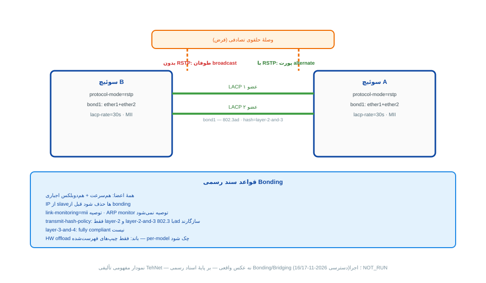

# حلقه، RSTP و LACP — جلوگیری از حلقه و تجمیع لینک (S5)

> وضعیت درس: **DRAFT / NOT_DEPLOYED — در انتظار مرور.** (درس مصوب سرفصل ‏S5: loop/RSTP/LACP)
> آموزش تصویری از سری switching؛ مخاطب: کارشناس شبکه.
> سناریوی کاملاً فرضی و آموزشی با دادهٔ ساختگی؛ هیچ شبکهٔ واقعی دستکاری نشده و هیچ اجرای واقعی NOT_RUN است.
> نمودار مفهومی و تألیفی است (نه عکس واقعی).

## پاسخ کوتاه

دو ابزار مکمل: **RSTP روی پل** جلوی حلقهٔ لایهٔ 2 را می‌گیرد (پورت زائد را بلوکه می‌کند) و **LACP ‏(bonding ‏mode=802.3ad)** دو یا چند کابل را به یک لینک تجمعی مدیریت‌شده تبدیل می‌کند که لینک قطع‌شده‌اش را خودش حذف می‌کند. قواعد سندشدهٔ LACP: همهٔ اعضا هم‌سرعت/هم‌دوبلکس، ‏MII monitoring توصیه می‌شود (ARP monitor توصیه **نمی‌شود**)، `transmit-hash-policy` فقط layer-2 و layer-2-and-3 با ‏802.3ad سازگارند، و روی سوئیچ، سیم‌کشی باند باید با پورت‌های همان چیپ و پشتیبانی HW سندشده انجام شود.

## پیش‌نیازها

- پل و VLAN: [M2](m2-vlan-small-office.fa.md) · ترانک بین سوئیچ‌ها: [S5 مکمل — آپ‌لینک/ترانک](s5-uplink-trunk.fa.md)

## مبنا آزمایشگاه (Lab Baseline) — دقیق و کامل

| بند | مقدار فرضی |
|---|---|
| سوئیچ‌ها | دو عدد سوئیچ فرضی ‏RouterOS v7.16+ ‏(سوئیچ A و ‏B) |
| باند LACP | ‏bond1 = ‏ether1+ether2، ‏mode=802.3ad، ‏lacp-rate=30secs، ‏link-monitoring=mii |
| پل | هر دو سوئیچ یک پل با ‏protocol-mode=rstp؛ ‏bond1 عضو پل |
| سناریوی حلقهٔ تصادفی | یک وصلهٔ سوم بین دو پورت آزاد دو سوئیچ (باعث حلقهٔ L2 در نبود RSTP) |
| سقف باند | دو لینک ‏1G: جمع ظاهری ‏2Gbps؛ ترافیک تک‌فلوی ‏TCP حداکثر ‏~1Gbps ‏(hash per-flow) |
| اجرای واقعی | **NOT_RUN** — دستورها از سند رسمی Bonding/Bridging نقل شده‌اند |

## تنظیم LACP — عین الگوی سند رسمی

```routeros
# هر دو سوئیچ A و B — یکسان:
# پیش‌شرط سند رسمی: روی slaveها IP نباشد
/interface bonding
add name=bond1 slaves=ether1,ether2 mode=802.3ad lacp-rate=30secs \
    link-monitoring=mii transmit-hash-policy=layer-2-and-3 comment="TN-S5"
/ip address
add address=10.0.0.A/30 interface=bond1 comment="TN-S5"
```

نکات سند رسمی که در این درس رعایت شده:

- «همهٔ دستگاه‌های aggregate باید هم‌سرعت و هم‌دوبلکس باشند» — دو سر ‏1G/full.
- ‏transmit-hash-policy: فقط `layer-2` و `layer-2-and-3` با ‏802.3ad سازگارند؛ «layer-3-and-4 fully compliant نیست».
- ‏link-monitoring=mii توصیه می‌شود؛ «ARP monitoring توصیه نمی‌شود چون reply ممکن است فقط روی یک slave برگردد».
- وضعیت هر پورت عضو: `/interface bonding monitor-slaves bond1` ‏(پرچم‌های ‏A/G/S/C/D).

## RSTP روی پل — سند رسمی

```routeros
/interface bridge
add name=bridge1 protocol-mode=rstp vlan-filtering=no comment="TN-S5"
/interface bridge port
add bridge=bridge1 interface=bond1
# بعد از تکمیل VLAN table — فیلترینگ آخر (الگوی M2/S5مکمل)
```

RSTP ‏(protocol-mode=rstp) فریم‌های ‏BPDU را بین سوئیچ‌ها رد و بدل می‌کند و پورت زائد مسیر حلقه را بلوکه می‌کند؛ در سناریوی حلقهٔ تصادفی، پورت مذکور نقش ‏alternate/backup می‌گیرد و برداشت کابل حلقه فقط از حالت بلوکه خارج می‌شود — بدون طوفان broadcast.

## سناریوی حلقهٔ تصادفی — چه می‌شود و چه انتظاری داشته باشیم

| حالت | بدون RSTP | با ‏RSTP سندشده |
|---|---|---|
| وصلهٔ حلقه وصل می‌شود | طوفان broadcast؛ ‏MAC table ناپایدار | پورت زائد در حالت ‏discard/alternate |
| وصله برداشته می‌شود | بازیابی خودکار طی چند ثانیه (تایمرهای RSTP سند رسمی) | همان |

**UNKNOWN:** زمان دقیق همگرایی (convergence) به مدل/تعداد پل وابسته است — سند رسمی تایمرها را سند می‌کند ولی عدد تجربی این ملبا NOT_RUN است.



**شرح متنی نمودار (جایگزین تصویر برای دسترس‌پذیری):** سمت چپ دو لینک موازی بین سوئیچ A و ‏B با برچسب ‏«bond1 ‏802.3ad/LACP — ‏lacp-rate=30s، ‏MII»؛ سمت راست یک وصلهٔ حلقوی تصادفی با علامت حلقه؛ روی پل هر دو سوئیچ ‏«protocol-mode=rstp» با پورت بلوکه‌شده روی مسیر حلقه. جعبه‌های کناری: «هم‌سرعت/هم‌دوبلکس اجباری»، ‏«layer-3-and-4 غیرسازگار»، ‏«MII بله، ‏ARP خیر»، ‏«حذف IP از slaveها». برچسب «تألیفی/مفهومی».

## خطاهای رایج

| نشانه | علت محتمل | بررسی | راه‌حل |
|---|---|---|---|
| طوفان broadcast پس از وصلهٔ اضافه | ‏RSTP روی پل فعال نیست | `protocol-mode` پل | ‏rstp + بازبینی ‏BPDU روی ترانک |
| ‏bond1 هرگز جمع نمی‌شود | ‏lacp-mode/passive یا سرعت ناهمسان یا ‏switch side بدون ‏LACP | ‏monitor-slaves | هر دو طرف active؛ هم‌سرعت |
| فقط یک لینک ترافیک می‌برد | ‏hash per-flow است — طبیعی ‏LACP | چند فلوی جدا تست کنید | طبیعی؛ جمع فقط روی فلوهای مختلف |
| بعد از ‏bonding، لینک ناپایدار | ‏IP روی slave باقی مانده (نقض پیش‌شرط سند) | `/ip address print` | حذف IP از slaveها |
| ‏HW offload باند فعال نیست | چیپ/device فهرست نشده | سند Bonding | مسیر CPU همچنان کار می‌کند؛ per-model چک |

## تمرین کوتاه (با پاسخ موردانتظار)

1. چرا ARP monitoring توصیه نمی‌شود؟ — **پاسخ موردانتظار:** سند رسمی: reply ممکن است فقط از یک slave برگردد و وضعیت سایر اعضا را کور می‌کند؛ ‏MII ملاک است.
2. دو لینک 1G در ‏LACP، یک دانلود تک‌فلوی بزرگ — سرعت؟ — **پاسخ موردانتظار:** حداکثر ≈1Gbps؛ چون ‏hash بر پایهٔ flow است و یک ‏TCP روی یک عضو می‌ماند — جمع 2G برای فلوهای مختلف.
3. وصلهٔ حلقه وصل شد و هیچ چیز نمی‌سوزد — کدام تنظیم نجات داد؟ — **پاسخ موردانتظار:** ‏protocol-mode=rstp روی پل؛ پورت زائد بلوکه شد.
4. transmit-hash-policy=layer-3-and-4 انتخاب کنیم؟ — **پاسخ موردانتظار:** خیر برای ‏802.3ad؛ سند رسمی: fully compliant نیست — ‏layer-2 یا ‏layer-2-and-3.

## چک‌لیست تحویل

- [ ] ‏IP از slaveها حذف شده قبل از bonding (پیش‌شرط سند)
- [ ] ‏bond ‏802.3ad با ‏lacp-rate و ‏transmit-hash-policy سازگار ‏(layer-2/layer-2-and-3)
- [ ] ‏link-monitoring=mii فعال؛ ‏monitor-slaves پرچم‌ها ثبت شده
- [ ] ‏protocol-mode=rstp روی پل هر دو سوئیچ
- [ ] سناریوی حلقهٔ تصادفی تست و رفتار بلوکه ثبت شده (اجرای واقعی NOT_RUN)
- [ ] ‏HW-offload باند فقط در صورت فهرست‌بودن چیپ/device ادعا می‌شود (UNKNOWN per-model ثبت شده)

## منابع رسمی (fetch شده با تاریخ)

- ‏Bonding ‏(RouterOS ‏help) — ‏802.3ad/LACP، ‏lacp-rate/mode، ‏transmit-hash-policy، ‏MII/ARP، ‏HW offload و چیپ‌ها: https://help.mikrotik.com/docs/spaces/ROS/pages/8323193/Bonding (دسترسی 2026-11-17)
- ‏Bridging and Switching — ‏RSTP و جدول VLAN: https://manual.mikrotik.com/docs/bridging-and-switching/ (دسترسی 2026-11-16)
- ‏L3HW — باند در ‏HW و محدودیت‌ها: https://help.mikrotik.com/docs/display/ROS/L3+Hardware+Offloading (دسترسی 2026-11-16)

## آموزش‌های مرتبط و مسیر خدمت

| پیوند | مقصد |
|---|---|
| درس‌های مرتبط | [S5 مکمل: آپ‌لینک/ترانک](s5-uplink-trunk.fa.md) · ‏[M2](m2-vlan-small-office.fa.md) · ‏[M6 dual-WAN](m6-dual-wan-failover.fa.md) |
| نقشهٔ کامل سری | [topic map](../topic-map.md) |
| طراحی تجمیع لینک و مقاوم‌سازی حلقه | [خدمات راه‌اندازی شبکهٔ تهران](https://tehnet.ir/services/network-setup-tehran/) |
| درس بعدی سری | S6 — ارتقای NAS/سرور 2.5G/10G (تولید در نوبت بعدی؛ فعلاً فقط در topic map) |
