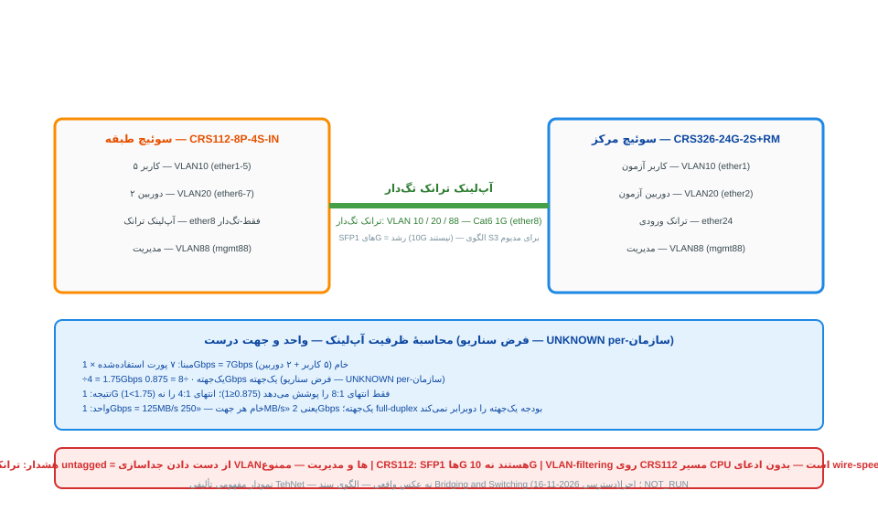

# آپ‌لینک و ترانک بین سوئیچ‌ها — انتخاب و راه‌اندازی (S5)

> وضعیت درس: **DRAFT / NOT_DEPLOYED — در انتظار مرور.**
> آموزش تصویری از سری switching؛ مخاطب: کارشناس شبکه.
> سناریوی کاملاً فرضی و آموزشی با دادهٔ ساختگی؛ هیچ شبکهٔ واقعی دستکاری نشده و هیچ اجرای واقعی NOT_RUN است.
> نمودار مفهومی و تألیفی است (نه عکس واقعی).

## پاسخ کوتاه

آپ‌لینک بین دو سوئیچ باید: ‏(۱) **ترانک تگ‌دار** برای همهٔ VLANهای لازم (نه untagged تک‌VLAN)، ‏(۲) **ظرفیت کافی** برای جمع ترافیک پایین‌دست (سقف آپ‌لینک = سقف تجمعی همهٔ کاربران آن سوئیچ) و ‏(۳) **قابل‌شناسایی** — پورت آپ‌لینک با frame-types تگ‌دار و ردیف جدول VLAN مشخص. سه اشتباه مرگبار آپ‌لینک: untagged گذاشتن ترانک، جا انداختن یک VLAN از ردیف جدول VLAN، و آپ‌لینک‌گیربی‌محاسبه (هشت پورت ‏1G پشت یک آپ‌لینک ‏100M).

## پیش‌نیازها

- ترانک و VLAN: [M2](m2-vlan-small-office.fa.md) · انتخاب ماژول/کابل آپ‌لینک: [S3](s3-sfp-dac-fiber.fa.md) · سازگاری پل: سند Bridging and Switching (دسترسی 2026-11-16)

## مبنا آزمایشگاه (Lab Baseline) — دقیق و کامل

سخت‌افزار سند رسمی CRS112-8P-4S-IN: **هشت پورت Gigabit RJ45 ‏(PoE-out) + چهار پورت ‏SFP ‏1G** — این مدل پورت ‏SFP+ ‏10G ندارد و آپ‌لینک نوری‌اش سقف ‏1Gbps است. تخصیص پورت‌به‌پورت شامل آپ‌لینک و مدیریت:

| پورت CRS112 | تخصیص | VLAN |
|---|---|---|
| ether1-5 (۵×RJ45 PoE) | ‏۵ کاربر دفتر — access ‏pvid=10 | 10 |
| ether6-7 (۲×RJ45 PoE) | ‏۲ دوربین — access ‏pvid=20 | 20 |
| ether8 (RJ45 PoE) | **آپ‌لینک ترانک 1G با Cat6** به سوئیچ مرکز — تگ‌دار 10/20/88 | trunk |
| sfp-sfpplus1-4 ‏(4×SFP ‏1G) | رشد — ماژول‌های ‏1G SFP ‏(مدل دقیق per-لینک: ‏UNKNOWN تا انتخاب؛ این پورت‌ها ‏10G نیستند) | — |

| بند | مقدار فرضی |
|---|---|
| سوئیچ طبقه | CRS112-8P-4S-IN — ‏۵ کاربر ‏(VLAN10) + ‏۲ دوربین ‏(VLAN20) + آپ‌لینک + ‏۴×SFP رشد |
| سوئیچ مرکز | CRS326-24G-2S+RM — هستهٔ شبکه (پورت GbE مقابل با Cat6) |
| ‏VLANهای عبوری از ترانک | ‏10 (دفتر) + ‏20 (دوربین) + ‏88 (مدیریت — در این درس روی پل هر دو سوئیچ تعریف می‌شود؛ از M2/M3 ارثی نیست) |
| اجرای واقعی | **NOT_RUN** — دستورها الگوی سند ‏Bridging and Switching با شروعِ صریح از تنظیمات کارخانه |

## محاسبهٔ ظرفیت آپ‌لینک — با واحد و جهت درست

```text
سقف تئوریک پایین‌دست:    ۷ پورت استفاده‌شده × 1Gbps = 7Gbps (۵ کاربر + ۲ دوربین)
                       (۱۲ پورت مسی کل؛ رشد روی SFPها/پورت‌های آزاد)
ضریب تجمعی (فرض سناریو — UNKNOWN per-سازمان): 4:1 تا 8:1
نیازمندی آپ‌لینک از این فرض:  12Gbps ÷ 4 = 3Gbps  ·  12Gbps ÷ 8 = 1.5Gbps
یعنی:                  آپ‌لینک 1G از نظر تئوریک این نسبت را برآورده نمی‌کند؛
                       توجیه 1G فقط با فرض واقع‌بینانهٔ ترافیک همزمان کم (سناریو-فرض، نه قاعده)
واحدها (سند رسمی واحدی):  1Gbps = 125MB/s حداکثر خام در هر جهت — «250MB/s» یعنی 2Gbps یک‌جهته
دوطرفه:                 Full-duplex یعنی هر جهت مستقل 1Gbps؛ جمع دو جهت بودجهٔ یک‌جهته را دو برابر نمی‌کند
قاعده:                  آپ‌لینک ≥ بزرگ‌ترین ترافیک همزمانِ محتمل + رشد ۲۴ ماه؛ در غیر این صورت ارتقای مدل/آپ‌لینک
```

دو یادداشت صادقانه: ‏(۱) ضریب تجمعی فرض سناریو است نه مقدار sourced — اندازه‌گیری واقعی (الگوی N2) ملاک نهایی؛ ‏(۲) اگر محاسبه نشان دهد ‏1G کافی نیست، این مدل برای آن ترافیک انتخاب غلط است (SFPهایش ‏1G هستند) → مدل با آپ‌لینک ‏10G (الگوی CRS326 با ‏S+ و ماژول‌های S3) — ارتقای مدل، نه معجزه روی آپ‌لینک 1G.

## راه‌اندازی ترانک — شروع صریح و توالی کامل (فیلترینگ آخر)

شروع صریح: هر دو سوئیچ از تنظیمات کارخانه/فاقد پل سفارشی ‏(بازرسی اول)؛ نگارش ‏RouterOS v7.16+. اگر bridge پیش‌فرض وجود دارد، مالکیت را بازرسی و همان را به‌کار بگیرید یا حذف/بازسازی کنید — دو bridge روی پورت‌های مشترک ممنوع. توجه سازوکار: CRS112 ‏VLAN/HW را از طریق پلِ hardware-offloaded سند می‌کند؛ پس از هر تغییر، `hw` flag پورت‌ها را در `/interface bridge port print` چک کنید.

```routeros
# --- سمت CRS112 (طبقه) ---
# بازرسی مالکیت
/interface bridge print
/interface bridge port print
# پل و اعضا با pvid هر access پورت
/interface bridge
add name=bridge1 vlan-filtering=no protocol-mode=rstp
/interface bridge port
add bridge=bridge1 interface=ether1 pvid=10
add bridge=bridge1 interface=ether2 pvid=10
add bridge=bridge1 interface=ether3 pvid=10
add bridge=bridge1 interface=ether4 pvid=10
add bridge=bridge1 interface=ether5 pvid=10
add bridge=bridge1 interface=ether6 pvid=20
add bridge=bridge1 interface=ether7 pvid=20
add bridge=bridge1 interface=ether8 frame-types=admit-all comment="uplink trunk 1G Cat6"
# جدول VLAN: ترانک تگ‌دار برای هر سه VLAN + اعضای access
/interface bridge vlan
add bridge=bridge1 vlan-ids=10 tagged=ether8 untagged=ether1,ether2,ether3,ether4,ether5
add bridge=bridge1 vlan-ids=20 tagged=ether8 untagged=ether6,ether7
add bridge=bridge1 vlan-ids=88 tagged=ether8,bridge1
# مسیر مدیریت روی VLAN88 (الگوی tagged CPU path)
/interface vlan
add name=mgmt88 vlan-id=88 interface=bridge1
/ip address
add address=192.168.88.2/24 interface=mgmt88
# فیلترینگ آخر — با مسیر بازگشت: set bridge1 vlan-filtering=no از جلسهٔ MAC/Console
/interface bridge
set bridge1 vlan-filtering=yes

# --- سمت CRS326 (مرکز) — پورت مقابل (فرض: ether24) با همان سه VLAN تگ‌دار ---
/interface bridge vlan
add bridge=bridge vlan-ids=10,20,88 tagged=ether24
```

هر دو طرف باید عضو مشترک و تنظیم یکسان داشته باشند؛ جدول چاپی به‌تنهایی اثبات forward/isolation نیست — ردیف‌های ماتریس پذیرش با نام پورت مبدأ/مقصد و نقش VLAN/IP اجرا می‌شوند (الگوی N4).



**شرح متنی نمودار (جایگزین تصویر برای دسترس‌پذیری):** دو سوئیچ: طبقه ‏(CRS112-8P-4S-IN با تخصیص ‏۵ کاربر ‏+ ۲ دوربین + ether8 آپ‌لینک + ‏۴×SFP رشد) و مرکز ‏(CRS326). بین آن‌ها آپ‌لینک Cat6 ‏1G با برچسب «ترانک تگ‌دار ‏VLAN ‏10/20/88». جعبهٔ محاسبه با واحد درست: ‏7Gbps تئوریک پایین‌دست ÷ 4:1-8:1 = ‏1.5-3Gbps نیازمندی (یعنی ‏1G با فرض سناریو پوشش داده می‌شود و عدد تئوریک را نه)، ‏1Gbps = ‏125MB/s هر جهت. هشدار قرمز: «ترانک untagged = از دست دادن جداسازی». راهنما و برچسب «تألیفی/مفهومی».

## جدول بررسی ترانک (قبل از تحویل — الگوی N4)

| # | تست | انتظار |
|---|---|---|
| ‏۱ | هر VLAN از هر دو طرف روی پورت آپ‌لینک تگ‌دار ثبت شده؟ | `/interface bridge vlan print` هر دو سوئیچ یکسان |
| ‏۲ | ترافیک هر VLAN از ترانک عبور می‌کند؟ | ping بین همان VLAN دو سوئیچ |
| ‏۳ | جداسازی‌ها حفظ شده؟ | تست‌های منفی الگوی M2 از سوئیچ دوم |
| ‏۴ | ظرفیت آپ‌لینک ≥ جمع محتمل؟ | محاسبهٔ بالا + مانیتور (الگوی N2) |

## خطاهای رایج

| نشانه | علت محتمل | بررسی | راه‌حل |
|---|---|---|---|
| یک VLAN از سوئیچ طبقه کار نمی‌کند | جا افتادن آن VLAN از ردیف جدول VLAN آپ‌لینک | مقایسهٔ `bridge vlan print` دو طرف | افزودن همان VLAN به ترانک هر دو طرف |
| کل سوئیچ طبقه از دسترس خارج | آپ‌لینک untagged شده (ترانک از دست رفته) | بررسی frame-types پورت آپ‌لینک | برگرداندن tagged |
| کندی جمعی در ساعت شلوغ | oversubscription آپ‌لینک | مانیتور ترافیک آپ‌لینک (الگوی N2) | آپ‌لینک 10G ‏(S3) یا تجمیع ‏bonding (سند رسمی — خارج این درس) |
| لینک بالا ولی ترافیک نمی‌گذرد | frame-types ناهمسان دو طرف | مقایسهٔ تنظیم پورت آپ‌لینک | هم‌سان‌سازی |

## تمرین کوتاه (با پاسخ موردانتظار)

1. آپ‌لینک untagged با VLAN10 چه خطری دارد؟ — **پاسخ موردانتظار:** ‏VLANهای 20/88 از ترانک حذف می‌شوند؛ جداسازی و مدیریت از سوئیچ طبقه از دست می‌رود.
2. ‏۱۲ پورت 1G پشت آپ‌لینک 1G یعنی چه؟ — **پاسخ موردانتظار:** oversubscription تئوریک؛ از نسبت 4:1-8:1 نیازمندی واقعی ‏1.5-3Gbps است یعنی ‏1G تئوریک را برآورده نمی‌کند — تنها با فرض ترافیک همزمان کم و اندازه‌گیری (الگوی N2) قابل‌تحمل؛ وگرنه ارتقای آپ‌لینک/مدل.
3. VLAN مدیریتی 88 را به ترانک اضافه نکنیم؟ — **پاسخ موردانتظار:** مدیریت سوئیچ طبقه از مرکز ناممکن می‌شود؛ یا باید مسیر مدیریتی جدا باشد.
4. کابل آپ‌لینک رک‌به‌رک ۱ متری روی CRS112؟ — **پاسخ موردانتظار:** پورت‌های SFP این مدل ‏1G هستند؛ ‏S+DA0001 ‏(DAC ‏10G) برای این مدل گزینهٔ درستی نیست — Cat6 ‏RJ45 ‏1G یا ماژول ‏1G SFP مناسب فاصله (الگوی S3؛ مدل دقیق ماژول per-لینک UNKNOWN تا انتخاب).

## چک‌لیست تحویل

- [ ] محاسبهٔ ظرفیت آپ‌لینک با فرض ضریب تجمعی مستند (UNKNOWN per-سازمان ثبت شده)
- [ ] مدیوم آپ‌لینک بر پایهٔ فاصله/سرعت انتخاب شده (الگوی S3)
- [ ] جدول VLAN هر دو طرف یکسان و کامل (همهٔ VLANهای عبوری)
- [ ] پورت آپ‌لینک هر دو طرف frame-types تگ‌دار
- [ ] تست‌های چهارگانهٔ جدول بررسی ترانک اجرا و ثبت شده (اجرای واقعی NOT_RUN)
- [ ] مانیتور ظرفیت آپ‌لینک در چک‌لیست دوره‌ای (الگوی N2)

## منابع (تأیید/تاریخ‌دار)

- Bridging and Switching — ترانک تگ‌دار و جدول VLAN: https://manual.mikrotik.com/docs/bridging-and-switching/ (دسترسی 2026-11-16)
- انتخاب ماژول/کابل آپ‌لینک: [S3](s3-sfp-dac-fiber.fa.md) + صفحات رسمی ماژول‌ها با تاریخ دسترسی همان درس
- تجربهٔ مهندسی ضریب تجمعی — فرض آموزشی با برچسب UNKNOWN، نه قاعدهٔ قطعی

## آموزش‌های مرتبط و مسیر خدمت

| پیوند | مقصد |
|---|---|
| درس‌های مرتبط | [M2](m2-vlan-small-office.fa.md) · [S1](../articles/mikrotik-switches-crs.fa.md) · [S3](s3-sfp-dac-fiber.fa.md) · [N2](n2-monitoring-maintenance.fa.md) |
| نقشهٔ کامل سری | [topic map](../topic-map.md) |
| طراحی آپ‌لینک/ترانک برای سازمان شما | [خدمات راه‌اندازی شبکهٔ تهران](https://tehnet.ir/services/network-setup-tehran/) |
| درس بعدی سری | S6 — برق و PSU سوئیچ (تولید در نوبت بعدی؛ فعلاً فقط در topic map) |
