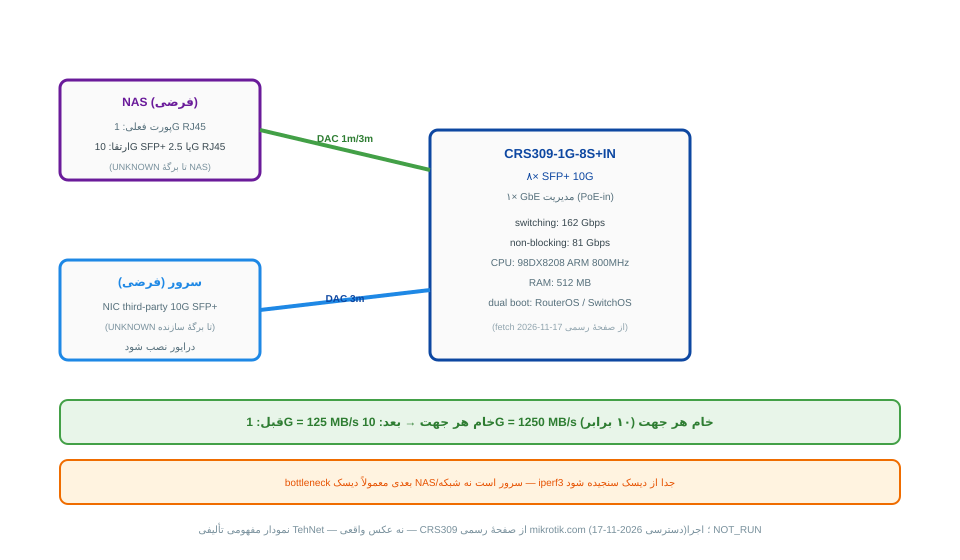

# ارتقای NAS/سرور به 2.5G/10G — مسیر، قطعات و آزمون (S6)

> وضعیت درس: **DRAFT / NOT_DEPLOYED — در انتظار مرور.** (درس مصوب سرفصل ‏S6: ارتقای NAS/سرور ‏2.5G/10G)
> آموزش تصویری از سری switching؛ مخاطب: مدیر IT/کارشناس شبکه.
> سناریوی کاملاً فرضی و آموزشی با دادهٔ ساختگی؛ هیچ شبکهٔ واقعی دستکاری نشده و هیچ اجرای واقعی NOT_RUN است.
> نمودار مفهومی و تألیفی است (نه عکس واقعی).

## پاسخ کوتاه

ارتقا سه بخش دارد: **سوئیچ با پورت ‏10G** (مثل ‏CRS309 با ‏۸×SFP+)، **NIC سرور** (کارت شبکهٔ ‏SFP+ در سرور/NAS) و **کابل/ماژول بین آن دو** (DAC برای رک، فیبر برای فاصله). کارت شبکهٔ سمت سرور خارج از تولید MikroTik است — مدل/درایور را از سازندهٔ کارت تأیید کنید. ‏2.5G مسی ‏(2.5GBASE-T) مسیر میانی برای Cat5e+ است؛ ‏10G مسی روی Cat6a/7 سندشده تا ‏30m ولی روی Cat5e تضمینی ندارد. قبل از خرید: NIC و سوئیچ و ماژول باید هم‌استاندارد باشند.

## پیش‌نیازها

- انتخاب ماژول و کابل: [S3](s3-sfp-dac-fiber.fa.md) · سوئیچ 10G: [CRS309 در S1](../articles/mikrotik-switches-crs.fa.md) · بودجه: [S2](s2-poe-budget.fa.md)

## مبنا آزمایشگاه (Lab Baseline) — دقیق و کامل

| بند | مقدار فرضی |
|---|---|
| سوئیچ 10G | CRS309-1G-8S+IN — ‏۸×SFP+ (تا ‏10G هر پورت) + ‏۱×GbE مدیریت ‏(PoE-in) |
| ظرفیت سند رسمی | ‏switching capacity ‏162 Gbps · ‏non-blocking ‏81 Gbps ‏(L2 ‏64B: ‏61,714 Mbps) |
| CPU/چیپ | ‏98DX8208 ‏ARM ‏32bit ‏800MHz ‏دو‌هسته — ‏512MB ‏RAM |
| NAS | NAS فرضی با پورت ‏1G موجود؛ ارتقا به ‏10G ‏SFP+ |
| سرور | سرور فرضی با کارت ‏10G ‏SFP+ ‏(NIC third-party — سازنده/مدل را از برگهٔ سازنده کارت تأیید کنید؛ UNKNOWN تا برگه) |
| کابل اولیه | ‏DAC ‏1m ‏(S+DA0001) — رک‌به‌رک؛ ‏Discontinued → جایگزین ‏DAC ‏3m از جدول سازگاری |
| سناریوی demand | ‏backup شبانه + دسترسی فایل همزمان چند کاربر → نیاز به ‏>1G توجیه‌پذیر |
| اجرای واقعی | **NOT_RUN** — دستورها الگوی سند RouterOS؛ سخت‌افزار فرضی |

## محاسبهٔ قبل از ارتقا — چه چیزی واقعاً >1G می‌خواهد؟

```text
backup شبانه:          2TB × ۸ ساعت = ~70 MB/s متوسط — 1G (125 MB/s خام) مرزی
فایل‌سرور همزمان:       ۵ کاربر × 20-40 MB/s پیک = 100-200 MB/s — با backup جمع می‌شود
دوربین‌های سنگین:       ۲ دوربین × 25 Mbps = 50 Mbps — جزئی
نتیجه:                 backup + فایل‌سروری همزمان > ‏1G خام → ارتقا به 10G توجیه‌پذیر
```

اعداد بالا **فرض سناریو**‌اند؛ اندازه‌گیری واقعی از مانیتورینگ (الگوی N2) ملاک نهایی است.

## سه بخش ارتقا

| بخش | انتخاب | نکتهٔ سندشده |
|---|---|---|
| سوئیچ 10G | ‏CRS309 ‏(۸×SFP+، ‏162 Gbps switching، ‏81 Gbps non-blocking) | تنها یک پورت ‏GbE مدیریتی دارد — مدیریت از آن یا از LAN موجود |
| ‏NIC سرور | کارت ‏10G ‏SFP+ ‏third-party (مثل ‏Intel ‏X710، ‏Mellanox ‏ConnectX-4) | خارج از تولید ‏MikroTik — سازگاری از برگهٔ سازنده کارت؛ ‏UNKNOWN تا برگه |
| کابل/ماژول | ‏DAC رک‌به‌رک ‏(الگوی S3) یا فیبر مالتی‌مود برای فاصله‌های بیشتر | ‏S+DA0001 ‏Discontinued → جایگزین ‏DAC ‏3m از جدول سازگاری |



**شرح متنی نمودار (جایگزین تصویر برای دسترس‌پذیری):** ‏NAS و سرور با کابل ‏DAC مستقیم به سوئیچ ‏CRS309 وصل شده‌اند که هشت پورت ‏SFP+ ده گیگابیت دارد. سوئیچ ظرفیت سوئیچینگ ‏۱۶۲ گیگابیت و ‏throughput ‏۸۱ گیگابیت دارد. سرعت قبل ارتقا ‏۱۲۵ مگابایت بر ثانیه و بعد ارتقا ‏۱۲۵۰ مگابایت بر ثانیه. تلهٔ بعدی دیسک است نه شبکه. برچسب «تألیفی/مفهومی».

## مهاجرت — توالی پنج‌گامی

| گام | عمل | انتظار |
|---|---|---|
| ‏۱ | سوئیچ CRS309 را رک کنید؛ مدیریت از پورت ‏GbE موجود | سوئیچ بالا آمده و از LAN مدیریت‌پذیر است |
| ‏۲ | ‏NIC ‏10G را در سرور نصب و درایور سازندهٔ کارت را نصب کنید | لینک با ‏DAC به CRS309 برقرار |
| ‏۳ | ‏NAS: پورت ‏10G را وصل کنید ‏(DAC دوم از CRS309) | لینک ‏10G در هر دو |
| ‏۴ | تست پهنای‌باند: ‏iperf3 بین سرور و ‏NAS | نزدیک ‏10Gbps ‏(محدودیت دیسک/FS جدا) |
| ‏۵ | آزمون failover: یک کابل DAC را قطع کنید | تونل/لینک دوم یا ‏bonding رک — خارج دامنه این درس، به N4 ارجاع |

## نمودار


**شرح متنی نمودار (جایگزین تصویر برای دسترس‌پذیری):** سمت چپ: ‏NAS و سرور با کارت‌های ‏10G ‏SFP+؛ سمت راست: سوئیچ ‏CRS309 با ‏۸×SFP+؛ بین آن‌ها دو کابل ‏DAC ‏(سبز = مسیر اصلی). یک فلش «قبل: ‏1G = ‏125 MB/s» به یک جعبهٔ خاکستری ‏(مدل قبلی) و یک فلش «بعد: ‏10G = ‏1250 MB/s» به جعبهٔ سبز؛ برچسب «تألیفی/مفهومی».

## خطاهای رایج

| نشانه | علت محتمل | بررسی | راه‌حل |
|---|---|---|---|
| لینک 10G بالا نمی‌آید | ‏DAC یا ماژول با پورت ناهمخوان | مدل پورت ‏(SFP+ ‏10G) و مدل کابل/ماژول را چک کنید | کابل/ماژول سازگار ‏(S3) |
| سرعت فقط ‏1G | ماژول ‏1G در پورت ‏10G نصب شده | `/interface ethernet monitor sfp-sfpplus1` | ماژول ‏10G (S+DA0001/S+85DLC03D) |
| سرعت بالا ولی دیسک bottleneck | دیسک NAS/سرور از ‏10G کندتر | ‏iperf3 جدا از دیسک | دیسک جداگانه ارتقا یابد |
| درایور NIC نصب نشده | ‏third-party بدون درایور | `lspci` / Device Manager | درایور از سازندهٔ کارت |

## تمرین کوتاه (با پاسخ موردانتظار)

1. چرا ‏CRS309 برای این ارتقا مناسب است؟ — **پاسخ موردانتظار:** ‏۸×SFP+ ‏10G + ‏non-blocking ‏81 Gbps — کافی برای چند سرور/NAS همزمان.
2. اگر فقط ‏backup شبانه دارید و هیچ دسترسی همزمان سنگین؟ — **پاسخ موردانتظار:** ‏1G مرزی اما قابل‌تحمل در پنجرهٔ شب؛ ارتقا توجیه فوری ندارد — اندازه‌گیری واقعی (N2) ملاک.
3. ‏DAC 1m برای سرور در رک و NAS در رک مجاور — کافی؟ — **پاسخ موردانتظار:** بله؛ رک‌به‌رک مجاور = فاصلهٔ <3m → ‏DAC ‏3m از جدول سازگاری.
4. کارت شبکهٔ سرور چه محدودیتی دارد؟ — **پاسخ موردانتظار:** خارج از تولید MikroTik — سازگاری از برگهٔ سازندهٔ کارت؛ UNKNOWN تا برگه.

## چک‌لیست تحویل

- [ ] سوئیچ 10G انتخاب و رک شده ‏(CRS309 یا مشابه فهرست‌شده در S1)
- [ ] ‏NIC سرور: برگهٔ سازنده بررسی و درایور نصب شده — UNKNOWN تا برگه
- [ ] کابل/ماژول مطابق فاصله و سرعت انتخاب شده (الگوی S3)
- [ ] تست پهنای‌باند ‏iperf3 قبل/بعد ثبت شده
- [ ] bottleneck بعدی شناسایی شده (دیسک؟ شبکه؟)
- [ ] قبل/بعد در گزارش تحویل ثبت شده (الگوی N4)
- [ ] اجرای واقعی این درس NOT_RUN (مبنا فرضی)

## منابع رسمی (fetch شده با تاریخ)

- صفحهٔ رسمی CRS309-1G-8S+IN — ‏۸×SFP+، ‏162 Gbps switching، ‏81 Gbps non-blocking، ‏98DX8208: https://mikrotik.com/product/crs309_1g_8s_in (دسترسی 2026-11-17)
- انتخاب کابل/ماژول ‏10G: [S3](s3-sfp-dac-fiber.fa.md) + صفحات رسمی ‏S+DA0001 / ‏S+85DLC03D با تاریخ دسترسی همان درس
- سند سازگاری Wired Interfaces: https://help.mikrotik.com/docs/spaces/ROS/pages/220233794/MikroTik+wired+interface+compatibility (دسترسی 2026-11-16)

## آموزش‌های مرتبط و مسیر خدمت

| پیوند | مقصد |
|---|---|
| درس‌های مرتبط | [S1 سوئیچ‌ها](../articles/mikrotik-switches-crs.fa.md) · [S3 ماژول‌ها](s3-sfp-dac-fiber.fa.md) · [N4 پذیرش](n4-delivery-acceptance.fa.md) |
| نقشهٔ کامل سری | [topic map](../topic-map.md) |
| ارتقای سرور/NAS برای سازمان شما | [خدمات راه‌اندازی شبکهٔ تهران](https://tehnet.ir/services/network-setup-tehran/) |
| پایان خوشهٔ S و M درس‌های فرضی؛ درس‌های بعدی سری | در topic map ثبت است |
