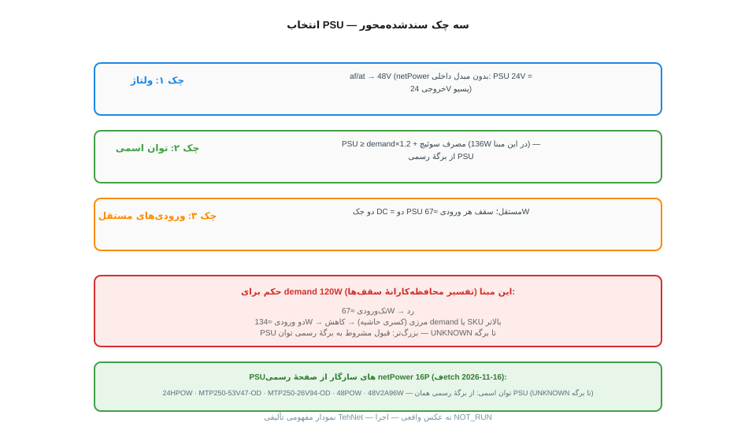

# برق و PSU سوئیچ — انتخاب، ولتاژ و پشتیبان‌گیری (S6)

> وضعیت درس: **DRAFT / NOT_DEPLOYED — در انتظار مرور.**
> آموزش تصویری از سری switching؛ مخاطب: مدیر IT/خریدار + کارشناس شبکه.
> سناریوی کاملاً فرضی و آموزشی با دادهٔ ساختگی؛ هیچ شبکهٔ واقعی دستکاری نشده و هیچ اجرای واقعی NOT_RUN است.
> نمودار مفهومی و تألیفی است (نه عکس واقعی).

## پاسخ کوتاه

PSU سه چک می‌خواهد: **ولتاژ مطابق** (بعضی سوئیچ‌ها مثل netPower 16P مبدل داخلی ندارند — ولتاژ PSU = ولتاژ PoE خروجی)، **توان اسمی** ≥ (demand PoE + حاشیهٔ امن + مصرف خود سوئیچ) و **ورودی‌های مستقل** (دو جک DC سقف جریان جدا دارند — یک PSU واحد برای دو ورودی، نقطهٔ خرابی واحد است). فهرست PSU سازگار را از صفحهٔ رسمی محصول بگیرید، نه از حدس بازار.

## پیش‌نیازها

- محاسبهٔ demand: [بودجهٔ PoE (S2)](s2-poe-budget.fa.md) · قواعد ترانک: [S5](s5-uplink-trunk.fa.md)

## مبنا آزمایشگاه (Lab Baseline) — همان سوئیچ و demand درس S2

| بند | مقدار فرضی/سندشده |
|---|---|
| سوئیچ | netPower 16P (CRS318-16P-2S+OUT) — fetch ‏2026-11-16 |
| PSU پیوست | **ندارد** (سند رسمی) |
| ورودی‌ها | دو جک DC مستقل: ‏18-30V یا ‏48-57V |
| demand ‏(از S2) | ‏8 دوربین ×10W + ‏4 تلفن ×5W = ‏100W → با حاشیهٔ ×1.2 = ‏120W |
| مصرف خود سوئیچ | ≈16W (سند رسمی) |
| PSUهای سازگار (فهرست رسمی صفحهٔ محصول) | ‏24HPOW · ‏MTP250-53V47-OD · ‏MTP250-26V94-OD · ‏48POW · ‏48V2A96W |

## محاسبهٔ انتخاب PSU — سه‌گام سندشده‌محور

```text
گام ۱ — ولتاژ: دستگاه‌های PoEگیرنده af/at هستند → PSU باید 48V باشد (سند رسمی: 24V → خروجی 24V پسیو؛ 48V → af/at)
گام ۲ — توان: demand+حاشیه (120W) + مصرف سوئیچ (16W) → PSU ≥ 136W
گام ۳ — سقف جریان: سقف هر ورودی DC سندشده ≈67W (24V: ‏2.8A · ‏48V: ‏1.4A)
       → با یک ورودی، سقف ≈67W < ‏136W → دو ورودی DC لازم است؛ جمع دو ورودی ≈134W
       → 136W > ‏134W → تفسیر محافظه‌کارانه: کسری کوچک → UNKNOWN رسمی (بودجهٔ تضمینی جفت-PSU در سند نیامده)
       → تصمیم محافظه‌کارانه: کاهش demand (دوربین‌های کم‌مصرف‌تر) یا SKU بالاتر — حاشیه حذف نمی‌شود
```

**UNKNOWN صریح:** توان اسمی دقیق هر PSU فهرست‌شده (به‌جز 48V2A96W که از کدش ≈96W پیداست) در fetch این درس نیامده — خریدار باید از برگهٔ رسمی همان PSU توان اسمی بگیرد؛ حدس زده نمی‌شود.

## جدول تصمیم PSU — برای همین demand

| سناریوی PSU | ولتاژ | توان قابل‌تامین PoE (تفسیر محافظه‌کارانه) | حکم برای demand ‏120W |
|---|---|---|---|
| یک PSU ‏48V تک‌ورودی | ‏48V | ≈67W (سقف یک ورودی) | **رد** |
| دو ورودی DC با PSU جفت | ‏24V یا ‏48V | ≈134W ‏(2×67W) | مشروط — کسری ‏2W+ حاشیه = مرزی؛ ترجیح: کاهش demand یا SKU بالاتر |
| PSU بزرگ‌تر از فهرست سازگار با دو جک | ‏48V | ≥ ‏136W لازم | قبول مشروط به تأیید توان اسمی از برگهٔ PSU — **UNKNOWN** تا برگه دیده شود |



**شرح متنی نمودار (جایگزین تصویر برای دسترس‌پذیری):** سه جعبهٔ چک به‌ترتیب: ‏چک ۱ ولتاژ ‏(af/at → ‏48V؛ ‏netPower بدون مبدل داخلی: ‏PSU ‏24V یعنی خروجی ‏24V پسیو)، ‏چک ۲ توان اسمی ‏(PSU ≥ ‏demand×1.2 + مصرف سوئیچ = ‏136W در این مبنا؛ مقدار از برگهٔ رسمی PSU)، ‏چک ۳ ورودی‌های مستقل ‏(دو جک DC با سقف هر ورودی ≈67W و دو PSU مستقل بهتر از یک PSU واحد). زیر آن جعبهٔ حکم برای ‏demand ‏120W این مبنا: تک‌ورودی رد؛ دو ورودی ≈134W مرزی (کاهش demand یا SKU بالاتر)؛ ‏PSU بزرگ‌تر قبول مشروط به برگهٔ رسمی. پایین: فهرست PSUهای سازگار سندشده از صفحهٔ رسمی محصول با یادداشت ‏UNKNOWN توان اسمی تا دیدن برگه. برچسب «تألیفی/مفهومی».

## خطاهای رایج

| خطا | چرا گران است | درست |
|---|---|---|
| PSU با ولتاژ ناهمسان با دستگاه‌های PoEگیرنده | دوربین af با خروجی ‏24V پسیو بالا نمی‌آید | ولتاژ PSU = نیاز استاندارد دستگاه‌ها ‏(48V برای af/at) |
| یک PSU برای دو جک DC | یک نقطهٔ خرابی؛ سقف جریان هر ورودی هم به آن گره می‌خورد | دو PSU مستقل (سند: دو ورودی مستقل) — حتی به‌بهانهٔ سادگی |
| توان اسمی PSU را از اسمش حدس زدن | کد محصول ≠ توان | برگهٔ رسمی همان PSU |
| PSU نزدیک سقف خودش (بدون حاشیه) | خاموشی محافظتی/عمر کوتاه | توان اسمی ≥ ‏demand+حاشیه+مصرف سوئیچ |
| فهرست PSU سازگار را از بازار | سازگاری تضمین‌شده فقط از صفحهٔ محصول | فهرست رسمی + برگهٔ PSU |

## تمرین کوتاه (با پاسخ موردانتظار)

1. چرا netPower 16P با PSU ‏24V دوربین‌های af را روشن نمی‌کند؟ — **پاسخ موردانتظار:** مبدل داخلی ندارد؛ خروجی PoE همان ‏24V می‌شود که af/at نیست (سند رسمی).
2. demand ‏120W با دو ورودی ≈134W — قبول؟ — **پاسخ موردانتظار:** مشروط/مرزی در تفسیر محافظه‌کارانه؛ حاشیه حذف نمی‌شود — کاهش demand یا SKU بالاتر.
3. یک PSU بزرگ برای دو جک؟ — **پاسخ موردانتظار:** نقطهٔ خرابی واحد؛ دو PSU مستقل روی دو ورودی مستقل سندشده.
4. توان اسمی یک PSU فهرست‌شده را از کجا بگیرید؟ — **پاسخ موردانتظار:** برگهٔ رسمی همان PSU؛ کد محصول ملاک توان نیست (UNKNOWN تا برگه).

## چک‌لیست تحویل

- [ ] ولتاژ PSU با نیاز استاندارد دستگاه‌های PoEگیرنده هم‌سان (af/at → ‏48V)
- [ ] توان اسمی PSU ≥ ‏demand×1.2 + مصرف سوئیچ (برگهٔ رسمی PSU، نه حدس از کد)
- [ ] دو ورودی DC با دو PSU مستقل (یا ریسک تک‌PSU مستند و پذیرفته)
- [ ] سقف جریان هر ورودی DC در محاسبه لحاظ شده
- [ ] فهرست PSU از صفحهٔ رسمی محصول (نه بازار)
- [ ] اجرای واقعی این درس NOT_RUN (مبنا فرضی)

## منابع (fetch/تأیید شده با تاریخ)

- صفحهٔ رسمی netPower 16P — بدون PSU، ورودی‌های DC مستقل، سقف‌های جریان، فهرست PSUهای سازگار: https://mikrotik.com/product/netpower_16p (دسترسی 2026-11-16 — همان fetch درس S2)
- روش محاسبهٔ demand و حاشیه: [بودجهٔ PoE (S2)](s2-poe-budget.fa.md)
- تجربهٔ فرایندی عمومی خرید PSU — بدون ادعای قیمت/مدل بازار

## آموزش‌های مرتبط و مسیر خدمت

| پیوند | مقصد |
|---|---|
| درس‌های مرتبط | [S2 بودجهٔ PoE](s2-poe-budget.fa.md) · [S5 آپ‌لینک](s5-uplink-trunk.fa.md) · [N2 نگهداری](n2-monitoring-maintenance.fa.md) |
| نقشهٔ کامل سری | [topic map](../topic-map.md) |
| طراحی برق/PSU برای سازمان شما | [خدمات راه‌اندازی شبکهٔ تهران](https://tehnet.ir/services/network-setup-tehran/) |
| پایان خوشهٔ S درس‌ها؛ درس‌های بعدی سری | در topic map ثبت است |
