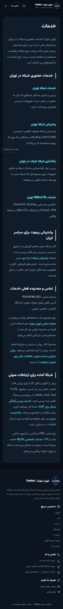
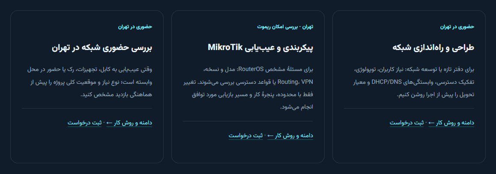

# کاتالوگ خدمات و مسیر درخواست — Issue63

وضعیت فعلی: **DEPLOYED_VERIFIED**؛ source تولید `4aff1784785bc0a8c90150c4a1435a2d3b7919ed`. [Issue63](https://github.com/DashSaman/TehNet/issues/63) باز می‌ماند. برابری رقابتی، رشد رتبه یا تبدیل فروش اثبات نشده است.

## تغییر قابل مشاهده

بدنهٔ همان [Services](https://tehnet.ir/services/)، ID8، به هفت مسیر قابل پیمایش، کارت‌های توضیح‌دار، شش URL موجود خدمات، مرزبندی حضوری تهران/ریموت، راهنمای انتخاب و فرم کوتاه تبدیل شده است. صاحب کسب‌وکار در همین گفتگو ارائهٔ مانیتورینگ، سرور/مجازی‌سازی، فایروال، Wi-Fi و اتصال شعب را تأیید کرد. خروجی و پذیرش هر حوزه توضیح داده شده؛ برند، گواهی، نرخ، SLA و زمان تضمینی ادعا نشده‌اند.

در همان [صفحهٔ اصلی](https://tehnet.ir/)، ID5، hero، هویت Learn/Lab/Services/Shop و معرفی موجود حفظ شده‌اند؛ CTA و فرم مستقیم خدمات افزوده شده است. PBX/IVR و خدمات تخصصی VoIP به [مایتل](https://mytel.one/services/) ارجاع دارند. هیچ URL تازه یا تغییر تولید مایتل وجود ندارد.

فرم `[tn_service_request]` در `class-tickets.php` از همان action `tn_ticket_submit` و موجودیت خصوصی `tn_ticket` استفاده می‌کند. نام، ایمیل، خدمت و شرح کوتاه لازم‌اند؛ سازمان اختیاری است. رسید تصادفی موقت فقط شماره/وضعیت را نشان می‌دهد؛ رسید، رزرو یا پیش‌فاکتور تأییدشده نیست. کارکنان همان شماره و زمینه را در پنل موجود می‌بینند. خرید تجهیزات به B2B موجود ارجاع دارد؛ سامانهٔ موازی ساخته نشده است.

## قبل و بعد و مقایسهٔ محدود

در برداشت خواندنی ۱ نوامبر، `main` خانه و Services فرم مستقیم نداشتند. سه مسیر واقعی TarazNet در دسکتاپ و موبایل بررسی شدند: [اکتیو](https://taraznet.com/active-network-services/)، [مانیتورینگ](https://taraznet.com/active-network-services/network-monitoring/)، [مجازی‌سازی](https://taraznet.com/active-network-services/configure-vmware/). دسته‌بندی و مسیرهای تخصصی آن‌ها شاهد معماری محتوایی‌اند؛ کیفیت اجرا، SLA، رتبه یا نتیجهٔ فروش از تبلیغات آن‌ها استنباط نشده است. بررسی۱۲۰ سایت ادعا نمی‌شود.

## آزمون واقعی و حدود آن

بستهٔ ثابت `acda6b6c3e34f44c0657c19e129091e231d1ffb5` در WordPress بومی ایزوله با ایمیل/شبکهٔ خروجی/پرداخت بسته آزموده شد. دو درخواست مصنوعی واقعاً ذخیره شدند: دسکتاپ و موبایل375 بدون JavaScript؛ شماره‌های مجزا و وضعیت باز در رسید و همان دو مورد در پنل کارمند مجاز مشاهده شدند. nonce و فرم واقعی، ورودی نامعتبر/آرایه، honeypot، throttle، منع پاسخ ناشناس، حریم رسید، noindex، لینک‌های شش مالک و چهار مسیر خانه بررسی شدند. مجموعه۵۱ بررسی گذشت؛ تعداد بررسی به معنی برابری رقابتی نیست.

اپراتور محدود check/apply/repeat و rollback/repeat با backup/checksum و محافظ drift اجرا شد. posts/meta/users، فایل‌های مدیریت‌شده/محافظ و runtimeها دقیقاً به حالت اولیه برگشتند. تلاش‌های قبلی وقفهٔ navigation و خطای selector داشتند؛ یک auto-draft متعلق به کارمند QA بازیابی را متوقف کرد و پس از تطبیق محدود و حذف فقط همان fixture، بازیابی دقیق تأیید شد. scroll نرم فرم بدون JS جداگانه بازتولید و اصلاح شد؛ علت واحد و قطعی برای تمام وقفه‌های قدیمی ادعا نشده است.

[رسید پاک‌سازی‌شدهٔ staging](../../qa/commercial-2026-11-01/staging-verification.json). بررسی محلی:۵۸ Python case، یک skip صریح به‌علت مجوز symlink میزبان؛۵۵ PHP contract و سه syntax check گذشتند. فایل‌های خام، اطلاعات اتصال، حساب QA و شماره‌های خصوصی در Git نیستند. بررسی کد مستقیم انجام شد؛ یک دستیار فقط نقشهٔ خواندنی اپراتور staging را تهیه کرد، و اجرای GLM یا CLI بیرونی ادعا نمی‌شود.

## انتشار و کار بعد

بک‌اند: [PR64](https://github.com/DashSaman/TehNet/pull/64)، CI41311680789؛ کاتالوگ: [PR65](https://github.com/DashSaman/TehNet/pull/65)، CI41312062988. هر دو موفق و ادغام شده‌اند. source تولید `4aff1784785bc0a8c90150c4a1435a2d3b7919ed` از نظر members/files/tool/guard با نسخهٔ native qualified برابر بود. backup/checksum/drift تازه، انتشار سه فایل/دو بدنه و repeat بدون تغییر گذشت؛ صفر صفحهٔ تازه.۱۴ GET با TLS معتبر، hash عمومی CSS و۱۳۹ بررسی مرورگر عمومی دسکتاپ1440/موبایل375 با JS و بدون JS گذشتند. فرم، چهار فیلد اجباری، CTA با پیش‌انتخاب، هفت دسته، شش مالک، MyTel و چهار مسیر خانه بررسی شدند؛ هیچ فرم تولید submit نشد. اطلاعات image/price/inquiry تمام۲۵کالا، دادهٔ محافظت‌شده و runtime همهٔ سرویس‌های موجود برابر ماندند. rollback زنده لازم نشد؛ مسیر آن در staging تمرین شده بود.

[رسید تولید و مرورگر](../../qa/commercial-2026-11-01/production-verification.json). تصاویر زیر از سایت عمومی پس از انتشارند:

noindex،۲۵کالای استعلامی/قابل‌خرید صفر، ERP/پرداخت بسته، خانه/منو/مالک‌های خدمات و داده‌ها حفظ می‌شوند. credential rotation همچنان UNKNOWN/NOT_ROTATED؛ purge مشترک NEEDS_APPROVAL؛ Origin UNDETERMINED و MyTel production READ_ONLY. این تغییرات گیت‌ها را نمی‌بندند.

وضعیت بسته‌های بعدی در بخش ادامهٔ اجرا آمده است: سه ارتقای محتوایی موجود منتشر شده‌اند؛ عمق باقیمانده، مدرک اعتماد و اندازه‌گیری/مجوز indexability هنوز بازند. فهرست نامزدها مقالهٔ منتشرشده نیست. منابع جاری: [محتوای مردم‌محور Google](https://developers.google.com/search/docs/fundamentals/creating-helpful-content)، [لینک قابل پیمایش](https://developers.google.com/search/docs/crawling-indexing/links-crawlable)؛ تاریخ بازبینی۱نوامبر۲۰۲۶. لینک توصیفی و پاسخ به نیاز کاربر راهنمای اجراست، نه تضمین رتبه.

## ادامهٔ اجرا: سه ارتقای محتوایی واقعاً منتشر شد

[PR66](https://github.com/DashSaman/TehNet/pull/66)، CI41313522605 و source `fd1209d200b87554a97e1671f4ef6f97d7e4de22`: سه بدنهٔ موجود، بدون نصب runtime یا URL تازه. برای هرکدام، تطابق بستهٔ qualified، backup/checksum/drift تازه، apply/repeat، hash بدنهٔ ذخیره‌شده، حفاظت داده/runtime و TLS عمومی گذشت؛ سپس۴۱بررسی مرورگر عمومی1440/375/JS/no-JS تأیید شد. هیچ فرم تولید submit نشد.

- [پشتیبانی/مانیتورینگ](https://tehnet.ir/services/network-support-tehran/#monitoring-acceptance)، ID31: سناریوی پذیرش قطع شعبه، کشف/اعلان/تأیید/بازیابی، مسئول پاسخ، سه الگوی همکاری پیشنهادی و FAQ.
- [راه‌اندازی/Wi-Fi](https://tehnet.ir/services/network-setup-tehran/#wifi-project-brief)، ID33: شرح پروژه، ظرفیت در برابر پوشش، مهمان و کاربرد نماینده، معیار تحویل و FAQ.
- [MikroTik/فایروال](https://tehnet.ir/services/mikrotik-tehran/#firewall-acceptance)، ID35: تفکیک input/forward/output، ماتریس دسترسی مجاز/منع‌شده، توقف/بازگشت و تحویل.

این سه ارتقای عمیق صفحات موجودند؛ مقالهٔ تازه یا پروژهٔ واقعی مشتری محسوب نمی‌شوند. مثال‌ها فرضی و اندازه‌گیری‌نشده‌اند. منابع رسمی Zabbix/Cisco/MikroTik با تاریخ و محدودیت نسخه/محصول در [brief](../../seo/commercial-depth-2026-11-01.md) و متن صفحات آمده‌اند؛ تست دستگاه، RF، تحویل اعلان، امنیت فایروال یا نتیجهٔ SEO ادعا نشده است. لینک‌های برآورد خدمت از B2B تجهیزات به همان فرم خدمات اصلاح شدند. [قالب مطالعهٔ موردی](../templates/service-case-study-private-workflow.md) فقط گردش‌کار خصوصی با وضعیت رضایت NOT_GRANTED است؛ مشتری یا نتیجهٔ ساختگی منتشر نشده.

[رسید تولید سه ارتقا](../../qa/commercial-2026-11-01/depth-production-verification.json). بررسی دادهٔ GSC Wizard با خطای واقعی `payment_required / subscription_required` متوقف شد؛ retry یا اشتراک پولی انجام نشد. دادهٔ query/rank/traffic/conversion در دسترس این اتصال نیست. [فهرست مسیرهای انتشار برای بررسی مالک](../../seo/commercial-launch-inventory-2026-11-01.json) از همان شواهد واقعی ساخته شده؛ noindex تغییر نکرده و مجوز ایندکس جداست.

باقی‌ماندهٔ دقیق: عمق سرور/مجازی‌سازی و ارتباط شعب فعلاً به کارت‌های تأییدشدهٔ کاتالوگ محدود است؛ مدرک پروژه/رضایت مشتری، SLA/قیمت/برند مشخص، اندازه‌گیری جست‌وجو/تبدیل و تصمیم مالک برای indexability لازم‌اند. Issue63 باز می‌ماند؛ برابری رقابتی ادعا نمی‌شود.

## انتقال دانش و تحویل این بسته

انتقال دانش در [-SEO PR21](https://github.com/DashSaman/-SEO/pull/21) ادغام شد؛ main `8d764e356d8f9b4a8844f5afb7696535f4ff60e4`، head آزموده‌شده `8072e6b60279688284347456c2cf1011c9ecfdcb` و CI41314407511 موفق. دو موضوع موجود/هفت ردیف منبع/بازبینی scoped Google و هماهنگی/dashboard به‌روز؛ baseline71٪ و۱۸مقصد ثابت.۱۲privacy محلی،scan۶۸/۶۸،منابع یکتا/لینک‌ها/anchorها پاس. گزارش سه انتشار در TehNet PR67/main `ce29a4a0e8e1c2e88af1745d8d535e0877055192` و CI41314181611 ادغام شد؛ این‌ها تغییر اسنادند و انتشار زنده را تکرار نمی‌کنند.

CP01/02 روی سایت تأیید شده‌اند؛ CP03 پوشش کاتالوگ و سه عمق آموزشی دارد و ادامهٔ سرور/شعب باز است؛ CP04 روش قرارداد/قالب خصوصی دارد و مدرک واقعی مشتری ندارد؛ CP05 سه ارتقای موجود واقعاً منتشر کرده، صفر مقالهٔ تازه؛ CP06 موجودی مسیر برای بررسی مالک آماده دارد، اما GSC اشتراک‌مسدود و indexability منتظر مجوز صریح است. ایشو۶۳ باز می‌ماند.
