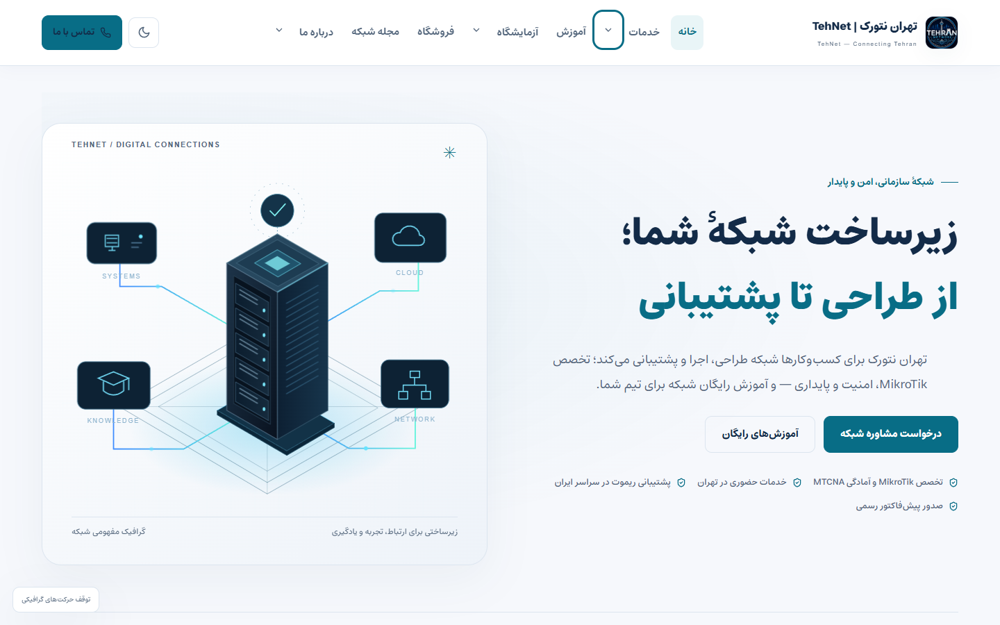
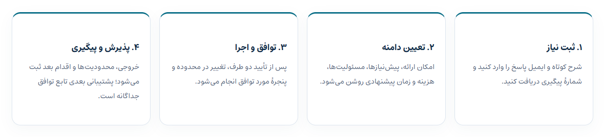
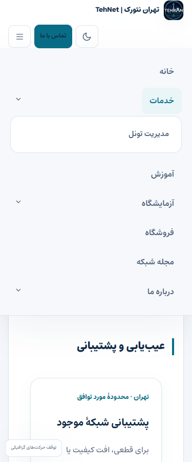

# تحویل اصلاحات شرکتی —۱نوامبر۲۰۲۶

وضعیت: **DEPLOYED_VERIFIED**؛ فعال‌سازی واقعی Google CAPTCHA همچنان **BLOCKED** است.

| درخواست مالک | تحویل و شاهد |
|---|---|
| حذف رزومه از فوتر | لینک حذف شد؛ خود صفحه و URL آن با HTTP200 باقی است |
| رفع بالا/پایین بودن مراحل | فاصلهٔ ناشی از flow margin وردپرس از۲۴px به اختلاف کمتر از۱px رسید؛ چهار کارت هم‌ارتفاع |
| فونت خواناتر | Estedad متغیر با مجوز OFL به‌صورت محلی، متن اصلی۱۷px و منوی دسکتاپ حداقل۱۵px به‌جای۱۲px؛ بارگذاری واقعی تأیید |
| ترتیب منو و مدیریت تونل | خانه، خدمات، آموزش، آزمایشگاه، فروشگاه، مجله شبکه، درباره ما؛ مدیریت تونل زیر خدمات، نرم‌افزار زیر آزمایشگاه، تماس زیر درباره ما و CTA مستقل تماس؛ همگی ویرایش‌پذیر در همان منوی WordPress |
| ظاهر حرفه‌ای‌تر | حالت روشن پیش‌فرض با حفظ انتخاب تیره؛ فاصله‌ها، کارت‌ها، CTA، ناوبری لمسی، focus کیبورد و نمایش موبایل هماهنگ شدند |
| Google CAPTCHA | adapter مشترک چهار intake موجود، نمایش چند widget و اعتبارسنجی سرور؛ غیرفعال، چون ایجاد کلید با سهمیهٔ پروژه و محدودیت کشور/منطقهٔ حساب Google مسدود شد |

[خانه](https://tehnet.ir/)، [خدمات](https://tehnet.ir/services/)، [درخواست خدمات](https://tehnet.ir/services/#service-request)، [تیکت](https://tehnet.ir/support/)، [پیش‌فاکتور](https://tehnet.ir/b2b/). اطلاعات خصوصی حساب Google، کلید، IP یا dump در این بسته ثبت نشده است.

کد: `site/themes/tehnet/assets/css/corporate.css` و `assets/fonts/Estedad*` برای تایپوگرافی و ظاهر؛ `header.php`/`footer.php`/`functions.php` و `assets/js/visual-refresh.js` برای حالت/منو؛ `class-recaptcha.php`/`assets/recaptcha.js` با اتصال به همان `class-tickets.php` و `class-quotes.php`. `ops/migrate-corporate-navigation.php` فقط title/order/parent همان۱۰آیتم را با snapshot، transaction، drift guard و rollback خصوصی تغییر می‌دهد؛ هیچ فیلتر دائمی برای خنثی‌کردن ویرایش پنل اضافه نشده است.

[PR69](https://github.com/DashSaman/TehNet/pull/69) و [PR70](https://github.com/DashSaman/TehNet/pull/70) با CI موفق ادغام شدند. source تولید [`5306cf2`](https://github.com/DashSaman/TehNet/commit/5306cf2f87a77394381f0f3247a09d5c72e02d43)، qualified source [`5b615f9`](https://github.com/DashSaman/TehNet/commit/5b615f9ebbdc1382b14101bfeb5e33a742cb2811)؛ payload، release tool و guardها برابرند. مستندات بعدی، مجوز بازپخش انتشار نیستند.

آزمون واقعی:۸۰بررسی native staging شامل۲۹ظاهر و۵۱سفر موجود، دو ثبت مصنوعی خصوصی، رسید و مشاهده همان تیکت‌ها در پنل؛ apply/repeat/rollback/repeat و بازیابی داده/فایل/runtime دقیق. در تولید۳۶بررسی مرورگر عمومی و۱۹GET با TLS معتبر، hash فونت/CSS/JS و نبود تغییر۲۵کالا تأیید شد؛ هیچ فرم QA در تولید ارسال نشد. پنج مجموعه قرارداد PHP، lint۴۵فایل و۲۷آزمون Python با یک skip؛۲۰قرارداد پاسخ مصنوعی CAPTCHA، نه آزمون زندهٔ Google. [staging](../../qa/corporate-ui-2026-11-01/staging-verification.json)، [تولید](../../qa/corporate-ui-2026-11-01/production-verification.json).

خطاها پنهان نشده‌اند: staging قدیمی فقط۸منو داشت و دو fixture لازم بود؛ محدودیت argv و بازنویسی eval-file در ابزار خصوصی آزمون اصلاح و اصل داده‌ها بازیابی شد. ذخیرهٔ order خانه۰ است و خروجی WordPress آن را۱ نشان می‌دهد؛ guard اصلاح شد. انتخابگر آزمون دکمهٔ theme نیز اصلاح شد. انتشار نخست پس از apply به‌دلیل شرط robots نادرست wrapper برای ابزار قدیمی `/tunnels/` کاملاً rollback شد؛ این ابزار از قبل noindex meta نداشت. تلاش دوم با journal/source و backup تازه، وضعیت واقعی همان مسیر را حفظ کرد. [رسید rollback](../../qa/corporate-ui-2026-11-01/first-release-rollback.json).

منابع: [Estedad و OFL در commit دقیق](https://github.com/aminabedi68/Estedad/tree/0dbe689787b8c2ea302373cb601d0f352f9f98e5)، [Disclosure Navigation در WAI](https://www.w3.org/WAI/ARIA/apg/patterns/disclosure/examples/disclosure-navigation/)، [Flowbite](https://github.com/themesberg/flowbite) به‌عنوان مرجع ساختار عمومی UI؛ صفحهٔ Blocks403 بود و ادعای مشاهده/کپی آن نداریم. CSS اصیل است؛ framework یا template کامل نصب نشده است. فونت و متن مجوز upstream بدون تغییر حفظ شدند. [Google display](https://developers.google.com/recaptcha/docs/display)، [Google verify](https://developers.google.com/recaptcha/docs/verify). انتقال دانش در [-SEO PR22](https://github.com/DashSaman/-SEO/pull/22).

ادامهٔ دقیق: از حساب واجد شرایط کلید v2 Checkbox همین دامنه را دریافت و خصوصی تنظیم کنید؛ سپس provider واقعی، شبکهٔ کاربران، خطا/انقضا، موبایل و راه تماس کاربران بدون JavaScript را پیش از فعال‌سازی بررسی کنید. [راهنمای خصوصی‌سازی تنظیمات](../recaptcha-operations.fa.md). حفاظت nonce/honeypot/throttle فعلی فعال می‌ماند. noindex وردپرس، پرداخت بسته، داده مشتری، استقلال MyTel و گیت‌های امنیتی حفظ شده‌اند. Issue63 باز است؛ برابری رقابتی، رتبه/ترافیک یا رشد تبدیل اثبات نشده است.

