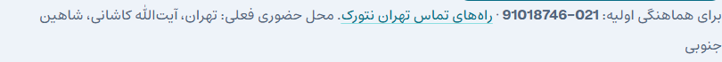
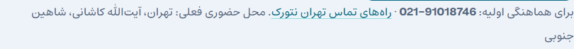
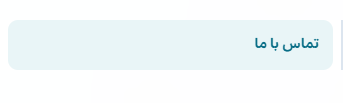

# اصلاح ترتیب شماره تماس در متن فارسی

**DEPLOYED_VERIFIED —۱نوامبر۲۰۲۶.** شمارهٔ درست `021-91018746` است و021 در ابتدای شماره، سمت چپ بخش بعدی، نمایش داده می‌شود.

مقدار ذخیره‌شده درست بود؛ خروجی plain-text شورت‌کد در پاراگراف RTL دو بخش دو طرف خط تیره را جابه‌جا نشان می‌داد. آزمون مرورگر با Range مختصات تک‌تک کاراکترها را اندازه گرفت و قبل از اصلاح شکست خورد. بعد از انتشار، همان آزمون بدون تغییر سبز شد: x شروع021 برابر878 و شروع91018746 برابر914 است؛ قبل از اصلاح به‌ترتیب960 و878 بود.

چهار فایل تغییر کردند: `class-settings.php` خروجی مشترک HTML با bdi/LTR/isolate/nowrap و تبدیل ارقام نمایشی فارسی/عربی به ASCII؛ `footer.php` همان خروجی؛ `class-quotes.php` در TehNet Core برای شمارهٔ کسب‌وکار در سر/ته چاپ سند؛ `corporate.css` برای یکپارچه ماندن لینک‌های tel. فیلد تنظیم شماره نیز LTR است. تنظیم ذخیره‌شده، مقصد `tel:+982191018746`، داده مشتری/سند، محتوا، منو و schema شماره تغییر نکردند. خروجی HTML شماره برای نمایش است؛ برای دادهٔ متنی همچنان از مقدار تنظیم استفاده شود.

[PR72](https://github.com/DashSaman/TehNet/pull/72)، [PR73](https://github.com/DashSaman/TehNet/pull/73)، source تولید [`5fb1bfa`](https://github.com/DashSaman/TehNet/commit/5fb1bfa2f3de2153f58babfa9eb98b0689e6e0dd)، native-qualified [`a4c6bfa`](https://github.com/DashSaman/TehNet/commit/a4c6bfa8e5019e3bce371378cc5cf8afb4054fd7). payload/tool/guards برابر؛ backup/checksum/drift تازه و repeat بدون تغییر، صفر ردیف DB تغییر یافت. [شاهد تولید](../../qa/phone-rtl-2026-11-01/production-verification.json).

آزمون:۲۰۰بررسی native روی۱۴مسیر و renderer واقعی فاکتور/پیش‌فاکتور با دادهٔ مصنوعی و print media، بدون ایجاد سند؛ apply/repeat/rollback/repeat و بازیابی اصل داده/فایل/runtime.۲۱۶بررسی عمومی روی۱۶مسیر در1440/375 باJS و بدونJS؛ همهٔ۸صفحهٔ منتشرشدهٔ دارای shortcode/شمارهٔ ثابت در این مجموعه‌اند و فوتر صفحهٔ محصول نیز بررسی شد. در `/software/` هیچ شماره تماس، لینک tel یا فوتر وردپرس وجود ندارد؛ فرض اولیهٔ آزمون دربارهٔ فوتر همگانی اصلاح شد و assertion ترتیب همهٔ شماره‌های واقعی حفظ شد. هیچ فرم یا تماس تلفنی واقعی ارسال نشد. [شاهد staging](../../qa/phone-rtl-2026-11-01/staging-verification.json).

خطاهای اجرایی: fixture اولیهٔ staging هنگام seed کردن loader جدید، dependency موجود CAPTCHA را نداشت؛ فایل‌ها و داده‌ها دقیق بازیابی و guard کامل شد، سپس تلاش جدید موفق بود. انتشار نخست نیز به‌دلیل بررسی آدرس بدون نسخهٔ CSS که در CDN کش قدیمی داشت، کاملاً برگشت. probe خواندنی HIT/Age1878 برای URL بدون نسخه و MISS برای stylesheet نسخه‌دار نشان داد. تلاش دوم با source/journal و backup تازه، hash همان URL نسخه‌دارِ واقعی HTML را تأیید کرد؛ هیچ purge یا تنظیم CDN/DNS انجام نشد. [رسید rollback](../../qa/phone-rtl-2026-11-01/first-release-rollback.json).

محدودیت‌ها و گیت‌های قبلی تغییر نکرده‌اند: noindex، پرداخت بسته،۲۵کالا/داده/runtime، استقلال MyTel و امنیت. Google CAPTCHA همچنان به حساب واجد شرایط/کلید واقعی نیاز دارد و فعال نیست. Issue63 و شکاف‌های تجاری/سئو با رفع این اشکال بسته نمی‌شوند.

