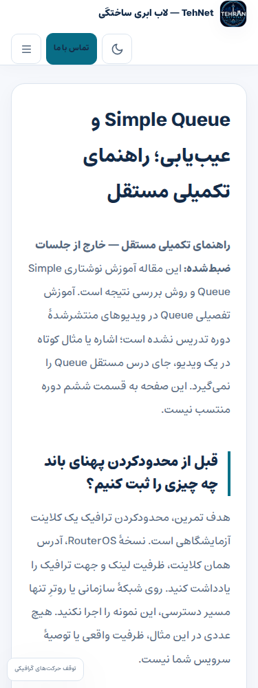
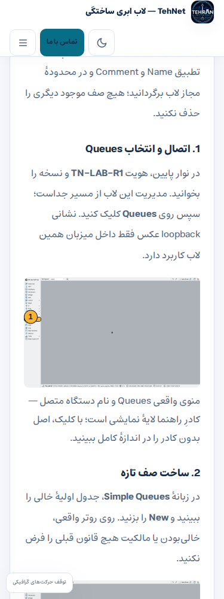

# تحویل بستهٔ Queue ابری —۸ نوامبر۲۰۲۶

**VERIFIED_SYNTHETIC_CLOUD_STAGING_NOT_DEPLOYED**؛ [PR93](https://github.com/DashSaman/TehNet/pull/93) فقط روی شاخهٔ `lab/cloud-queue-20261108` است.

۱۲فریم واقعی با مراحل کلیک و برگشت امن به بدنهٔ موجود [Queue](https://tehnet.ir/learn/mikrotik/mtcna/queues-troubleshooting/) آماده شده‌اند؛ هنوز در آن URL زنده منتشر نشده‌اند. [راهنمای قابل مرور در مخزن](../../content/queue-winbox-cloud-2026-11-08/README.fa.md) و [سناریوی جداگانهٔ ضبط](../../content/video-production/2026-11-08/09-simple-queue-cloud.fa.md) موجودند.

## پذیرش واقعی
| بسته | منبع/اجرا | نتیجه |
|---|---|---|
| لاب WinBox/CHR | [42483186544](https://github.com/DashSaman/TehNet/actions/runs/42483186544)، source4d5c3ba | ساخت از GUI، Target/دو سقف، اثر برگشت‌پذیر، Disable/Enable، حذف فقط قانون تمرین،۵/۵ping نهایی؛۱۲اصل PNG hash/بصری بررسی شدند. |
| native/renderer/browser نهایی | [42489095686](https://github.com/DashSaman/TehNet/actions/runs/42489095686)، source683830a2696e471eff7e6969083465b68111a728 | native۵۲،renderer۸،before۴،after۵۱۸؛۱۳فایل،repeat۰،rollback و حفاظت ردیف/فایل پذیرفته شدند. |
| runtime fixture | WP7.1.4/PHP8.3.36/MariaDB11.4.13، Playwright1.56.1 | WooCommerce11.2.1/Core0.3.1/Store0.7.0 واقعاً فعال؛ چهار probe برای HTTP/mail/payment/cron بسته پاس شدند. نسخه‌ها با digestهای دقیق در receipt ثبت‌اند؛ تطابق کامل production ادعا نمی‌شود. |
| مرز بسته | همان run نهایی |۵آزمون Python exact-scope/original-byte پاس؛ public-file guard پاس. مرزهای قبلی publisher گسترده نشدند. |

[رسید دست‌نخوردهٔ runner و review جدا](../evidence/2026-11-08/cloud-queue/native-staging.json) شامل۵۱۸label واقعی مرورگر است. [مشاهدهٔ پاک‌سازی‌شدهٔ runtime سایت](../evidence/2026-11-08/cloud-queue/production-runtime-observation.json) فقط خواندنی است.

## قبل و بعد واقعی در fixture
| قبل از افزودن | پس از افزودن |
|---|---|
|  |  |

تصویر قبل ابتدای مقاله و تصویر بعد لنگر تازه است؛ scroll برابر و pixel-diff ادعا نمی‌شود. [نمای دسکتاپ](../evidence/2026-11-08/cloud-queue/staging/callout-67-1440-light.png) نیز بازبینی شد؛ هر۵PNG frontend با hash مستقل تطبیق و بدون تغییر پیکسل ذخیره شده‌اند.

## کد و کنترل دامنه
- `ops/release-growth-content.py` و `ops/migrate-growth-content.php`: scope ثابت `tehnet-winbox-queue-cloud-20261108-v1`، فقط owner67/بدنه و۱۲PNG/CSS؛ validator برای title/uri/field/media/full-size/class/hash، drift/lock/transaction و rollback همان زیرساخت است.
- `tests/cloud-queue-migration-native.php`، `tests/cloud-queue-renderer-native.php`، `tests/cloud-queue-site-readonly.cjs` و `tests/cloud_queue_release_test.py`: native مثبت/منفی، حفاظت محتوا و گزینه‌ها، چند viewport/بدون JS/روشن/تیره/اصل عکس.
- `tools/cloud-queue/staging.py` و دو workflow محدود: GitHub-hosted عمومی استاندارد و رایگان، Docker internal network؛ browser داخل namespace همان app با relay فقطloopback. هیچ مرورگر یا VM مالک به کار نرفت. نسخهٔ Woo از asset رسمی با SHA256 بررسی شد.
- `content/queue-winbox-cloud-2026-11-08/`، media و CSS scoped: اصل PNG از لایهٔ کادر مستقل است. متن موجود حفظ و فقط راهنمای اصیل به همان intent اضافه شد؛ فرمی ساخته نشد.

## شکست‌ها و حدودی که پنهان نشدند
fixture اولیه بدون WooCommerce در [42487871528](https://github.com/DashSaman/TehNet/actions/runs/42487871528) و [42488675841](https://github.com/DashSaman/TehNet/actions/runs/42488675841) پاس شد و معادل production شمرده نشد. پس از مشاهدهٔ نسخهٔ فعال سایت، [42488843981](https://github.com/DashSaman/TehNet/actions/runs/42488843981) به برخورد تخصیص ID صفحات ساختگی پس از فعال‌سازی Woo رسید؛ شرط هویت تضعیف نشد. رزرو fixture پیش از فعال‌سازی با source683830a اصلاح و run نهایی پاس شد. تمام محیط شکست‌خورده حذف شد.

خطاهای قبلیِ prompt، نمایشگر، parse سقف64k، مسیر ping، option-value type و loopback HTTP نیز در تاریخچه و [گزارش لاب](../labs/CLOUD_QUEUE_2026-11-08.fa.md) حفظ شده‌اند. اختلاف typeِ API با مقدار persisted به جای نادیده‌گرفتن مقایسه، با snapshot ردیف واقعی اصلاح شد. برای HTTP، network باز نشد؛ relay داخل namespace app استفاده شد.

## حدود پذیرش و گیت‌های انتشار
- عکس‌ها: ۱۲ PNG اصلی WinBox4.5/CHR7.25.1، بازبینی بصری و hash مستقل؛ اصل بدون کادر محفوظ و کادر CSS فقط لایهٔ راهنماست.
- تغییر محدود سایت: فقط بدنهٔ موجود۶۷ +۱۲PNG + همان CSS مشترک، بدون ساخت صفحه یا سامانهٔ درخواست تازه و بدون تغییر title/URL/excerpt/meta.
- آزمون staging: fixture کاملاً ساختگی، نه dump سایت یا دادهٔ مشتری. ردیف‌های posts/postmeta/users/usermeta، گزینه‌های محافظت‌شده و فایل/پوشه‌های fixture بازگشتند؛ کنترل جدول‌های محافظت‌شدهٔ canonical هم برقرار بود. checksum backup SQL تأیید شد، ولی restore کامل SQL/DR اجرا نشده است.
- خواندن TehNet فقط از connector مجاز و read-only بود؛ WooCommerce11.2.1، TehNet Core0.3.1، Store0.7.0 و theme0.5.1 مشاهده شدند. مقدار حساب/اتصال در گزارش عمومی نیست. نسخهٔ واقعی WP/PHP/DB از این ابزار به دست نیامد؛ تطابق کامل runtime production هنوز **NOT_ESTABLISHED** است.
- MyTel read-only و primary VoIP، noindex عمدی، payment/CAPTCHA، خانه/منو/Shop، ERP و داده‌ها حفظ‌اند. هیچ mutation در production یا دسترسی به سیستم/مرورگر/فایل/VM محلی مالک انجام نشده است.
- PR88 قبلاً DEPLOYED_VERIFIED است و مجوزش مصرف شده؛ دوباره اجرا نشود. PR89/90/91 در آخرین مشاهدهٔ۸نوامبر OPEN/NOT_MERGED با headهای3c52cea/9a082ff/48b9d7a بودند؛ هر سه VERIFIED_STAGING_NOT_DEPLOYED و merge/deploy جداگانه **NEEDS_APPROVAL**. PR93 نیز merge/deploy تأیید ندارد.
- اسکن فهرست خصوصی قدیمی **NOT_RUN_OWNER_APPROVED_BRANCH_EXCEPTION** فقط همین شاخه است؛ source-pattern scan تازه و publication_guard ابری جایگزین محدودند. gitleaks یا اسکن فهرست قدیمی اجراشده ادعا نشود. تأیید جداگانهٔ پیکسل‌ها فقط تصاویر تازهٔ همین لاب ساختگی را پوشش می‌دهد.
- اجرای زنده پس از تأیید جدا، تطبیق منبع و runtime، backup تازه، checksum، drift guard، مسیر امن دسترسی و rollback انجام می‌شود. محدودیت سیستم محلی با تأیید merge برداشته نمی‌شود؛ secret production به runner عمومی منتقل نشود.
- سناریوهای قدیمی ویدیویی، بازبینی AV کامل ویدیوهای موجود، GNS3 و شکاف‌های تجاری Issues63/75 همچنان کامل نیستند. CI، تعداد check، ۱۰۰ موضوع یا مدرک staging مساوی parity، انتشار یا رشد سئو نیست. وضعیت rotation تاریخی UNKNOWN و history/origin/force-push/cache/fork همچنان گیت‌های جدا دارند.

## وضعیت بسته‌های منتشرنشده
| PR | دامنه | head مشاهده‌شدهٔ۸نوامبر | وضعیت |
|---|---|---|---|
| [89](https://github.com/DashSaman/TehNet/pull/89) | Static Routing،۱۰عکس | `3c52cea433bb82e51d7471a7ab25f6033b714c62` | OPEN / NOT_MERGED / VERIFIED_STAGING_NOT_DEPLOYED؛ merge و production نیازمند تأیید جدا |
| [90](https://github.com/DashSaman/TehNet/pull/90) | NAT،۱۳عکس | `9a082fffd2376a4250a07b4e476b6fdcae970fd4` | OPEN / NOT_MERGED / VERIFIED_STAGING_NOT_DEPLOYED؛ merge و production نیازمند تأیید جدا |
| [91](https://github.com/DashSaman/TehNet/pull/91) | Firewall،۶عکس | `48b9d7a9f6df9c0157458e742b8182d40277c43d` | OPEN / NOT_MERGED / VERIFIED_STAGING_NOT_DEPLOYED؛ merge و production نیازمند تأیید جدا |
| [93](https://github.com/DashSaman/TehNet/pull/93) | Queue،۱۲عکس ابری | source اجرایی `683830a2696e471eff7e6969083465b68111a728` | draft / VERIFIED_SYNTHETIC_CLOUD_STAGING_NOT_DEPLOYED؛ مجوز merge/production ندارد |

CSS، operator و migrator با بسته‌های۸۹–۹۱ مشترک‌اند. اگر main یا آن بسته‌ها ادغام شدند، این diff را بازبینی و به‌صورت عادی reconcile کنید؛ baseline/live و qualification تازه لازم‌اند. overwrite یا force-push، یا تکیه بر receipt قبلی برای source متفاوت مجاز نیست.

## گام بعدی مستقل
[دانش قابل انتقال SEO](../../seo/lessons/2026-11-08-cloud-queue-evidence.fa.md) با منابع رسمی Google و تفاوت مدرک لاب/staging/live آماده شد. انتقال به -SEO با gate همان مخزن انجام شود، نه با تعمیم استثنای این شاخه. پس از بازبینی، ابتدا گیت merge/انتشار محدود همین بسته روشن شود؛ هیچ مجوزی با گذشت زمان یا سبزبودن CI ایجاد نمی‌شود.
