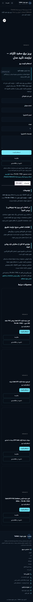
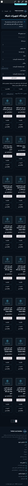
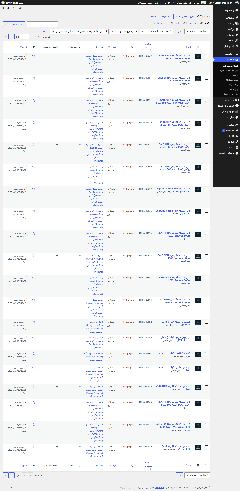
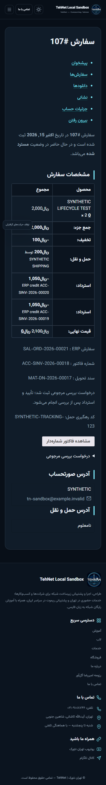
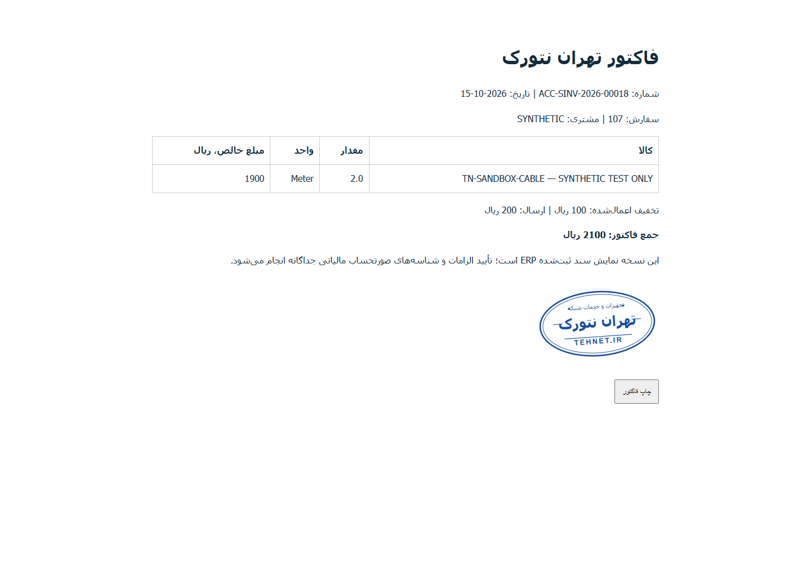
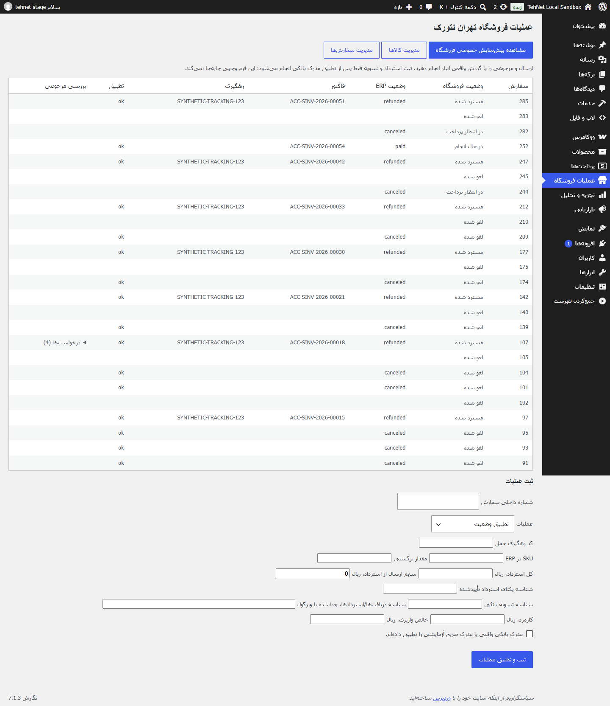
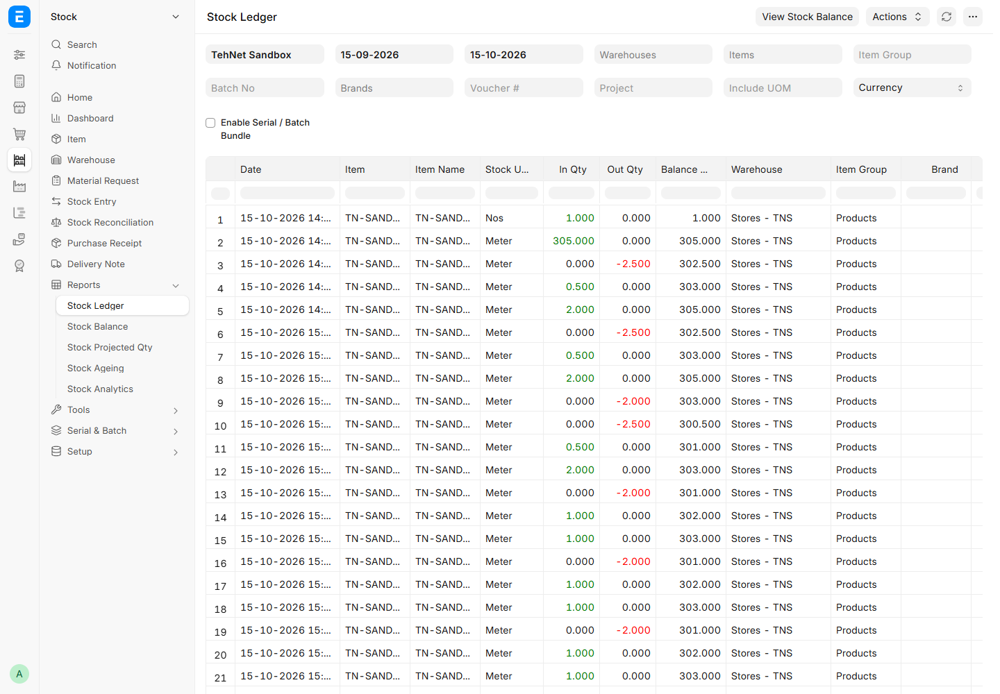
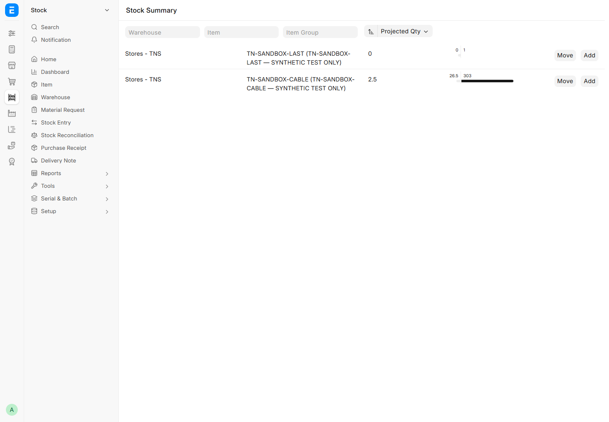
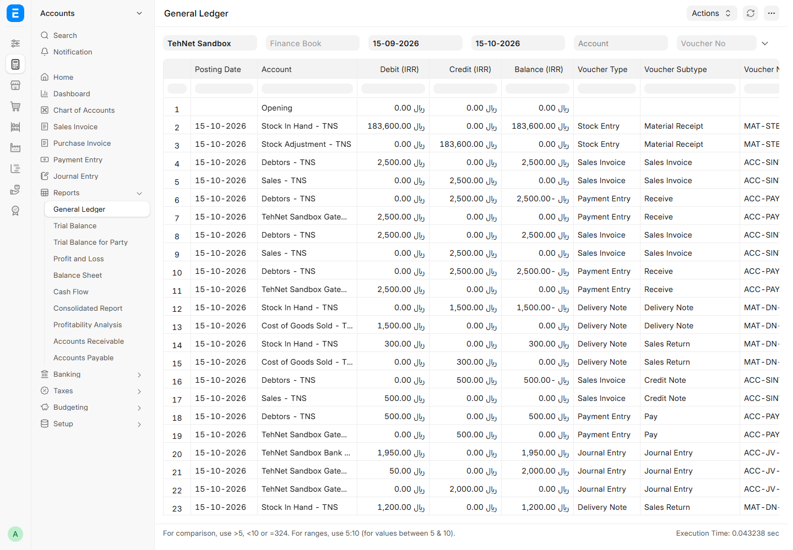

# راهنمای نسخه آنلاین — ۱۶ اکتبر ۲۰۲۶

[فروشگاه عمومی از منوی سایت](https://tehnet.ir/shop/) ورود نمی‌خواهد. [پنل عملیات و لینک مدیریت کالا/سفارش](https://tehnet.ir/wp-admin/admin.php?page=tn-store) با حساب مدیریتی موجود باز می‌شود؛ رمزها تغییر نکرده‌اند. ERP و پرداخت واقعی تولید هنوز وصل نیستند. ۲۵ قلم فقط استعلام‌اند. بخش‌های عملیاتی محلی زیر، داده ساختگی دارند و گزارش افتتاح تولید نیستند.

تصاویر کاتالوگ سعید شبکه با تأیید مالکیت شما برای هر ۲۵ محصول قرار گرفتند؛ ۳۰ ارجاع تصویر و گالری بومی دارند. با انتخاب بندانگشتی، عکس دیگر را ببینید؛ ذره‌بین گالری نمای بزرگ را باز می‌کند. آدرس کم‌رنگ `tehnet.ir` روی نمایش سایت افزوده شده و فایل اصلی دست‌نخورده است. تطبیق مدل و منشأ عکاسی از روی ظاهر فرض نمی‌شود.

مجموعهٔ کامل ۳۶۰ فعلاً برای هیچ محصولی وجود ندارد؛ نمای شماتیک قدیمی روی کالاهای دارای عکس نمایش داده نمی‌شود. نمایشگر عکس‌محور آماده است و تنها پس از ثبت فریم‌های واقعی همان مدل و تأیید مسئول فعال می‌شود. [راهنمای عکس و فریم ۳۶۰](product-media-operations.fa.md).

مهر آبی تهران نتورک در پایین نسخه چاپی فاکتور ERP و اسناد چاپی Core است. SVG در اندازه ۵۸×۳۶ میلی‌متر قابل چاپ و PNG شفاف آماده است. درج مهر، وضعیت پرداخت یا اعتبار مالیاتی سند را تغییر نمی‌دهد.

## راهنمای مراحل محلی و آزمایشی قبلی

# راهنمای فروشگاه تهران نتورک — نسخه محلی ۱۵ اکتبر ۲۰۲۶

این راهنما از صفحات واقعی نسخه اجراشده تهیه شده است. سفارش‌ها، شرکت **TehNet Sandbox**، پرداخت‌های اثباتی و موجودی آزمایش ساختگی‌اند. همه ۲۵ قلم منبع پیش‌نویس‌اند؛ این نسخه فروشگاه منتشرشده یا خرید بانکی واقعی نیست. رمزها فقط در فایل خصوصی محیط نگه داشته می‌شوند.

## مشاهده کاتالوگ

با حساب مدیر محلی وارد WordPress شوید و `/shop/?tn_preview=1` را باز کنید. هشدار پیش‌نویس در بالای صفحه دیده می‌شود. بازدیدکننده عمومی این کالاها را نمی‌بیند. جست‌وجو، دسته، واحد، شیلد، روکش و محیط نصب از نوار فیلتر انتخاب می‌شوند؛ مشخصات فنی فقط پس از ثبت منبع معتبر توسط مدیر وارد فیلتر تأییدشده می‌شوند. مرتب‌سازی بومی Woo، مقایسه و علاقه‌مندی فعال‌اند. انتخاب‌های مرورگر روی همان دستگاه می‌مانند.

تصویر جایگزین با عبارت «تصویر محصول در انتظار تأیید» نمایش داده می‌شود. این تصویر شکل واقعی هیچ مدل نیست. عکس منبع بدون مجوز استفاده نشده و مدل سه‌بعدی معتبر در دسترس نبوده است؛ گالری و بزرگ‌نمایی بومی برای رسانه مجاز آماده‌اند.

## بررسی و انتشار محصول

از «محصولات ← همه محصولات» قلم را با SKU مستقل `TN-SN-ID` پیدا کنید. شناسه/URL و review flagهای منبع محفوظ‌اند. جدول `docs/catalog-review-fa.md` وضعیت تک‌تک اقلام را نشان می‌دهد.

۱. شماره فنی، برند و ویژگی را با سند مدل دقیق تطبیق دهید؛ تناقض تلفن Cat6، brand/SKU و ادعای تست را حدسی تأیید نکنید.
۲. متن اصیل و مشخصات اثبات‌شده و عکس دارای مجوز را اضافه کنید؛ امتیاز یا نظر منبع منتقل نمی‌شود.
۳. واحد فروش، MOQ، کد کالا و UOM دقیق ERP و منبع مشخصات فنی را در زبانه موجودی ثبت کنید. برای کابل، stock UOM متر است و قرقره تبدیل معتبر همان کالا دارد.
۴. موجودی واقعی را با سند رسید انبار در ERP ثبت کنید و Item Price ریالی تأییدشده بسازید. عدد stock منبع ورودی انبار نیست.
۵. از `wp tehnet erp sync-product PRODUCT_ID` snapshot را تازه کنید. worker نیز کالاهای تأییدشده را تازه می‌کند. پس از انقضای snapshot، فروش متوقف می‌شود.
۶. فقط پس از تکمیل شرایط و مجوز انتشار، «مشخصات و قیمت تهران نتورک تأیید شد» و وضعیت انتشار را فعال کنید. checkout بدون flag رزرو و gateway سمت سرور آزموده‌شده باز نمی‌شود.

## خرید و حساب مشتری

پس از فعال‌سازی معتبر، WooCommerce سبد، آدرس، ارسال و تخفیف را در سرور محاسبه می‌کند؛ قبل از پرداخت، ERP کل موجودی را تراکنشی رزرو می‌کند. در نسخه حاضر ارائه‌دهنده پرداخت/ارسال مشخص نشده و خرید بانکی نهایی آزموده نشده است. هیچ دکمه یا مسیر نمایشی، تأیید بانک محسوب نمی‌شود.

در «حساب کاربری ← سفارش‌ها»، شماره فاکتور ERP و کد رهگیری دیده می‌شود. «مشاهده فاکتور شماره‌دار» نسخه قابل چاپ مبلغ ریالی همان سند ERP را نشان می‌دهد. این برگه جای تأیید الزامات فاکتور مالیاتی را نمی‌گیرد. مشتری به فاکتور سفارش دیگر دسترسی ندارد.

پس از سند تحویل، مشتری می‌تواند کالا، مقدار و دلیل را در «درخواست بررسی مرجوعی» ثبت کند. درخواست در سابقه سفارش ذخیره می‌شود و استرداد خودکار انجام نمی‌دهد. پشتیبانی مقدار و شرایط را بررسی و تصمیم را در سفارش ثبت می‌کند.

## فروش، آماده‌سازی و ارسال

منوی «عملیات فروشگاه» فهرست سفارش، state ERP، فاکتور، tracking و نتیجه تطبیق را نشان می‌دهد. نقش فروش می‌تواند وضعیت را تطبیق دهد یا رزرو پرداخت‌نشده را لغو کند. سفارش پرداخت‌شده با cancel ساده بسته نمی‌شود.

انباردار ابتدا native Sales Order / Pick List را در ERP بررسی، کالا و محل را تطبیق، سپس برداشت و بسته‌بندی را ثبت می‌کند. اسکن بارکد در مسیرهای بومی ERP انجام می‌شود؛ اتصال اختصاصی دستگاه اسکن این اجرا آزمون نشده است. پس از تحویل واقعی، شماره سفارش و tracking معتبر را در «ثبت تحویل به حمل‌کننده» وارد کند. Delivery Note بومی ساخته می‌شود و موجودی و بهای تمام‌شده از همان سند می‌آیند.

## دریافت، انتقال، شمارش و کسری

ERP از منوی Stock، Item و Warehouse برای محل انبار و قفسه‌های زیرمجموعه استفاده می‌کند. کالا یک stock UOM و در صورت نیاز conversion معتبر خرید/فروش دارد. برای رسید خرید، Purchase Order → Purchase Receipt و برای انتقال، Stock Entry از نوع Material Transfer استفاده می‌شود. در حسابرسی، شماره سند، مسئول و زمان را نگه دارید؛ موجودی را مستقیم در SQL تغییر ندهید.

برای شمارش، Stock Reconciliation را با انبار و تاریخ شمارش تهیه کنید؛ مقدار شمارش‌شده و اختلاف پس از بررسی مسئول مجاز submit شود. ضایعات کابل با Stock Entry و علت ثبت‌شده از همان موجودی متری کم می‌شود. قرقره و متر دو موجودی مستقل نیستند. Serial/Batch، reorder level و Material Request قابلیت‌های native هستند؛ کالاهای serial/batch فعلاً در مرز فروش این اتصال بسته‌اند تا workflow آن‌ها جداگانه آزموده شود.

## مرجوعی و استرداد

مالی بعد از تأیید درخواست و دریافت واقعی کالا، مبلغ و واحد اصلی و هزینه ارسال قابل برگشت را بررسی می‌کند. پرداخت یا استرداد بانکی با adapter ارائه‌دهنده باید جداگانه تأیید شود. فرم حاضر **وجه ارسال نمی‌کند**؛ فقط استرداد واقعاً انجام‌شده یا مدرک صریح آزمایش را با شناسه یکتا ثبت می‌کند.

در عملیات «ثبت استرداد انجام‌شده»، SKU در ERP، مقدار، کل مبلغ ریال، سهم ارسال و شناسه استرداد وارد می‌شوند. برگشت کالا، credit note و Payment Entry بومی مرتبط ساخته می‌شوند. تخفیف اصلی در net rate کالای برگشتی لحاظ می‌شود؛ کل تخفیف و ارسال در هر مرجوعی تکرار نمی‌شوند. fractional rial یا مالیات نامشخص رد می‌شود. تطبیق بعدی فقط یک native refund Woo برای هر credit note می‌سازد و وجه را دوباره ارسال نمی‌کند.

## حسابداری و تسویه

شرکت آزمایشی FIFO و ارز IRR دارد؛ این افتتاحیه یا سرفصل واقعی کسب‌وکار شما نیست. در Accounts، Chart of Accounts، General Ledger، Trial Balance، Profit and Loss، Balance Sheet، Cash Flow و Accounts Receivable/Payable قابل استفاده‌اند. اسناد خرید/فروش/برگشت و هزینه انبار توسط موتور بومی ERP ثبت می‌شوند. اسناد submitted را با SQL پاک نکنید؛ برگشت و credit note و دوره مالی مصوب را استفاده کنید.

برای settlement، شناسه دریافت‌ها و استردادهای مرتبط، gross، کارمزد، net و شناسه واقعی واریز بانکی وارد شوند. gross باید با مجموع دریافت منهای استرداد و با fee+net برابر باشد. دریافت تسویه‌شده دوباره پذیرفته نمی‌شود. مالیات غیرصفر و اتصال قانونی ایران نیاز پیکربندی بررسی‌شده دارند؛ تضمین قانونی یا بی‌نیازی کامل از بررسی مالی ارائه نشده است.

## نقش و خطای عملیاتی

مدیر تنظیمات و محصول را مدیریت می‌کند؛ فروش برای sync/cancel، انبار برای dispatch، مالی برای refund/settle و پشتیبانی فقط برای مشاهده وضعیت مجازند. نقش‌های ERP جداگانه با حساب‌های واقعی هر مسئول تنظیم شوند. حساب ماشینی را به مشتری یا مرورگر ندهید.

در timeout، ابتدا «تطبیق وضعیت» را اجرا کنید؛ سفارش/سند جدید نسازید. outbox همان payload را با backoff تا هشت تلاش نگه می‌دارد و سپس به بررسی دستی نیاز دارد. در نتیجه نامعلوم بانک، کالا ارسال نشود. راهنمای lock، backup و rollback در `deployment-and-rollback.md` است. ایمیل/پیامک تحویل‌شده‌ای در این محیط ادعا نمی‌شود.

## پشتیبان‌گیری

SQL، فایل‌ها و encryption key خصوصی ERP باید باهم نگه داشته شوند. بازیابی فقط در DB/site/volume جدا آزمایش شود. نتایج واقعی rehearsal محلی در `qa/store-2026-10-15/recovery-results.json` ثبت شده‌اند. برنامه خودکار production هنوز نصب نشده و به release تأییدشده، فضای امن خارج میزبان و سیاست نگهداری نیاز دارد.

## ادامه پرداخت آزمایشی — ۱۵ اکتبر ۲۰۲۶

درگاه «زرین‌پال — فقط آزمایش» اضافه شده و خاموش است. برای دیدن مرحله فعال‌سازی در محیط محلی، داده synthetic، تطبیق receipt و بازیابی، docs/payment-sandbox-fa.md را بخوانید. 25 قلم اصلی را برای آزمایش قابل فروش یا synthetic علامت نزنید.

این بخش تصویر پنل فعال یا خرید کامل جدید ندارد، چون درگاه به دلیل محدودیت Docker فعال نشده است. تصاویر قبلی این راهنما متعلق به صفحات واقعی اجراشده مرحله قبل‌اند. آزمون مستقل صفحه واقعی sandbox، آزمون کامل موبایل فروشگاه محسوب نمی‌شود.
