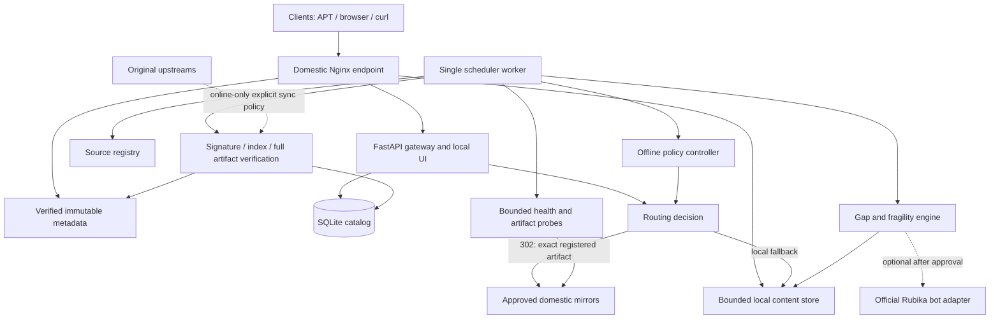

# Architecture decision record — Iranian software mirror gateway

Status: **design selected for P0, not deployed**. Date: 2026-10-17. Read [RESEARCH.md](RESEARCH.md), [API_CONTRACT.md](API_CONTRACT.md), and [SECURITY_AND_OFFLINE.md](SECURITY_AND_OFFLINE.md) together.

## 1. Goal and non-goals

Provide a stable Iranian endpoint for a selected Ubuntu package profile and registered downloadable artifacts, reusing existing mirrors whenever an exact, trusted copy is available. Keep a small amount of local metadata and selected critical content. During international outages, never silently depend on foreign upstream retrieval.

P0 is not a full Ubuntu archive, live Git forge, universal package proxy, container registry, or anonymous file-upload platform. Rubika is not required for P0 availability. The capability `apt_profile_accepted` remains false until real clean-client acceptance succeeds. Directory reachability and software unit tests cannot set it true.

## 2. Chosen stack

| Concern | P0 choice | Reason / future replacement |
|---|---|---|
| Host | Existing authorized Ubuntu 24.04 amd64 VM inside Iran | Reuse current capacity; no purchase without approval. |
| Edge | Nginx, HTTP in isolated tests; valid HTTPS for public deployment | Static files, TLS termination, limits, efficient local file/Range serving. |
| API/UI | Python 3.12, FastAPI, Jinja2, locally hosted CSS | One codebase, OpenAPI, no external frontend build/CDN dependency. |
| State | Python sqlite3, SQLite WAL, foreign keys, one writer worker | Small predictable workload; PostgreSQL when multiple nodes/writers needed. |
| Worker | Single Python CLI scheduler, lockfile, bounded job table | No Redis/Celery/Kubernetes required. |
| HTTP inspection | Guarded fetch abstraction with DNS pinning, SNI/certificate validation, no implicit redirects | Avoid SSRF and DNS-rebinding gap; reusable probe behavior. |
| APT metadata | Native `gpgv`, trusted Ubuntu archive keyring, python-debian parser | Do not invent signature verification or dependency solver. |
| Resolver | Native APT in a clean, pinned Ubuntu baseline | Captures alternatives, architecture and already-installed baseline. |
| Artifact storage | Bounded filesystem CAS by SHA-256 | Atomic upload, hash checks, independent recovery copy; S3/Rubika adapters later. |
| Packaging | Docker Compose: edge, app, worker, persistent volumes | Images/dependencies preloaded for outage bootstrap. |

Dependency versions must be resolved, security-reviewed and locked during implementation; this document does not invent current version numbers or image digests. Production must not use floating `latest` tags. No root-repository workflow modifications are authorized.

## 3. Component graph

## 4. Control plane and data plane

Control plane: source configuration, evidence, signed index import, profile resolution, bounded probes, availability classifications and administrative decisions. Its database and UI remain domestic and locally usable.

Data plane: local metadata, redirect responses, or files from the selected storage backend. Normal remote artifact downloads go directly from client to provider. The gateway may previously have downloaded a full copy for verification; this cost is separate from client traffic. A previous successful verification does not guarantee that a remote server can never mutate bytes: clients must still enforce their trusted digest chain.

There is no per-client synchronous fan-out to twenty mirrors. Worker results are shared, expire, and are refreshed under budget. Uncached requests return a clear retryable result and enqueue one deduplicated job; they do not create an unbounded probe storm.

## 5. Trust and APT metadata

APT's trust chain is repository signature -> index checksum -> package checksum, not a universal signature on every `.deb`. Date/replay protections also matter. Sources: [S25–S26](SOURCES.md).

For P0:

1. Fetch original `InRelease` for `noble`, `noble-updates`, and `noble-security` from an approved source. A source may use a separate archive/security base (e.g. Liara); mapping is explicit.
2. Verify with a provisioned Ubuntu archive keyring and `gpgv`, checking exit code and extracted Release content. Never fetch an unknown key merely because a server requests it.
3. Validate Codename/Suite/Components/Architectures, Date and any Valid-Until. Prevent rollback of mutable suites relative to the last accepted metadata. A base release may legitimately have an old Date; do not apply the updates-age policy blindly to `noble`.
4. Download exact signed-index paths for `main/binary-amd64/Packages` and advertised compressed representations needed by the tested client. Verify compressed and, if generated, uncompressed bytes against the corresponding signed checksums. Include `all` packages as listed in the architecture index; fetch separate `binary-all` only if advertised and needed.
5. Stage the entire metadata bundle. Bundle ID is SHA-256 of canonical JSON mapping each suite to its InRelease SHA-256. Publish its local pointer atomically only after required indices pass. Keep original signed files unchanged.
6. Serve `/ubuntu/dists/<suite>/...`, including advertised immutable `by-hash/SHA256/<digest>` objects. Retain previous by-hash objects for at least seven days and until no retained profile references them. If the storage cap prevents safe retention, stop publishing new metadata rather than delete live references.
7. Maintain pool-path -> exact artifact mapping. If a path is associated with conflicting trusted hashes across retained snapshots, block it and require explicit reconciliation; never choose by filename or newest mtime.
8. Metadata not included in the supported client configuration returns an explicit 404. Translations are disabled in the test client. This endpoint is documented as a limited gateway; it is not advertised as a complete official Ubuntu mirror.

Mutable suites without Valid-Until use a local **seven-day maximum metadata age** as an additional routing policy, with a visible stale state. This value is our initial conservative design setting, not a Canonical guarantee. Do not alter signed metadata to extend it. When an original channel expires, preserve artifacts but fail that channel closed.

P1 long-outage recovery: publish a curated, separately signed repository using a dedicated project key, different Origin/Label and explicit user opt-in. Preserve provenance back to verified original metadata and show original security-data age. This is a new trust relationship, not a re-signed Canonical mirror. Use aptly or equivalent after evaluating publication/disk implications. [S37](SOURCES.md)

## 6. Dependency closure and availability

Use a clean disposable Ubuntu baseline. Record its image digest, installed packages, architecture, APT sources, repository snapshot IDs, recommends policy and exact requested packages. Resolve with native APT; `apt-rdepends` alone does not prove installability. P0 intentionally uses `--no-install-recommends`; document this user-visible choice.

Store resolved artifacts and SHA-256/size from verified Packages metadata. A dependency is not satisfied just because the test host already has an unrelated cached `.deb`. Acceptance starts with clean lists/archive cache and known baseline. Supplementary download scripts, installer hooks and third-party repositories are outside a native Ubuntu profile unless separately captured.

Availability is time- and source-set-scoped:
- `present_verified`: full bytes matched expected digest at the recorded vantage/time.
- `present_unverified`: response suggests a file, but full integrity not established.
- `absent`: correct known path returned 404/410.
- `unknown`: DNS/TLS/timeout, 403, 429, HTML login, or other ambiguous outcome.
- `quarantined`: digest/signature mismatch, unsafe redirect or revoked trust.

A missing-file upload is allowed only after all eligible tested sources are absent. Unknown sources prevent a claim of globally proven absence. A separate `fragile` decision permits a local critical copy when existing replicas share one failure domain or have no retention evidence.

## 7. Routing and protocol boundaries

| Method | P0 role | Cost and limitation |
|---|---|---|
| 302 for GET/HEAD | Default for approved immutable remote artifacts | Very little gateway data traffic; cannot repair a transfer after redirect. |
| 307 | Reserved for a protocol requiring method preservation | Not inherently better failover; P0 does not forward arbitrary writes. |
| Reverse proxy | Local metadata/controlled special cases | Gateway pays/handles traffic; no universal external proxy. |
| Streaming proxy | P1 exceptional fallback | Full output buffering/size/hash policy required to avoid serving corrupt bytes before verification. |
| Local CAS | Critical/gap artifacts and test fixtures | Uses disk; native Range/resume can be supplied by Nginx. |
| Object storage | Optional P1 standard backend or pilot free tier | Must inspect exact quotas, access policy, signing, retention and costs. |
| Rubika | Disabled optional backend | Activation requires contract and empirical tests. |

A 302 is not transparent multi-mirror failover. If transfer breaks, a client must request a new decision or use a controlled local copy. Selection prioritizes integrity, freshness, policy and availability before measured latency. Server-side probe latency is not end-user ISP throughput.

Docker/GHCR, PyPI, npm and Git do not become compatible by redirecting arbitrary paths. Registries may contain absolute download/token URLs, authentication exchanges, tag revalidation and garbage collection. Use their protocol-specific tools in later phases. GHCR stores container artifacts; it does not back up GitHub source code. [S28–S33](SOURCES.md)

## 8. Offline and degraded states

Modes: `ONLINE`, `DOMESTIC_ONLY`, `MAINTENANCE`. `DOMESTIC_ONLY` denies foreign upstream sync and any unapproved redirect host, but it does not pretend every domestic service is reachable. Manual mode control is available via local admin CLI; automatic suggestions require multiple independent observations and do not change mode after one failed ping.

The mode is a policy, not geolocation by string suffix. Approved domestic routes require explicit evidence. Outage testing must include DNS, IPv6, object CDN hostnames, token services, correct system clock and already-expiring certificates. Users' own networks can still be partitioned from an otherwise healthy Iranian host.

## 9. Data retention and scaling

Initial design caps: metadata 1GiB, local CAS 5GiB, job concurrency 4 globally and 1 per source, app one worker, scheduler one writer. These are safety budgets, not proven capacity/performance. Protect pinned profile files and metadata; delete only unreferenced objects after a grace period. Refuse writes before disk exhaustion.

SQLite WAL state is backed up with the SQLite backup API, not by copying the live `.db` file alone. Backups include source approvals, signatures, manifests and policy; credentials are separate. P1 PostgreSQL supports independent readers/workers. Multiple public nodes require shared state or deterministic signed catalog export, an independent failure-domain plan, and deployment-specific capacity measurements.

## 10. Acceptance boundaries

The implementation must produce three separate reports: deterministic software tests, external-provider probe results, and clean in-Iran offline installation. Only the last can support a claim about the intended outage scenario. Tests may validate the design under emulated restrictions, but cannot guarantee accessibility during every future nationwide network event.
