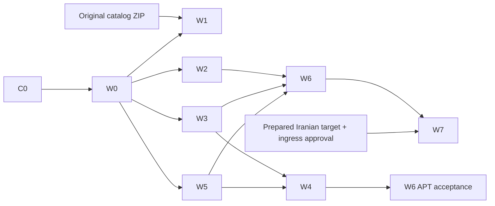

# Independently owned workstreams

> Current owner override (2026-10-17): no downloadable payloads on the website VPS. [ADR 0002](decisions/0002-external-payload-storage.md) supersedes historical local-CAS requirements. The engine keeps metadata only, redirects approved public downloads externally, and refuses private redirects. W2/W3/external-W5 engine is active after accepted same-host recovery/code rollback (2026-10-18); owner password setup, external private delivery, provider and Iran migration acceptance remain separate gates. See [external storage](EXTERNAL_STORAGE.md) and [engine operations](deployment/ENGINE_OPERATIONS.md).

These are work packages, **not agents already launched or tasks already implemented**. One owner per row; manager assigns names when work begins. Follow the user's limit of at most one focused assistant per request; parallelism in this plan does not authorize uncontrolled spawning or external coding CLIs. Different humans/sessions can claim disjoint tasks without overlapping edits.

## Shared-file rule

Integrator owns README/DESIGN/CONTRACTS/ROADMAP/STATUS/CHANGELOG and root PROGRESS/HANDOFF/TASKS. Only the W0 contract owner edits shared models/config/schema/OpenAPI until frozen. Each other worker owns its listed files, tests and `tasks/<ID>.md`; workers propose shared changes in their own log. Integrator applies shared updates serially before merge. Do not edit a sibling's modules, revert concurrent changes or modify the archived research. Request contract changes instead of guessing types.

| ID / owner role | Owned deliverable and paths (relative to projects/software-hub) | Depends on | Acceptance evidence |
|---|---|---|---|
| C0 / integrator | This research consolidation + docs; `research/upstream/`, PROVENANCE, tools/rehearsal, current evidence | Current owner request | Exact 22-blob hashes, archive probe rerun, docs/isolation checks; honest missing-catalog and runtime limits |
| W0 / contracts | `app/models.py`, `config.py`, `db.py`, `migrations/`, `contracts/`, tests `test_contracts.py`, `tasks/W0.md`; shared-doc integration | C0 | Concrete types/signatures, visibility deny-default, schema/release versions, root architecture alignment, base-path contract, source defaults, migration compatibility tests |
| W1 / catalog researcher | `research/offline-catalog-import/`, its manifest/index, `catalog/`, `tests/test_catalog_import.py`, `tasks/W1.md` | Original package; interfaces from W0 for runtime export | All recovered files indexed/hash-traced; actual counts; license/classification checks; package tests and no secret leaks. Can audit independently before W0 |
| W2 / access | `app/access.py`, `auth.py`, `private_routes.py`, `tests/test_access.py`, `test_private_routes.py`, `tasks/W2.md` | W0 | Full SECURITY_PRIVACY matrix including cache/HEAD/Range/object bypass, local login/logout/revoke, sanitized public DTOs |
| W3 / trusted networking | `app/netguard.py`, `http_client.py`, `health.py`, `tests/test_netguard.py`, `fixtures/tls/`, `tasks/W3.md` | W0 | Real local TLS and pinned-address tests; mixed/private DNS, redirect, quotas, no secrets; no providers auto-enabled |
| W4 / APT and gaps | `app/aptmeta.py`, `catalog.py`, `profiles.py`, `gaps.py`, `profiles/`, `tests/test_aptmeta.py`, `test_profiles.py`, `test_gaps.py`, `tasks/W4.md` | W0, W3, W5 storage contract | Signature/hash/expiry/rollback/by-hash atomicity, native dependency closure. Real clean client acceptance separate from fixtures |
| W5 / storage | `app/external_storage.py`, metadata helpers `storage.py`, `storage_backends/`, `tests/test_external_storage.py`, `tasks/W5.md` | W0; W2 authorization context contract | No payload disk writes; bounded full hashing; approved external metadata and expiry; external upload/private-backend gates; encrypted metadata/auth recovery; no private public-URL redirects; disabled Rubika |
| W6 / service and staging | `app/main.py`, `public_routes.py`, `routing.py`, `scheduler.py`, `cli.py`, `templates/`, `static/`, Dockerfile/compose/lockfiles, `tests/test_routing.py`, `test_scheduler.py`, `test_subpath.py`, integration fixtures, `deployment/staging/`, `tasks/W6.md` | W0/W2/W3/W5; W4 for APT capability | Prefix-safe public/private integration, offline boot/no pulls, one writer, route/WordPress regressions, real VPS inventory and rollback before live claims |
| W7 / migration operator | `deployment/scripts/`, `deployment/qualification/`, `tests/test_migration.py`, `tasks/W7.md`; proposes runbook updates to integrator | W6 release; W2 auth; approved Iran hosts/route design | Cold Linux restore + 2 timed representative cross-host drills, pre/post-write rollback, exact sizes/timings/refs and no-foreign-dependency checks |

## Scheduling and dependency boundaries

After W0, W2/W3/W5 can implement in parallel against frozen types with fixtures; W5 depends only on W2's frozen context contract, not its completed code. W1 retrieval/audit is independent and must not block public work based on existing research, but no one can claim all prior research imported until W1 passes. W6 may build a preview using fixture adapters but cannot claim APT or private acceptance without the real corresponding owner gates. Shared test fixture changes go through W0; do not create cross-owned helper churn.

## Common completion contract

Each task: claim owner/branch/base ref → read current status/spec → record bounded plan and touched paths → write meaningful tests for the actual behavior before code → implement within ownership → run fresh checks → inspect complete diff and private-data risk → update `tasks/<ID>.md` with results/limits/next action → integrator updates STATUS/CHANGELOG and root coordination notes → verify refs if committing/pushing is authorized. No force push, automatic merge, production deploy, provider purchase or credential/provider-routing changes by implication.

Independent task branches start from the current integration baseline and merge serially after checks. Resolve conflicts by reading both versions and preserving the other owner's work. Completed means the acceptance evidence exists; blocked means a specific missing input is recorded, not that a design file exists.

Current same-host acceptance: [engine activation](evidence/ENGINE_ACTIVATION.md) and [recovery](deployment/RECOVERY.md). Frozen v1 preview manifest retains its historical meaning; the implemented encrypted engine backup has its own format 1 and strict image/state contract. Generic future Iran cutover commands remain proposals unless explicitly implemented.
